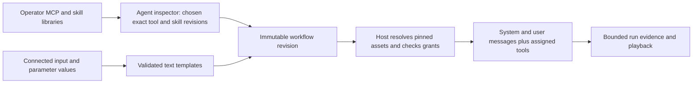

# Agent capability libraries and prompt composition

This page records the current implementation boundary and the remaining authoring direction. The [roadmap](roadmap.md) tracks delivery; the [architecture guide](architecture.md) describes current behavior.

## What comparable builders do

| Product | Observed approach | Decision for Visual Agent Workflow |
| --- | --- | --- |
| Dify | Workspace **Tools** connects HTTP MCP servers, imports discovered tools, and lets an Agent choose its tools. Server IDs travel with exported apps; refreshing discovery can break a tool whose contract changed. Its Agent node separates persistent instructions from a task/query and uses prompt variables. | Keep a central catalog and separate agent assignment. Pin server/tool identity and contract in a published workflow; show drift before activation. Keep system and user messages separate. |
| Dify | Its **Skills** page imports or creates skill packages and exposes library skills to agents. The current docs say agents pick up a newly published skill version automatically. | Use a library and per-agent selection, but require explicit revision upgrades for published workflows so old runs remain reproducible. |
| n8n | A field can switch to expression mode; authors can drag input values into it and preview the result. It recommends a dedicated Set node when transformations become complex. | Offer an insertable variable chip and preview in prompt fields. Use a visible **Text template** node for reusable or complex composition rather than hiding program logic in every textbox. |

These observations come from the checked-out source documentation at [Dify docs commit `47b88d5`](https://github.com/langgenius/dify-docs/tree/47b88d5c00d05bb41f526115e1ad8e066470315b) ([MCP tools](https://github.com/langgenius/dify-docs/blob/47b88d5c00d05bb41f526115e1ad8e066470315b/en/self-host/use-dify/workspace/tools.mdx), [Agent node](https://github.com/langgenius/dify-docs/blob/47b88d5c00d05bb41f526115e1ad8e066470315b/en/self-host/use-dify/nodes/agent.mdx), [Skills](https://github.com/langgenius/dify-docs/blob/47b88d5c00d05bb41f526115e1ad8e066470315b/en/self-host/use-dify/build/skills.mdx)) and [n8n docs commit `eb11969`](https://github.com/n8n-io/n8n-docs/tree/eb119693be5b4b21749e553cba7bba5a403f4fff) ([expressions](https://github.com/n8n-io/n8n-docs/blob/eb119693be5b4b21749e553cba7bba5a403f4fff/docs/build/work-with-data/transform-data/expressions-for-data-transformation.md)). The comparison is limited to those documented flows; it does not establish their internal security or runtime behavior.

## Implemented first slice and remaining design

Schema 1.7 supports embedded text-only skill revisions, per-agent selection, and ordered literal/input/parameter parts for user messages. Schema 1.8 adds typed scalar workflow parameters and agent reasoning configuration. Studio offers local skill and Streamable HTTP MCP pages with folder metadata, tool discovery, input summaries, and explicit tool enablement. Agent tools accept flat object schemas with up to 32 required or optional `string`, `integer`, `number`, and `boolean` properties. The pinned schema is sent to the model adapter and checked again by the broker before dispatch. MCP endpoints and bearer tokens remain outside exports; consumers configure their own matching MCP registrations and host policy. The sections below describe broader targets that exceed this implementation, including stdio authoring, resource-bearing skills, nested/collection tool inputs, richer parameter schemas, keyboard prompt chips, and a dedicated text-template node.

## Studio authoring flow

The left navigation gains **MCP library** and **Skill library**. Both support nested folders, search, tags, and recent items. Folders organize assets; they do not confer access or form part of a runtime identity. Moving or renaming a folder cannot change a published binding.

1. An operator adds a Streamable HTTP MCP server under **MCP library**. Discovery shows each supported tool's flat scalar inputs, required/optional status, and contract hash. A refresh does not silently replace a contract pinned by a workflow. Richer health, protocol identity, schema diff, and compatibility diagnostics remain future work.
2. An author opens an agent node and selects **Tools** from the library. The picker groups tools by folder and server, searches names/descriptions, displays schema and risk/policy status, and distinguishes *available*, *assigned*, *authorized by this host*, and *unavailable*. Assigning a tool updates only that agent node's requested set.
3. An author creates or imports a skill as a reviewable draft in **Skill library**, organizes it in a folder, then publishes an immutable revision. The agent's **Skills** picker attaches exact revisions. The inspector shows the skill's instructions, resource manifest, and which requested tools it mentions; a mention never adds a grant.
4. The agent inspector has distinct **System instructions** and **User message** editors. System instructions define stable role and behavior. The user message describes this invocation's task and defaults to the incoming graph value. The editors provide **Insert value** and a searchable picker, accessible by keyboard and by typing `{{`; inserted values appear as labeled chips. A preview shows resolved text using sample inputs, highlights missing values, and marks any redacted values. It makes no model or tool calls.
5. A **Text template** node uses the same editor and renderer to compose reusable strings. It has explicit input sockets for each referenced value and one string output. Node order and wiring decide which values exist; a template cannot pull arbitrary data from an unrelated node.

Keep server connection setup in the operator side of the Studio. The designer can request capabilities from the catalog, but published requirements must still resolve through the consuming service's host policy.

## Definition and execution contracts

MCP server profiles use stable logical IDs. Connection URLs, commands, credentials, OAuth state, and launch policy remain in host configuration. A workflow stores the logical server/tool ID, tool name, schema fingerprint, and required policy class; the host resolves the connection and grants each tool call. Folder paths, display labels, and cached discovery data are authoring metadata only. An exported workflow may carry requirements, but cannot establish a server connection or grant a tool.

A skill has a stable ID, immutable revision, content hash, name, description, instructions, and a bounded resource manifest. Start with reviewed UTF-8 text references; executable scripts, arbitrary remote fetches, and resource APIs require separate extension contracts. Imported packages land as drafts. A publication pins skill revision and hash, and the consumer host must possess or explicitly import that exact revision. Resource bytes used by a run must be retained or content-addressed with the publication for historical inspection. Skill content never grants MCP access.

The new agent schema adds `systemTemplate` and `userTemplate` while retaining the legacy `instructions` field for older definitions. On legacy revisions, preserve today's behavior: `instructions` becomes the system instruction and the incoming string remains the user message. On new revisions, send the resolved system instruction as system content and the resolved user message as user content through the Agent Framework adapter. Do not concatenate them into one message. Skill instructions are appended to system content in a deterministic, bounded order and recorded by identity/hash. Provider adapters must verify that message roles and capability settings are honored before a workflow can activate.

## Safe, predictable templates

Store a template as ordered literal and reference segments, not as an executable expression string. A reference contains a stable source kind and ID: incoming value, declared workflow parameter, or an explicit template-node input socket. The editor displays a friendly label, but renaming that label does not change the reference. Literal braces remain literal; only an inserted reference chip substitutes a value. The `{{` shortcut opens the picker and never evaluates arbitrary text as code.

At save and publish, validate each reference's existence, type, reachability, sensitivity, and allowed message role. In the first slice, references resolve to bounded strings with an explicit maximum rendered length; later types require an explicit formatter or conversion node. Missing required values fail before model or tool dispatch. No JavaScript, C#, Jinja control flow, reflection, environment-variable access, nested evaluation, or implicit lookup of prior node output is available in templates.

System templates may reference only trusted, non-secret workflow configuration values. Run input, prior model output, MCP output, and caller-provided text belong in the user message or a text-template node connected to it. This avoids silently elevating lower-trust content into system instructions. If a caller overrides a parameter used in a system template, the host must classify and authorize that override as trusted configuration; otherwise activation or invocation fails. The preview clearly labels each value's origin and sensitivity.

Capture the exact template/skill revision identities and bounded resolved-message evidence for playback under the run's payload policy. Playback displays recorded messages and tool use; it does not re-render templates with today's library content or contact a model.

## Validation and release slice

Future work should prove stdio and additional Streamable HTTP compatibility through local protocol fixtures before expanding the accepted MCP schema or transport set. The current executable slice connects a server, discovers supported flat scalar inputs, assigns a pinned tool to an agent, attaches a published text-only skill, and renders distinct system/user messages using incoming data and workflow parameters. Save, publish, export/import, run in a consumer service, and replay the exact resolved identities and messages.

Tests must reject unassigned tool calls, host-denied tools, drifted schemas, missing skill revisions, missing/unreachable template references, oversized rendered prompts, and untrusted input in a system template. UI checks should cover folder moves without binding changes, keyboard insertion and editing of chips, previews, navigation, and clear recovery messages. Production use still requires the planned identity, credential, storage, and recovery foundations.
