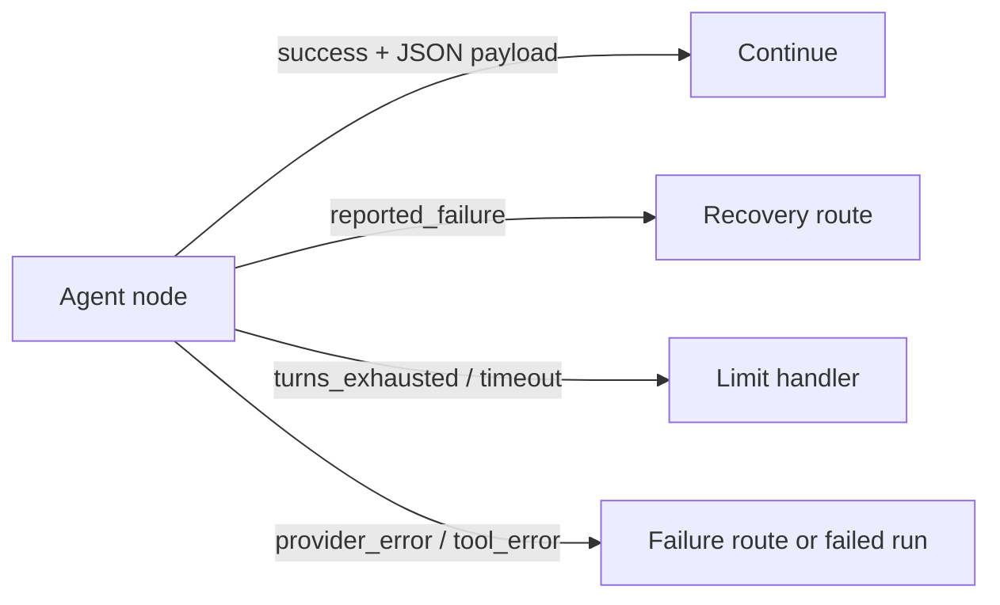

# Agent outcomes and resource budgets

Schema 1.21 adds per-agent maximum model turns (positive integer, default 8; `-1` means unlimited), an optional positive whole-number timeout, and opt-in structured results. Schema 1.22 adds an optional aggregate reported-token budget (1–100,000) shared by the agent and its delegated profiles. Each response is capped by the existing per-response output-token setting (1–16,384) and by remaining reported-token budget. A configured node timeout takes priority over the model connection default; when blank, the connection timeout applies. `agent.started` records the effective timeout and token/turn limits.

## Result contract

An agent that opts into structured results receives a built-in `submit_result` function. It is an internal Agent Framework function, not an MCP binding and not an arbitrary host capability. Its input is a bounded JSON object payload encoded as text plus a task-level outcome (`success` or `failure`). The runtime accepts exactly one valid submission and preserves the payload as typed JSON. Payloads are limited to 16,384 characters, depth 16, and unique object keys. Missing, duplicate, malformed, or oversized submissions become explicit node outcomes rather than silently falling back to free-form prose. The node's output pin becomes `json` and returns `{ "status": ..., "payload": ..., "message": ... }`.

Keep model-reported task outcome separate from runtime completion. A model may report that its task failed, but it cannot claim a completed result after the host timed out, denied a tool, rejected a schema, or exhausted a configured budget. The runtime-owned status vocabulary currently includes:

- `success`: a valid structured result was submitted and accepted.
- `reported_failure`: a valid result explicitly reports task failure.
- `turns_exhausted`, `tokens_exhausted`, and `timeout`: a configured execution bound was reached.
- `token_usage_unavailable`: a configured aggregate token budget could not be enforced because the provider omitted usage.
- `execution_error`: an unexpected bounded agent invocation error occurred.
- `invalid_result`, `provider_error`, and `tool_error`: the runtime could not complete the declared contract. A host may explicitly mark a known MCP server-declared failure as recoverable; the adapter feeds one sanitized correction message back to the model, while authorization, contract, budget, timeout, transport, and outcome-unknown failures remain terminal.

Schema 1.21 pins the structured-result contract and schema 1.22 adds aggregate token budgets. Connect the JSON agent output to **Select JSON property** at `/status`, then use a Condition to route an explicit status string. Select `/payload` or project explicit fields when downstream nodes need result data. Do not parse human-facing error strings. Structured outcomes are normal agent-node values; host cancellation still cancels the run and is not converted into a model result.

## Resource controls

Each control must be enforced at the layer that owns it and represented in run evidence:

| Limit | Enforcement | Important boundary |
| --- | --- | --- |
| Maximum model turns | Agent adapter / framework | Implemented in schema 1.21. Counts model responses; the initial request is turn one. Positive integer, default: 8; `-1` means unlimited and `0` is invalid. The adapter maps unlimited to the framework's largest iteration count; host timeout and token budgets remain separate bounds. |
| Maximum output tokens | Provider request where supported | Provider may ignore or clamp the requested cap; record the requested cap and observed usage. Schema 1.29 permits a validated integer workflow-parameter binding (1–16,384) in place of a static value. |
| Maximum total tokens | Adapter accumulates provider-reported usage across the parent agent and delegated profiles; remaining output allowance is sent on subsequent requests | Implemented in schema 1.22. Schema 1.29 permits a validated integer workflow-parameter binding (1–100,000) in place of a static value. Providers must report usage; otherwise the agent stops with `token_usage_unavailable`. An already-issued request can exceed the budget due to prompt/input tokens, and concurrent delegated requests already in flight can finish after another crosses the limit. This is not a strict billing cap. |
| Timeout | Linked host cancellation token | Implemented in schema 1.21 as an optional positive whole-number agent bound. A configured node timeout overrides the model connection default; blank uses the connection timeout. Connections can be configured in Studio without a product-level timeout ceiling. Cancellation may not undo an already completed external side effect. |
| Context compaction | Host-managed Agent Framework context strategy | Not configured by the current adapter. The run viewer counts explicit host-compaction evidence but cannot infer provider-internal compactions; automatic model-side compaction remains unobservable. Any future strategy needs an explicit opt-in and tests for tool-result retention, summary injection, context bounds, and audit events. |
| Maximum estimated cost | Host policy using usage and a pinned price schedule | Not implemented. Not enforceable when pricing or usage is missing; label estimates and never imply guaranteed billing caps. |

The workflow may declare per-agent overrides. Host-wide aggregate token quotas and host-selected lower ceilings are not implemented yet; any future host policy must take precedence over workflow settings. Configured finite limit values are validated before dispatch; model turns accept any positive integer or `-1` for unlimited (zero and values below `-1` are invalid). Run events record configured values and provider-reported usage without copying secrets. The run viewer can display estimated cost from provider-reported usage and user-configured per-million-token prices. Hard cost limits remain unimplemented: providers may omit or misreport usage, change pricing, or ignore request limits, so the engine cannot promise a billing cap.

## Versioning and rollout

Limits and structured results are separate optional agent settings so existing definitions keep their current behavior and hashes. Turn limits, timeouts, and structured results are versioned in schema 1.21; aggregate token budgets use schema 1.22; legacy documents serialize unchanged. Deterministic adapter tests cover budget shrinking across turns, over-budget rejection before tool invocation, and missing usage. The Linux CI local-model test verifies 1+1 through the required `submit_answer` MCP binding (exposed to the model as `tool_0`) and aggregate usage enforcement. Its prompt must use the function name the model actually sees. A real-model qualification test that verifies the internal structured `submit_result` tool and JSON payload round-trip remains planned. Live inference stays opt-in.

Related: [agent profiles](agent-profiles.md), [workflow data and control graph limits](conditional-graphs.md), and [roadmap](roadmap.md).
