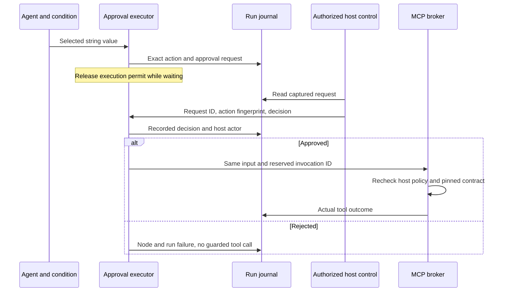

# Approve an exact MCP action

Schema 1.5 adds `core.approval` version `1.0.0`. An approval node immediately precedes one explicit MCP tool node and holds the current string value until a trusted host records an approve/reject decision. The backend owns the wait; closing the browser does not decide or cancel it.



## What is approved

The request binds the run ID, immutable revision ID/content hash, approval node/invocation, target MCP node, reserved target invocation ID, logical tool binding, contract hash, exact string input and input SHA-256. Its action fingerprint is SHA-256 over the platform's JSON serialization of that captured action. The request has its own fresh ID and timestamp. The configured prompt is part of the pinned workflow definition; it does not specify tool arguments or grant capabilities.

After approval, the next MCP invocation uses the reserved invocation ID and unchanged input. This correlates `approval.requested` with actual `node.started` and `tool.*` evidence. There is no intermediate transformation between approval and the target tool. The broker still checks node-local requirements, host policy, budgets and contract identity. An approved action can be denied or fail at the broker; approval cannot broaden permissions or guarantee an external outcome.

This milestone guards explicit `core.mcp-tool` nodes. It does not intercept tool calls made inside an agent loop, approve arbitrary provider-selected calls, approve all future actions in a run, or impose mandatory host approval on workflows that have no approval node. Hosts still own deployment review and authorization over definitions and run controls. The local MCP fixtures remain read-only; no live external write or live LLM is validated here.

## Author and review

1. Configure an MCP tool node in the designer. Select **Require approval before tool** on that card. This inserts a separate approval node as one undoable edit.
2. Edit **Approval prompt for …** (1–2,000 non-whitespace characters), organize the graph, save and publish.
3. Run the exact publication. When its selected path reaches approval, status becomes `waiting-approval`. Other admitted workflows can execute while it waits.
4. Review **Recorded action approval**: tool binding/contract, target node, action/input fingerprints and **Exact tool input**. Select **Approve recorded action** or **Reject recorded action** through a control-enabled client.
5. Approval continues the same run. Rejection records the decision and fails the run before the guarded call. The unchosen conditional arm never requests approval.

The input/payload is recorded plaintext in this prototype. Prompts and inputs are rendered as text, not trusted HTML. Remove the approval step before deleting the guarded tool or replacing it with a non-tool operation. New nodes/conditionals cannot be spliced between an approval and its target. Tools can still be changed to another approved binding in a draft, but that produces different content for future publications; it does not alter an active request.

Manual pause is independent: resume cannot approve a request, and approving while paused does not resume the run. After approval, the continuation reacquires the shared execution permit and respects any pause before advancing. Approval waits count toward the existing 32-context admission limit. Cancel stops the wait without dispatching the guarded action. Cancellation after approval is best effort and cannot roll back an already dispatched tool.

## Host APIs and attribution

`IWorkflowApprovalClient.DecideApprovalAsync(runId, requestId, actionHash, approve)` is an optional control capability. `LocalWorkflowRuntime`, `PublishedWorkflowClient` and local-runtime DI expose it; existing clients do not have to implement it. The development implementation uses the explicit placeholder actor `local-developer`.

A trusted consumer host can call the runtime overload with a server-derived actor:

```csharp
await runtime.DecideApprovalAsync(runId, requestId, actionHash, approve, authenticatedActor);
```

Authenticate/authorize the caller, load the exact request, check resource/workspace permissions and derive `authenticatedActor` on the server. Do not accept actor names or grants from request JSON. The overload validates bounded attribution text but is not an authentication system. An embedded app can wrap its authorized backend in `IWorkflowApprovalClient` and pass it to the viewer.

The development Studio exposes:

| Request | Result |
| --- | --- |
| `POST /api/runs/{runId}/approvals/{requestId}/decision` with `{ "actionHash": "…", "approve": true }` | Record approval and return 202 with the current snapshot |
| The same body with `approve: false` | Record rejection and return 202; the run then fails |

Unknown runs return 404. Invalid/missing fields return 400; extra JSON fields, including `actor`, are rejected. Stale, cross-run, opposite or no-longer-owned requests return 409. A matching retry acknowledges the original decision/actor, even after terminal cleanup, without adding another event or dispatching another call. Concurrent identical decisions have the same one-record behavior. These routes inherit the Studio's development-only loopback/origin restrictions; they are not production authenticated controls.

`IWorkflowApprovalGate` is the adapter's optional trusted execution capability. The local controller implements it alongside the execution gate. A low-level direct runner without an approval coordinator fails closed at an approval node. A custom host coordinator must provide its own decision policy, evidence, cancellation and lifetime handling; the interface alone is not a security boundary.

## Audit and observation

The same sequenced writer records `approval.requested`, `approval.approved`, `approval.rejected` and `approval.cancelled` alongside node/model/tool events. Requests include exact action metadata; decisions include request ID, action fingerprint, outcome and host actor. A rejection is distinct from a tool failure. An approval record is not proof the action dispatched or completed; inspect the matching target invocation's evidence.

The recorded viewer shows pending details at the selected event prefix. Controls appear only at the latest live position when a control-enabled client is supplied. Scrubbing over a historical request cannot submit a decision. `WorkflowApprovalPanel` is also independently embeddable. The read-only [consumer observation API](observation.md), HTTP observer and observation panel do not expose approval commands; readers may inspect the captured request without receiving control authority.

## Persistence and failure boundary

Request/decision evidence is flushed to the local journal, but the waiting continuation remains process-owned. Graceful shutdown cancels waits. A host restart marks unfinished runs interrupted; old unresolved requests cannot be approved to recover them. There is no automatic retry of an approved MCP call or recovery of uncertain external effects. Durable checkpoints, approval expiry, multi-user/workspace authorization, notification delivery, retention/redaction and recovery/reconciliation remain planned.

Layout schema 1.0, package format 1.0 and database schema 2 are unchanged. Old schema hashes remain valid because absent approval properties are omitted. Schema 1.5 retains conditional string graph semantics and adds the approval-target constraint. Whole workflows can be packaged/versioned; linear-only reuse rejects approval/control-node graphs until control-aware prefab expansion is designed.

## Evidence

Backend tests verify exact input/tool/invocation binding, duplicate/concurrent decisions, stale/cross-run denial, pause independence, broker denial after approval, cancellation and restart/crash snapshots. Adapter tests prove a missing coordinator cannot auto-approve. `python3 scripts/approval_smoke.py` authors the real scripted Agent → Condition → Approval → MCP → Output path, checks reload and other-run progress, approves/rejects/cancels exact requests, rejects actor/origin forgery, verifies actual tool invocation correlation and confirms playback is read-only. The agent is the deterministic fixture, not an LLM.
