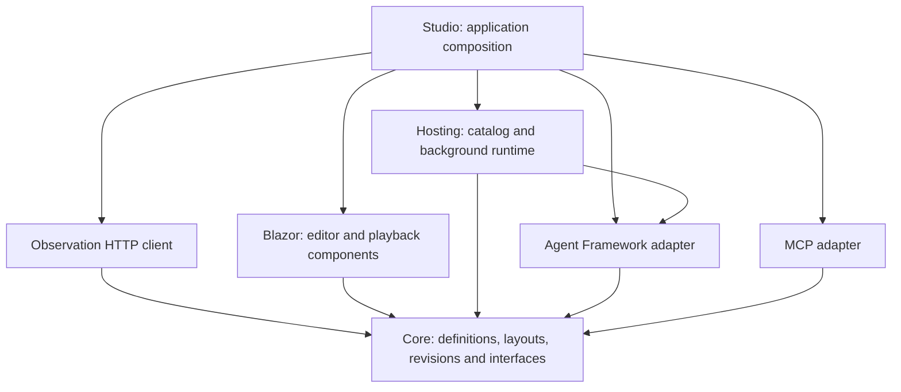
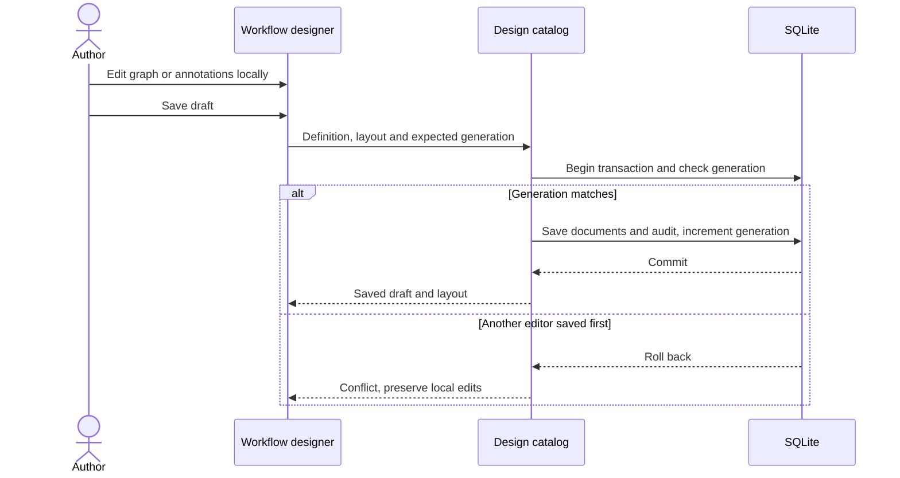
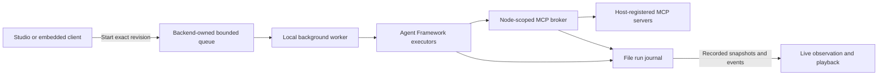

# Implemented architecture

The engine and designer are independently consumable libraries; Studio is their optional IDE and development composition. User-owned service hosting is a first-class product goal, with existing lower-level execution APIs and a supported hosting SDK still to be delivered. See [service integration](service-integration.md).

The Studio is a .NET 10 Interactive Server development host that composes embeddable Blazor components, a SQLite workflow catalog, a background run queue, Microsoft Agent Framework adapters, and a node-scoped MCP broker. Execution belongs to the backend. A browser edits definitions and observes recorded evidence; closing it does not cancel a run.

This page describes shipped code. The broader [product design](design.md) includes planned distributed recovery, workspace authorization, parallelism, collaboration, extensions, and reusable assets. Those are not implied by these diagrams.

## Package boundaries

The arrows below mean project dependencies, not network requests. Core has no external package dependencies. The Razor library depends on Core and rendering support, not the concrete runtime, SQLite, or MCP transport. Studio chooses concrete services at the composition root. Architecture tests enforce these inward boundaries.

## Editing and versioning

`WorkflowDefinition` is executable JSON. `WorkflowLayout` is separate presentation metadata for positions, labels, comments, sections, and reroutes. Layout-only edits do not change the executable content hash. The designer keeps local immutable edits and a shared undo/redo history until the user explicitly saves.

`IWorkflowDesignCatalog` extends the original catalog without breaking its methods. A design save writes definition, layout, generation, and audit entries in one SQLite transaction. A stale generation returns a conflict without overwriting either document. Publication captures an immutable definition/revision and layout; restoring copies a historical version into the draft. Activation selects which revision new runs use.

The database schema is version 2. Schema 1 databases migrate by adding layout tables. Older revisions without a captured layout receive deterministic default positions. The definition schema remains independent from the database and layout schemas.

## Execution and observation

A published run resolves the exact stored revision before enqueueing. The local background worker translates validated linear/conditional string graphs to real Agent Framework executors and edges. A maximum of 32 process-owned contexts share one active execution permit. Paused continuations release the permit while retaining their live framework state and admission slot. A per-run writer sequences control and executor events together; pause is acknowledged between nodes, not inside an admitted agent/tool operation. See [pause and resume](run-control.md). Actual receiver-side transfers, node invocations, model rounds, tool calls, and terminal outcomes become recorded events. The viewer reconstructs those events without calling executors, models, or tools.

Linear pipelines and schema-1.4 acyclic conditional string graphs are executable today. Conditions select one string output and exclusive merges pass through the selected value; they are not parallel join barriers. See [conditional graph semantics](conditional-graphs.md). Uppercase/reverse are deterministic operations. The host's `demo.scripted` agent exercises the framework tool loop but does not interpret instructions or contact an LLM. MCP bindings are pinned requirements that must also pass host policy on every invocation. Tool/provider catalogs are authoring choices, not permissions.

## Persistence and failure boundaries

SQLite stores drafts, immutable revisions, layouts, and catalog audit. The file journal separately stores each run's pinned definition and append-only execution evidence. These stores do not share a transaction. The journal is single-process; after a host restart, unfinished runs are marked interrupted instead of being silently resumed or replayed. Historical payload viewing makes no live calls.

The development host permits only loopback/same-origin access and refuses non-Development startup. These checks are containment, not authentication. Audit actors are development placeholders; captured text is plaintext. There is no workspace authorization, distributed ownership, transactional crash repair, encryption/redaction, approval durability, extension sandbox, or production readiness claim. See [runtime configuration](runtime-configuration.md) and [roadmap and current scope](roadmap.md) before integrating a host.

## Reuse and sharing contracts

Core supports [version-pinned pipeline expansion and portable packages](reusable-pipelines.md). Expansion creates ordinary processing nodes with fresh identities and optional schema-1.3 origin metadata. It adds no runtime source loader or new project dependency. Source updates do not mutate a consumer, and imported provenance does not authenticate an author. Exact MCP/provider requirements travel with copied nodes; host grants do not. Studio uses the same workflow catalog for reusable drafts and publications. Extraction creates a separate draft; insertion is a single local immutable composition edit, followed by normal save/publication. No additional database schema or runtime service is introduced. Package exports read a consistent saved design or an immutable publication, and import only stages local definition/layout edits. Requirement listings report registration availability rather than authorization.

## Headless service integration boundary

`VisualAgentWorkflow.Core` and `VisualAgentWorkflow.AgentFramework` do not reference the Blazor library or Studio. `WorkflowJson`/`WorkflowPackageJson`, `WorkflowRevision`, and `PipelineRunner.ExecuteAsync` already provide lower-level artifact loading and execution. The caller supplies tool/agent adapters, an event sink, run identity, and cancellation. The current `LocalWorkflowRuntime`, file journal, and SQLite catalog are optional development-host building blocks rather than a production service SDK.

The standalone consumer proof uses these public APIs without a Studio process, browser connection, or renderer. `AddLocalWorkflowRuntime` now provides shared lazy DI registration for that sample and Studio, without creating a catalog or UI dependency. Studio explicitly adds publication-aware clients and its catalog. A stable production SDK, packaged distribution, richer typed contracts, production persistence and durable recovery remain planned. See [local hosting API](hosting-sdk.md).

## Standalone consumer

`samples/WorkflowService` references Hosting/MCP and their inward dependencies, with no Blazor/Studio reference. It loads a reviewed package and reconstructs the operator-configured exact revision, resolves only host-registered dependencies, and executes directly or through the local queue. Its direct/queued modes create no catalog/database or HTTP listener; optional `serve` mode explicitly enables the separate observation endpoint. Its journal directory has one process owner; stopped/unfinished work is cancelled or interrupted, not crash-resumed. See [service integration](service-integration.md).

## Consumer observation

Core owns the read-only `IWorkflowRunObserver` contract, summaries and cursor pages. Hosting can explicitly map a policy-protected GET-only API over a host-supplied observer; registering a runtime does not enable it. Observation.Http depends only on Core and implements bounded HTTP reads. Studio server configuration supplies named remote sources and credentials, while `WorkflowObservationPanel` in Blazor consumes only the observer contract. A consumer can embed that same panel directly over its journal or an HTTP observer. Read requests never enter execution or control services. The development example provides single-operator bearer authentication; production identity, per-run visibility and access audit remain host concerns. See [consumer observation](observation.md) for limits and data flow.

## Approval gates

Schema 1.5 approval nodes immediately precede a pinned MCP tool. The adapter captures the exact input/tool/revision plus a reserved target invocation ID. The process-owned controller persists the request, releases its execution permit while waiting, sequences a host-attributed decision and reacquires the permit only when approved and not paused. The next tool invocation consumes the reserved identity and still passes broker authorization. The browser owns no continuation, and the separate observation API gains no mutation authority. Requests persist as evidence, not crash-restorable checkpoints. See [approvals](approvals.md).
