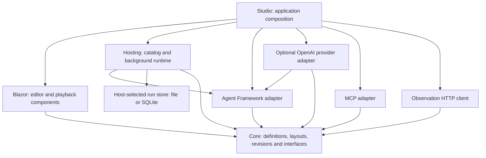
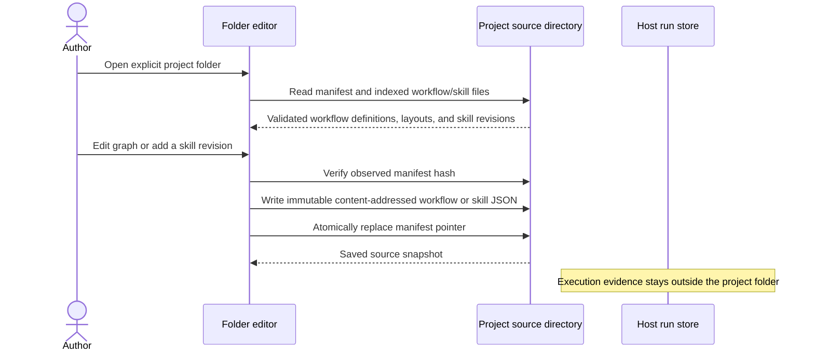
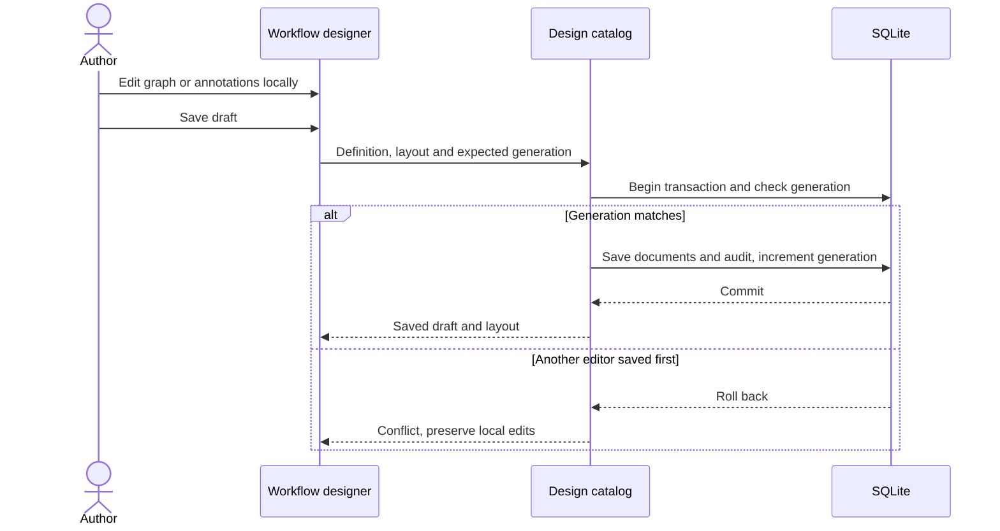
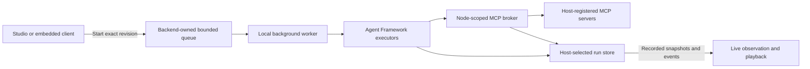
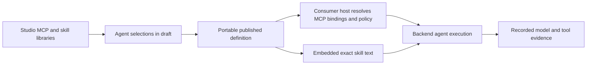

# Implemented architecture

The engine and designer are independently consumable libraries; Studio is their optional IDE and development composition. User-owned service hosting is a first-class product goal, with direct execution APIs and a local hosting helper already available; a production SDK and stable package distribution remain planned. See [service integration](service-integration.md).

The Studio is a .NET 10 Interactive Server development host that composes embeddable Blazor components, local project-scoped authoring catalogs, a background run queue, Microsoft Agent Framework adapters, and a node-scoped MCP broker. Execution belongs to the backend. A browser edits definitions and observes recorded evidence; closing it does not cancel a run. Studio project workspaces are single-operator; Git is the intended source-control mechanism, with no simultaneous editing or in-app Git client. Current SQLite/JSON project catalogs are transitional; the target is ordinary portable folders with ignored `.vaw/` local metadata and immutable run/package snapshots kept outside canonical source.

This page describes shipped code. The broader [product design](design.md) includes planned project bundles, Git-friendly project serialization, environment binding references, nested and unbounded parallelism, collaboration, extensions, and reusable assets. Studio project selection is local organization for one operator; it is not multi-user authorization, and project membership never grants runtime capabilities.

The project workflow route uses the reusable `WorkflowStudio` IDE mode. `WorkflowDesigner` owns document tabs, save/run controls, settings, and the lower panel; `WorkflowStudio` supplies observed run history and output through render fragments. A workflow-selection callback keeps the host Explorer synchronized with document-tab changes. The selected-node inspector and graph navigation remain in the Razor library; host-specific layout/theme CSS remains in Studio. These view and selection changes do not own execution or introduce another persistence layer. For direct catalog-backed execution, the shared client captures a layout only when the saved and supplied definitions have matching canonical draft serialization. The run header owns that presentation snapshot; playback prefers it over a catalog lookup. Layout-only headers are structurally and size-validated before persistence and on read, without claiming folder provenance. Embedded hosts can continue using the non-IDE save/publish interface.

The built-in pure-text MCP demonstration subprocess disables generic-host configuration defaults. It does not load or watch the calling application’s appsettings; real configured stdio servers retain their own normal process configuration behavior.

## Package boundaries

The arrows below mean project dependencies, not network requests. Core has no external package dependencies. The Razor library depends on Core and rendering support, not the concrete runtime, SQLite, or MCP transport. Its CSS and graph assets are local and self-contained; theming is scoped to the component and inherited tokens without changing unrelated host controls. Studio chooses concrete services at the composition root. Its local Settings page manages OpenAI-compatible Chat Completions connections keyed by stable IDs; edits replace the live executor registration for that ID and affect future runs. API keys are protected in the Studio data directory and omitted from descriptors. Deletion removes a locally saved registration without checking workflow references. AgentStarted evidence snapshots the selected model descriptor, optional context window and all configured pricing metadata; model responses capture provider-reported token usage plus nullable cache dimensions. The run viewer displays token totals, cache counts, latest completed prompt usage against the configured context size, and an estimated cost when every observed priced component has a rate. It marks those context figures as last completed while a newer request is in flight, and counts explicit host context-compaction evidence. These estimates are observational, not billing guarantees. This local management surface inherits the development host’s loopback-only, unauthenticated boundary. Architecture tests enforce these inward boundaries.

Agent tool failures retain their dispatch disposition in evidence. A host may explicitly allow a known MCP server-declared failure to be fed back once as a sanitized correction message; authorization, contract, budget, timeout, transport, and outcome-unknown failures remain terminal and are not automatically retried.

## Editing and versioning

`WorkflowDefinition` is executable JSON with a stable `WorkflowId` and an optional user-facing `DisplayName`. The ID remains the key for storage, imports, integrations, and workflow calls; the display name is versioned with the definition and appears in Studio lists. `WorkflowLayout` is separate presentation metadata for positions, labels, comments, sections, and reroutes. Layout-only edits do not change the executable content hash. The designer keeps local immutable edits and a shared undo/redo history until the user explicitly saves. The searchable library, contextual palette and output-pin creation all call validated Core graph operations. An additive UI-only `WorkflowGraphEdit` combines semantic and placement changes into one history entry; it changes no execution or artifact contract. Selected properties, multi-selection, zoom, viewport pan/reset, workspace mode and native fullscreen are view state, while completed node/group moves update presentation layout. Designer and run-inspector views share the same embeddable components and remain independent of backend run ownership.

Definition serialization sorts ID-keyed maps and normalizes indented JSON line endings to LF before hashing, so content hashes remain stable across Windows and Unix.

`IWorkflowDesignCatalog` extends the original catalog without breaking its methods. A design save writes definition, layout, generation, and audit entries in one SQLite transaction. A stale generation returns a conflict without overwriting either document. Publication captures an immutable definition/revision and layout; restoring copies a historical version into the draft. Activation selects which revision new runs use.

Standalone Studio owns a local `projects.json` registry and a data directory for each catalog-backed project. Each such project has its own SQLite workflow catalog plus JSON skill, profile, and graph-function libraries. Workflow IDs and revisions remain unchanged within their migrated catalog. API routes under `/api/projects/{projectId}` and project-aware Studio routes select that catalog; unscoped workflow API routes continue to address the default project. The project identifier is a local selection key, not an authenticated principal or a security boundary. The project manager archives projects instead of deleting their files. The first access to the deterministic `default` project copies the legacy root catalog with SQLite backup and copies legacy skill/profile/function files if the destination does not already exist; the source files are retained. This migration is per-file and repeatable, not a cross-catalog transaction. Studio can download a bounded deterministic source ZIP of current drafts and project assets. A separate **Open folder** workspace reads manifest-indexed source directories, shows a separate hierarchical tree for each open root, and saves workflow drafts plus new immutable skill, profile, and graph-function revisions directly. Markdown files use the local Monaco bundle in the browser, loaded on demand only when a document opens; its pinned build source is in `tools/monaco/`, and CI regenerates the static assets. No runtime CDN or external editor service is required. Newly written source paths use `.workflow`, `.skill`, `.agent`, and `.function` suffixes with JSON contents; previously indexed `.json` paths remain readable. The folder editor presents an IDE-style Explorer and open-file tabs around the graph editor, with run controls, validation issues, and output in a bottom dock. Up to eight roots can be open as tabs; their order and selected ID are saved in machine-local `open-workspace.json`, while the registry retains canonical local paths. Each tab owns a mounted editor session so switching roots preserves unsaved buffers in the current browser circuit; dirty tabs require confirmation before closing. The local tab list stores project IDs rather than duplicating paths or becoming a portable workspace descriptor. Project-scoped catalog APIs return HTTP 409 for folder-backed IDs, preventing accidental edits or runs against an unrelated SQLite catalog, and source snapshot download reads the validated folder. `StudioFolderWorkflowSource`, `StudioFolderSkillSource`, `StudioFolderAgentProfileSource`, and `StudioFolderGraphFunctionCatalog` are deliberately separate from catalog-backed libraries: source edits update only the folder manifest and do not create catalog revisions, activate versions, or write execution evidence. Folder profile, skill, and graph-function libraries are supplied to workflow authoring. Graph-function editing is limited to the existing pure string/Boolean function contract; each save creates a new versioned snapshot, never mutating its selected base revision. Graph-function source revisions use a Studio-owned versioned envelope to persist the visual layout alongside the catalog entry. The semantic function hash and embedded runtime contract remain layout-free, while the project-file hash includes the layout. Legacy catalog-entry assets are read with a deterministic generated layout; legacy source cannot recover unrecorded placement. Workflow content is atomically replaced; reusable asset content is written to immutable content-addressed paths before an atomic manifest replacement; saves compare the observed project manifest immediately before the pointer update, rejecting detected stale state. This is optimistic conflict detection, not an atomic cross-process compare-and-swap: an external editor can still replace a manifest in the check/replace interval. Each open folder editor allows workflow edits and new immutable skill/profile/function versions. Only the active tab watches its tree for file notifications and fully validates the manifest and indexed hashes every 20 seconds; inactive tabs stop watching and revalidate when reactivated. Reload rereads the tree, and dirty buffers require an explicit discard before reload. Browser refresh and Studio restart restore the tab list but not unsaved editor buffers. The watcher is a user-interface signal, not an execution lock, and temporary Git checkout inconsistency is shown as a conflict while the loaded buffer remains intact. The workspace holds no more than eight folder roots at once. The editor uses host-level model/MCP configuration and the host run store; project-owned MCP definition files are not implemented yet. Existing catalog-backed projects continue using SQLite/JSON and are not silently mirrored to folder source.

Every Studio route uses the shared `StudioNavigation` component for the project selector, route links, active-page state, and persisted theme selector. Shared shell styles keep the navigation full width and pages aligned; narrow viewports wrap navigation and reflow content. Browser checks cover every route at desktop and phone widths, including 200% text reflow. The reusable function editor also uses container-based breakpoints so embedded hosts receive a workable canvas and property pane at narrower widths.

Project-owned authoring assets are workflows, skills, agent profiles, and pure graph functions. Settings for model providers, MCP endpoints, protected credentials, broker registrations, and effective host grants remain global to the local Studio environment. Projects do not yet store environment binding manifests or narrow the process-wide MCP allowlist. Runtime history also remains in the host-level run store. Catalog-backed projects use SQLite/JSON; the **Open folder** workspace reads each open tab’s manifest-indexed source directory and saves workflow drafts and immutable skill/profile/graph-function revisions directly. That source editor is not backed by or mirrored to `IWorkflowCatalog`, `ISkillLibrary`, or the profile catalog. Folder profile/skill/function sources can be provided to graph editing; pure graph functions are authored as immutable project revisions. Catalog-to-folder cutover is an offline operation because open Blazor circuits retain direct mutation references; the migration command and Studio host share an exclusive data-directory lock, and startup recovers a journal before exposing writable project services. The migration captures current drafts/assets only; revision history and runs stay in host storage. Multiple-root tab sessions are implemented. See [local project workspaces](project-workspaces.md) for current behavior and migration sequence.

Folder-backed Studio runs are admitted separately from project catalog APIs. Before execution, `StudioFolderWorkflowRunner` reads and validates the complete indexed source into memory, checks the project and selected asset against the editor's expected manifest/asset hashes, validates executable graph semantics, and creates a runtime revision from the captured definition. Restore-point testing uses the same path after validating the content-addressed archive and does not switch the active manifest. `WorkflowRevision` carries optional captured layout and source provenance into `RunHeader`; this provenance includes project/workflow IDs, manifest hash, source asset hash, layout hash, and for a restore-point run the archive content hash. Runtime input, parameters, payloads, and host execution evidence remain in the single configured `IWorkflowRunStore`; no evidence is written into project or `.vaw/` files. The existing `RunHeader.ContentHash` remains the normalized executable definition hash. The source and layout hashes are separate so presentation changes remain auditable without changing execution identity. Fresh capture prevents later folder edits from changing an admitted run, but it is not a lock against arbitrary Git/editor writers. Provider resolution and MCP grants remain host-owned; selecting a folder or restore point conveys no capability.

Folder-backed projects can export an explicitly selected set of executable workflows as `.vawpkg`. Core owns `WorkflowProjectPackageJson`, a deterministic, bounded ZIP contract whose top-level `vaw.release.json` manifest pins each inner `WorkflowPackageJson` payload and a derived union of package requirements. It does not duplicate snapshots already embedded by workflow definitions. The reader rejects unsafe or colliding paths, unknown formats, mismatched hashes or requirements, and missing/extra files before exposing any workflow; it does not extract files. A consumer resolves logical node/provider/MCP requirements against host registrations and independently checks grants. The artifact installs no assemblies, endpoints, credentials, or permissions. The standalone WorkflowService sample demonstrates package creation from selected package JSON files and direct artifact execution without Studio or a catalog. Production staging, activation, and trusted publisher verification remain future work.

The folder editor's source save order keeps the manifest as the commit pointer. It validates the project and saves a content-addressed skill/profile/function asset first, rechecks the observed manifest, then atomically replaces that manifest. This is a local single-process conflict check, not a cross-process filesystem transaction.

Manual local restore points use the same validated ZIP contract inside ignored `.vaw/snapshots/`. They include one manifest and exactly its indexed assets, not an arbitrary recursive folder copy. Restore validates the point, adds only missing immutable asset files, checks the source manifest hash shown in the preview, then atomically switches the manifest pointer. Newer and unindexed files remain untouched. A restore point can also be loaded in memory and executed as a test without switching the active manifest. Missing or corrupt sidecar data affects restore/test history only; folder source and exports remain usable. Snapshot data is capped at 20 points and 256 MiB and is never silently pruned.

The database schema is version 2. Schema 1 databases migrate by adding layout tables. Older revisions without a captured layout receive deterministic default positions. The definition schema remains independent from the database and layout schemas. Schema 1.6 optionally adds up to 64 user-defined typed scalar parameters with stable IDs, display names, defaults, and bounded editorial descriptions; absent optional JSON members remain omitted so existing definition hashes are unchanged. Descriptions appear as Studio help and have no runtime effect. A `core.workflow-value` node explicitly replaces its incoming string with one resolved parameter value.

Schema 1.9 adds a bounded typed JSON entry path: the Input may declare a `json` output and connect to `core.json.select-string`, which resolves a bounded RFC 6901 pointer and emits text. Schema 1.13 adds `core.json.project`, which maps 1–16 selected JSON Pointer values into a new JSON object, and permits that JSON output to reach the workflow Output. Schema 1.14 adds a JSON-valued parallel join. Schema 1.15 adds an optional expected JSON value kind to each projected field (`string`, `number`, `integer`, `boolean`, `object`, `array`, or `null`); absent kinds preserve the prior pass-through behavior. Schema 1.16 adds recursive mapping contracts for objects and array items. Schema 1.17 adds one bounded loop region to string workflows: one `core.loop`, one `core.loop.body` anchor, a safe continue predicate, and at most 16 linear body executions. Object properties name an output field, select a relative JSON Pointer, and declare a nested value kind; required missing properties fail, while explicitly optional properties are omitted. Arrays map each item through a declared item contract and are capped at 64 items. Extra object properties are omitted. A mismatch fails the projection and records the field path and expected/actual kind without recording the offending value. Mapping configuration is bounded to depth 8, 128 schema nodes, 16 properties per object, and 16,384 configuration characters. JSON payloads are limited to 16,384 characters and depth 32; projection names and pointers are bounded. JSON remains a typed graph payload rather than an agent/tool input: select a value to convert it to text before connecting to existing string nodes. There are no expressions, dynamic mappings, or arbitrary conversion nodes. Optional fields are omitted when absent, preserving earlier serialized definitions and content hashes. Core validates port compatibility, and graph editing updates connections and output types atomically.

Schema 1.23 introduces a new explicit graph form with separate `executionConnections` and data `connections`. Its initial runtime subset is Input/Output scheduling plus pure string constants and text concatenation evaluated on demand when Output runs. Schema 1.24 adds `core.text.equals` and `core.branch.boolean`; schema 1.25 adds `core.constant.boolean` and `core.boolean.not`; schema 1.26 allows a bounded Boolean decision DAG with 1–8 Branch nodes and 0–16 Terminate nodes. Input activates one root Branch; each Branch selects exactly one authored true/false edge, which may reach another Branch, Output, or Terminate. Output and Terminate may have multiple incoming alternative edges, allowing reconvergence without an implicit Merge node. Each reached target executes once per run even when several mutually exclusive routes converge. Cycles and unreachable executable nodes are rejected, and at least one structural route to Output is required. This structural rule does not prove predicate feasibility: constants or repeated predicates can still make every Output route impossible for a particular run. String equality is ordinal and case-sensitive; Boolean Branch and NOT accept no text coercion. Pure values are evaluated only when the reached Branch or Output requests them; each `data.evaluated` event records a typed value and the data connection identity, while route delivery is a separate `execution.activated` event and the choice is recorded as `branch.selected`. Termination records the selected success/failure outcome and does not activate Output. Studio exposes schema upgrades through the opt-in authoring preview; playback only reads recorded evidence. Broader control/agent/MCP support and migration of legacy node families remain out of scope. Prior schemas retain their existing edge meaning and serialization.
Schema 1.27 adds pure graph functions to that explicit graph. A `core.function.call` node embeds a hash-checked versioned function snapshot and derives typed input/output pins from the function contract. The function body is a separate data-only DAG with named function boundary nodes; it cannot contain workflow execution edges or nodes outside the deterministic string/Boolean allowlist. The runtime evaluates the function lazily when its output is requested and records function identity, inputs, nested evaluated values, and output within the call node's `data.evaluated` event. Packages include a matching graph-function requirement. Calls do not resolve mutable catalog entries, execute as scheduler steps, or inherit host capabilities. Studio's Function library persists immutable revisions and folder metadata in its local data directory; its canvas editor validates and saves bounded pure function bodies. Schema 1.28 adds `GraphFunctionTools` to agent configuration as exact immutable snapshots. Only assigned revisions are advertised to the model, calls use a strict named-input schema, and the adapter bounds invocations, aggregate node visits and payload sizes. Each call records its correlation ID, pinned hash, inputs, outputs, evaluated values or failure in the parent run's event stream, so replay is read-only. Graph functions cannot inherit an agent's MCP grants or perform external effects. Workflow packages declare each assigned function as a `graph-function-tool` requirement and contain its snapshot. The local library remains an authoring catalog only; consumer hosts do not need it to execute. Existing workflow-call nodes retain their distinct orchestration lifecycle. Prior schemas retain their existing edge meaning and serialization.

Schema 1.31 extends explicit graph dataflow with signed 64-bit integers. `core.constant.integer`, `core.integer.add`, and `core.integer.equals` expose `integer` pins; addition is checked and never wraps. Workflow-value nodes can expose string, Boolean, or integer pins when bound to a parameter of the same type; `number` parameters remain unsupported as graph pins until a deterministic numeric representation is chosen. The Output node accepts string, Boolean, integer, and bounded JSON values and returns their canonical text representation as the workflow result. Workflow parameter defaults and overrides remain portable canonical text, while runtime graph values are typed CLR scalars. Existing schemas preserve their original string behavior. Pure graph functions use the same integer operators and typed interface. Overflow evidence identifies both the failing arithmetic node and the scheduled node that requested its value. Regression coverage includes serialization/compatibility, parameter types, wire matching, function and workflow execution, Boolean branching, and overflow.

Parameter overrides belong to a run, never its immutable published definition. The host resolves defaults and bounded caller overrides before enqueueing, rejects unknown IDs, and stores the complete effective string map in the run header for audit/playback. Workflow packages carry parameter contracts and defaults, but not run overrides or credentials. Values are not secret: consumers should not put credentials or sensitive payloads into parameters because current local run stores record them in plaintext.

An incomplete editor draft may retain topology issues such as missing pins, disconnected nodes, or cycles. Draft serialization and hash calculation permit those issues so users can save work-in-progress; publication and runtime still use strict validation and reject the graph until all issues are fixed. Adding a library node creates it without edges. Insertion is a separate explicit command on a selected wire, and condition nodes can be routed independently to output or termination nodes without an implicit merge. Termination nodes can declare success or failure outcomes; see [workflow termination](workflow-termination.md).

## Execution and observation

Conditional routes can now finish at the workflow Output or end successfully without a result at a schema-1.18 `core.terminate` node. The adapter records this as a distinct `run.terminated` outcome while preserving the single declared Output contract used by Agent Framework; details and the compatibility behavior of the string-returning runner API are in [workflow termination](workflow-termination.md).

Schema 1.19 adds `core.workflow-call` with an embedded immutable child definition, revision/version pin, and content hash. Nested nodes are executed in the parent run with one event sequence and slash-separated `ScopeId`; child run lifecycle events are represented as `subworkflow.*`, and playback displays child activity/evidence without invoking dependencies. Calls are bounded and keep child tools/providers subject to host policy. Call pins inherit the child's declared `string` or `json` Input and Output types, and ordinary graph validation enforces those boundary types. The runtime supports pinned mappings from declared parent parameters to compatible declared child parameters; unmapped parameters retain child defaults. The Studio can inspect a call's pinned child graph and dependencies, compare and apply explicit child revision upgrades to a draft with undo, and preserve the parent graph context during inspection. When the host has no saved child layout, the inspection graph uses a generated layout; it is read-only and does not add layout data to the workflow call. Nested approvals bind to the root run/revision plus every exact pinned call edge and executing child revision, and are checked against the embedded graph and matching event scope before a decision. Host grants remain independently enforced. See [nested workflow calls](nested-workflows.md) and [approvals](approvals.md).

A published run resolves the exact stored revision before enqueueing. The local background worker translates validated linear, conditional, bounded-loop, and bounded-parallel graphs, including JSON input, selection, and projection nodes, to real Agent Framework executors and edges. The loop is a real feedback edge: one initial message and one body return arrive on the same loop input, distinguished by source node and pin. The body repeats while its ordinal string predicate matches and stops normally on a false predicate or the hard iteration cap. Other controls and nested control regions are rejected in loop workflows. A schema 1.14–1.22 workflow with a parallel fork uses the Agent Framework concurrent in-process environment; the fork sends the same input to two visible branch anchors, and a fan-in barrier waits for each branch endpoint before the join emits a named JSON object. Schema 1.32 adds one explicit 2–8 branch fork/anchor/join region: stable branch IDs name execution pins, the same fork invocation ID travels to each branch, and the join publishes its JSON value only after all matching arrivals. Studio can create this region from a valid schema 1.31 graph, select its initial branch count, add and reorder branches, edit labels without changing IDs, remove empty branches, and remove/undo the full region. Topology edits update fork descriptors, anchors, and join pins atomically; populated branch work must be moved or deleted before that branch can be removed. Branch failure prevents a joined result; already completed external effects are not rolled back. Workflow value nodes read the run's resolved parameter map and emit the value through ordinary node/transfer evidence. The JSON selector emits one selected value as text; the projection node constructs a bounded JSON object from selected values. Loop iteration start, completion, and stop reason are sequenced audit events; replay reconstructs the loop path without re-executing it. The text-template node combines its incoming string with bounded literal and declared-parameter parts through the same non-evaluating renderer used for agent user messages. Recorded transfer and node events retain the exact selected, projected, joined, or rendered payload. A maximum of 32 process-owned contexts share one active execution permit. Paused continuations release the permit while retaining their live framework state and admission slot. A per-run writer sequences control and executor events together; pause is acknowledged between nodes, not inside an admitted agent/tool operation. See [pause and resume](run-control.md). Actual receiver-side transfers, node invocations, model rounds, tool calls, and terminal outcomes become recorded events. If an assigned MCP tool returns successfully but the model ends without final text, the agent node completes with the last successful tool result (or a bounded success notice when that result is empty/oversized) and records `completionMode: successful-tool-result-fallback`; failed calls do not use this fallback. The viewer reconstructs those events without calling executors, models, or tools. Live and playback node cards derive concise activity labels from the current invocation’s latest model, tool, join, or loop event; loop cards show the current iteration and cap, and labels never expose event payloads.

Schema 1.33 adds one collaborative rendezvous to a static 2–8 branch region. Each branch has explicit publish-before and read-after Agent grants, bounded channel IDs, one finite timeout, an immutable shared snapshot, and a stable branch ID through join correlation. The backend checks grants per operation, records messages/arrivals/release/abort, and playback reads that evidence without agent or tool calls. Its pre/post-rendezvous paths remain linear Agent paths. Schema 1.34 adds one Boolean Branch within each branch of a static schema 1.32 region: both selected outcomes stay inside the owning branch and produce exactly one result at its matching join pin. The Boolean decision and actual execution activations record fork activation and branch IDs. Local exclusive reconvergence through a shared node is a route choice, not a second barrier. Schema 1.34 intentionally does not enable conditions inside schema 1.33 collaboration regions. Schema 1.35 adds two ordered rendezvous phases to a static collaboration region with separate phase boards/snapshots, exact phase/role grants, one deadline across both waits, and cumulative region limits. The Agent Framework waits for every branch at each phase, preserves earlier released/read evidence after later failure, and suppresses join output on abort. Journal validation checks phase identity, ordering, grants, snapshots, reads, and abort state; playback displays each recorded phase without running agents or tools. Studio authoring integration is separate work. See [parallel branch routing](parallel-branch-routing.md), [schema 1.33 collaboration](parallel-agent-collaboration.md), and [schema 1.35 collaboration phases](parallel-agent-collaboration-phases.md).

Schemas 1.14–1.31 support up to four sequential two-branch blocks. Schema 1.32 adds a separate static 2–8 branch region whose labels and display order may change without changing stable execution-pin IDs. The Studio can atomically add, reorder, rename, and remove empty branches, and remove the full region as one undoable operation. Both forms use barriers and bounded JSON join results. Nested or independently concurrent blocks remain rejected. Loop workflows are limited to a single linear body and no other control nodes; see [bounded loop graphs](loop-graphs.md). Schema 1.6 adds workflow-defined string parameters; schema 1.8 adds validated scalar types. Getter nodes pass their canonical text values through the existing string graph. Mutable variables and general object/collection ports remain unsupported. Conditions select one string output; exclusive merges pass the selected value through for shared downstream processing, while the sole Output can receive alternative terminal routes directly. Neither behavior is a parallel join. Core’s `ConditionalBlockEditing` previews and removes only single-entry/single-exit decision regions, including nested decisions; outside incoming paths cause rejection. `ParallelBlockEditing` previews and removes a selected fork-to-join region as one undoable editor change. See [conditional graphs](conditional-graphs.md) and [bounded parallel graph behavior](parallel-graphs.md). Uppercase/reverse are deterministic operations. The host's `demo.scripted` agent exercises the framework tool loop but does not interpret instructions or contact an LLM. The optional OpenAI provider adapter supplies host-configured factories keyed by stable connection IDs through the official SDK and AI bridge; protocol tests cover its path, while credentialed live-service qualification remains outstanding. Core and Blazor have no provider SDK dependency. See [model providers](model-providers.md). MCP bindings are pinned requirements that must also pass host policy on every invocation. Tool/provider catalogs are authoring choices, not permissions.

Schema 1.7 optionally embeds reviewed text-only skill revisions and per-agent structured user-message parts, plus an optional low/medium/high reasoning effort request. Schema 1.8 adds typed scalar parameters and can expose an allowlisted choice parameter as an agent reasoning-effort input. The agent's existing `instructions` remain the system message; the user-message template resolves only incoming text and declared parameters. A run records the resolved model request, reasoning preference, and exact assigned skill IDs, versions, and content hashes. Providers advertise whether the adapter can send this option; compatible endpoints may still ignore it. Imported skill text cannot grant MCP access. Schema 1.29 adds mutually exclusive static-or-parameter bindings for an Agent node’s per-response output-token cap and parent-plus-delegate total-token budget. Their integer workflow parameters are range-checked both at definition validation and run admission; the resolved value is recorded in `agent.started`, while the full effective parameter map is stored on the run header. Model identity and capability grants remain host-resolved. Studio's local Skill library manages revisions and folders, while the published definition carries the assigned revision text; a consumer service can execute it without Studio. This is a bounded text capability, not arbitrary skill scripts or remote skill resources.

Schema 1.30 optionally gives an Agent node authored execution routes. Each stable route ID maps to an execution output pin, while labels and descriptions are authoring metadata. The Agent Framework adapter provides an internal `select_route` function whose enum only includes those IDs; it is invocation-scoped, is not an MCP capability, and cannot invoke another node. The runner latches the proposal and only commits it after the agent finishes successfully with exactly one valid choice. Missing, duplicate, or unknown selections fail closed, and a choice made before a later model/tool/limit failure is discarded. Event evidence distinguishes proposed, rejected, committed, and discarded selections; route activation uses the normal execution event path, so playback remains passive. Providers must support function calling. Removing a route leaves now-invalid outgoing edges visible as draft validation issues rather than silently deleting user-authored wires. The Studio saves such incomplete drafts but blocks publish and execution until validation passes. See [agent-selected routes](graph-values.md#agent-selected-routes).

## Versioned agent profiles

Schema 1.11 embeds immutable agent-profile revisions; schema 1.12 adds optional pinned coordination-channel membership to those profiles. The local Studio Agent Designer authors and organizes profile versions, while assigning a profile snapshots its stable model connection ID, instructions, MCP tool contract and description hashes, optional inference controls, selected skill text, and channel IDs into the workflow. Model/endpoint versions are mutable host settings, not dependencies of the profile. Profile package requirements remain explicit; there are no endpoints, credentials, or policy grants in the profile or export.

Schema 1.33 persists one static collaboration-region record tying a parallel fork, a branch-keyed `core.parallel.rendezvous`, and a matching join together. Its grants retain the original phase (`publish` or `read`) field. Schema 1.35 adds a second ordered rendezvous ID and phase/role grants (`phase1`/`phase2`, `publish`/`read`); Core validates both barriers and exact straight-line branch membership. The optional model members are omitted from schema 1.33 JSON. `WorkflowJson.SerializeDraft` permits intermediate collaboration configuration and invalid routes; strict package, publication, and run codecs use full validation. Studio keeps schema-1.33 grant controls and serialization unchanged, and binds phase/role controls only after an explicit 1.35 upgrade. See [schema 1.33 collaboration](parallel-agent-collaboration.md) and [schema 1.35 collaboration phases](parallel-agent-collaboration-phases.md).

`WorkflowRunner` admits each fork activation with a finite effective timeout, derived from the workflow setting or host default, then routes each branch through the ordinary graph scheduler. It attaches collaboration send/read functions only to the exact authorized Agent invocation; profile delegation does not inherit them. `ParallelCollaborationExchange` orders concurrent messages by observed append order and parks arrivals without holding an execution permit. Schema 1.33 releases one immutable snapshot after all branches arrive. Schema 1.35 releases a phase-1 snapshot at its first barrier and a separate phase-2 snapshot at its second barrier; both waits share the fork-started deadline and the region-wide 8-channel, message-count, and 65,536-byte snapshot bounds. After either release, a later branch failure or cancellation aborts the region and prevents the join value; already completed effects are not rolled back.

Versioned execution events carry the region/fork activation identity, effective timeout, exact sends/reads and grants, phase-specific arrivals, canonical release bytes and digest, branch outputs, and abort reason. `RunStoreRecords` validates those journal prefixes on writes and reads, including phase order, exact snapshot/read references, cumulative bounds, and terminal status. `ParallelCollaborationPlayback` renders the recorded lifecycle and exact persisted values without model/MCP calls; unsupported payload versions and incomplete prefixes are marked unavailable or partial. Studio keeps the schema-1.33 single-rendezvous controls and adds an explicit upgrade action for schema 1.35. The upgrade adds an unwired second barrier, maps existing grants to phase 1, and exposes phase/role controls; authors wire all paths themselves. Invalid drafts save with visible diagnostics, while publish/run remain blocked. Schemas 1.32–1.34 serialization and hashes remain unchanged; workflow packages never include provider endpoints, credentials, or host authorization. Collaboration excludes nested/repeated barriers, loops, retries, dynamic membership, and interrupted-run recovery.

The Microsoft Agent Framework adapter exposes each assigned profile as a request/response function on the parent. The child runs through the registered host provider and a child-specific tool scope made from that profile's exact tool bindings. The scope intersects profile requirements with the existing host authorization policy for the parent workflow node, and tools are never copied from the parent. The bounded slice allows four assigned profiles and four child executions per parent invocation, one delegation level, and 16,384-character tasks. Each child has the existing provider timeout and optional output-token cap. A schema-1.22 total-token budget configured on the parent is shared across its delegated calls. Child events preserve run and revision, use distinct invocation IDs, and include profile identity plus parent/child correlation. The viewer replays persisted events only. See [agent profiles and bounded delegation](agent-profiles.md).

When at least two profiles are assigned, the parent also receives a team function. A call fans the same task out concurrently to all assigned profiles (maximum four) and returns an ordered JSON array with each profile's identity and output. Individual and team calls share the four-child-execution limit. A failed member cancels siblings where possible and suppresses the aggregate; already completed external effects are not undone. The aggregate is bounded to 80,000 characters. WorkflowRunner serializes concurrent event writes under one run sequence gate. `agent.team.*` lifecycle events and child-correlated model/tool evidence are persisted together, and the run viewer identifies the active subagent on its parent node.

For schema-1.12 profiles, the adapter supplies `channel_send` and `channel_read` functions only to delegated children, and only for memberships in their exact immutable profile. The tool schemas enumerate those channel IDs and the board rechecks membership at invocation. Sequential `delegate_N` calls made by one parent share a transient board scoped to that parent invocation; each `team_0` call creates a separate board scoped to its unique team invocation. Neither board is shared across parent invocations or runs. Each board caps messages at 4,000 characters each, 32 per channel and 64 total. Send and read evidence is written under the child invocation; read evidence includes the ordered messages returned to the model. The event journal is the playback source. The parent model selects sequential delegates through its assigned tools; this is bounded tool orchestration, not persistent memory, shared mutable profile state, or a graph-level join. Aggregate token/time budgets remain future work.

Schema 1.10 adds an optional per-agent maximum output-token setting, bounded to 1–16,384. Definitions without it preserve the legacy 1,024-token request cap; newly edited settings are serialized into the immutable definition and recorded in `agent.started` and `model.requested` evidence. Schema 1.21 adds maximum model turns (positive integer, default 8; `-1` means unlimited), an optional positive whole-number timeout that overrides the model connection default (blank uses the connection timeout), and opt-in structured JSON results. The initial model request counts as turn one. Structured mode exposes a built-in `submit_result` function and changes the agent output pin to JSON containing status, payload, and message. Task-level failure and runtime outcomes are returned as values for a JSON selector and Condition to route; host cancellation still cancels the run. Schema 1.22 adds a 1–100,000 provider-reported total-token budget shared with delegated profiles. Each request is capped to remaining budget where possible, and an over-budget response is recorded then rejected before Agent Framework can invoke its requested tools. Providers must report usage; missing usage fails closed. A single prompt or requests already in flight may exceed the threshold, so this is not a guaranteed billing cap. Turn/time/token limits record `agent.limit_exceeded`; other structured runtime values record `agent.outcome`. The Studio exposes provider-supported reasoning **Off** as an explicit `none` preference, distinct from leaving the setting at provider default. Adapters may send supported settings that a compatible endpoint can still ignore or clamp.

The prompt editor displays text tokens (`{{input}}` and `{{parameter:ID}}`) over the structured prompt-part contract. Its codec escapes backslashes and literal opening braces, rejects unknown/incomplete references, and does not evaluate expressions. The picker appears as an unfinished `{{` token is typed; suggestions can be reached by keyboard and selected with Enter. Only the editor representation is text; persisted definitions still store typed literal/input/parameter parts. System instructions remain a plain trusted host-authored field, so caller input is not implicitly elevated into that role.

Studio's local MCP library connects Streamable HTTP endpoints or launches explicitly configured stdio programs. Discovery reports every returned tool as supported or excluded with a schema/description reason, and only supported tools can be enabled. HTTP endpoint and bearer-token settings, stdio executable/arguments/working directory, and protected explicit environment values stay in local Studio configuration. Stdio uses structured process arguments, a small SDK-provided base environment allowlist, explicit configured variables, disabled environment inheritance, bounded operation timeouts, and client/process disposal. Its MCP client leaves protocol selection to SDK negotiation: it first probes the current `2026-07-28` `server/discover` protocol, then falls back to an initialize-capable revision when needed. The SDK's default probe timeout is five seconds; the enclosing connection operation remains bounded by Studio's 30-second deadline. Studio starts a fresh stdio process for discovery and each tool connection; it does not keep a persistent process pool. This is local process launch under the Studio OS user's authority, not sandboxing. Studio's Streamable HTTP client remains pinned to `2025-11-25` until the newer protocol's changed HTTP session semantics have dedicated compatibility coverage. Workflow definitions and packages contain only logical tool IDs and pinned hashes; a consumer must register matching connections and host policy itself.

Agent tool arguments support nested bounded objects and arrays of `string`, `integer`, `number`, and `boolean` values, with required/optional fields, scalar enums, string/array length bounds, regex string patterns, and numeric minimum/maximum constraints. Patterns are limited to 256 characters and the .NET non-backtracking regex subset; matching has a 50 ms timeout. JSON Schema `default` is accepted as annotation metadata and is not used to make an argument optional or permit null. An omitted `additionalProperties` is normalized to `false`; omitted array bounds receive the Studio limit of 64 items. Limits are 32 declared properties per closed object, nesting depth 8, 64 array items, 8,192 characters per string, 1,024 values, 65,536 characters per call, and 16,384 characters per schema. Unsupported keywords, open/dynamic objects other than the bounded explicit `{}` map case, unions, references, and non-text MCP results remain unavailable. MCP descriptions are trimmed and limited to 2,048 characters. The discovery UI reports unsupported schema keywords and overlong descriptions instead of silently hiding a tool. New workflow bindings pin the description hash separately from the existing input/output schema hash. Legacy bindings without a description pin remain valid for compatibility. The explicit MCP graph node maps ordinary input text to the conventional `text` argument; a JSON object input can supply the supported typed arguments. The agent adapter publishes the tool's normalized discovered schema to Microsoft.Extensions.AI and passes model-produced arguments as JSON to the broker. The broker rechecks pinned hashes and recursively validates argument names, presence, values, and limits before dispatch. The broker checks a node's requested contract and effective host policy before invocation, including tools exposed to an agent. Configured servers run under the local Studio operator's trust boundary; they are not a sandbox or a production tenant boundary.

Consumer hosts may additionally register digest-pinned container MCP tools through `ContainerMcpToolRegistration`. Each invocation launches a disposable Docker worker with no network or inherited environment, read-only root, dropped capabilities, non-root identity, resource limits, and a small no-exec temporary filesystem. By default it has no host mounts. An explicitly configured worker may receive one read-only directory containing only a private Unix socket; requests through that channel are narrowed to configured binding IDs that are also pinned on the active node and rechecked by the normal broker under current host grants, contracts, budgets, and audit. Chained worker capabilities are denied. A host may pin one versioned .NET extension assembly by SHA-256 in the container image; only the isolated worker loads it, through the `IWorkflowExtension` contract. Docker Engine, its runtime, host kernel, and reviewed image remain trusted parts of the host boundary. Linux CI is being extended to verify network, environment, host-path, root-write, temporary-filesystem, direct broker, delegated broker, and assembly identity/execution behavior; Windows CI verifies compilation only. See [containerized MCP workers](extension-workers.md) and [isolated .NET extensions](extension-assemblies.md).

## Persistence and failure boundaries

SQLite stores drafts, immutable revisions, layouts, and catalog audit. The separate `IWorkflowRunStore` persists each run's pinned definition and execution evidence. The default file implementation publishes complete snapshots atomically; the optional SQLite implementation commits event batches with sequence/status in one transaction. Runtime/controller and read-only observers can share a host-selected store. Catalog and run stores do not share a transaction. Runtime ownership is exclusive even with SQLite concurrency checks; the ordinary local runtime interrupts unfinished runs after restart. A separate opt-in checkpoint host can explicitly rehydrate deterministic graphs saved in a suspended state. Historical payload viewing makes no live calls. SQLite schema 3 keeps operator assertion records in a separate table and transactionally validates their current evidence cursor; these records never modify execution history. The assertion service is an optional trusted-host capability, not a mapped endpoint, and hosts must supply authenticated actor identity and enforce access policy. See [run storage](run-storage.md) for compatibility, store selection and failure boundaries.

The development host permits only loopback/same-origin access and refuses non-Development startup. These checks are containment, not authentication. Audit actors are development placeholders; captured text is plaintext. There is no workspace authorization, distributed ownership, transactional crash repair, encryption/redaction, approval durability, extension sandbox, or production readiness claim. See [runtime configuration](runtime-configuration.md) and [roadmap and current scope](roadmap.md) before integrating a host.

## Reuse and sharing contracts

Core supports [version-pinned workflow expansion and portable packages](reusable-workflows.md). Expansion creates ordinary processing nodes with fresh identities and optional schema-1.3 origin metadata. It adds no runtime source loader or new project dependency. Source updates do not mutate a consumer, and imported provenance does not authenticate an author. Exact MCP/provider requirements travel with copied nodes; host grants do not. Studio uses the same workflow catalog for reusable drafts and publications. Extraction creates a separate draft; insertion is a single local immutable composition edit, followed by normal save/publication. No additional database schema or runtime service is introduced. Package exports read a consistent saved design or an immutable publication, and import only stages local definition/layout edits. Requirement listings report registration availability rather than authorization.

## Headless service integration boundary

`VisualAgentWorkflow.Core` and `VisualAgentWorkflow.AgentFramework` do not reference the Blazor library or Studio. `WorkflowJson`/`WorkflowPackageJson`, `WorkflowRevision`, and `WorkflowRunner.ExecuteAsync` already provide lower-level artifact loading and execution. The caller supplies tool/agent adapters, an event sink, run identity, and cancellation. The current `LocalWorkflowRuntime`, file journal, and SQLite catalog are optional development-host building blocks rather than a production service SDK.

The standalone consumer proof uses these public APIs without a Studio process, browser connection, or renderer. `AddLocalWorkflowRuntime` now provides shared lazy DI registration for that sample and Studio, without creating a catalog or UI dependency. Studio explicitly adds publication-aware clients and its catalog. A stable production SDK, packaged distribution, richer typed contracts, production persistence and durable recovery remain planned. See [local hosting API](hosting-sdk.md).

## Standalone consumer

`samples/WorkflowService` references Hosting/MCP and their inward dependencies, with no Blazor/Studio reference. It loads a reviewed package and reconstructs the operator-configured exact revision, resolves only host-registered dependencies, and executes directly or through the local queue. Its direct/queued modes create no authoring catalog or HTTP listener; SQLite run persistence is optional; optional `serve` mode explicitly enables the separate observation endpoint. Its journal directory has one process owner; stopped/unfinished work is cancelled or interrupted, not crash-resumed. See [service integration](service-integration.md).

## Consumer observation

Core owns the read-only `IWorkflowRunObserver` contract, summaries and cursor pages. Hosting can explicitly map a policy-protected GET-only API over a host-supplied observer; registering a runtime does not enable it. Observation.Http depends only on Core and implements bounded HTTP reads. Studio server configuration supplies named remote sources and credentials, while `WorkflowObservationPanel` in Blazor consumes only the observer contract. A consumer can embed that same panel directly over its journal or an HTTP observer. Read requests never enter execution or control services. The development example provides single-operator bearer authentication; production identity, per-run visibility and access audit remain host concerns. See [consumer observation](observation.md) for limits and data flow.

## Approval gates

Schema 1.5 approval nodes immediately precede a pinned MCP tool. The adapter captures the exact input/tool/revision plus a reserved target invocation ID. The process-owned controller persists the request, releases its execution permit while waiting, sequences a host-attributed decision and reacquires the permit only when approved and not paused. The next tool invocation consumes the reserved identity and still passes broker authorization. The browser owns no continuation, and the separate observation API gains no mutation authority. Requests persist as evidence, not crash-restorable checkpoints. See [approvals](approvals.md).

## Deterministic checkpoint host

`CheckpointWorkflowHost` is a separate opt-in consumer API over SQLite and the adapter's native Agent Framework JSON checkpoint path. It commits bounded native state, capture/suspension evidence and the current status together; explicit recovery validates the exact latest checkpoint/cursor and rebuilds identical executors without replaying completed nodes. Only deterministic linear/conditional graphs are admitted. It does not change Studio's process-owned queue, and model/MCP/approval recovery remains excluded. Both built-in stores now provide an exclusive local owner handle honored by the ordinary runtime and checkpoint host, while observers read independently. Run-database schema 2 added checkpoint storage; schema 3 adds the separate assertion table. The authoring catalog is unchanged. See [recovery scope and ownership](checkpoint-recovery.md).

## Reconciliation assessment and operator assertions

Core's optional `IWorkflowRunReconciliationObserver` supplies cursor-bound metadata without changing the original observer contract. A pure work projection preserves unsettled model/tool/approval facts even after terminal status; new model/tool call IDs distinguish repeated calls without changing event envelopes. Hosting combines that evidence with checkpoint validation; SQLite reads both under one transaction. The protected observation group adds only a GET assessment route, and the Core-only HTTP client plus embeddable reconciliation panel validate identity/cursor alignment. The panel suppresses stale eligibility on source changes or outage and remains independent of playback. The optional `IWorkflowRunReconciliationDecisionStore` stores a separate append-only human assertion, with exact target and current-head checks in one SQLite write transaction. Assertions never alter the assessment or recovery gates. There is no HTTP mutation route or Studio control; a consuming host must provide authenticated actor identity and authorize access before exposing the capability. See [run reconciliation](run-reconciliation.md).
