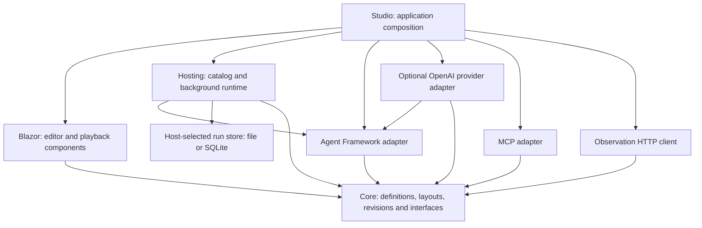
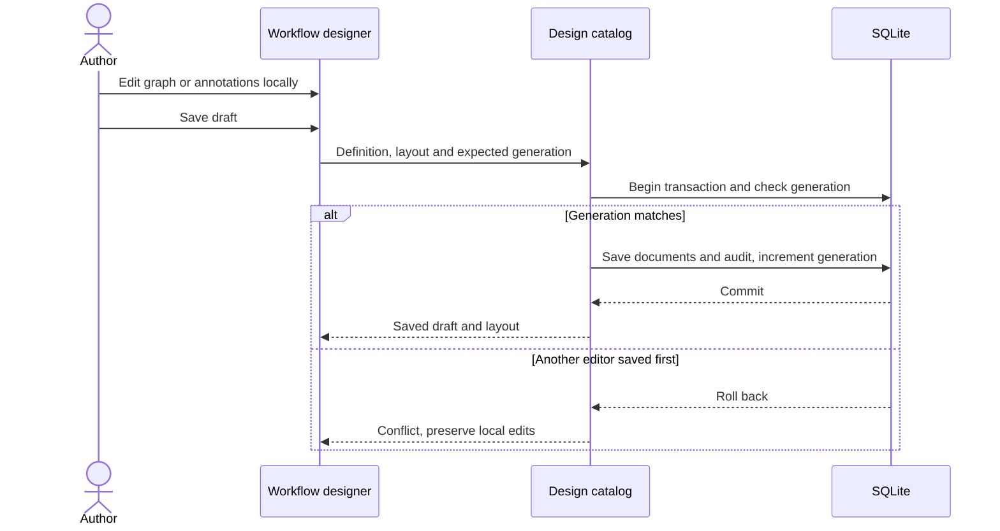
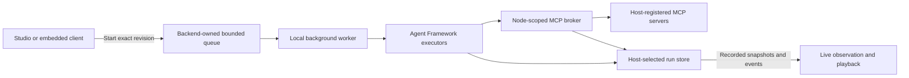
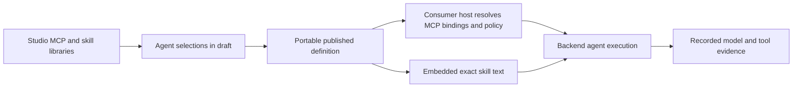

# Implemented architecture

The engine and designer are independently consumable libraries; Studio is their optional IDE and development composition. User-owned service hosting is a first-class product goal, with direct execution APIs and a local hosting helper already available; a production SDK and stable package distribution remain planned. See [service integration](service-integration.md).

The Studio is a .NET 10 Interactive Server development host that composes embeddable Blazor components, a SQLite workflow catalog, a background run queue, Microsoft Agent Framework adapters, and a node-scoped MCP broker. Execution belongs to the backend. A browser edits definitions and observes recorded evidence; closing it does not cancel a run.

This page describes shipped code. The broader [product design](design.md) includes planned distributed recovery, workspace authorization, nested and unbounded parallelism, collaboration, extensions, and reusable assets. Those are not implied by these diagrams.

## Package boundaries

The arrows below mean project dependencies, not network requests. Core has no external package dependencies. The Razor library depends on Core and rendering support, not the concrete runtime, SQLite, or MCP transport. Its CSS and graph assets are local and self-contained; theming is scoped to the component and inherited tokens without changing unrelated host controls. Studio chooses concrete services at the composition root. Its local Settings page can create, list, version, and delete OpenAI-compatible Chat Completions providers in a version-aware executor; API keys are protected in the Studio data directory and omitted from descriptors. Deletion removes a locally saved registration without checking workflow references. This local management surface inherits the development host’s loopback-only, unauthenticated boundary. Architecture tests enforce these inward boundaries.

## Editing and versioning

`WorkflowDefinition` is executable JSON. `WorkflowLayout` is separate presentation metadata for positions, labels, comments, sections, and reroutes. Layout-only edits do not change the executable content hash. The designer keeps local immutable edits and a shared undo/redo history until the user explicitly saves. The searchable library, contextual palette and output-pin creation all call validated Core graph operations. An additive UI-only `WorkflowGraphEdit` combines semantic and placement changes into one history entry; it changes no execution or artifact contract. Selected properties, multi-selection, zoom, viewport pan/reset, workspace mode and native fullscreen are view state, while completed node/group moves update presentation layout. Designer and run-inspector views share the same embeddable components and remain independent of backend run ownership.

Definition serialization sorts ID-keyed maps and normalizes indented JSON line endings to LF before hashing, so content hashes remain stable across Windows and Unix.

`IWorkflowDesignCatalog` extends the original catalog without breaking its methods. A design save writes definition, layout, generation, and audit entries in one SQLite transaction. A stale generation returns a conflict without overwriting either document. Publication captures an immutable definition/revision and layout; restoring copies a historical version into the draft. Activation selects which revision new runs use.

The database schema is version 2. Schema 1 databases migrate by adding layout tables. Older revisions without a captured layout receive deterministic default positions. The definition schema remains independent from the database and layout schemas. Schema 1.6 optionally adds up to 64 user-defined typed scalar parameters with stable IDs, display names, defaults, and bounded editorial descriptions; absent optional JSON members remain omitted so existing definition hashes are unchanged. Descriptions appear as Studio help and have no runtime effect. A `core.workflow-value` node explicitly replaces its incoming string with one resolved parameter value.

Schema 1.9 adds a bounded typed JSON entry path: the Input may declare a `json` output and connect to `core.json.select-string`, which resolves a bounded RFC 6901 pointer and emits text. Schema 1.13 adds `core.json.project`, which maps 1–16 selected JSON Pointer values into a new JSON object, and permits that JSON output to reach the workflow Output. Schema 1.14 adds a JSON-valued parallel join. Schema 1.15 adds an optional expected JSON value kind to each projected field (`string`, `number`, `integer`, `boolean`, `object`, `array`, or `null`); absent kinds preserve the prior pass-through behavior. Schema 1.16 adds recursive mapping contracts for objects and array items. Object properties name an output field, select a relative JSON Pointer, and declare a nested value kind; required missing properties fail, while explicitly optional properties are omitted. Arrays map each item through a declared item contract and are capped at 64 items. Extra object properties are omitted. A mismatch fails the projection and records the field path and expected/actual kind without recording the offending value. Mapping configuration is bounded to depth 8, 128 schema nodes, 16 properties per object, and 16,384 configuration characters. JSON payloads are limited to 16,384 characters and depth 32; projection names and pointers are bounded. JSON remains a typed graph payload rather than an agent/tool input: select a value to convert it to text before connecting to existing string nodes. There are no expressions, dynamic mappings, or arbitrary conversion nodes. Optional fields are omitted when absent, preserving earlier serialized definitions and content hashes. Core validates port compatibility, and graph editing updates connections and output types atomically.

Parameter overrides belong to a run, never its immutable published definition. The host resolves defaults and bounded caller overrides before enqueueing, rejects unknown IDs, and stores the complete effective string map in the run header for audit/playback. Workflow packages carry parameter contracts and defaults, but not run overrides or credentials. Values are not secret: consumers should not put credentials or sensitive payloads into parameters because current local run stores record them in plaintext.

## Execution and observation

A published run resolves the exact stored revision before enqueueing. The local background worker translates validated linear, conditional, and bounded parallel graphs, including JSON input, selection, and projection nodes, to real Agent Framework executors and edges. A workflow with a parallel fork uses the Agent Framework concurrent in-process environment; the fork sends the same input to two visible branch anchors, and a fan-in barrier waits for each branch endpoint before the join emits a named JSON object. Branch failure prevents a joined result; already completed external effects are not rolled back. Workflow value nodes read the run's resolved parameter map and emit the value through ordinary node/transfer evidence. The JSON selector emits one selected value as text; the projection node constructs a bounded JSON object from selected values. The text-template node combines its incoming string with bounded literal and declared-parameter parts through the same non-evaluating renderer used for agent user messages. Recorded transfer and node events retain the exact selected, projected, joined, or rendered payload. A maximum of 32 process-owned contexts share one active execution permit. Paused continuations release the permit while retaining their live framework state and admission slot. A per-run writer sequences control and executor events together; pause is acknowledged between nodes, not inside an admitted agent/tool operation. See [pause and resume](run-control.md). Actual receiver-side transfers, node invocations, model rounds, tool calls, and terminal outcomes become recorded events. If an assigned MCP tool returns successfully but the model ends without final text, the agent node completes with the last successful tool result (or a bounded success notice when that result is empty/oversized) and records `completionMode: successful-tool-result-fallback`; failed calls do not use this fallback. The viewer reconstructs those events without calling executors, models, or tools. Live and playback node cards derive a concise activity label from the current invocation’s latest model/tool event; labels contain operation names only, never event payloads.

Conditional workflows may include one bounded two-branch parallel block with named string inputs and a JSON join result. Schema 1.6 adds workflow-defined string parameters; schema 1.8 adds validated scalar types. Getter nodes pass their canonical text values through the existing string graph. Mutable variables and general object/collection ports remain unsupported. Conditions select one string output; exclusive merges pass the selected value through for shared downstream processing, while the sole Output can receive alternative terminal routes directly. Neither behavior is a parallel join. Core’s `ConditionalBlockEditing` previews and removes only single-entry/single-exit decision regions, including nested decisions; outside incoming paths cause rejection. `ParallelBlockEditing` previews and removes the complete fork-to-join region as one undoable editor change. See [conditional graphs](conditional-graphs.md) and [bounded parallel graph behavior](parallel-graphs.md). Uppercase/reverse are deterministic operations. The host's `demo.scripted` agent exercises the framework tool loop but does not interpret instructions or contact an LLM. The optional OpenAI provider adapter supplies host-configured, versioned factories through the official SDK and AI bridge; protocol tests cover its path, while credentialed live-service qualification remains outstanding. Core and Blazor have no provider SDK dependency. See [model providers](model-providers.md). MCP bindings are pinned requirements that must also pass host policy on every invocation. Tool/provider catalogs are authoring choices, not permissions.

Schema 1.7 optionally embeds reviewed text-only skill revisions and per-agent structured user-message parts, plus an optional low/medium/high reasoning effort request. Schema 1.8 adds typed scalar parameters and can expose an allowlisted choice parameter as an agent reasoning-effort input. The agent's existing `instructions` remain the system message; the user-message template resolves only incoming text and declared parameters. A run records the resolved model request, reasoning preference, and exact assigned skill IDs, versions, and content hashes. Providers advertise whether the adapter can send this option; compatible endpoints may still ignore it. Imported skill text cannot grant MCP access. Studio's local Skill library manages revisions and folders, while the published definition carries the assigned revision text; a consumer service can execute it without Studio. This is a bounded text capability, not arbitrary skill scripts or remote skill resources.

## Versioned agent profiles

Schema 1.11 embeds immutable agent-profile revisions; schema 1.12 adds optional pinned coordination-channel membership to those profiles. The local Studio Agent Designer authors and organizes profile versions, while assigning a profile snapshots its provider/version, instructions, MCP tool contract and description hashes, optional inference controls, selected skill text, and channel IDs into the workflow. Profile package requirements remain explicit; there are no endpoints, credentials, or policy grants in the profile or export.

The Microsoft Agent Framework adapter exposes each assigned profile as a request/response function on the parent. The child runs through the registered host provider and a child-specific tool scope made from that profile's exact tool bindings. The scope intersects profile requirements with the existing host authorization policy for the parent workflow node, and tools are never copied from the parent. The bounded slice allows four assigned profiles and four child executions per parent invocation, one delegation level, and 16,384-character tasks. Each child has the existing provider timeout and optional output-token cap; there is no aggregate token budget. Child events preserve run and revision, use distinct invocation IDs, and include profile identity plus parent/child correlation. The viewer replays persisted events only. See [agent profiles and bounded delegation](agent-profiles.md).

When at least two profiles are assigned, the parent also receives a team function. A call fans the same task out concurrently to all assigned profiles (maximum four) and returns an ordered JSON array with each profile's identity and output. Individual and team calls share the four-child-execution limit. A failed member cancels siblings where possible and suppresses the aggregate; already completed external effects are not undone. The aggregate is bounded to 80,000 characters. PipelineRunner serializes concurrent event writes under one run sequence gate. `agent.team.*` lifecycle events and child-correlated model/tool evidence are persisted together, and the run viewer identifies the active subagent on its parent node.

For schema-1.12 profiles, the adapter supplies `channel_send` and `channel_read` functions only to delegated children, and only for memberships in their exact immutable profile. The tool schemas enumerate those channel IDs and the board rechecks membership at invocation. Sequential `delegate_N` calls made by one parent share a transient board scoped to that parent invocation; each `team_0` call creates a separate board scoped to its unique team invocation. Neither board is shared across parent invocations or runs. Each board caps messages at 4,000 characters each, 32 per channel and 64 total. Send and read evidence is written under the child invocation; read evidence includes the ordered messages returned to the model. The event journal is the playback source. The parent model selects sequential delegates through its assigned tools; this is bounded tool orchestration, not persistent memory, shared mutable profile state, or a graph-level join. Aggregate token/time budgets remain future work.

Schema 1.10 adds an optional per-agent maximum output-token setting, bounded to 1–16,384. Definitions without it preserve the legacy 1,024-token request cap; newly edited settings are serialized into the immutable definition and recorded in `agent.started` and `model.requested` evidence. The Studio exposes provider-supported reasoning **Off** as an explicit `none` preference, distinct from leaving the setting at provider default. Adapters may send supported settings that a compatible endpoint can still ignore or clamp.

The prompt editor displays text tokens (`{{input}}` and `{{parameter:ID}}`) over the structured prompt-part contract. Its codec escapes backslashes and literal opening braces, rejects unknown/incomplete references, and does not evaluate expressions. The picker appears as an unfinished `{{` token is typed; suggestions can be reached by keyboard and selected with Enter. Only the editor representation is text; persisted definitions still store typed literal/input/parameter parts. System instructions remain a plain trusted host-authored field, so caller input is not implicitly elevated into that role.

Studio's local MCP library can connect Streamable HTTP endpoints and reports every discovered tool as supported or excluded with a schema/description reason. Only supported tools can be explicitly enabled. Agent tool arguments support nested bounded objects and arrays of `string`, `integer`, `number`, and `boolean` values, with required/optional fields, scalar enums, string/array length bounds, regex string patterns, and numeric minimum/maximum constraints. Patterns are limited to 256 characters and the .NET non-backtracking regex subset; matching has a 50 ms timeout. JSON Schema `default` is accepted as annotation metadata and is not used to make an argument optional or permit null. An omitted `additionalProperties` is normalized to `false`; omitted array bounds receive the Studio limit of 64 items. Limits are 32 declared properties per closed object, nesting depth 8, 64 array items, 8,192 characters per string, 1,024 values, 65,536 characters per call, and 16,384 characters per schema. Unsupported keywords, open/dynamic objects other than the bounded explicit `{}` map case, unions, references, and non-text MCP results remain unavailable. MCP descriptions are trimmed and limited to 2,048 characters. The discovery UI reports unsupported schema keywords and overlong descriptions instead of silently hiding a tool. New workflow bindings pin the description hash separately from the existing input/output schema hash. Legacy bindings without a description pin remain valid for compatibility. The explicit MCP graph node maps ordinary input text to the conventional `text` argument; a JSON object input can supply the supported typed arguments. The agent adapter publishes the tool's normalized discovered schema to Microsoft.Extensions.AI and passes model-produced arguments as JSON to the broker. The broker rechecks pinned hashes and recursively validates argument names, presence, values, and limits before dispatch. Its endpoint and protected bearer token remain in Studio storage. Workflow definitions and packages contain only logical tool IDs and pinned hashes; a consumer must register matching connections and host policy itself. Folder paths are authoring metadata. The broker checks a node's requested contract and effective host policy before invocation, including tools exposed to an agent. Configured servers run under the local Studio operator's trust boundary; they are not a sandbox or a production tenant boundary.

## Persistence and failure boundaries

SQLite stores drafts, immutable revisions, layouts, and catalog audit. The separate `IWorkflowRunStore` persists each run's pinned definition and execution evidence. The default file implementation publishes complete snapshots atomically; the optional SQLite implementation commits event batches with sequence/status in one transaction. Runtime/controller and read-only observers can share a host-selected store. Catalog and run stores do not share a transaction. Runtime ownership is exclusive even with SQLite concurrency checks; the ordinary local runtime interrupts unfinished runs after restart. A separate opt-in checkpoint host can explicitly rehydrate deterministic graphs saved in a suspended state. Historical payload viewing makes no live calls. See [run storage](run-storage.md) for legacy journal compatibility, store selection and failure boundaries.

The development host permits only loopback/same-origin access and refuses non-Development startup. These checks are containment, not authentication. Audit actors are development placeholders; captured text is plaintext. There is no workspace authorization, distributed ownership, transactional crash repair, encryption/redaction, approval durability, extension sandbox, or production readiness claim. See [runtime configuration](runtime-configuration.md) and [roadmap and current scope](roadmap.md) before integrating a host.

## Reuse and sharing contracts

Core supports [version-pinned pipeline expansion and portable packages](reusable-pipelines.md). Expansion creates ordinary processing nodes with fresh identities and optional schema-1.3 origin metadata. It adds no runtime source loader or new project dependency. Source updates do not mutate a consumer, and imported provenance does not authenticate an author. Exact MCP/provider requirements travel with copied nodes; host grants do not. Studio uses the same workflow catalog for reusable drafts and publications. Extraction creates a separate draft; insertion is a single local immutable composition edit, followed by normal save/publication. No additional database schema or runtime service is introduced. Package exports read a consistent saved design or an immutable publication, and import only stages local definition/layout edits. Requirement listings report registration availability rather than authorization.

## Headless service integration boundary

`VisualAgentWorkflow.Core` and `VisualAgentWorkflow.AgentFramework` do not reference the Blazor library or Studio. `WorkflowJson`/`WorkflowPackageJson`, `WorkflowRevision`, and `PipelineRunner.ExecuteAsync` already provide lower-level artifact loading and execution. The caller supplies tool/agent adapters, an event sink, run identity, and cancellation. The current `LocalWorkflowRuntime`, file journal, and SQLite catalog are optional development-host building blocks rather than a production service SDK.

The standalone consumer proof uses these public APIs without a Studio process, browser connection, or renderer. `AddLocalWorkflowRuntime` now provides shared lazy DI registration for that sample and Studio, without creating a catalog or UI dependency. Studio explicitly adds publication-aware clients and its catalog. A stable production SDK, packaged distribution, richer typed contracts, production persistence and durable recovery remain planned. See [local hosting API](hosting-sdk.md).

## Standalone consumer

`samples/WorkflowService` references Hosting/MCP and their inward dependencies, with no Blazor/Studio reference. It loads a reviewed package and reconstructs the operator-configured exact revision, resolves only host-registered dependencies, and executes directly or through the local queue. Its direct/queued modes create no authoring catalog or HTTP listener; SQLite run persistence is optional; optional `serve` mode explicitly enables the separate observation endpoint. Its journal directory has one process owner; stopped/unfinished work is cancelled or interrupted, not crash-resumed. See [service integration](service-integration.md).

## Consumer observation

Core owns the read-only `IWorkflowRunObserver` contract, summaries and cursor pages. Hosting can explicitly map a policy-protected GET-only API over a host-supplied observer; registering a runtime does not enable it. Observation.Http depends only on Core and implements bounded HTTP reads. Studio server configuration supplies named remote sources and credentials, while `WorkflowObservationPanel` in Blazor consumes only the observer contract. A consumer can embed that same panel directly over its journal or an HTTP observer. Read requests never enter execution or control services. The development example provides single-operator bearer authentication; production identity, per-run visibility and access audit remain host concerns. See [consumer observation](observation.md) for limits and data flow.

## Approval gates

Schema 1.5 approval nodes immediately precede a pinned MCP tool. The adapter captures the exact input/tool/revision plus a reserved target invocation ID. The process-owned controller persists the request, releases its execution permit while waiting, sequences a host-attributed decision and reacquires the permit only when approved and not paused. The next tool invocation consumes the reserved identity and still passes broker authorization. The browser owns no continuation, and the separate observation API gains no mutation authority. Requests persist as evidence, not crash-restorable checkpoints. See [approvals](approvals.md).

## Deterministic checkpoint host

`CheckpointWorkflowHost` is a separate opt-in consumer API over SQLite and the adapter's native Agent Framework JSON checkpoint path. It commits bounded native state, capture/suspension evidence and the current status together; explicit recovery validates the exact latest checkpoint/cursor and rebuilds identical executors without replaying completed nodes. Only deterministic linear/conditional graphs are admitted. It does not change Studio's process-owned queue, and model/MCP/approval recovery remains excluded. Both built-in stores now provide an exclusive local owner handle honored by the ordinary runtime and checkpoint host, while observers read independently. Run-database schema 2 adds checkpoint storage; the authoring catalog is unchanged. See [recovery scope and ownership](checkpoint-recovery.md).

## Read-only recovery disposition

Core's optional `IWorkflowRunReconciliationObserver` supplies cursor-bound metadata without changing the original observer contract. A pure work projection preserves unsettled model/tool/approval facts even after terminal status; new model/tool call IDs distinguish repeated calls without changing event envelopes. Hosting combines that evidence with checkpoint validation; SQLite reads both under one transaction. The protected observation group adds only a GET assessment route, and the Core-only HTTP client plus embeddable reconciliation panel validate identity/cursor alignment. The observation panel suppresses stale eligibility on source changes or outage and keeps assessment independent of playback. It neither grants ownership nor triggers execution or operator decisions. See [run reconciliation](run-reconciliation.md).
