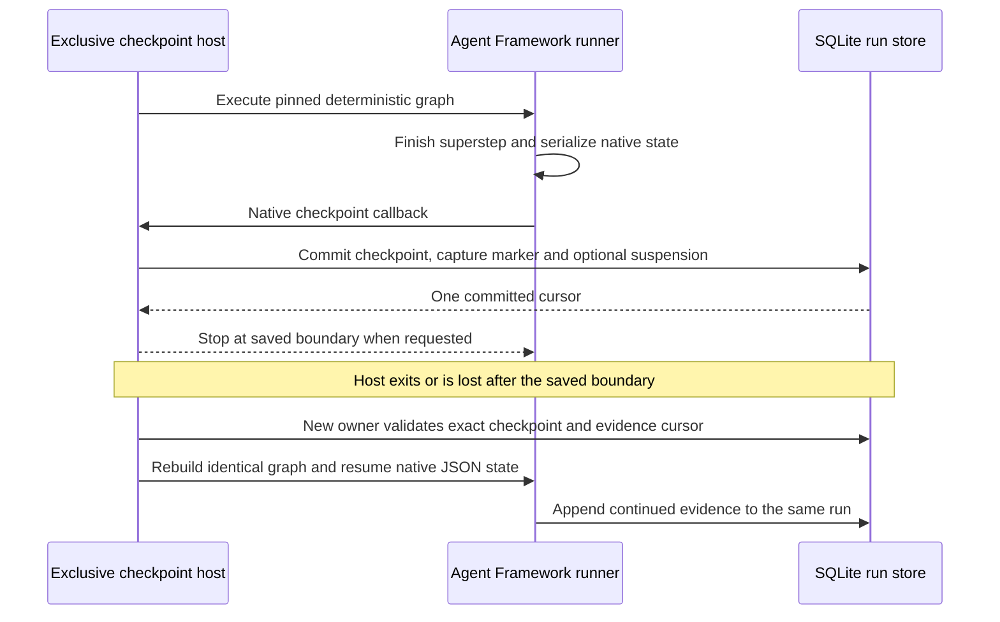

# Deterministic checkpoints and explicit recovery

`CheckpointWorkflowHost` is an opt-in consumer API for saving and explicitly resuming deterministic workflows through **native Microsoft Agent Framework JSON checkpoints**. It uses the same run identity, pinned revision and audit history after host replacement. It does not rerun completed nodes or reconstruct execution from UI events. This path is separate from Studio's process-owned `LocalWorkflowRuntime` queue.

Supported graphs contain only input/output, uppercase/reverse, ordinal conditions and exclusive merges. The host rejects the entire graph before admission if it includes an agent, MCP tool or approval, including an unchosen branch. External outcomes, model sessions and approval holds need a separate recovery policy. No checkpoint API is exposed in Studio, the development workflow HTTP API or the read-only observation API.

Schema 1.45 loop-variable workflows remain rejected by this host. Core contains
a proof-only composite frame that binds native JSON state, a loop cursor, the
definition-bound variable snapshot, and the exact evidence prefix with hashes;
it is not an admission path or an alternate scheduler. A test-only durable
proof now stores that frame with the checkpoint/evidence transaction and
resumes the loop from independent test processes, preserving the evidence
prefix and variable versions without duplicating the committed write. This
proves a cross-process serializer/storage boundary, not production loop
admission: cancellation/failure races, repeated recovery, process loss, and
the remaining admission restrictions are still open. See [decision
0031](decisions/0031-loop-checkpoint-proof-frame.md).

## Use the host API

```csharp
var store = new SqliteWorkflowRunStore("data/checkpoint-runs.sqlite3");
Guid runId;
string checkpointId;
await using (var firstHost = new CheckpointWorkflowHost(store))
{
    var saved = await firstHost.StartAsync(revision, "abc", suspendAfterCompletedNodes: 2);
    runId = saved.Header.RunId;
    checkpointId = store.GetCheckpoint(runId)!.Native.CheckpointId;
}

// Reopen in another process/host after the first owner has stopped.
await using var nextHost = new CheckpointWorkflowHost(
    new SqliteWorkflowRunStore("data/checkpoint-runs.sqlite3"));
var completed = await nextHost.ResumeAsync(runId, checkpointId);
```

The suspension threshold is a **cumulative completed-node count**, including input, conditions and merges. Recovery may request a later threshold; it must advance completed work. The output boundary completes instead of suspending, and a threshold beyond the executed path simply allows completion. This is deliberate checkpoint suspension, not the existing in-process pause command. A suspended checkpoint run has no live framework continuation and requires this host API to resume.

Calls on one checkpoint host execute serially. Each resume requires the expected checkpoint identity, checks admission again after acquiring execution ownership, and refuses terminal, stale, incompatible or advanced histories. Cancellation of active work records cancellation where storage remains writable; a saved suspension already committed before cancellation remains saved. `DisposeAsync` cancels active/queued calls and waits for execution to stop before releasing local ownership.

## Save and restore contract



The framework callback runs before the next superstep is scheduled. A requested suspension commits the checkpoint and suspension evidence, then aborts scheduling at that saved boundary. The adapter consumes that internal stop signal without fabricating failure/cancellation events. Resume rebuilds the identical executor IDs/topology and invokes native `ResumeStreamingAsync`; no alternate scheduler or event-log replay is used.

`WorkflowRunCheckpoint` is a trusted local envelope with schema `1.0`, adapter/framework runtime stamp, run/revision/content identities, final audit sequence, native session/checkpoint/parent identifiers, bounded JSON state and SHA-256 payload hash. Native state is at most 1 MiB. It is **runtime-specific execution data**, not a portable workflow package; never accept it through workflow import or browser JSON editing. The hash detects accidental mismatch, not malicious database tampering. Checkpoint payloads are plaintext and must receive the same access controls as run inputs/results.

`IWorkflowCheckpointStore.CommitCheckpoint` publishes the latest checkpoint pointer with its event/state transition in one SQLite transaction. If publication fails after event insertion, all changes roll back. Capture events contain identity/hash/runtime metadata rather than the full native blob; `run.suspended` and `run.recovered` make the lifecycle visible to existing snapshots and playback. Only the latest frame is executable; this API does not permit arbitrary historical rewind or forking.

Recovery requires all of the following:

- Supported deterministic definition and exact run, revision, definition hash, checkpoint schema and runtime stamp.
- Correct native session identity, bounded valid JSON and matching payload checksum.
- The saved cursor equals the current last event, and the latest event explicitly records suspension.
- Started invocations have matching completed boundaries, with no unresolved work.
- The caller names the exact current checkpoint and holds exclusive local runtime ownership.

The recovery marker is persisted before native execution begins. If evidence advances beyond the saved checkpoint and the host crashes, the API refuses to replay from the older frame. This conservative policy also rejects interrupted/cancelled/failed runs, ordinary in-process pauses and arbitrary native frames. A commit acknowledgement failure can still be ambiguous: inspect/reconcile stored evidence rather than blindly retrying execution.

## Local ownership and ordinary runtime behavior

Built-in file and SQLite stores now implement `ILocalRuntimeOwnershipStore`. The ordinary runtime and checkpoint host hold an OS-backed exclusive file handle for their lifetime. Another owner fails before startup interruption or execution; read-only observers remain available. Cleanup is idempotent and must not interrupt a later owner's runs. Stop timeouts do not release ownership underneath active writers. Process loss releases the OS handle; the ownership file itself remains and must **never be deleted to steal ownership**.

This protects cooperating local hosts using the same path. It is not a distributed lease, fencing token, authentication boundary, network-share guarantee or protection against aliases/non-cooperating writers. Custom stores must implement the ownership capability or enforce their own exclusive-owner contract. Hosts must serialize lifecycle start/stop and stop old binaries before upgrade; older binaries do not participate in the new lock protocol.

Studio and ordinary `LocalWorkflowRuntime` still mark unfinished work interrupted on startup. **Do not start either against a checkpoint host's database to observe it**: that intentionally applies interruption semantics to suspended work after ownership is released. Instead register `JournalRunObserver.FromStore(store)` directly and optionally map the existing policy-protected observation API without starting a local runtime. Observation and recorded playback neither resume a checkpoint nor require provider/model registration.

## Database and runtime compatibility

The dedicated SQLite run database migrates schema 1 to **schema 2** transactionally by adding `run_checkpoints`, then schema 2 to **schema 3** by adding the separate `reconciliation_decisions` table; existing headers, events, and checkpoints remain unchanged. Workflow definitions, portable packages, layout and authoring-catalog schemas do not change. Older run-store binaries reject schema 2 or 3 and cannot be used for downgrade. Back up and stop all writers before upgrade.

The current native format stamp is `agent-framework/1.26.0;vaw-adapter/1`. Package or adapter changes must explicitly review checkpoint compatibility and update that stamp when needed. There is no cross-version native-state migration guarantee. Historical snapshots remain inspectable without deserializing/executing the native checkpoint.

## Standalone proof and verification

The sample exposes two explicit CLI modes (paths below are relative to `samples/WorkflowService`):

```sh
dotnet run --configuration Release -- checkpoint artifacts/pure.deployment.json /tmp/checkpoint-runs.sqlite3 abc 2
dotnet run --configuration Release -- recover /tmp/checkpoint-runs.sqlite3 RUN_ID CHECKPOINT_ID
```

Use the actual IDs printed by the first command. The optional `--hold` suffix keeps the saved boundary's owner alive for the process-loss check. CLI commands do not configure or contact models/MCP servers. `checkpoint` rejects an external-node package before creating the database. The sample's existing direct/queued/paused/serve modes retain their previous behavior.

`python3 scripts/checkpoint_smoke.py --dotnet /path/to/dotnet` owns a temporary database and child processes. It saves a real native checkpoint, verifies a second owner cannot mutate it, forcibly kills the first owner, resumes in a fresh process and checks unchanged revision/hash, sequenced evidence, exact output and no duplicate node invocations. It rejects terminal/stale requests and external graphs. The process-loss script runs on Linux in CI; .NET ownership/recovery tests run on Windows/Linux.

Native and hosting tests additionally cover both conditional paths, repeated suspensions, payload/runtime/schema/identity mismatch, advanced evidence, observer visibility, checkpoint/event rollback, schema-1 migration and old-owner cleanup after ownership transfer. These tests establish the bounded explicit saved-suspension path, **not arbitrary-crash recovery, automatic takeover, external effects, durable approvals or production readiness**.

The implementation was checked against the official [`dotnet-1.26.0` source](https://github.com/microsoft/agent-framework/tree/9c8a3514a15a702f81bfda456d80c7ccaa4d2712/dotnet), particularly `CheckpointAndRehydrate`, `CheckpointManager.CreateJson`, `ICheckpointStore<JsonElement>` and the runner's superstep callback, and compiled/executed against the pinned packages. Public checkpoint keys require explicit session/checkpoint IDs; sample/internal constructors are not assumed callable. No live credentials or external service calls were used.


## Inspect before recovery

The optional [read-only reconciliation assessment](run-reconciliation.md) explains saved, advanced, invalid and unsettled evidence without invoking recovery. Checkpoint admission now also rejects ambiguous or unsettled work correlation. A returned `CanResume` value is not an ownership grant; `ResumeAsync` still validates the exact current frame under the exclusive host. The sample's checkpoint/recover JSON includes the assessment without native state.
