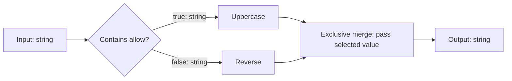

# Conditional string graphs

Schema 1.4 adds deterministic conditional routing and exclusive merges to the existing string workflow contracts. Every run follows one path through an acyclic graph. This is not parallel execution, a loop engine or general-purpose scripting.

The diagram shows a configured example. Adding a condition creates only the condition and the merge; each branch initially passes the input through unchanged.



## Execution contract

A `core.condition` node declares implementation version `1.0.0` and a `condition` object. It evaluates its current input once, passes the unchanged text through exactly one output (`true` or `false`), and records `branch.selected`. The other output does not deliver a message or execute downstream nodes. Unchosen MCP/agent nodes do not acquire tool scopes or make calls. Deployment preflight may still require every declared dependency to be available; the standalone sample deliberately checks all requirements before admission.

| Operator | Meaning |
| --- | --- |
| `equals` | Exact ordinal, case-sensitive equality |
| `contains` | Ordinal, case-sensitive substring search |
| `starts-with` | Ordinal, case-sensitive prefix comparison |
| `is-empty` | Input length is zero; operand must be empty |

Operands are bounded to 1,024 characters. Empty operands for equals/contains/starts-with follow .NET ordinal string semantics: every string contains and starts with the empty string. These are approved pure functions, not expressions, scripts, regexes, URLs or capability grants.

```json
{
  "type": "core.condition",
  "typeVersion": "1.0.0",
  "condition": { "operator": "contains", "operand": "allow" }
}
```

`core.merge` version `1.0.0` accepts 2–16 alternative incoming connections on `in` and immediately passes the selected incoming string through `out`. It does not wait for the unchosen arm. Since no node broadcasts and cycles are forbidden, a run has one flowing value, and each visited node executes at most once. Nested and sequential conditionals use the same rules.

`WorkflowPorts` provides explicit port IDs and data types. Input has `out: string`; output has `in: string`; processing and merge nodes have string `in`/`out`; conditions have string `in` and string `true`/`false` outputs. The labels true/false select a route; their payload is still text, not a Boolean value. Additional payload types and separate execution pulses are not implemented.

## Validation and compatibility

Exactly one input and output are required. Every node must be reachable from the input; every output port connects exactly once, and only merges accept multiple incoming connections. Cycles, dangling references, duplicate connections, missing or duplicate branch arms, unknown ports, unsupported predicates, implicit joins and generic fan-out are rejected. A valid finite graph always reaches the sole output. Limits remain 256 nodes; schema 1.4 permits up to 510 connections, while schemas 1.0–1.3 retain the 255-connection limit.

Old definition schemas and hashes remain supported. The optional condition property is omitted when absent; old serialized nodes do not gain null properties. New condition/merge types require schema 1.4. Origin metadata from schema 1.3 is also valid in 1.4. Layout schema 1.0, package format 1.0 and SQLite schema 2 remain unchanged. Packages declare the new node implementation requirements. Older consumers must reject unsupported schema/types rather than silently flattening a graph.

`WorkflowGraph.OrderedNodes` returns a deterministic topological order for display and analysis. It is not an execution schedule. Linear-only `PipelineEditing` and reusable pipeline operations reject routing graphs rather than turning that order into a sequence. Complete conditional workflows can be saved, published, restored and shared as packages; extracting/inserting conditional prefab blocks is not implemented.

## Author in Studio or embedded designer

1. Create/open a draft. On a connected output, choose **+ Condition after out** (or a true/false output). This inserts a condition and an exclusive merge in one undoable edit. Both branches initially connect directly to the merge, so no unrequested operations appear. Existing node identities and unrelated connections remain stable.
2. Set **Condition operator for …** and **Condition operand for …** on the condition card. To make the branches do different work, choose an operation on the condition and add a node after its true or false output. Tools and agents retain node-local requirements and host authorization.
3. Use **+ Add node after …** to extend an arm, **Remove** to remove a processing node, or another conditional insertion to nest a decision. Removing the condition/merge as a whole block and arbitrary socket rewiring are not yet exposed. Linear move-up/down controls are hidden for routing graphs because display order does not define execution order.
4. Use **Arrange nodes** for a graph-aware starting layout, then freely position cards, add comments/sections or route wires. True/false sockets have distinct measured edge positions. Graph geometry never changes the predicate or route semantics.
5. Save, publish and run the selected exact version. Exercise inputs taking both outcomes. Editing a draft or publishing a newer version does not change a run's pinned definition.

The designer keeps the existing validated-edit model. Unsupported changes fail without replacing the draft; import/API validation returns graph diagnostics. There is no transient invalid wiring editor or expression-language editor in this milestone. Existing linear workflows retain their insertion, removal and reorder controls.

## Observation and playback

`branch.selected` records the selected output port with run/revision, node and invocation identity. A decision is not proof of downstream delivery: `connection.received` is still recorded when the target executor receives the message. A cancellation after selection can therefore leave a decision without a highlighted downstream edge.

The viewer shows **Selected output: true/false** only after that decision's recorded position. It highlights only actual received connections. Unvisited nodes retain their unexecuted state. Scrubbing never evaluates a predicate, invokes a node or changes recorded evidence. The same captured schema/events pass through the read-only [consumer observation API](observation.md). Remote viewing still uses default positions unless a host supplies a separate layout.

Pause/resume checks remain before every visited node and before final completion. Pausing does not admit the next selected node, and resume continues the same live framework execution. Restart still interrupts unfinished runs; graph routing does not add checkpoints or durable recovery.

## Framework mapping and evidence

The adapter uses a private message envelope containing text and trusted source node/port metadata. It maps each platform connection to `WorkflowBuilder.AddEdge<T>(source, target, condition)` in Microsoft Agent Framework 1.26.0. Predicates inspect the already selected source port; the platform does not implement another scheduler. Receiver-side source metadata identifies the actual incoming connection at a merge. Provider inputs/outputs and public run inputs/outputs remain bounded strings; the private envelope is never serialized into workflow artifacts.

Version-matched evidence: [official conditional-edge sample](https://github.com/microsoft/agent-framework/blob/9c8a3514a15a702f81bfda456d80c7ccaa4d2712/dotnet/samples/03-workflows/ConditionalEdges/01_EdgeCondition/Program.cs) at the peeled `dotnet-1.26.0` tag, commit `9c8a3514a15a702f81bfda456d80c7ccaa4d2712`, plus the installed package XML API documentation. The official sample's live Azure/model calls were not run. Local tests exercise the released .NET package with deterministic operations and fixtures.

`ConditionalGraphTests` covers validation, ordinal predicates, immutable edits and package/compatibility behavior. `ConditionalExecutionTests` proves both paths, actual merge transfers, unchosen-tool isolation, nested decisions and cancellation before the selected arm. `python3 scripts/conditional_graph_smoke.py` exercises the real designer, sockets, undo/redo, publication, both outcomes, package export/reload, pinned versions and recorded playback. These checks do not establish parallel joins, approvals, live-model reliability or production recovery.

## Approval nodes in schema 1.5

Schema 1.5 retains these routing semantics and permits an exact-action approval immediately before an explicit MCP node, including on a selected arm. An unchosen arm requests no approval. Approval nodes do not introduce true/false decision outputs; rejection stops the run. See [approvals](approvals.md).
