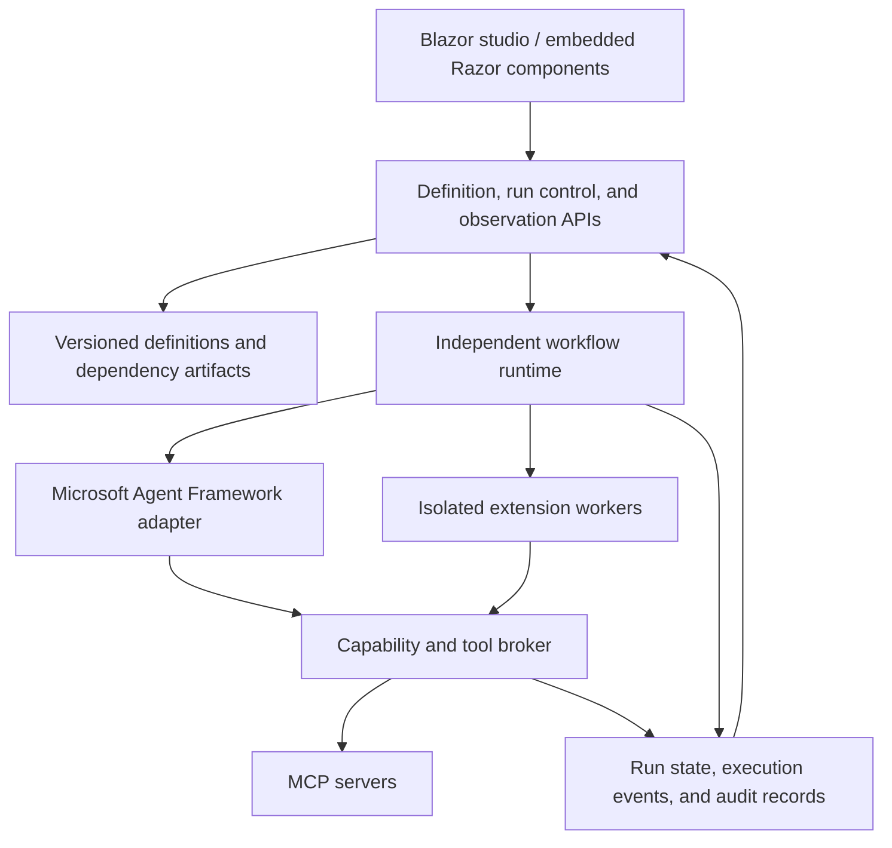

# Visual Agent Workflow design

## Status and purpose

This document captures the product direction and architectural decisions discussed for this repository. It is a design baseline, not a claim that these capabilities are implemented or production validated. API names and serialization examples are illustrative. Changes to this design should record their rationale and compatibility implications.

Build a C#/.NET platform that lets people design agentic workflows visually, execute them independently of the editor, and inspect live or historical execution in the same graph. Provide a standalone Blazor application and reusable Razor components that integrating applications can embed.

Users must also be able to build and host their own services around these workflows. Treat Visual Agent Workflow as an optional IDE and an independently consumable execution platform: author in Studio or an embedded designer, publish a portable artifact, and invoke the engine from a user-owned .NET service, worker, job, or application. The production service must not require Studio, a Blazor circuit, or a running designer. See [service integration](service-integration.md) for current APIs and the hosting SDK delivery goal.

Aim for broad extensibility, with explicit, validated execution semantics. Supporting arbitrary future patterns is an extension goal; production support must be defined and tested for each supported operation.

## Product principles

- Microsoft Agent Framework is the intended agent and workflow execution foundation.
- The browser is an editor and observer. Runs must outlive browser connections and UI processes.
- Blueprint-style visual scripting is the default authoring model. General-purpose user scripting is not part of the initial design.
- MCP servers are the primary providers of external tools and side effects.
- Capabilities are granted explicitly, scoped to nodes, and enforced on every invocation by the backend.
- Published definitions and dependencies are immutable and identifiable.
- Execution evidence drives live visualization and recorded playback.
- The standalone studio consumes the same public component APIs offered to integrating applications.
- The workflow engine is a first-class library for user-owned services. Studio is an optional IDE, and editor embedding and engine embedding are independent choices.
- Hosts own inbound triggers, public service contracts, identity, configuration, capability grants, storage, and execution lifetime. A workflow artifact declares behavior and requirements; it does not provision an endpoint, transfer credentials, or grant tools.

## Architecture



### User-owned service deployment goal

Support three independently usable surfaces: the engine/runtime SDK, reusable designer/observability components, and the standalone Studio IDE. An application can use the engine without either UI, embed the designer and use its own backend, or run a separate workflow execution service with optional remote observation.

A host can invoke workflows from its own controller, message consumer, webhook handler, scheduler, background job, CLI, or application method. The initial service-integration proof should use supported string inputs/outputs; richer typed service contracts follow explicit schema support. Public endpoint and trigger configuration belong to the host rather than becoming arbitrary network capabilities inside an imported graph.

Deployment uses reviewed, version-pinned definitions/packages and host-side dependency resolution. Each run captures its resolved revision and dependency identities. Replacing a deployment changes future runs, not in-flight or historical runs. Authoring catalogs and SQLite are optional deployment choices; a service should also be able to load its approved artifact from its own release/configuration mechanism. Environment credentials, MCP connection factories, and policy remain with the service host.

### Proposed packages

| Package | Responsibility |
| --- | --- |
| `VisualAgentWorkflow.Core` | Definition models, schemas, node contracts, validation, execution-event contracts |
| `VisualAgentWorkflow.AgentFramework` | Translation to Agent Framework executors/workflows and runtime instrumentation |
| `VisualAgentWorkflow.Blazor` | Embeddable studio, designer, run viewer, inspectors, and customization points |
| `VisualAgentWorkflow.Hosting` | Backend APIs, run management, storage integration, tool brokering, and event delivery |
| `VisualAgentWorkflow.Studio` | Standalone Blazor application using the public packages |

Keep persistence, authorization, credential resolution, tool discovery, and runtime access behind host-configurable interfaces. Support a backend in the consuming application or a separately hosted service. Embedding components must not require hosting execution in the UI process.

The adapter isolates framework-specific APIs from stored definitions and UI contracts. Validate supported Agent Framework features against pinned package versions before committing public contracts. Do not introduce a competing orchestration engine accidentally; platform nodes must have documented mappings to framework execution semantics.

## Visual authoring

Borrow Unreal Blueprints interactions: typed pins, searchable node creation, drag-to-connect, zoom/pan, comments, grouping, undo/redo, and reusable subgraphs. Use agent/workflow semantics rather than assuming Unreal execution semantics apply directly.

Initial node categories:

| Category | Examples |
| --- | --- |
| Data | Constants, typed objects, field selection, list operations |
| Computation | Arithmetic, comparison, text transformation, validation |
| Control flow | Branch, switch, bounded loop, parallel branches, join |
| Agents | Agent invocation, instructions, assigned skills and tools |
| External operations | Explicitly granted MCP tool invocation |
| Interaction | Human approval, wait for input |
| Composition | Versioned prefab/subworkflow invocation |
| Extensions | Host-approved .NET node implementations |

Define data flow, execution dependencies, and configuration references explicitly. A connection must have one documented meaning; visual proximity must never imply execution behavior. Specify join policy, loop bounds, error propagation, ordering, cancellation, and retry behavior before implementing each control node.

Provide configuration editors, input/output inspectors, semantic diagnostics, and compatibility errors. Keep layout-library models out of persisted execution contracts. Evaluate Blazor.Diagrams as a canvas foundation, including realistic graph sizes and streamed updates. Decide interaction hosting based on measured responsiveness rather than assuming every pointer movement can tolerate server round trips.

## Independent execution and durability

Each run binds to an immutable published workflow revision and resolved dependency set. Editing or activating another revision affects subsequent runs only. Active-run modification is not an implicit editor feature; any future intervention mechanism needs a separate contract and audit trail.

Pause/resume is cooperative at explicit safe boundaries. An admitted operation finishes before pause acknowledgement; resuming preserves the same run and pinned definition without replaying completed work. Pause must not be interpreted as rollback of external effects. Durable pause across worker restart requires persisted continuation state, ownership and recovery policy. The current development implementation supports process-owned node boundaries only; see [implemented run control](run-control.md).

Start, cancel, approve, and supported pause/resume actions are authenticated backend commands. UI disconnection does not cancel execution. Persist run state and events so observers can reconnect, retrieve a consistent snapshot, and receive events after their last cursor without gaps. Define snapshot/stream ordering and deduplication explicitly.

Browser independence and worker crash recovery are separate requirements. Use supported Agent Framework checkpointing or durable execution integrations where appropriate, with persisted waits and approvals. Verify recovery behavior rather than assuming every executor or external call is resumable.

Production behavior must cover:

- Durable state, worker ownership, recovery, and cancellation propagation.
- Timeouts, bounded loops, concurrency limits, backpressure, payload limits, and execution budgets.
- Explicit retry policies, idempotency keys where supported, and deduplication.
- External actions whose outcome is unknown after a timeout or crash, with reconciliation paths.
- Approval identity, scope, expiration, and binding to the exact requested action.
- Tenant isolation, authorization, secret handling, operational telemetry, backup, and retention.

Do not promise universal exactly-once external side effects. A tool can complete externally before its response or checkpoint is persisted. Recovery must distinguish safe retries from uncertain outcomes.

## MCP tools and node-scoped capabilities

Register MCP server connections centrally with host-managed authentication and policy. Designers select permitted server/tool bindings for individual nodes. A connected server is not automatically available to every node, agent, function, or prefab.

Use logical tool bindings in definitions. At runtime, resolve them to authorized MCP tools through a broker. Do not expose credentials, raw unrestricted MCP clients, arbitrary server connection APIs, or general-purpose HTTP access to user-authored behavior.

Every invocation must verify the published node requirements, host grants, caller policy, and any applicable parent restrictions. Nested invocations must not increase authority. Sharing or importing a definition never grants access.

The broker applies argument/resource restrictions, approvals, timeouts, concurrency and usage budgets, retry policy, and audit capture. MCP is a protocol, not a security boundary; server trust and downstream permissions remain material.

Pin tool contract fingerprints in release metadata and validate drift. A fingerprint detects schema changes but cannot freeze an external server's implementation. Define compatibility policy for changed or unavailable tools.

For API integrations, users can provide MCP servers wrapping the API. A later OpenAPI-backed MCP connector may expose administrator-approved operations and authentication. Avoid a generic unrestricted URL-calling tool.

Platform logging, cancellation, controlled clock/randomness, and workflow state are internal services and need not be exposed as MCP tools.

## Skills

Assign skills to specific agents through the designer. Skills can contain versioned instructions, parameters, and supporting resources. Published workflows pin their skill versions.

Skill attachment does not grant tool permissions. Skill content that describes an operation must still operate within the receiving agent's explicitly authorized capabilities. Define a concrete skill package format and supported resource behavior during implementation; do not assume every external skill format has identical execution semantics.

## Prefabs and reusable components

A prefab is a reusable agent or subworkflow with typed inputs/outputs, declared configurable parameters, internal nodes/connections, and required capabilities.

- Save immutable versions with stable identity and provenance.
- Instances pin a version and permit only declared overrides.
- Updates are explicit, with a diff and compatibility validation.
- Support detaching an instance into an independent editable copy.
- Permit nested prefabs while rejecting circular dependencies.
- Resolve and retain dependency definitions with published workflows for inspection and playback.

Editing a prefab creates a new version; it does not silently alter existing consumers. A containing workflow must explicitly supply authorized capability bindings required by the prefab.

## Custom .NET extensions and sandboxing

Developers may supply versioned packages containing assemblies that implement approved node contracts. Packages describe stable type IDs, implementation versions, input/output schemas, configuration, required capabilities, execution handlers, and validation behavior.

The designer generates ports and configuration controls from approved metadata. Publication pins exact package versions and artifact hashes. Node execution must use the same capability and audit infrastructure as built-in nodes.

Installation is an administrative/deployment action, not an immediate DLL-upload-and-execute feature:

| Source | Intended handling |
| --- | --- |
| Host-trusted developer extension | Installed through the host's deployment process; any in-process execution explicitly trusts the code with process authority |
| User-supplied assembly | Reviewed/approved and executed in an isolated worker under host policy |

A restricted context object is an API boundary, not a security sandbox. Roslyn, interface implementation, assembly allowlists, and `AssemblyLoadContext` do not prevent arbitrary .NET side effects.

User extension workers require an appropriate isolation boundary, no host secrets, restricted filesystems, no direct external network access, resource limits, and a narrowly authenticated broker channel. Worker identity must be bound to the invocation so code cannot impersonate another node when requesting tools. Isolation strength must match the trust model; mutually untrusted tenants may require stronger boundaries than shared containers.

General-purpose C# scripting is deferred. User-authored workflows use visual operations; specialized C# behavior arrives through approved extensions or MCP servers. Prefer pure computation where possible and declare side-effecting capabilities explicitly.

## Execution history, audit, and recorded playback

Persist execution history independently of the UI. Events should identify:

- Run and immutable workflow revision.
- Node and distinct invocation, including prefab instance scope.
- Parent invocation, message correlation, branch/loop iteration, and retry attempt where applicable.
- Event identity, sequence/cursor, timestamps, and causal relationships.
- Node lifecycle, actual routing/message transfer, input/output references, errors, approvals, and tool activity.
- Relevant implementation, model, and tool identity/configuration, subject to policy.

Distinguish observed facts from inferred visualization. A node completion does not establish which edge carried a message. Instrument actual transfers and correlate them to invocations. Parallel event ordering is not automatically a causal ordering.

Keep execution history and administrative audit conceptually separate:

| Record | Purpose |
| --- | --- |
| Execution history | Reconstruct what a run executed, with which inputs, outputs, routes, and outcomes |
| Audit log | Attribute changes, publication, permissions, run controls, approvals, and sensitive-data access to actors |

Both use append-only records; corrections are new entries. Define controlled retention/deletion separately from record mutation, and add tamper-evident storage where audit requirements demand it. Apply redaction, encryption, access control, and payload-size limits. Large payloads belong in referenced artifact storage.

The same graph viewer supports Live and Recorded Playback modes. Recorded playback permits pause, speed adjustment, stepping, scrubbing, and invocation inspection. It must never execute nodes, load extension DLLs, or call models/tools. Save sufficient graph metadata and resolved prefab information to inspect old runs without executable dependencies.

Playback is reconstruction of recorded evidence, not deterministic re-execution. Redacted, expired, truncated, or unrecorded content must be visibly marked. Show uncertain external outcomes accurately. Re-execution from a checkpoint and testing against recorded tool responses are separate features with separate side-effect semantics.

## Workflow versions and releases

- Drafts are editable working copies with autosave and conflict detection.
- Saved revisions record author, time, description, and parent/merge lineage.
- Published revisions are immutable, validated release artifacts.
- Loading an older/newer revision supports viewing, comparison, or creating a draft, subject to schema compatibility.
- Restoring an old revision creates a new draft/revision rather than rewriting history.
- Activation chooses the published revision used by new runs.
- Existing runs retain their original revision and dependencies.

For example, restoring version 2 after version 5 creates version 6 containing the restored definition. Versions 3–5 and their execution histories remain available.

Pin node implementation versions, configuration schemas, skills, prefabs, and extension artifacts. Missing or incompatible dependencies produce explicit errors. Schema migration creates a new draft and preserves the original. Playback remains available from stored evidence even when execution dependencies are unavailable.

Promote the same immutable release across environments using separately authorized environment bindings. Record relevant resolved binding metadata for each run without copying credentials into definitions or logs.

## Sharing, collaboration, and source control

Organize definitions and reusable assets into workspaces/projects. Enforce roles such as viewer, editor, runner, publisher, and administrator on the backend. Workflow-definition access and execution-payload access may require different permissions.

Sharing supports pinned references to catalog assets and independent copies/forks with provenance. Export bundles include dependency manifests, never credentials. Imports validate content and require explicit mapping to authorized local capabilities. Imported extension references must not trigger automatic assembly installation or loading.

Start collaborative drafts with optimistic concurrency and explicit conflicts; never silently overwrite another editor's changes. Later add presence, selections, comments, and real-time operations using a server-authoritative log. Define conflicts such as deletion versus connection creation. Undo should reverse the user's operations without reverting others' changes.

Support branching, visual comparison, and semantic merging. Compatible changes may merge automatically; conflicting port, configuration, or dependency changes require resolution and revalidation.

Design serialization for Git from the beginning. Git commits capture deliberate reviewable snapshots, while collaboration operations capture editing activity. Do not commit every drag operation. A future integration should validate definitions/dependencies in CI and explicitly define import/export ownership and conflict behavior rather than allowing two silent sources of truth.

## Serialization

Use platform-owned versioned JSON documents validated against JSON Schema. Do not serialize Agent Framework runtime instances, diagram-library objects, delegates, credentials, or arbitrary CLR type metadata.

### Bundle structure

| Document | Contents |
| --- | --- |
| `workflow.json` | Executable nodes/connections, input/output schemas, configuration, capability requirements |
| `layout.json` | Node positions, viewport, groups, and visual annotations |
| `dependencies.lock.json` | Exact dependencies, artifact hashes, and tool contract fingerprints |
| `manifest.json` | Bundle identity and document/resource references |

Keep layout separate so moving nodes does not obscure behavior changes. Published revisions retain the associated layout snapshot. Execution events, audit records, payload artifacts, collaboration operations, and runtime checkpoints are separate records, not mutations to `workflow.json`.

### Illustrative definition fragment

This fragment demonstrates identifiers and bindings; it is not a complete runnable workflow or a finalized schema.

```json
{
  "schemaVersion": "1.0",
  "workflowId": "wf_customer-review",
  "entryNodeId": "node_input",
  "inputs": {
    "type": "object",
    "properties": {
      "customerId": { "type": "string" }
    },
    "required": ["customerId"],
    "additionalProperties": false
  },
  "nodes": {
    "node_input": {
      "type": "core.input",
      "typeVersion": "1.0.0",
      "configuration": {}
    },
    "node_lookup": {
      "type": "core.mcp-tool",
      "typeVersion": "1.0.0",
      "configuration": {
        "binding": "customerLookup"
      }
    }
  },
  "connections": {
    "connection_customer": {
      "source": {
        "nodeId": "node_input",
        "portId": "customerId"
      },
      "target": {
        "nodeId": "node_lookup",
        "portId": "customerId"
      },
      "kind": "data"
    }
  },
  "capabilityRequirements": {
    "customerLookup": {
      "kind": "mcp-tool",
      "contract": "crm.get-customer",
      "contractVersion": "1.0"
    }
  }
}
```

### Format rules

- Stable IDs survive renaming and layout changes. References use IDs, not display names.
- Registered type IDs resolve only to approved implementations. Documents cannot instantiate arbitrary CLR types.
- Use deterministic formatting and defined canonicalization for hashes. Sort unordered ID-keyed collections; preserve arrays whose order affects semantics.
- Distinguish document schema versions, revision identities, node versions, and dependency versions.
- Represent expressions/mappings as structured approved operations, not hidden executable strings. Prompt strings remain agent instructions, not trusted executable code.
- Define supported data types, nullability, numeric precision, schema compatibility, and payload limits before freezing the public schema.
- Reject unsupported schema versions clearly; migrate through explicit, tested transformations into new drafts.

JSON Schema validates structure. Semantic validation additionally checks IDs/references, port compatibility, entry/output definitions, control flow, limits, dependencies, capability requirements, and runtime compatibility. Import validation must also constrain resource paths and sizes.

## Delivery and validation

### First vertical slice

Implement Input → Agent → Conditional Branch → Approval → MCP Tool → Output, alongside a deterministic mock provider. Include save/load, typed connection validation, immutable revision selection, cancellation, live invocation states, actual route evidence, payload inspection, and recorded playback.

Demonstrate the standalone Studio, a separate consuming Blazor app embedding the public components, and a separate headless .NET service/worker invoking an artifact through the engine without any UI dependencies. Confirm runs continue after UI disconnection and reconnect without missing events.

### Architecture proof before broad expansion

Exercise a pinned skill, reusable versioned subworkflow, node-scoped MCP permissions, durable approval, and worker recovery together. Test unauthorized tool calls, duplicate delivery, tool timeout with uncertain outcome, incompatible tool contract changes, dependency absence, and redacted playback.

### Subsequent milestones

1. Parallel joins, bounded loops, nested prefabs, richer data transformations, and supported checkpoint recovery.
2. Workspace sharing, catalog assets, portable import/export, revision comparison, and deployment promotion.
3. Approved .NET extension SDK and isolated workers with verified containment.
4. Branching, semantic merge, Git integration, and simultaneous editing.
5. Operational hardening, scale tests, recovery exercises, retention controls, and documented production support boundaries.

Build permissions, auditability, stable identities, and concurrency-safe persistence into the first slice; do not retrofit their foundations at later milestones. Do not describe a release as production ready until supported failure modes and operational requirements have been tested.

## Research references and open decisions

Primary references reviewed during design:

- [Microsoft Agent Framework](https://github.com/microsoft/agent-framework): intended runtime foundation.
- [.NET workflow samples](https://github.com/microsoft/agent-framework/tree/main/dotnet/samples/03-workflows) and [streaming example](https://github.com/microsoft/agent-framework/blob/main/dotnet/samples/03-workflows/_StartHere/01_Streaming/Program.cs): workflow patterns and observable execution.
- [.NET DevUI](https://github.com/microsoft/agent-framework/tree/main/dotnet/src/Microsoft.Agents.AI.DevUI): development testing/debugging reference; not assumed to supply our authoring product.
- [Elsa Workflows / Studio](https://github.com/elsa-workflows/elsa-core): alternative .NET workflow/Blazor designer architecture using its own execution model.
- [Blazor.Diagrams](https://github.com/Blazor-Diagrams/Blazor.Diagrams): candidate canvas library.
- [Langflow](https://github.com/langflow-ai/langflow), [AutoGen Studio](https://github.com/microsoft/autogen/tree/main/python/packages/autogen-studio), and [Flowise](https://github.com/FlowiseAI/Flowise): visual-authoring references, not selected dependencies. Maintenance status must be rechecked before adoption.

Open implementation decisions include the supported .NET/framework versions, precise Agent Framework mappings and durability integration, storage and event transport, canvas/render hosting, schema/type system, tool-contract compatibility policy, extension SDK/isolation technology, and collaboration protocol. Resolve these with small proofs and documented decisions rather than treating illustrative names here as settled APIs.

## Consumer-owned observation boundary

A consumer explicitly opts into a read-only observation endpoint and supplies its authentication, visibility and storage policies. Studio can attach to approved consumer endpoints; the live/historical graph view is independently embeddable in consumer applications. Observation credentials grant no authoring or execution-control authority, and disconnecting an observer never changes execution lifetime. The [initial implementation](observation.md) provides named server-side Studio sources and a shared observer component; production identity/delegation, centralized access auditing and scalable stores remain separate work.
