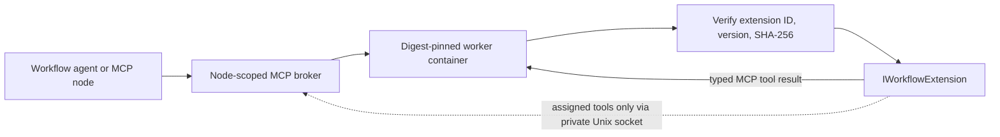

# Isolated .NET extensions

An extension assembly can implement a deterministic operation and expose it as one or more typed MCP tools. The consumer host packages the assembly in a reviewed worker image and pins its identity; the workflow engine never loads user assemblies.



## Implement the extension contract

The current extension contract lives in `VisualAgentWorkflow.Mcp`. It uses the MCP SDK's typed tool declarations, so each operation exposes a concrete input schema through `McpServerTool`:

```csharp
public sealed class MathWorkflowExtension : IWorkflowExtension
{
    public WorkflowExtensionDescriptor Descriptor { get; } = new("acme.math", "1.2.0");

    public IReadOnlyList<McpServerTool> CreateTools(IWorkflowExtensionContext context)
    {
        var tools = new MathTools(context);
        return [
            McpServerTool.Create(typeof(MathTools).GetMethod(nameof(MathTools.Add))!, tools),
            McpServerTool.Create(typeof(MathTools).GetMethod(nameof(MathTools.AddViaHostTool))!, tools)
        ];
    }
}
```

Tool methods declare normal typed arguments and return values. Each published tool name must begin with the extension ID followed by a period, and the extension can expose at most eight unique operations. The worker verifies that the loaded assembly has exactly one extension implementation and that its declared ID/version match the host pin.

`IWorkflowExtensionContext` exposes only `ListToolsAsync` and `InvokeMcpToolAsync`. The host worker implements this context over the brokered Unix socket. The returned list contains only tool bindings present in the active workflow node's requirements and currently allowed by host policy. Every call is dispatched by the regular broker, which checks the exact contract, current node grant, call budget, timeout and audit writer. Capability calls inherit the active run, revision, node, and invocation identity; audit events carry the parent tool-call ID. A worker cannot grant itself or chain through another capability-enabled worker.

## Pin and host an artifact

Build the extension into a reviewed image using the isolated worker image layout. The current sample expects one assembly at `/app/extensions/extension.dll`; the image itself must also be pinned by an immutable OCI digest.

```csharp
var artifact = new WorkflowExtensionArtifact(
    "acme.math",
    "1.2.0",
    "<64-lowercase-hex-sha256-of-extension.dll>");

var registration = ContainerMcpToolRegistration.Create(
    "extension.math.add",
    "Acme math · add",
    "acme-math-worker",
    "acme.math.add",
    new ContainerMcpServerOptions(
        "registry.example/acme/math-worker@sha256:<64-lowercase-image-digest>")
    {
        AllowInvocation = true,
        ExtensionArtifact = artifact,
        CapabilityBindingIds = ["math.add"]
    });
```

Register this binding alongside the `math.add` MCP capability with the consumer's `McpToolBroker`. Add both logical bindings to the agent node's requirements and provide separate host grants for that exact workflow/node pair. The image digest and extension hash are operator-owned deployment configuration, never imported workflow permissions. For an extension that does not need other tools, omit `CapabilityBindingIds`; the worker then gets no broker socket mount.

The extension hash protects the assembly bytes loaded from the image, while the image digest pins the complete worker environment. The host operator remains responsible for reviewing and approving the image and assembly. Publisher signatures, a Studio extension catalog, dynamic upload, assembly-specific configuration forms, and artifact revocation management are not implemented. Do not treat a digest as proof that code is trustworthy.

## Trust and execution limits

The assembly loads inside the disposable container, never inside Studio, the workflow engine, or the consumer process. The worker retains the container boundary described in [containerized MCP workers](extension-workers.md): network disabled, read-only root, no inherited environment, non-root identity, dropped Linux capabilities, bounded resources, and only bounded temporary storage. If configured, its sole host mount is the read-only capability socket directory. The socket grants only the configured subset of node tools and cannot access host credentials or arbitrary host services.

Containers share the host kernel. Docker Engine, the runtime, the kernel, the image and its reviewed assembly remain trusted. This is not a hostile multi-tenant sandbox. The current worker loads one assembly per image, starts a fresh worker for each MCP connection, and uses no process pool or durable retry. A canceled or failed call does not imply that external side effects were rolled back.

## Verification

`samples/ExtensionMathPlugin` demonstrates typed addition and an extension operation that calls one separately assigned host tool. `scripts/container_mcp_smoke.py` builds a temporary image with the extension, computes the expected assembly digest, checks its manifest at worker startup, invokes both operations through the real MCP broker, and verifies that the nested call is authorized and audited. The Linux CI integration job runs the actual Docker test. This cloud workspace could not fetch the pinned ASP.NET base image, so the complete image-based proof remains dependent on a passing CI run.
