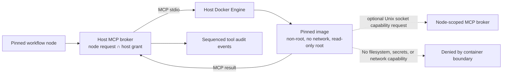

# Containerized MCP extension workers

This increment lets a consumer host register an MCP tool implemented by a digest-pinned container image. Workflow execution continues through the normal node-scoped `INodeToolBroker`; definitions and packages contain only logical tool IDs and contract hashes. Host registration remains outside the workflow artifact, and selecting a tool in a workflow never installs or launches an image by itself.



## Host configuration

Register each tool with its logical binding ID and an immutable container image identity:

```csharp
var options = new ContainerMcpServerOptions(
    "ghcr.io/example/number-tools@sha256:<64-lowercase-hex-digest>")
{
    AllowInvocation = true,
    CapabilityBindingIds = ["math.add"]
};

var add = ContainerMcpToolRegistration.Create(
    "custom.add", "Number tools · add", "number-tools", "add_integers", options);
var broker = new McpToolBroker([add], hostToolPolicy);
services.AddSingleton<INodeToolBroker>(broker);
```

The worker can request one of its explicitly configured host capabilities through the worker-side client:

```csharp
using var arguments = JsonDocument.Parse("{\"left\":20,\"right\":22}");
var result = await new McpWorkerCapabilityClient()
    .InvokeJsonAsync("math.add", arguments.RootElement, cancellationToken);
```

Capability IDs are the intersection of the host registration's `CapabilityBindingIds` and the active node's pinned tool requirements. `ListToolsAsync` returns only bindings currently allowed by the host policy. Every request goes through the regular broker again, which rechecks the current registration, pinned schema/description, node grant, input/output bounds, timeout and audit writer. Calls are bound to the active run/revision/node/invocation by a host-created scope; the worker cannot supply or change those identities. At most eight capability IDs can be configured, and capability delegation is limited to one level to prevent cycles and unbounded recursive calls. A worker does not receive endpoint credentials.

`AllowInvocation` opts the registered service into discovery/dispatch. It does not grant a workflow node access. The workflow must still declare the binding and the host's `IToolAuthorizationPolicy` must grant that exact workflow/node/binding tuple. MCP schema and contract checks remain in `McpToolBroker`. The Studio's current connection form is for Streamable HTTP; container registrations are host-code configuration in this increment.

The Docker CLI launches a fresh disposable container per connection with `--network=none`, a read-only root filesystem, no inherited environment, all Linux capabilities dropped, `no-new-privileges`, non-root UID/GID 65532, 256 MiB memory/no swap, one CPU, 64 processes, 128 open files, and a 16 MiB no-exec temporary filesystem. By default there are no host mounts. If brokered capabilities are configured, the host mounts one read-only directory containing only a private Unix socket; that socket accepts bounded requests and exposes no filesystem or network access. Docker image pulls are disabled for invocation. The host should pull/review the image through its deployment process before enabling the binding. The MCP broker's invocation timeout cancels the channel and disposes the worker process.

The worker may perform deterministic computation, use its private temporary space, and request only separately assigned MCP capabilities from the host broker. It cannot call arbitrary HTTP APIs, read host files, or access host credentials through this registration. A worker can only use a tool if it is both listed in `CapabilityBindingIds`, pinned as a requirement on the active node, and currently permitted by the host's node grant. Chained worker capabilities are denied; a worker cannot call another capability-enabled worker. Audit evidence records each nested MCP call under the active workflow invocation and playback remains read-only.

## Trust boundary and limitations

This is process/container isolation, not a promise that arbitrary hostile native code is safe. The Docker Engine, container runtime, Linux kernel, pinned image contents, and host administrator remain trusted. Images must be reviewed; use a dedicated or rootless worker daemon where possible, keep the runtime patched, and do not treat shared-kernel containers as a mutually untrusted multi-tenant boundary. A consumer that cannot meet this host trust model should keep extension code in an independently operated MCP service or disable the feature.

The worker is an MCP server executable baked into the image. An operator may also pin one .NET extension assembly in that image; the sample worker verifies its SHA-256 hash and version before loading it inside the container. The engine and Studio never load the assembly. Direct assembly upload, dynamic discovery from untrusted registries, a user-facing container catalog, Windows-native isolation, per-workspace identity, health pools, and durable retries remain unsupported. Brokered Unix-socket capabilities and extension loading currently require a local Linux Docker Engine; arbitrary remote daemon mounts and Windows workers are not supported. See [isolated .NET extensions](extension-assemblies.md) for the contract and sample.

## Verification

`samples/IsolatedMcpServer` exposes deterministic addition, an isolated extension loader, and a boundary probe. `samples/ExtensionMathPlugin` builds an extension with typed MCP operations; `python3 scripts/container_mcp_smoke.py` publishes both fixtures, pins the extension SHA-256, builds the Docker image from a pinned ASP.NET runtime digest, and invokes the operations through the real MCP broker. The probe asserts that host secrets and paths are absent, direct network access and writes to the image root are denied, the bounded temporary filesystem remains writable, and an extension can call its one assigned nested MCP capability. The Linux integration workflow runs this check. Ordinary Windows/Linux unit suites still compile and exercise the socket protocol and artifact validation; Docker runtime containment is Linux-integration-only today. This environment could not complete the image pull because the configured Docker daemon returned `Forbidden`; a passing Linux CI run is still required to establish the runtime proof.
