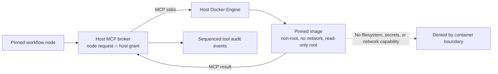

# Containerized MCP extension workers

This increment lets a consumer host register an MCP tool implemented by a digest-pinned container image. Workflow execution continues through the normal node-scoped `INodeToolBroker`; definitions and packages contain only logical tool IDs and contract hashes. Host registration remains outside the workflow artifact, and selecting a tool in a workflow never installs or launches an image by itself.



## Host configuration

Register each tool with its logical binding ID and an immutable container image identity:

```csharp
var options = new ContainerMcpServerOptions(
    "ghcr.io/example/number-tools@sha256:<64-lowercase-hex-digest>")
{
    AllowInvocation = true
};

var add = ContainerMcpToolRegistration.Create(
    "custom.add", "Number tools · add", "number-tools", "add_integers", options);
var broker = new McpToolBroker([add], hostToolPolicy);
services.AddSingleton<INodeToolBroker>(broker);
```

`AllowInvocation` opts the registered service into discovery/dispatch. It does not grant a workflow node access. The workflow must still declare the binding and the host's `IToolAuthorizationPolicy` must grant that exact workflow/node/binding tuple. MCP schema and contract checks remain in `McpToolBroker`. The Studio's current connection form is for Streamable HTTP; container registrations are host-code configuration in this increment.

The Docker CLI launches a fresh disposable container per connection with `--network=none`, a read-only root filesystem, no inherited environment, no host mounts, all Linux capabilities dropped, `no-new-privileges`, non-root UID/GID 65532, 256 MiB memory/no swap, one CPU, 64 processes, 128 open files, and a 16 MiB no-exec temporary filesystem. Docker image pulls are disabled for invocation. The host should pull/review the image through its deployment process before enabling the binding. The MCP broker's invocation timeout kills an overdue child process.

The worker may perform deterministic computation and use its private temporary space. It cannot call arbitrary HTTP APIs, read host files, or access host credentials through this registration. To use external services, register those services as separate MCP capabilities and have the workflow invoke them through separately authorized nodes. A brokered extension-to-MCP capability channel is not implemented yet.

## Trust boundary and limitations

This is process/container isolation, not a promise that arbitrary hostile native code is safe. The Docker Engine, container runtime, Linux kernel, pinned image contents, and host administrator remain trusted. Images must be reviewed; use a dedicated or rootless worker daemon where possible, keep the runtime patched, and do not treat shared-kernel containers as a mutually untrusted multi-tenant boundary. A consumer that cannot meet this host trust model should keep extension code in an independently operated MCP service or disable the feature.

The worker is an MCP server executable baked into the image, not a DLL loaded by Visual Agent Workflow. Direct assembly upload, dynamic discovery from untrusted registries, a user-facing container catalog, brokered worker capabilities, Windows-native isolation, per-workspace identity, health pools, and durable retries remain unsupported. A Windows host can use a separately configured Linux Docker Engine only when its operator supplies the required Docker CLI/context configuration; this path is not yet covered by the Windows CI job.

## Verification

`samples/IsolatedMcpServer` exposes deterministic addition and a boundary probe. `python3 scripts/container_mcp_smoke.py` publishes the fixture, builds the Docker image from a pinned ASP.NET runtime digest, and invokes it through the real MCP broker. The probe asserts that host secrets and paths are absent, direct network access and writes to the image root are denied, and the bounded temporary filesystem remains writable. The Linux integration workflow runs this check. Ordinary Windows/Linux unit suites still compile and execute the container configuration and immutable image/argument validation tests; Docker runtime containment is Linux-integration-only today. This environment could not complete the image pull because the configured Docker daemon returned `Forbidden`; a passing Linux CI run is still required to establish the runtime proof.
