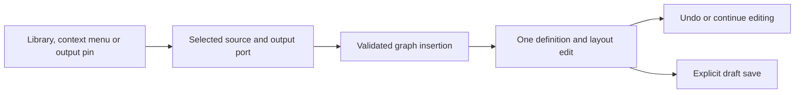

# Blueprint-style graph editing

## Reference research

Epic's current documentation pages (Connecting Nodes, Nodes, and the Blueprint Editor Cheat Sheet) were blocked by this environment's proxy during research. The following accessible references were inspected instead:

- [Archived Epic Wiki: Blueprint Fundamentals](https://github.com/MichaelJCole/wiki.unrealengine.com/blob/5f5d1dfc7542ba3e826f959986cf540d288091ed/docs/Blueprint_Fundamentals/README.md): direction and type of pins, left-to-right connected flow, and named comment blocks around selected nodes. Linked screenshot hosts were also blocked; this is a historical UE4 reference, not a visual verification of current UE5.
- [Unreal SGraphPin reference](https://github.com/folgerwang/UnrealEngine/blob/release/Engine/Source/Editor/GraphEditor/Private/SGraphPin.cpp): input pin before its label on the left; output pin after its label on the right; connected/unconnected and type-specific pin styling.
- [Unreal reroute-knot contract](https://github.com/folgerwang/UnrealEngine/blob/release/Engine/Source/Editor/BlueprintGraph/Classes/K2Node_Knot.h): pass-through control points used to organize wires, not compiler-relevant executable work.

These inform interaction conventions. No Unreal source code or artwork is incorporated into this project. Legacy workflow schemas use data links to carry values and activate downstream processing. Explicit schemas display separate typed data and execution wires. Schema 1.23 is a direct Input-to-Output route with pure constant/concatenation data nodes. Schema 1.24 adds one Boolean Branch with an ordinal string comparison; schema 1.25 adds Boolean constants and Boolean NOT. The explicit branch proof still has two statically wired outcomes: true to Output, false to failure termination. It does not imply arbitrary branch fan-out, reconvergence, or mixed legacy/explicit semantics. Schema 1.4 conditions in legacy graphs continue to expose true/false string outputs.

## Portable presentation model

`WorkflowLayout` schema `1.0` is a separate presentation artifact. It stores node coordinates, user labels and comments, wire style and ordered waypoints with optional pinned tangent angles, and named sections with explicit node membership. Moving nodes, adding comments, and routing wires do not change executable definitions, capability grants, event evidence, or `WorkflowJson` content hashes.

Positions are finite and bounded to 0–32768 logical canvas units. Limits are 160 characters per label, 4000 per comment, 32 waypoints per wire, and 64 sections. A node belongs to at most one section. Sections are organizational only, not runnable subgraphs or prefabs. Curved-wire tangent angles are clockwise screen degrees [0,360); orthogonal wires accept multiples of 90 only. Duplicate/unknown JSON properties and invalid references are rejected. Layout edits never become executable nodes.

`IWorkflowDesignCatalog` extends the optional host contract without changing existing `IWorkflowCatalog` methods. Its design save updates definition and layout under one expected generation and SQLite transaction. An explicit save records `draft.saved` and `layout.saved`; the latter identifies the presentation hash. Publishing snapshots layout with the immutable revision; restoring restores both. Older catalogs/revisions without layout use deterministic default positions. Definition-only API saves preserve annotations for surviving node IDs and prune routes/sections whose references disappear.

SQLite schema 2 adds presentation tables to schema 1 without changing existing definitions, generations, revisions, or hashes. The development database remains single-host and unauthenticated, as documented in [roadmap and current scope](roadmap.md).

## Creation workbench

Studio opens the **Designer** workspace with a full-width authoring area. **Run inspector** holds quick-run controls, history and recorded playback. Components remain mounted across view changes; selection and local edits persist. The searchable **Node library** contains deterministic transformations, complete conditional blocks, eligible approval steps, and host-registered MCP tools/agent providers. Registration is an authoring choice, never an execution grant. New drafts begin with connected Input and Output.

Click an action to insert on the selected path and open downstream space. Drag a library entry to choose its position; dropping onto a wire selects that exact insertion path. Right-click opens a searchable contextual palette, with duplicate/delete actions on eligible processing nodes and reroute/disconnect actions on wires. Space or Shift+F10 provides a keyboard alternative. Drag an output pin to a compatible input pin to connect or rewire; the input highlights during a compatible drag. A new connection replaces the wire on that output and the wire on that input, if present. Drag an output pin to empty canvas to open creation for its existing edge, including distinct true/false paths. Canceling the preview/menu saves nothing. Modern browsers with the Popover API support contextual menus; the persistent node library provides the primary creation controls.

The editor can save incomplete drafts so users can disconnect and repair graphs incrementally. A validation panel lists every outstanding issue, and publish/run operations remain blocked until validation succeeds. Definition, layout, and package exports are disabled until the graph validates. Draft canvas ordering is only for display and safely includes disconnected or cyclic nodes; it is never used as runtime execution order.

Graph additions produce a UI-only `WorkflowGraphEdit` containing definition and layout, allowing one undo operation to restore both. This is not a runtime command or new serialization schema. Compact cards hold readable summaries; the selected-node inspector holds configuration and complete comments. Duplicate copies executable configuration with a fresh identity; it does not copy host grants.

## Canvas controls

The reusable `WorkflowGraphCanvas` renders left-edge input sockets and right-edge output sockets, measured from the actual rendered nodes. Wires use SVG geometry and keep following the pins when cards change size. Legacy graph links are string data pins; legacy conditions expose distinct true/false sockets backed by real exclusive routing. Explicit graph schemas draw typed execution and data pins separately. Schema 1.24 adds a Boolean Branch with a typed Boolean data input; schema 1.25 adds typed Boolean constant and NOT nodes. The current proof graph has a single prescribed route to Output or failure termination. Do not connect legacy condition semantics into explicit graphs.

- Drag a node header to place it freely. Arrow keys move by 8 units; Shift moves by 40. Numeric X/Y fields provide an alternative. Placing nodes does not change the connected execution order; the existing move-up/down operations still reorder execution.
- Scroll or drag empty graph background to pan. Zoom controls change the view, not stored coordinates. Coordinate conversion accounts for zoom and scroll. Pointer cancellation restores the preview rather than saving an accidental move.
- Double-click a wire to add a reroute waypoint, or use **Add reroute point** in the inspector. Drag or keyboard-nudge the point. Curved routes support automatic or pinned tangent angles (presets and custom degrees); right-angle routes constrain tangents to multiples of 90. Resetting a route removes its presentation waypoints, not the connection.
- Open **Labels, comments, sections, and wire routing** to set a node label/comment. Identity and executable type remain stable. Text is rendered as text, not HTML, Markdown, or instructions to an agent.
- Select section members using the inspector checkboxes, enter a label, and group them. Frames fit their explicit members automatically. Drag the section header to move its nodes together in one undoable edit. Rename or ungroup from the inspector. Sections do not nest, execute, or infer membership merely because a node happens to overlap them. Pinned wire points remain in graph coordinates when a section moves. **Arrange nodes** retains annotations/sections and wire styles but clears reroute points; the whole operation is undoable.

**Fit graph** changes only zoom/scroll. **Fullscreen graph** uses native browser fullscreen and includes the library, selected properties and toolbar (save/publish/undo or playback). Escape exits and restores focus; denied requests show an inline explanation. An embedding iframe must permit fullscreen. Fullscreen Tab navigation stays inside the expanded graph. Disposal removes browser listeners without canceling backend execution.

Node positions, annotations, groups, and routes share the designer’s undo/redo history with semantic edits. Saves are explicit. A completed drag creates one edit; transient browser pointer previews do not stream commands to the backend. Publish and restore preserve layout with its revision. Preview and run playback are read-only. The Studio fetches the recorded revision's layout for playback; template/ad-hoc runs and pre-layout revisions use default positions. Legacy wire completion uses recorded transfers; explicit data wires use recorded `data.evaluated` events and connection IDs, while execution routes use recorded `execution.activated` events. Playback never infers or reevaluates a value from graph geometry.

JSON definition export remains compatible. Separate layout export/import controls share the JSON editor and provide `workflow.layout.json`; importing validates IDs against the current definition and does not publish or execute anything. Consuming hosts implement `IWorkflowDesignCatalog` for persistence; hosts implementing only the older catalog retain semantic editing with presentation editing disabled.

## Verification and scope

`python3 scripts/workbench_smoke.py --browser-executable /path/to/chromium --screenshots /tmp/workbench` covers blank creation, library and contextual actions, drag placement, pin creation, undo/deletion, compact properties, fit, native fullscreen/focus/rejection, view switching, filtering and recorded playback.

`python3 scripts/graph_canvas_smoke.py --browser-executable /path/to/chromium` exercises real mouse/keyboard moves, socket alignment, shared undo/redo, labels/comments, grouped movement, reroute creation/dragging, pinned/right-angle geometry, zoom conversion, save/reload, stale-write denial, publication, immutable version preview/restore, and recorded-layout playback. `--screenshots DIRECTORY` captures the tested UI. CI runs it alongside the existing authoring and UI-skill checks.

Core/storage tests cover bounded imports, canonical layout round trips, immutable definition hashes, stale writes and rollback, schema-1 migration, revision capture, restore, and safe annotation rendering with no execution services. These do not establish complete accessibility or production readiness. Parallel branches, nested sections, collaborative live dragging, and graph virtualization remain future work.

Conditional insertion and predicate/arm editing use validated semantic operations. Port identities drive wire geometry, and topological display order is distinct from execution. See [conditional graphs](conditional-graphs.md).
