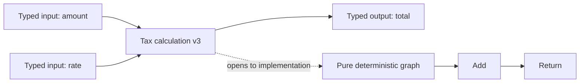
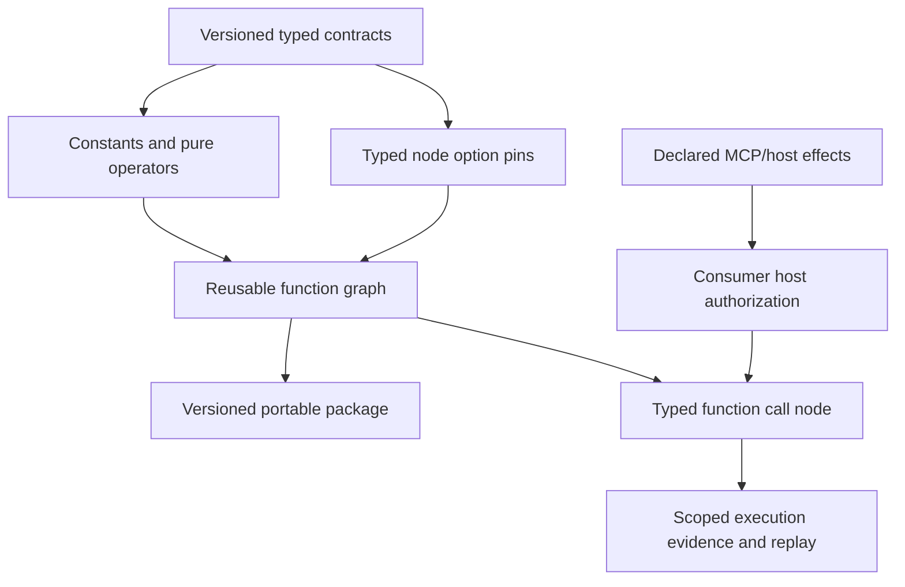

# Deterministic visual programming and reusable graph functions

This is a planned product capability, not a current claim. Today the graph engine supports string and bounded JSON data pins, deterministic text/JSON nodes, conditions, bounded loops, parallel blocks, and versioned workflow parameters. The toolbox should grow into a safe visual programming language for deterministic work, with reusable, packaged functions that feel like small integrated circuits.

For the source-grounded Blueprint concepts, capability map, scope boundaries, and project adaptations, see the [Unreal Blueprint design reference](https://github.com/gnalvesteffer/visual-agent-workflow/blob/main/docs/unreal-blueprint-reference.md). Treat that document's capability targets as roadmap guidance; shipped behavior remains defined by this repo's architecture and focused contracts.

## Blueprint-inspired, adapted for workflows

Adopt Unreal Blueprint's visible, composable dataflow philosophy while making execution rules explicit for server workflows. Do not copy game-frame concepts such as Actors, Tick, latent world state, or engine object references. The visual language should grow through validated node types, never arbitrary source execution.

The planned toolbox includes:

- Typed literals/constants and workflow inputs for strings, booleans, integers, numbers, enums, records/structs, and bounded arrays/maps where their JSON representation is stable.
- Arithmetic, comparison, Boolean, text, collection, and explicit conversion nodes. Type conversions must be visible; no implicit coercion.
- Control flow such as Branch, Select, Switch, Sequence, bounded For/ForEach/While, early return, and explicit success/failure exits. Every loop has a validated maximum; cancellation and run-wide execution limits still apply.
- Variables with explicit get/set nodes and declared scope. Start with immutable values. Mutable state must specify lifetime and parallel branch isolation/merge behavior before it is offered.
- Pure functions that only transform declared inputs, and effectful functions whose MCP/host capabilities are declared as dependencies and checked by host policy.
- Reusable function graphs with named, typed input/output pins, like an integrated circuit. A caller sees a compact function node with its contract; opening it reveals the implementation graph.

Events should initially mean a host-triggered workflow invocation or an explicit graph signal within one run. No hidden background listener or frame loop is implied. Asynchronous work must be an explicit awaited node with a cancellation/timeout contract.

## Reusable function asset contract

A function asset has a stable logical ID, immutable version, content hash, input/output schema, purity/effect declaration, bounded graph definition, and dependency manifest. Function-call nodes pin an exact version and hash. Export packages include the function definitions and their transitive function dependencies, but never credentials or host permission grants. Consumers register required MCP/host capabilities separately, just as they do for workflow packages. Upgrade is a reviewed draft edit; old published runs retain the exact embedded/pinned implementation. Recursion and dynamic function lookup are rejected initially; expansion depth, node count, collection sizes, and serialized payloads are bounded.

This is different from calling another workflow: reusable functions are small typed graph subroutines whose contract is inputs/outputs and declared effects. Workflow calls remain orchestration boundaries with run-level parameter mapping, audit scope, and workflow outcomes. The package model may share implementation primitives, but the Studio should make the distinction clear.

## Safety, determinism, and audit

- Validate node configuration, pin IDs, types, graph topology, dependencies, and budgets before publish and again before execution.
- Bound graph expansion, recursion (initially reject it), loop iterations, collection sizes, nesting depth, payload sizes, and total node visits.
- Make pure nodes deterministic and side-effect free. Clock, randomness, filesystem, network, and external services require explicit capability nodes or declared effectful function dependencies; hosts authorize those independently.
- Record function ID/version/hash, invocation scope, inputs/outputs according to the consumer's audit policy, elapsed time, and failure reason. Replay reads evidence and never invokes the function again.
- Keep secret values out of embedded function/workflow definitions and normal payload logs. A future redaction policy must be explicit and versioned.
- Parallel branches may read immutable inputs. Mutable writes require branch-local state and an explicit merge policy; shared last-writer-wins state is not acceptable.

## Delivery sequence

1. Expand a versioned type registry for bounded scalar and JSON contracts, with stable serialization and compatibility rules.
2. Add typed constant/literal nodes and a small pure operator set with exhaustive deterministic tests.
3. Expose selected node options as typed pins, with visible defaults and validation errors for incompatible connections.
4. Add declared record/enum/collection types and workflow parameter bindings where there is a clear portability need.
5. Add immutable scoped variable reads/writes only after concurrency, loop, nested workflow, and replay semantics are specified.
6. Add a function-graph asset format, editor/preview, immutable versions, package manifests, call node, dependency resolution, and end-to-end replay tests.
7. Add broader control constructs in small bounded increments, with UX tests for rewiring, invalid drafts, and understandable validation messages.

Related: [architecture](architecture.md), [current graph limits](conditional-graphs.md), [roadmap](roadmap.md), [agent results and budgets](agent-results-and-budgets.md), and [reusable workflows](reusable-pipelines.md).
