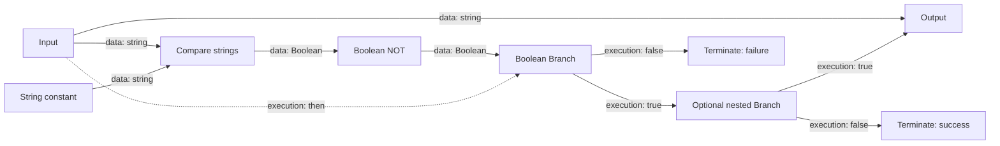
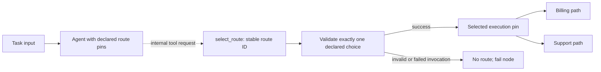
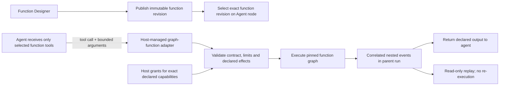
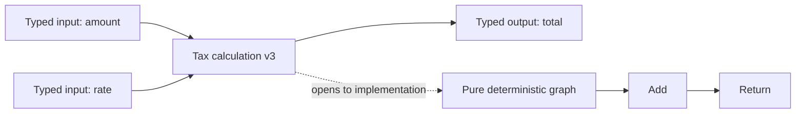
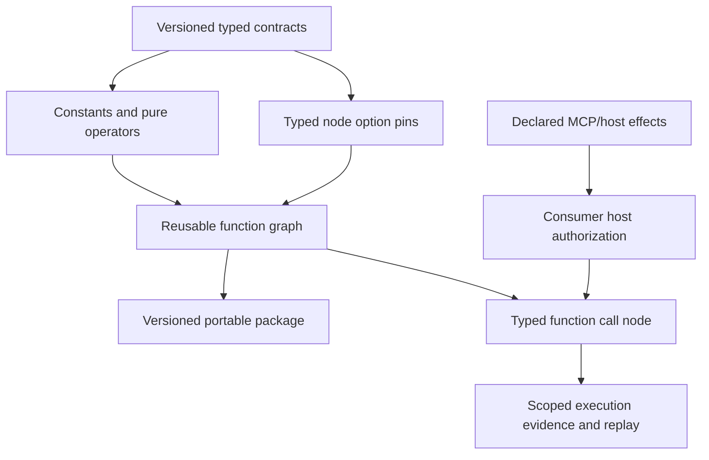

# Deterministic visual programming and reusable graph functions

This is an active product capability, not a claim that the full Blueprint-style language exists. The graph engine supports string and bounded JSON values, deterministic text/JSON nodes, conditions, bounded loops, parallel blocks, and versioned workflow parameters. Schema 1.23 separates execution edges from pure data dependencies. Schema 1.24 adds ordinal, case-sensitive string equality and a Boolean Branch. Schema 1.25 adds an explicit Boolean constant and Boolean NOT. Schema 1.26 allows bounded branching and reconvergence with 1–8 Branch nodes and up to 16 Terminate nodes. Schema 1.27 adds immutable pure graph-function snapshots as lazy data nodes, with string/Boolean inputs and outputs. Schema 1.28 lets an agent expose its assigned function snapshots as bounded model tools. Branch arms may target another Branch, Output, or Terminate; shared targets accept alternative incoming routes and execute once when reached. Acyclicity, static reachability, and a structural Input-to-Output path are required. Static reachability is not predicate analysis, so a valid graph can still have no Output on a particular run if its Boolean values do not select that path. Pure values are evaluated on demand. Branch selection, evaluated values, function identity, inputs, nested values, and activated edge identities are audited; playback does not reevaluate them. Studio can upgrade valid branch graphs and users add ordinary nodes unconnected. Its local Function library/editor creates immutable revisions; workflow call nodes and agent tools embed exact snapshots. Standalone function asset import/export remains unsupported. Legacy serialized `data` connections still activate downstream nodes under their original schemas, so they are not reinterpreted as pure value wires. General operators and migration of legacy node families remain unsupported. The toolbox should grow into a safe visual programming language for deterministic work, with reusable, packaged functions that feel like small integrated circuits.

Data wires supply typed values; execution wires activate nodes. The input can feed both pure comparison and output data without activating either data dependency. Branch chooses one recorded execution route, and the false path does not evaluate Output.

For the source-grounded Blueprint concepts, capability map, scope boundaries, and project adaptations, see the [Unreal Blueprint design reference](https://github.com/gnalvesteffer/visual-agent-workflow/blob/main/docs/unreal-blueprint-reference.md). Treat that document's capability targets as roadmap guidance; shipped behavior remains defined by this repo's architecture and focused contracts.

## Blueprint-inspired, adapted for workflows

Adopt Unreal Blueprint's visible, composable dataflow philosophy while making execution rules explicit for server workflows. Do not copy game-frame concepts such as Actors, Tick, latent world state, or engine object references. The visual language should grow through validated node types, never arbitrary source execution.

The planned toolbox includes:

- Typed literals/constants and workflow inputs for strings, booleans, integers, numbers, enums, records/structs, and bounded arrays/maps where their JSON representation is stable.
- Arithmetic, comparison, Boolean, text, collection, and explicit conversion nodes. Type conversions must be visible; no implicit coercion.
- Control flow such as Branch, Select, Switch, Sequence, bounded For/ForEach/While, early return, and explicit success/failure exits. Every loop has a validated maximum; cancellation and run-wide execution limits still apply.
- Variables with explicit get/set nodes and declared scope. Start with immutable values. Mutable state must specify lifetime and parallel branch isolation/merge behavior before it is offered.
- Pure functions that only transform declared inputs, and effectful functions whose MCP/host capabilities are declared as dependencies and checked by host policy.
- Reusable function graphs with named, typed input/output pins, like an integrated circuit. A caller sees a compact function node with its contract; opening it reveals the implementation graph.

## Agent-selected routes

**Status: planned.** Today an agent can return a structured JSON field such as `route: "billing"`; a JSON selector and one or more deterministic Condition nodes can route it. This works for a small number of choices but requires a condition chain and does not expose route pins on the agent. The model must never activate an arbitrary edge or invent a destination.

The preferred authoring model is an optional route set on the generic Agent node. Each route has a stable ID, display label, and bounded description; the editor renders one execution output pin per declared route. The model receives a built-in internal `select_route` function whose enum is derived from that route set. It is an Agent Framework function, not an MCP binding, cannot invoke other nodes, and cannot widen tool permissions. The function records a proposed route in the current agent invocation. The runtime activates exactly that authored output only after the agent completes successfully and has made exactly one valid selection. Missing, duplicate, or undeclared choices fail the agent node without taking a route. A selected route remains distinct from the agent's optional structured data result.

This keeps route authority in the workflow definition and avoids coupling the scheduler to model text. Route IDs and pin IDs remain stable when labels change, and the route list is bounded (initial target: 16). Validation checks the selected route set, edge cardinality, execution/data pin kinds, and runtime tool payload. Evidence records the route request, acceptance/rejection, final selected pin, and activation identity; playback reads those events only. If the provider cannot make function calls, the node reports a clear compatibility error. Failure, timeout, cancellation, exhausted limits, or malformed output never dispatches a route, even if the model proposed one before failing.

| Design | Advantages | Costs and limits | Decision |
| --- | --- | --- | --- |
| Structured output plus a separate Switch node | Provider-neutral when the adapter supports constrained structured output; agent stays focused on reasoning; routing contract is visible as a separate deterministic node. | Requires another node and a typed result schema; current implementation needs a JSON selector and chained Conditions because a multiway Switch is not implemented. | Keep as the general composition pattern and the current workaround. |
| Dedicated Decider agent node | Makes intent obvious and can present route pins as its primary contract. | Duplicates provider, prompt, skill, MCP, resource-limit, structured-result, and evidence settings; risks two agent implementations drifting. | Do not create a separate runtime node type initially. A palette preset/template may be added for discoverability. |
| Generic Agent with declared route pins and internal `select_route` tool | Reuses one agent contract, gives direct Blueprint-style execution outputs, constrains choices to authored routes, and provides explicit route-call evidence. | Requires function-call support and one extra model tool decision; some models may fail to call it or may call it repeatedly, which must fail closed. | Preferred direct-routing mode, implemented as optional Agent-node configuration. |

## Graph-defined function tools for agents

**Implemented in schema 1.28.** An Agent node can embed up to eight immutable pure graph-function snapshots and expose those exact selections as tools. The model cannot discover other catalog functions, even if they exist in the Studio. Tool arguments are validated against the function's named input ports, undeclared fields are rejected, and outputs are returned as a JSON object containing the named outputs. The runtime bounds function calls per agent invocation, aggregate node visits, and input/output payload size.

Each tool call has a correlation ID and records its function ID, revision, content hash, inputs, outputs, evaluated pure values, or failure in the parent run's event stream. This evidence is sufficient for replay and does not trigger a new evaluation. The workflow package carries exact function snapshots and a `graph-function-tool` requirement, so execution does not depend on a Studio catalog lookup. Functions remain pure and data-only; they do not inherit MCP grants from the calling agent and cannot perform network, filesystem, or other external effects.

This uses a first-class graph-function tool adapter rather than starting an MCP server for every function. MCP remains the cross-process extension point for independently hosted services, while the native adapter keeps deterministic editor-authored logic in the same execution and audit boundary. Exporting graph functions as MCP tools remains a possible interoperability adapter, not a prerequisite for agent use. Existing workflow-call nodes continue to schedule a pinned child workflow and do not become tools automatically.

Separate a graph function's **availability** from its **authority**. A pure function needs no external grant. A function that invokes external capabilities declares those exact requirements, and the host must authorize them for this function invocation in addition to the parent workflow and agent's selected function list. Do not implicitly pass every tool available to the parent agent into the function. Begin with deterministic pure graphs; add declared MCP effects only after their authorization, retries/unknown outcomes, cancellation, evidence, and replay contracts are defined. Enforce limits on function nesting, graph steps, time, input/output size and capability calls, and reject recursion or a dependency cycle. The model may call an exposed function zero or more times within the agent's own turn/tool limits; each call has its own correlation ID and budget accounting.

The three implementation shapes have different tradeoffs:

| Shape | Advantages | Costs and risks | Direction |
| --- | --- | --- | --- |
| First-class graph-function tool adapter | Native authoring and version pinning; no server to deploy; nested graph events remain in the same audit run; the agent sees normal typed tools | A pure deterministic subset is implemented; future external effects still need declared capability contracts and host authorization | Implemented for pure functions |
| Wrap every graph function as an MCP server | Reuses the existing MCP discovery and invocation boundary; can be consumed by other MCP clients | Adds a server lifecycle/deployment boundary for in-process graphs; complicates local iteration and version pinning; inner graph evidence may be opaque to the parent observer | Optional export/host adapter for interoperability, not the required authoring path |
| Let the agent invoke an arbitrary workflow or schedule graph nodes directly | Superficially maximally flexible | Blurs tool invocation with orchestration; risks bypassing authored edges, validation, deterministic scheduling and capability boundaries; weakens audit/replay guarantees | Avoid |

This composes the existing reusable workflow idea with agent tools, but it is a separate contract: an agent tool must return a bounded result to the still-running agent invocation, while an ordinary workflow-call node returns control to the graph scheduler. Keep these invocation semantics distinct even if the editor later shares a function asset format between both node kinds.

Do not dispatch immediately when `select_route` is called: the model may continue and later fail or exceed a limit. Latch the selection for the invocation, validate it, and emit the route only after successful agent completion. Keep ordinary structured output available independently for downstream data pins.

Events should initially mean a host-triggered workflow invocation or an explicit graph signal within one run. No hidden background listener or frame loop is implied. Asynchronous work must be an explicit awaited node with a cancellation/timeout contract.

## Reusable function contract and current implementation

Schema 1.27 implements a bounded first slice of this contract. Each call embeds a stable function ID, positive version, content hash, named input/output ports, and immutable body snapshot in the consuming workflow definition. Packages include a content-addressed `graph-function` requirement; they need no live function catalog to execute. Function bodies are data-dependency DAGs only, limited to 64 nodes, 128 edges, 16 inputs, and 16 outputs. The closed allowlist is Function Input/Output boundaries plus string constant, concatenation, string equality, Boolean constant, and Boolean NOT. Port types are exactly `string` and `boolean`; there are no implicit casts. Calls are lazy data values, never execution nodes. Nested calls, control flow, variables, workflow parameters, MCP/host effects, agents, and arbitrary code are rejected. The runtime caps aggregate function-body node visits at 1,024 per run and string values at 16,384 characters. It records the exact function ID/version/hash, call inputs, requested output, and evaluated body values inside the caller's `data.evaluated` evidence; replay reads that record only.

The Studio Function library and visual function editor provide local CRUD, folders, immutable revisions, named string/Boolean pins, and authoring for the supported pure nodes. Workflow function-call nodes and Agent function tools embed exact selected snapshots; consumer hosts do not resolve mutable library entries. Standalone function asset package import/export and collaboration are not implemented. Hashes establish identity, not author authenticity. Recursion and dynamic function lookup remain rejected; function snapshots never carry credentials or host grants.

This is different from calling another workflow: reusable functions are small typed graph subroutines whose contract is inputs/outputs and declared effects. Workflow calls remain orchestration boundaries with run-level parameter mapping, audit scope, and workflow outcomes. The package model may share implementation primitives, but the Studio should make the distinction clear.

## Safety, determinism, and audit

- Validate node configuration, pin IDs, types, graph topology, dependencies, and budgets before publish and again before execution.
- Bound graph expansion, recursion (initially reject it), loop iterations, collection sizes, nesting depth, payload sizes, and total node visits.
- Make pure nodes deterministic and side-effect free. Clock, randomness, filesystem, network, and external services require explicit capability nodes or declared effectful function dependencies; hosts authorize those independently.
- Record function ID/version/hash, invocation scope, inputs/outputs according to the consumer's audit policy, elapsed time, and failure reason. Replay reads evidence and never invokes the function again.
- Keep secret values out of embedded function/workflow definitions and normal payload logs. A future redaction policy must be explicit and versioned.
- Parallel branches may read immutable inputs. Mutable writes require branch-local state and an explicit merge policy; shared last-writer-wins state is not acceptable.

## Delivery sequence

1. Expand a versioned type registry for bounded scalar and JSON contracts, with stable serialization and compatibility rules.
2. Add typed constant/literal nodes and a small pure operator set with exhaustive deterministic tests.
3. Expose selected node options as typed pins, with visible defaults and validation errors for incompatible connections.
4. Add declared record/enum/collection types and workflow parameter bindings where there is a clear portability need.
5. Add immutable scoped variable reads/writes only after concurrency, loop, nested workflow, and replay semantics are specified.
6. Add a function-graph asset format, editor/preview, immutable versions, package manifests, call node, dependency resolution, and end-to-end replay tests.
7. Add broader control constructs in small bounded increments, with UX tests for rewiring, invalid drafts, and understandable validation messages.

Related: [architecture](architecture.md), [current graph limits](conditional-graphs.md), [roadmap](roadmap.md), [agent results and budgets](agent-results-and-budgets.md), and [reusable workflows](reusable-workflows.md).
