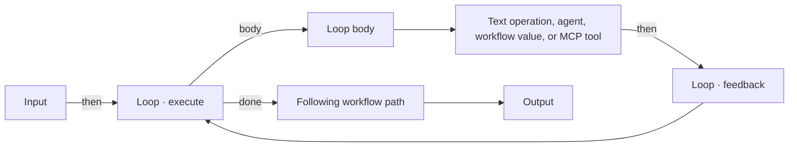

# Bounded loop graphs

The unified schema 2.0 Loop is a control node with a declarative continue predicate and a hard per-node maximum of 1–16 iterations. Its `execute` input receives the initial activation, and its `feedback` input receives the bounded body's return activation. The distinct pins make the two roles visible in the graph. Schema 2.0 also supports activation-only loops, variable loops with explicit VariableGet/Set state, and the legacy loop-carried data shape. Pure string-transform legacy loops retain their data feedback edge while normalization adds explicit execution wires.

A bounded Loop may also have one once-only Agent between the workflow Input and
the root Loop: `Input.then → Agent.execute → Loop.execute`, with the caller's
input connected from `Input.out` to `Agent.in`. The Agent completes before the
Loop is admitted and runs once before the first loop evaluation, whether or not
a body pass occurs. If the Agent fails or is cancelled, the Loop does not start. This is a
narrow root-entry form: the Agent must have no other execution routes and its
output data pin must be unused. Its result does not feed the loop body; body
values continue to come from the graph's declared parameter and data wires.
Other execution prefixes and multiple prefix nodes are invalid.

The initial activation enters through `execute`. The loop tests the current string using an ordinal, case-sensitive `equals`, `contains`, `starts-with`, or `is-empty` predicate. When it matches, the body runs and returns its activation through `feedback`; when the predicate no longer matches, the loop sends the current value through `done`. If the predicate still matches after the maximum number of body executions, `done` receives the current value and the run completes normally. The cap is a safety bound, not an error condition. For data-carried loops, the ordinary data `in` pin still carries the initial and returned string values; `feedback` identifies only the execution return.

## Authoring

In the Studio, add **Bounded loop** from the **Flow** node library. Connect the initial execution path to `execute`, connect the `body` output to the **Loop body** anchor, and connect the final body's execution output to `feedback`. Connect `done` to the downstream execution path. Configure **Continue while**, its match text, and **Maximum iterations** in the loop properties. Data values continue to use the Loop's typed data pins. When a pre-existing unified-schema draft has the old body-return-to-`execute` shape, Studio migrates its draft copy to `feedback` when that mapping is unambiguous, preserving node and connection IDs; the source and published revisions remain unchanged.

Unified schema 2.0 supports finite static nesting of predicate Loops. Each Loop owns one **Loop body** anchor and one body route; an inner Loop's `done` output returns to the owning outer Loop's `feedback` input, while the outermost `done` continues downstream. Core proves each feedback edge has one owner and validates the graph after removing only those proven returns. Every Loop still has a 1–16 iteration cap, every body is limited to 16 owned nodes, and one root-run budget limits all body-pass activations to 1,024 across nested Loops and pinned WorkflowCall descendants. Loop-scoped evidence across those workflows is additionally capped at 65,536 persisted events. Exceeding either aggregate budget fails the root execution before admitting over-limit work and records a safe failure reason.

A `core.wait` node may sit in a Loop or For Each body (sequential only; never behind a Fork branch or Sequence output). Admission charges it its duration times the enclosing iteration bound (the Loop maximum, or 64 for a For Each), so the host's per-run wait budget must cover every possible iteration; each iteration records a distinct `waitId` with a `loopIteration` and the iteration scope. See [Decision 0081](decisions/0081-latent-and-time-based-work.md#wait-in-loop-bodies-implementation-2026-11-25).

A single Loop can also own one complete schema-2.0 static Fork/Join region as a body step; the matching Join is the only route back to feedback or onward in that body. Nested Loops cannot be combined with Fork/Join in the same workflow yet, and Fork/Join outside a Loop body remains invalid when a Loop is present. The parallel validator remains authoritative for ownership, stable branch IDs, matching arrivals, and branch paths. JSON paths, approvals, implicit loop exits, and early termination are not supported inside this loop composition. Every loop path and downstream route must validate before publication or execution. Draft editing is allowed while incomplete, but runtime and publication fail closed until all issues are fixed.

Legacy schema 1.17–1.22 data-carried loops normalize only when their body is a linear chain of pure `Uppercase` and `Reverse` nodes. The loop input has distinct initial and feedback data connections; the runtime selects the initial edge on iteration zero and reevaluates the feedback chain on every later arrival. The `LoopBody.out`, `Loop.body`, and `Loop.done` values are captured as runtime data outputs, so downstream evaluation observes the exact current value. Legacy Agent/MCP bodies and other effectful or control-flow loop bodies are not migrated by this conversion.

Removing the loop removes its structural anchor and connects the original input through the body exactly once to the original downstream route. This preserves the body work as ordinary workflow nodes instead of deleting it.

## Runtime, audit, and playback

Every arrival at the loop is a recorded node invocation. Each body pass records `loop.iteration.started` and, on return, `loop.iteration.completed`, with its one-based iteration number. When the loop exits, `loop.stopped` records either `predicate-false` or `maximum-iterations`, plus the count and configured cap. The loop's node completion records the selected `body` or `done` output. Ordinary node starts, completions, and exact connection transfers retain the body payloads. Replay displays those facts from the event journal and does not call a model, tool, or workflow executor.

For unified schema 2.0, each predicate-loop body pass carries a fresh runtime activation scope, `{loopNodeId}/{iteration}`. Nested passes extend the parent scope, so evidence is attributed to the exact nested activation. On inner-loop completion, execution restores the parent frame and its iteration before continuing. Run-scoped variable state events keep their storage scope stable across iterations and record the loop iteration in their evidence payload, so passive state reconstruction can follow writes across passes. Legacy loop histories keep their existing event scopes. These pass scopes do not add array iteration or Break semantics.

Loop iteration playback uses the explicit one-based `iteration` value in lifecycle event data when present. It treats the numeric scope suffix as a legacy fallback, since a scope identifies an activation frame and is not itself the display counter.

Playback pairs start and completion events by loop node, scope, and explicit iteration number. A loop node is invoked again when a body returns, so the invocation IDs on those two lifecycle events can differ; invocation identity is used only when older records do not carry an iteration number. Missing or duplicate matches remain incomplete evidence.

The existing execution gate is checked at every node boundary, so a host can pause or cancel between body nodes and loop iterations. An already admitted agent or MCP operation is not interrupted by pause; cancellation remains subject to that operation's cancellation support. Looping does not add automatic retries, rollback, or recovery for external side effects. Hosts should give tools idempotency keys or other duplicate-effect protection when the body may repeat an external operation.

## Contract boundaries

The serialized definition contains only `core.loop` configuration and normal graph edges; it stores no code, executable expression, runtime instance, or credential. The loop condition reuses the safe string-predicate contract. Fixed per-loop and aggregate limits are enforced by Core/runtime, so imported definitions cannot bypass them by changing the UI. The `execute` and `feedback` inputs and `body` and `done` outputs are declared execution pins. The runtime follows explicit edge source pins; Core validation checks exactly one initial activation and one body return per Loop. Old unified-schema definitions that return to `execute` remain readable and executable for immutable history; Studio converts editable copies when the mapping is unambiguous.

This is bounded structured control flow, not general-purpose graph scheduling. Nested Loop composition is recorded in [Decision 0078](decisions/0078-nested-bounded-loops.md); static Fork/Join composition is recorded in [Decision 0077](decisions/0077-loop-parallel-composition.md). See [architecture](architecture.md), [roadmap](roadmap.md), and [implementation history](implementation-history.md) for implementation and verification evidence.

## For Each (first runtime slice, unreleased)

`core.for-each` iterates a bounded `array<T>` (T is `string`, `integer`, `number`, `boolean` or `json`) in ascending order. It reuses the Loop pin roles (`execute`, `feedback`, `body`) and adds `completed`, typed `item` and zero-based integer `index` outputs, and the `LoopBody` anchor. The array input is evaluated once per activation; each item gets a fresh pass frame whose scope is settled before the next item starts, and the pass shares the Loop's 1,024-pass and evidence limits. An empty array continues directly on `completed`. A failing or cancelled item stops later items. Nested For Each (outer item readable from inner passes) is tested. Studio offers For each and Break in the palette (checked in the running Studio: adding For each shows it on the canvas with an element-type selector in the inspector). `GraphEditing.InsertForEachAtExecutionConnection` inserts a complete region on one unified schema 2.0 execution edge that the loop validator accepts for a root iterator (in practice the edge leaving Input or the Input → Agent prefix; edges after other nodes or a second root loop are rejected): For each (string elements), its `LoopBody` anchor, an empty body returning to `feedback`, the `completed` continuation, and a two-item string Array literal wired to `array`; the result validates, is pure, and is rejected at the 256-node or connection limits and on loop-body anchor/feedback edges. Studio surfaces it as "Insert For each region" in the context menu of an execution wire, mirroring the parallel-region action; when the wire is not eligible the button is shown disabled with the reason (for example, a loop cannot start after another node, which the loop validator reports as `loop.feedback.root`) instead of disappearing. Edit the sample array and add body nodes afterwards. A `core.break` node ends the For Each early and continues on `completed`; a Condition or Boolean Branch may guard it, and the validator rejects a Break after a Sequence, collaboration rendezvous or nested loop on its path (`foreach.break.nonlinear`). A Break may follow a Fork/Join region in the body, and a Boolean Branch outcome inside a Fork branch may be a Break: the branch that selects it cancels the pass frame, so its still-running sibling Agents and MCP tools see a cancelled token and record `NodeCancelled`, the Break waits for them to settle (a sibling that ignores cancellation for more than 5 seconds fails the run with a clear message), cancels the pass's pending Join, and the For Each continues on `completed`. A For Each body may contain at most one Break (`foreach.break.multiple`). Fork branches are still limited to Agent, MCP tool, WorkflowCall and one Boolean Branch, and a workflow with a Fork may contain only one loop, so a nested For Each cannot have an outer Fork sibling. A graph that contains a Sequence cannot also contain a For Each or Loop: the validator reports `foreach.sequence.unsupported` or `loop.sequence.unsupported` on the iterator, and the runner refuses such a definition before recording any event. To repeat Sequence work per item, put a pinned WorkflowCall in the For Each body and the Sequence in the child workflow (tested, including a child failure that stops later items). Not yet supported: Break inside a Sequence, a Sequence directly in a For Each body, checkpoint recovery, and node stepping. See [Decision 0070](decisions/0070-bounded-array-iteration-contract.md).
