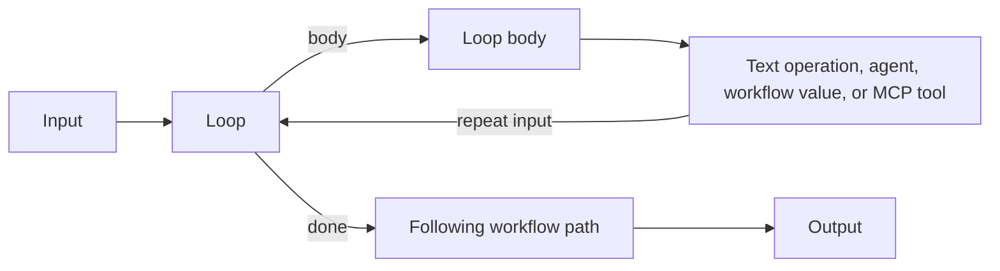

# Bounded loop graphs

Schema 1.17 supports one explicit loop region in a workflow. The loop is a control node with ordinary string pins, a declarative continue predicate, and a hard per-node maximum of 1–16 iterations. It executes inside the Agent Framework workflow; the Studio is only the editor and observer.

The initial value enters the loop once. The loop tests the current string using an ordinal, case-sensitive `equals`, `contains`, `starts-with`, or `is-empty` predicate. When it matches, the body runs and returns its resulting string to the loop input. When the predicate no longer matches, the loop sends that value through `done`. If the predicate still matches after the maximum number of body executions, `done` receives the current value and the run completes normally. The cap is a safety bound, not an error condition.

## Authoring

In the Studio, select a connected output on a plain string workflow and add **Bounded loop** from the **Flow** node library. Configure **Continue while**, its match text, and **Maximum iterations** in the loop properties. The inserted **Loop body** anchor marks where the body begins; insert normal text operations, workflow values, agent nodes, and direct MCP tool nodes after it. The final body node returns to the loop input automatically. The **done** output continues along the original downstream path.

The current implementation admits one loop per workflow, one linear body, and no other control nodes in a workflow containing a loop. JSON paths, conditionals, approvals, parallel blocks, nested loops, implicit loop exits, and early termination are not supported inside this loop milestone. Every loop path and downstream route must validate before publication or execution. Draft editing is allowed while incomplete, but runtime and publication fail closed until all issues are fixed.

Removing the loop removes its structural anchor and connects the original input through the body exactly once to the original downstream route. This preserves the body work as ordinary workflow nodes instead of deleting it.

## Runtime, audit, and playback

Every arrival at the loop is a recorded node invocation. Each body pass records `loop.iteration.started` and, on return, `loop.iteration.completed`, with its one-based iteration number. When the loop exits, `loop.stopped` records either `predicate-false` or `maximum-iterations`, plus the count and configured cap. The loop's node completion records the selected `body` or `done` output. Ordinary node starts, completions, and exact connection transfers retain the body payloads. Replay displays those facts from the event journal and does not call a model, tool, or workflow executor.

The existing execution gate is checked at every node boundary, so a host can pause or cancel between body nodes and loop iterations. An already admitted agent or MCP operation is not interrupted by pause; cancellation remains subject to that operation's cancellation support. Looping does not add automatic retries, rollback, or recovery for external side effects. Hosts should give tools idempotency keys or other duplicate-effect protection when the body may repeat an external operation.

## Contract boundaries

The serialized definition contains only the `core.loop` configuration and normal graph edges; it stores no code, executable expression, runtime instance, or credential. The loop condition reuses the safe string-predicate contract. The fixed maximum is validated by Core, so imported definitions cannot bypass the bound by changing the UI. The loop's body and done outputs are separate declared pins. The runtime matches both source node and pin when routing a message, which distinguishes the initial input edge from the body's return edge.

This is a single bounded-loop primitive, not general-purpose graph scheduling. See [architecture](architecture.md), [roadmap](roadmap.md), and [implementation history](implementation-history.md) for current implementation and verification evidence.
