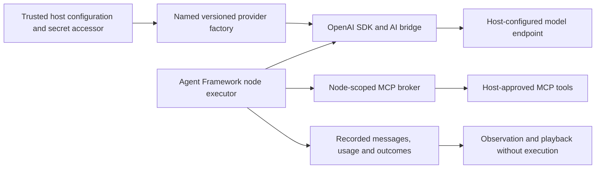

# Host-configured model providers

The optional `VisualAgentWorkflow.Providers.OpenAI` library supplies fresh, owned `IChatClient` factories using official OpenAI Chat Completions and the Microsoft.Extensions.AI bridge. Studio and the standalone service consume the same host configuration. It is disabled by default. Protocol fixtures verify the SDK path; **credentialed live-service qualification has not been run**. This is not a production reliability claim.

## Ownership and data flow



Core and Blazor do not depend on the SDK. Hosts select providers, destinations, models and credentials; workflow packages contain only provider ID/version, instructions and requested tool requirements. Catalogs reveal descriptors, not endpoints or credentials. Agent instructions, input and assigned tool results are sent to the selected provider. Studio warns about this when an external provider is selected. Treat model-visible content and recorded payloads according to the host's data policy; current local journals are plaintext.

## Configure Studio or the service sample

Provide a trusted configuration section `WorkflowAgents:OpenAI:openai.primary`. In environment variables replace each colon with two underscores, for example `WorkflowAgents__OpenAI__openai.primary__Enabled`. Supply secrets through the host's secret store or environment, never a workflow, browser field or checked-in settings file.

| Setting | Meaning |
| --- | --- |
| `Enabled` | Explicit `true` enables the entry; absent/false ignores it |
| `Version` | Required operator-owned contract version, pinned by nodes |
| `Model` | Required model identifier; no automatic model selection |
| `ApiKey` | Required host secret; never included in descriptors or artifacts |
| `DisplayName` | Optional catalog label |
| `Endpoint` | Default `https://api.openai.com/v1/`; host-owned absolute HTTPS URL |
| `TimeoutSeconds` | Whole agent invocation budget, 1–120 seconds; default 30 |
| `AllowInsecureLoopback` | Default false; allows HTTP only for a loopback protocol fixture |

Enabled invalid entries fail startup rather than falling back to the demo provider. Endpoints cannot contain user information, query strings or fragments. The default transport rejects redirects and cookies and retains normal TLS validation. Configuration may contain deployment secrets: restrict access and do not dump it to logs.

Studio retains `demo.scripted` and host-configured entries. Its **Settings → Model providers** page lists locally saved versions, creates providers, edits a provider by creating another version, and deletes an exact locally saved version. Credentials are protected in the local Studio data directory using ASP.NET Core Data Protection, while only non-secret provider descriptors are shown. Each saved version is registered immediately in the live executor. Published workflow nodes remain pinned to their original ID/version. Deleting a version removes its saved credential and executor registration, so subsequent runs that require it fail provider preflight; Studio does not currently check references before deletion. Environment and application configuration remain supported for hosts that provision providers outside Studio. Select the configured provider from **Node library → Agents**, then configure instructions/tools, save and publish before running. The standalone service registers no demo agent and only enables configured entries. Its package preflight rejects missing provider IDs/versions before admission; direct and queued execution use the same provider executor. See the [service sample](../samples/WorkflowService/README.md).

The registry, model and endpoint are captured at startup. Each invocation reads the credential accessor again, allowing rotation when the underlying configuration provider refreshes. Enablement/model/endpoint changes require rebuilding the registry, normally by restarting the host. Bump the provider version when changing the model, destination or behavioral settings. That version is an operator contract, not a computed configuration hash or a guarantee that a remote model alias remains unchanged.

## Integrate in a consumer

Reference the optional provider project alongside the Agent Framework adapter. Register the resulting executor with your host or pass it to the direct runner:

```csharp
var providers = OpenAIProviders.FromConfiguration(
    configuration.GetSection("WorkflowAgents:OpenAI"));
var agents = new AgentNodeExecutor(providers, broker);
var runner = new PipelineRunner(broker, agents);
```

Alternatively, `OpenAIProviders.Create(OpenAIProviderOptions, Func<string>)` accepts a host-owned secret accessor. Options deliberately carry no credential. Return fresh transports when using the custom transport overload; the trusted host then owns redirect and TLS policy. Never let imported workflow content select transport factories or credentials. `AddLocalWorkflowRuntime` does not automatically register providers or grant tools. Hosts still own cancellation, journal storage and lifecycle; see [hosting](hosting-sdk.md).

## Bounds, tools and recorded evidence

The executor applies the provider's whole-invocation deadline, including its tool loop. Clients and transports are disposed per invocation. The current limits are eight model iterations, 1,024 requested output tokens per response, 16,384 final text characters and 262,144 serialized model-trace characters. The optional SDK transport additionally bounds each success/error response body to 1 MiB, including bodies without a declared length. Only complete responses are supported; this adapter does not stream tokens.

SDK retries are disabled. Cancellation, timeout, authentication failures, rate limits and transport failures do not silently switch providers or replay calls. Request errors expose a safe failure category and optional HTTP status without retaining provider response bodies or inner exceptions, which may contain credentials. A timeout or cancelled connection does not prove the remote operation stopped or that billing/side effects did not occur.

Only functions explicitly assigned to the node are exposed; broker preflight precedes client construction, and each MCP invocation still checks node grants and contracts. Model output cannot grant capabilities. Approval nodes guard explicit MCP nodes, **not model-selected calls inside agent loops**.

`AgentStarted` captures provider identity/model and timeout. `ModelResponded` captures logical messages, resolved model ID, response ID, finish reason and input/output/total token counts when returned. This is bounded logical evidence, not a raw HTTP transcript; headers, credentials and arbitrary SDK metadata are excluded. Tool events retain their own correlation. Playback reads these records without constructing a provider or making requests.

## Verification and remaining qualification

The pinned integration uses Agent Framework 1.26.0, Microsoft.Extensions.AI.OpenAI 10.10.1 and OpenAI 2.14.0. Package selection was checked against the official [`dotnet-1.26.0` source](https://github.com/microsoft/agent-framework/tree/9c8a3514a15a702f81bfda456d80c7ccaa4d2712/dotnet), including its OpenAI Chat Completions sample and central package versions. Lockfiles pin the restored dependency graph.

Unit/integration tests exercise actual SDK HTTP serialization through a controlled handler, tool loops with real stdio MCP, policy denial, cancellation, timeout, response bounds, redirect rejection, secret-free errors and disposal. `python3 scripts/provider_smoke.py --dotnet /path/to/dotnet --browser-executable /path/to/chromium` uses a local protocol fixture to exercise Studio authoring/publication/run/playback and independent direct/queued service execution, missing/version-mismatched providers and rate-limit handling. It makes no live model calls.

Before claiming live support, an operator must supply authorized credentials through host configuration and qualify a chosen deployment: instruction/text behavior, assigned MCP tool calls, resolved model/usage evidence, cancellation/timeouts, authentication/rate-limit/unavailable failures, secret handling and operational limits. That credentialed qualification remains planned. The fixture does not establish behavior of every OpenAI-compatible server, Responses API, native Azure configuration, audio/vision, streaming or production durability. See the [roadmap](roadmap.md).


For LM Studio, start its local server with the model loaded, then add an endpoint such as `http://localhost:1234/v1` in **Studio settings**. Explicitly check **Allow plain HTTP for this local endpoint**. HTTP is accepted only when the endpoint parses as a loopback address; remote plain-HTTP endpoints remain rejected. If LM Studio does not require authentication, leave the API key empty. Studio supplies a local placeholder credential to the OpenAI SDK. Use the exact served model identifier displayed by LM Studio.

The settings interface and provider inventory API are served by the same loopback-only development host. The encrypted settings file contains no plaintext API key; the Data Protection key ring is owned by the Studio process user. Back up/protect the Studio data directory and OS user profile together if settings must survive a host migration. This is local development configuration, not a multi-user secrets vault. Existing saved providers are loaded before the provider catalog is exposed. A repeated provider ID/version is rejected. **Edit as new version** prefills a provider and increments the highest numeric three-part version for that provider; nonnumeric versions receive a unique `-next` suffix. The selected version's credential is reused when the key field is left blank; entering a key rotates it for the new version. Published workflows retain their pinned older version. **Delete version** removes only that saved provider version, but Studio does not detect workflow references; new runs pinned to a deleted version cannot start.
