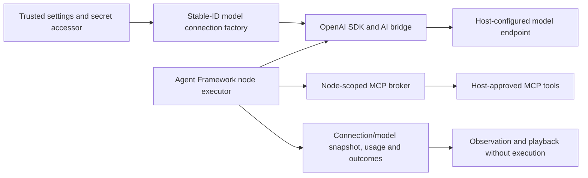

# Model connections and provider integration

The optional `VisualAgentWorkflow.Providers.OpenAI` library supplies fresh, owned `IChatClient` factories using official OpenAI Chat Completions and the Microsoft.Extensions.AI bridge. Studio and the standalone service consume the same host configuration. It is disabled by default. Protocol fixtures verify the SDK path; **credentialed live-service qualification has not been run**. This is not a production reliability claim.

## Ownership and data flow



Core and Blazor do not depend on the SDK. Hosts select connection IDs, destinations, models and credentials; workflow packages contain only the stable connection ID, instructions and requested tool requirements. Model and endpoint settings are mutable host configuration, not workflow identity. Catalogs reveal descriptors, not endpoints or credentials. Agent instructions, input and assigned tool results are sent to the selected provider. Studio warns about this when an external provider is selected. Treat model-visible content and recorded payloads according to the host's data policy; current local journals are plaintext.

## Configure Studio or the service sample

Provide a trusted configuration section `WorkflowAgents:OpenAI:openai.primary`. In environment variables replace each colon with two underscores, for example `WorkflowAgents__OpenAI__openai.primary__Enabled`. Supply secrets through the host's secret store or environment, never a workflow, browser field or checked-in settings file.

| Setting | Meaning |
| --- | --- |
| `Enabled` | Explicit `true` enables the entry; absent/false ignores it |
| `Model` | Required model identifier; no automatic model selection |
| `ApiKey` | Optional host secret; an empty value sends no Authorization header |
| `DisplayName` | Optional catalog label |
| `Endpoint` | Default `https://api.openai.com/v1/`; absolute OpenAI-compatible API base URL |
| `TimeoutSeconds` | Default invocation timeout used by agents that leave their node timeout blank; any positive whole number of seconds; default 30 |
| `ContextWindowTokens` | Optional prompt context size shown in run inspection |
| `InputCostPerMillionTokens` / `OutputCostPerMillionTokens` | Optional USD rates for ordinary input and output tokens |
| `CacheReadCostPerMillionTokens` / `CacheWriteCostPerMillionTokens` | Optional USD rates for cached input reads and writes, when the endpoint reports those counts as subsets of input tokens |
| `AllowInsecureHttp` | Default false; explicitly allows plain HTTP for any endpoint; prompts and keys are unencrypted in transit |
| `AllowInsecureLoopback` | Legacy setting; remains supported for loopback-only HTTP configurations |

Enabled invalid entries fail startup rather than falling back to the demo provider. Endpoints cannot contain user information, query strings or fragments. The default transport rejects redirects and cookies and retains normal TLS validation. Plain HTTP requires explicit opt-in; it sends model prompts, responses, and any API key without transport encryption, so use it only on a trusted network. Configuration may contain deployment secrets: restrict access and do not dump it to logs.

Studio retains `demo.scripted` and host-configured entries. Its **Settings → Model connections** page creates, edits, tests, and deletes entries by stable connection ID. Each entry describes the current endpoint, served model, timeout, optional context window, optional token pricing, and optional API key. Editing keeps the ID unchanged and updates every workflow and agent profile that references it; future runs use the edited settings. The form's **Test connection** and each saved entry's test button send a fixed short chat-completions request with a one-token output limit. This checks authentication, endpoint compatibility, and model availability, but may incur a small provider charge. The test never saves or changes connection settings and returns sanitized status rather than response content or credentials. The Studio form accepts any OpenAI-compatible Chat Completions server, including hosted APIs and local servers such as Unsloth, LM Studio, llama.cpp, or vLLM. The API key is optional, and plain HTTP is an explicit opt-in. Credentials are protected in the local Studio data directory, while descriptors exposed to the editor contain no endpoint or credential. Deleting a connection leaves definitions intact but makes new runs fail preflight until the connection is restored or the affected agents are changed. Environment and application configuration remain supported for hosts that provision connections outside Studio. Select a connection from **Node library → Agents**, then configure instructions and tools. The standalone service registers no demo agent and only enables configured entries; its package preflight rejects missing connection IDs before admission. Direct and queued execution use the same provider executor. See the [service sample](../samples/WorkflowService/README.md).

Host-configured connection entries are captured when the registry is built, normally at host startup; to edit one, rebuild and replace the registry under the same connection ID. Studio saves edits directly and replaces its live registration without changing the ID. Each invocation reads the credential accessor again. A model alias is still controlled by the remote endpoint and may change independently of Studio settings.

## Integrate in a consumer

Reference the optional provider project alongside the Agent Framework adapter. Register the resulting executor with your host or pass it to the direct runner:

```csharp
var providers = OpenAIProviders.FromConfiguration(
    configuration.GetSection("WorkflowAgents:OpenAI"));
var agents = new AgentNodeExecutor(providers, broker);
var runner = new WorkflowRunner(broker, agents);
```

Alternatively, `OpenAIProviders.Create(OpenAIProviderOptions, Func<string>)` accepts a host-owned secret accessor. Options deliberately carry no credential. Return fresh transports when using the custom transport overload; the trusted host then owns redirect and TLS policy. Never let imported workflow content select transport factories or credentials. `AddLocalWorkflowRuntime` does not automatically register providers or grant tools. Hosts still own cancellation, journal storage and lifecycle; see [hosting](hosting-sdk.md).

## Bounds, tools and recorded evidence

The executor applies a whole-invocation deadline, including its tool loop. A positive timeout configured on the agent node is the effective deadline even when it exceeds the model connection timeout; the connection timeout is the fallback for nodes without an override. Clients and transports are disposed per invocation. The current limits are eight model iterations, 16 MCP tool calls per opened node scope, 1,024 requested output tokens per response, 16,384 final text characters and 262,144 serialized model-trace characters. The MCP count is an invocation-count bound, not an aggregate time or cost budget; each call still has the configured per-call deadline and the broker rechecks authorization and pinned contracts. The optional SDK transport additionally bounds each success/error response body to 1 MiB, including bodies without a declared length. Only complete responses are supported; this adapter does not stream tokens.

SDK retries are disabled. Cancellation, timeout, authentication failures, rate limits and transport failures do not silently switch providers or replay calls. Request errors expose a safe failure category and optional HTTP status without retaining provider response bodies or inner exceptions, which may contain credentials. A timeout or cancelled connection does not prove the remote operation stopped or that billing/side effects did not occur.

Only functions explicitly assigned to the node are exposed; broker preflight precedes client construction, and each MCP invocation still checks node grants and contracts. Model output cannot grant capabilities. Approval nodes guard explicit MCP nodes, **not model-selected calls inside agent loops**.

`AgentStarted` captures the provider connection ID, display name, current model ID, optional context window and pricing metadata, plus the effective timeout. `ModelResponded` captures logical messages, resolved model ID, response ID, finish reason and input/output/total token counts when returned. It also records nullable cached-input and cache-write counts and nullable reasoning tokens; missing values remain unknown rather than zero. Reasoning tokens are shown separately while remaining included in output totals for cost estimates. Cached input and cache-write tokens are priced at their respective rates when reported as disjoint subsets of input usage; the remaining input is priced at the ordinary rate. The run viewer shows per-node token totals, a compact context-window meter, cache counts, the latest completed prompt-token count against the configured context window, and an estimated cost when all observed priced components have rates. While a request is in flight, the previous context figure is explicitly labeled as the last completed measurement. A host context-compaction event is counted when recorded. The estimate is based on configured prices and provider-reported usage; it is not an invoice or a hard cost limit. MCP failure evidence retains the binding, dispatch disposition, safe exception detail, and—when available—the relevant authorized input path; playback can also recover an `Error:` detail from the recorded model response. This is bounded logical evidence, not a raw HTTP transcript; headers, credentials and arbitrary SDK metadata are excluded. Tool events retain their own correlation. Playback reads these records without constructing a provider or making requests.

## Verification and remaining qualification

The pinned integration uses Agent Framework 1.26.0, Microsoft.Extensions.AI.OpenAI 10.10.1 and OpenAI 2.14.0. Package selection was checked against the official [`dotnet-1.26.0` source](https://github.com/microsoft/agent-framework/tree/9c8a3514a15a702f81bfda456d80c7ccaa4d2712/dotnet), including its OpenAI Chat Completions sample and central package versions. Lockfiles pin the restored dependency graph.

Unit/integration tests exercise actual SDK HTTP serialization through a controlled handler, tool loops with real stdio MCP, policy denial, cancellation, timeout, response bounds, redirect rejection, secret-free errors and disposal. `python3 scripts/provider_smoke.py --dotnet /path/to/dotnet --browser-executable /path/to/chromium` uses a local protocol fixture to exercise Studio authoring/publication/run/playback and independent direct/queued service execution, missing model connections and rate-limit handling. It makes no model calls. A separate Linux CI job downloads [Qwen3-1.7B-Q4_K_M](https://huggingface.co/ggml-org/Qwen3-1.7B-GGUF/tree/daeb8e2d528a760970442092f6bf1e55c3b659eb) (Apache-2.0, about 1.28 GB), then runs it using the prebuilt [`llama.cpp` server container](https://github.com/ggml-org/llama.cpp/blob/master/docs/docker.md). It caches the model weights, pins the model revision, file hash, and server image digest, and runs `RealModelInferenceTests` through the actual OpenAI-compatible provider, Agent Framework, workflow graph, and stdio MCP broker. The workflow asks “What is 1+1?”; the model calls its assigned `submit_answer` tool with `2`, and the test verifies the accepted tool input, recorded model/tool events, and final numeric answer. CI does not compile llama.cpp. This validates one small model's arithmetic and constrained tool-call path; it does not qualify arbitrary compatible servers, broad semantic answer quality, or credentialed hosted providers. The demo MCP catalog's `submit_answer` tool accepts only an integer string.

To run the opt-in inference test locally, download the pinned model revision and start the pinned llama.cpp server image:

```sh
set -e
trap 'docker stop vaw-llama-server >/dev/null 2>&1 || true' EXIT
mkdir -p /tmp/vaw-models
curl --fail --location --retry 3 --retry-all-errors \
  --output /tmp/vaw-models/Qwen3-1.7B-Q4_K_M.gguf \
  https://huggingface.co/ggml-org/Qwen3-1.7B-GGUF/resolve/daeb8e2d528a760970442092f6bf1e55c3b659eb/Qwen3-1.7B-Q4_K_M.gguf
test "$(stat --format=%s /tmp/vaw-models/Qwen3-1.7B-Q4_K_M.gguf)" = 1282439264
echo "d2387ca2dbfee2ffabce7120d3770dadca0b293052bc2f0e138fdc940d9bc7b5  /tmp/vaw-models/Qwen3-1.7B-Q4_K_M.gguf" | sha256sum --check --status
docker run --detach --name vaw-llama-server \
  --publish 127.0.0.1:11434:8080 \
  --volume /tmp/vaw-models:/models:ro \
  ghcr.io/ggml-org/llama.cpp@sha256:20c4196fc08b459a34ef78aaa05b101333b2fac687e30ec99f37b3c9dc071b44 \
  -m /models/Qwen3-1.7B-Q4_K_M.gguf --host 0.0.0.0 --port 8080 \
  --alias qwen3-1.7b --ctx-size 2048 --threads 4 --threads-batch 4 --parallel 1 --n-predict 64 --jinja
for attempt in $(seq 1 60); do
  curl --fail --silent http://127.0.0.1:11434/health && break
  sleep 1
done
VAW_RUN_REAL_MODEL_TESTS=1 \
VAW_REAL_MODEL_ENDPOINT=http://127.0.0.1:11434/v1/ \
VAW_REAL_MODEL_NAME=qwen3-1.7b \
dotnet test tests/VisualAgentWorkflow.Mcp.Tests --filter 'Category=RealModel'
```

The test rejects non-loopback HTTP endpoints and uses a placeholder credential accepted by the local llama.cpp server; it sends no requests to an external model provider. Without `VAW_RUN_REAL_MODEL_TESTS=1`, the test is reported as skipped in ordinary cross-platform test runs. Qwen3's `/no_think` marker keeps this test short. It verifies the actual model-directed `submit_answer` call and checks the final integer in the response, allowing concise explanations such as `1 + 1 = 2.`.

Before claiming live support, an operator must supply authorized credentials through host configuration and qualify a chosen deployment: instruction/text behavior, assigned MCP tool calls, resolved model/usage evidence, cancellation/timeouts, authentication/rate-limit/unavailable failures, secret handling and operational limits. That credentialed qualification remains planned. The fixture does not establish behavior of every OpenAI-compatible server, Responses API, native Azure configuration, audio/vision, streaming or production durability. See the [roadmap](roadmap.md).


For LM Studio, start its local server with the model loaded, then add an endpoint such as `http://localhost:1234/v1` in **Studio settings**. Explicitly check **Allow plain HTTP for this local endpoint**. HTTP is accepted only when the endpoint parses as a loopback address; remote plain-HTTP endpoints remain rejected. If LM Studio does not require authentication, leave the API key empty. Studio supplies a local placeholder credential to the OpenAI SDK. Use the exact served model identifier displayed by LM Studio.

The settings interface and provider inventory API are served by the same loopback-only development host. The encrypted settings file contains no plaintext API key; the Data Protection key ring is owned by the Studio process user. Back up/protect the Studio data directory and OS user profile together if settings must survive a host migration. This is local development configuration, not a multi-user secrets vault. Existing saved providers are loaded before the provider catalog is exposed. A provider ID identifies one mutable connection entry. **Edit connection** updates that entry in place; agent nodes and profiles continue to reference the stable ID, and new runs use the current endpoint/model/key. If the API-key field is blank, the existing key is kept; select **Remove saved API key** to clear it. The Studio does not check workflow references before deletion. Deleting a connection removes its credential and live registration; workflow files keep their connection ID, and execution reports it unavailable until the connection is re-added or the workflow is edited. Run evidence snapshots the connection descriptor and model metadata used at invocation time so older playback remains informative without contacting a provider.
