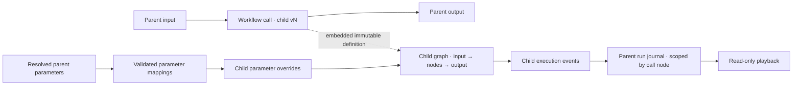

# Nested workflow calls

Schema 1.19 adds a runtime `Workflow` call node for immutable, published workflow revisions. It is separate from copy-on-insert: a call keeps the child graph intact and visible as a scoped execution in the parent run.

## Contract

A call node stores the child workflow ID, publication revision ID and version, definition content hash, and the complete immutable child definition. This makes a released parent self-contained for execution and historical playback: the runtime never looks up a newer child from a live catalog. Exported packages recursively list child revision and provider, tool, skill, agent-profile, and node requirements. Credentials, MCP server registrations, provider secrets, and host grants remain outside workflow files.

The current call contract passes one string to the child workflow input and returns its string output. The child can also terminate successfully without a result; that terminal outcome propagates to the parent without running the next connected node. In the call-node inspector, authors can map declared parent parameters into declared child parameters. Unmapped child parameters keep their published defaults. Mappings are pinned in the parent definition, resolve from validated per-run parent values, and are checked for declared IDs and compatible types before publish or execution. Choice mappings are valid only when every parent choice is accepted by the child. Values and secrets are not copied into the child definition. Typed inputs/outputs and upgrade/rebase operations remain future work. Nested approval nodes remain unsupported because approval authorization and decision evidence currently bind to the root revision and graph node identities.

Nesting is bounded to three child levels and 1,024 expanded nodes across the complete call tree. Re-entering a workflow ID on the active call path is rejected. Every embedded definition and pinned content hash is validated before publication or execution. A child retains its own pinned MCP/provider/skill requirements; parent capabilities are not copied into it. The host must still authorize each actual call according to its own policy.

## Runtime evidence and replay

Child nodes execute as part of the parent run. Their events are remapped onto the parent run ID, parent revision ID, and one monotonically increasing event sequence, while `ScopeId` records the slash-separated workflow-call node path. Child `run.started/completed/terminated/failed/cancelled` lifecycle facts become `subworkflow.*` facts so they cannot accidentally terminalize the parent journal. The call node records its own normal start/completion/failure, and a child termination is represented as a successful no-result outcome.

The run header includes the parent revision and its embedded child definitions. The run viewer filters scoped child events from the parent graph state, shows a call node’s current child activity, and exposes its recorded nested events in the inspector. Playback only renders captured evidence; it does not invoke child tools or models. As with other workflows, recorded payloads are subject to the host’s run-storage and data-retention policy.

## Studio use

In **Reusable pipelines**, select a published workflow and exact version, then choose **Call pinned workflow version**. The Studio inserts a call node after the selected graph node. In its properties, map any compatible parent parameter to a child parameter or leave the child default selected. The pinned child appears in the node properties and contributes its recursively derived requirements to exported packages. Use **Insert published pipeline** when you instead want editable copies expanded into the current graph. Changing a child publication never mutates an existing call; create a new explicit call or replace the workflow definition to adopt another version.

The Studio does not yet provide an embedded child-graph drill-in editor, explicit dependency upgrades, or nested approval composition. The child graph can be edited independently, published as a new immutable version, and selected explicitly by a parent draft.

## Verification

Core tests cover exact revision pins, recursive package requirements, round trips, invalid hashes, schema gates, and cycle rejection. Agent Framework tests execute a child without a catalog, verify one parent-owned audit sequence with child scope, and confirm successful child termination propagates to the parent. Existing hosts and consumer observation continue using the same run-store contract.
