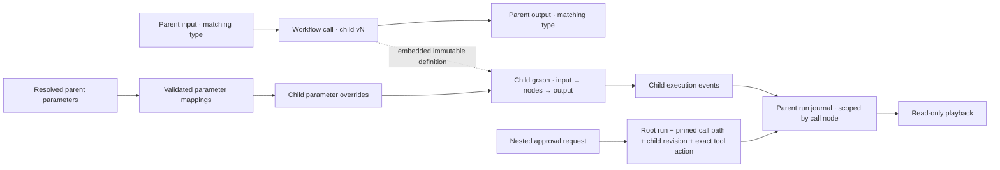

# Nested workflow calls

Schema 1.19 adds a runtime `Workflow` call node for immutable, published workflow revisions. It is separate from copy-on-insert: a call keeps the child graph intact and visible as a scoped execution in the parent run.

## Contract

A call node stores the child workflow ID, publication revision ID and version, definition content hash, and the complete immutable child definition. This makes a released parent self-contained for execution and historical playback: the runtime never looks up a newer child from a live catalog. Exported packages recursively list child revision and provider, tool, skill, agent-profile, and node requirements. Credentials, MCP server registrations, provider secrets, and host grants remain outside workflow files.

The call node's input and output pins inherit the exact data types declared at the child workflow's Input and Output boundaries. Current graph types are `string` and `json`; each call boundary is validated independently, so a JSON-input child may return a string or JSON result. The Studio displays those types and normal graph connection rules reject incompatible links. JSON input is parsed and normalized by the child's Input node, and JSON output can only be connected from a validated JSON-producing path. The child can also terminate successfully without a result; that terminal outcome propagates to the parent without running the next connected node. In the call-node inspector, authors can map declared parent parameters into declared child parameters. Unmapped child parameters keep their published defaults. Mappings are pinned in the parent definition, resolve from validated per-run parent values, and are checked for declared IDs and compatible types before publish or execution. Choice mappings are valid only when every parent choice is accepted by the child. Values and secrets are not copied into the child definition. A child may contain an approval immediately before an MCP tool; nested approval evidence is bound to the parent run and the exact pinned call path described below.

Nesting is bounded to three child levels and 1,024 expanded nodes across the complete call tree. Re-entering a workflow ID on the active call path is rejected. Every embedded definition and pinned content hash is validated before publication or execution. A child retains its own pinned MCP/provider/skill requirements; parent capabilities are not copied into it. The host must still authorize each actual call according to its own policy.

## Nested approval scope

The approval request keeps the root run ID, root revision and root workflow hash, then records every traversed workflow-call node ID with its pinned child revision ID and content hash. It also identifies the definition currently executing the approval and its exact approval/target MCP nodes, input hash, tool binding, contract and reserved invocation. The sequenced approval event carries the same slash-separated call-node `ScopeId` used by child execution evidence. Before allowing a decision, the controller verifies the path against the root's embedded snapshots and confirms the approval-to-tool edge in the final child definition. A changed child revision, path, node, contract, input, or event scope makes the request stale/invalid.

Approval remains an execution gate, not a capability grant. The consumer host still authorizes the selected MCP binding and node independently; approving a nested request does not inherit or widen parent/child permissions. The Studio highlights the parent call node while the child awaits approval and displays the nested path and executing child revision in the request details. Read-only observers see the same evidence without decision controls.

The current controller holds one outstanding approval per run. Validation therefore rejects a parallel block when both branches can contain nested approvals. A single approval-bearing branch is permitted. Loop regions continue to reject approvals, and durable approval recovery is not supported: host restart still interrupts the process-owned continuation.

## Runtime evidence and replay

Child nodes execute as part of the parent run. Their events are remapped onto the parent run ID, parent revision ID, and one monotonically increasing event sequence, while `ScopeId` records the slash-separated workflow-call node path. Child `run.started/completed/terminated/failed/cancelled` lifecycle facts become `subworkflow.*` facts so they cannot accidentally terminalize the parent journal. The call node records its own normal start/completion/failure, and a child termination is represented as a successful no-result outcome.

The run header includes the parent revision and its embedded child definitions. The run viewer filters scoped child events from the parent graph state, shows a call node’s current child activity, and exposes its recorded nested events in the inspector. Playback only renders captured evidence; it does not invoke child tools or models. As with other workflows, recorded payloads are subject to the host’s run-storage and data-retention policy.

## Studio use

In **Reusable pipelines**, select a published workflow and exact version, then choose **Call pinned workflow version**. The Studio inserts a call node after the selected graph node when its output type matches the child input type. The call exposes the child's output type to the next connection; use existing JSON-producing or JSON-consuming nodes to connect JSON contracts. In the node properties, map any compatible parent parameter to a child parameter or leave the child default selected. The pinned child appears in the node properties and contributes its recursively derived requirements to exported packages. Use **Insert published pipeline** when you instead want editable copies expanded into the current graph.

To inspect the child without leaving the parent, open **Reusable pipelines**, choose the call under **Inspect or upgrade a pinned call**, then expand **Inspect pinned child graph**. This read-only canvas shows the exact definition embedded in the call. The saved child layout is shown when the current catalog provides it; otherwise Studio creates a temporary layout for viewing. It never changes the child, executes it, or changes the parent graph. During an upgrade review, expand **Inspect target child graph** to compare the candidate graph while retaining the original pin.

To inspect or update an existing call, open **Reusable pipelines** and select it under **Inspect or upgrade a pinned call**. Review the embedded dependencies and choose another published revision. **Review revision changes** compares child nodes, connections, parameters, skills, profiles, and dependency requirements. Apply changes only after reviewing; compatible parameter mappings stay pinned, while incompatible mappings are listed and removed so the child uses its new default. This changes the local parent draft, adds one undo step, and does not publish or activate it. The child graph remains an embedded snapshot in the parent. Updating or publishing the child elsewhere never changes an existing call.

The Studio does not yet provide an embedded child-graph editing experience. The child graph can be edited independently and published as a new immutable version. Nested approval composition is supported by exact path-bound evidence, subject to the single-outstanding-approval and process-lifetime limits above.

## Verification

Core tests cover exact revision pins, recursive package requirements, round trips, invalid hashes, schema gates, and cycle rejection. Agent Framework tests execute a child without a catalog, verify one parent-owned audit sequence with child scope, and confirm successful child termination propagates to the parent. Existing hosts and consumer observation continue using the same run-store contract.
