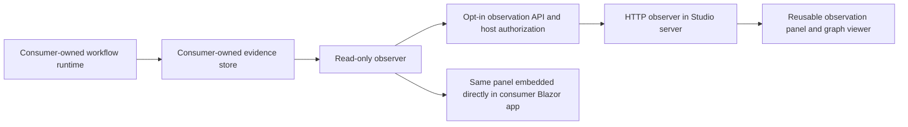

# Observe workflows hosted by a consumer

A consumer can explicitly expose read-only workflow evidence. Studio connects to that endpoint from its server, and the same reusable graph panel can be embedded in a consuming Blazor application. Neither observation nor historical playback executes a workflow or grants control over it.



The consumer remains the execution and storage owner. Studio does not import remote runs into its local runtime or catalog. A browser disconnect, source change or playback action cannot pause, resume, cancel or restart consumer work.

## Enable the consumer API

Reference Hosting and register the local runtime, or provide your own evidence reader. The example assumes the host has configured authentication and a named `workflow-observe` authorization policy:

```csharp
builder.Services.AddLocalWorkflowRuntime(".local/service-runs");
builder.Services.AddSingleton<IWorkflowRunObserver, JournalRunObserver>();
// Configure host authentication and the "workflow-observe" policy here.
var app = builder.Build();
app.UseAuthentication();
app.UseAuthorization();
if (builder.Configuration.GetValue<bool>("WorkflowObservation:Enabled"))
    app.MapWorkflowObservation("/workflow-observation", "workflow-observe");
```

Registering the runtime alone maps nothing. `MapWorkflowObservation` requires a nonblank named authorization policy and returns a route group that the host can further configure. It maps only GET reads:

| Relative route | Result |
| --- | --- |
| `/runs` | Up to 50 summaries ordered by recent activity, without input/output payloads |
| `/runs/{runId}` | A consistent captured definition, identity and ordered event snapshot |
| `/runs/{runId}/events?after=0&limit=256` | Events after an exclusive sequence cursor; limit 1–256, current watermark and `hasMore` |

Snapshot reads contain sensitive recorded inputs/outputs and model/tool evidence. They use the same policy as discovery/cursor reads and return `Cache-Control: no-store`. Unknown runs return 404; negative/future cursors and invalid page limits return 400. There are no start/edit/pause/resume/cancel routes. A cursor page comes from one snapshot; subsequent reads after the last received sequence recover later events without executing anything.

`IWorkflowRunObserver` in Core is independent from mutation-capable `IWorkflowClient`. `JournalRunObserver` reads the same in-process `FileRunJournal` used by the local runtime. Other stores/access models implement the observer interface; the API is not tied to Studio or a catalog. The current journal reader returns all runs in its directory to an authorized reader. A multi-tenant host must supply a filtered/scoped observer that independently enforces visibility for list, snapshot and cursor lookup, including guessed IDs. Endpoint authentication alone does not implement tenant isolation.

## Try the service sample

The [standalone service sample](../samples/WorkflowService/README.md) has a `serve` mode. Observation is disabled by default. To opt in, provide `WorkflowObservation__Enabled=true` and a strong random `WorkflowObservation__Token` through the process environment or your secret provider, then run:

```sh
dotnet run --project samples/WorkflowService --configuration Release --no-build -- serve samples/WorkflowService/artifacts/pure.deployment.json .local/observable-service "consumer visibility"
```

It starts a run and listens on loopback port 5100. `/health` is a readiness endpoint. `/workflow-observation/*` exists only when explicitly enabled and requires the configured bearer token; incorrect/missing credentials receive 401. Enabled observation refuses startup without a token of at least 32 characters. This is a single-operator development example, not an identity provider or workspace authorization system. Production consumers supply their own authenticated users/service identities, policies, HTTPS, access auditing and storage protection. `WorkflowService__Port` can select another loopback port.

## Attach Studio

Configure named sources in the Studio **server** configuration. For example, supply these configuration keys through environment variables (`__` replaces `:`), a secret provider or trusted host configuration:

| Configuration key | Example/meaning |
| --- | --- |
| `WorkflowObservation:Sources:consumer:BaseAddress` | `http://127.0.0.1:5100/workflow-observation/` |
| `WorkflowObservation:Sources:consumer:BearerToken` | The consumer's observer credential; keep it out of source control |

Start Studio normally, choose **Observe a consumer service**, select **Consumer source**, then **Connect to consumer**. Choose a recent run and inspect node payloads, actual transfer paths and recorded playback. The panel automatically chooses the first visible run and polls every 500 ms. It fetches a selected snapshot when its event count changes; cursor reads are also available to integrations. This is polling, not an SSE/WebSocket subscription.

Sources are operator-configured aliases; users cannot enter arbitrary server-side URLs or credentials in the browser. HTTPS is required except for loopback HTTP development destinations. URLs must end in `/` and cannot contain user information, query strings or fragments. The source clients reject redirects and cookies; credentials stay on the Studio server. Studio remains the existing loopback-only development app, and configured sources are available to its local users. Per-user delegation/source permissions are not implemented.

**Disconnect observation** removes the view without altering consumer execution. A connection error retains the last received evidence with an explicit warning. Switching sources clears previous run data and ignores late old-source responses. Reconnecting polls the consumer again; historical playback never changes stored evidence. Stop/restart of the consumer still follows its own runtime recovery limits.

For isolated development instances, `WorkflowStudio__Port` changes the loopback port, and `WorkflowStudio__DataDirectory` supplies an exclusive local catalog/journal root. Two processes must not share a run directory. These settings do not expose Studio on a public interface.

## Embed the same view

A Blazor consumer app references the Blazor component library and supplies an observer:

```razor
@using VisualAgentWorkflow.Core
@using VisualAgentWorkflow.Blazor.Components
@inject IWorkflowRunObserver Observer

<WorkflowObservationPanel Observer="Observer" SourceLabel="Service workflows" />
```

Use `JournalRunObserver` for direct in-process observation, or `HttpWorkflowRunObserver` from the separate Observation.Http project for a remote endpoint. Include the component stylesheet and interactive render mode described in [embedding](embedding.md). No Studio, designer, authoring catalog or execution client is required by this panel. The existing `WorkflowRunViewer` remains available if the host wants to supply individual snapshots and its own navigation.

The HTTP client accepts a host-owned `HttpClient` with a fixed base address. Configure its handler with `AllowAutoRedirect = false`, supply credentials through the host, and set a request timeout. It validates snapshot identities, definition hashes and event sequences, and rejects responses larger than 8 MiB. The reusable panel cancels observation waits on disposal/source replacement, rejects changes to already received evidence, and does not rewind live state when an older overlapping response arrives. Observer cancellation is unrelated to workflow cancellation.

## Current limits and audit ownership

This implementation exposes recorded execution history, not a production centralized audit system. Control actors remain development placeholders. Authenticated observation access is not automatically appended to the workflow event journal; hosts can add route-group filters/middleware to record reader identity, run ID and access outcome in their administrative audit store without logging credentials or payloads. Redaction, retention, encryption, cross-tenant isolation, OpenTelemetry export and durable restart remain separate work.

The local journal reader currently scans stored run snapshots to build summaries. Polling/full snapshots and the 8 MiB HTTP-client limit are appropriate to the prototype, not a claim of large-history scalability. The remote panel currently renders deterministic default positions from the captured definition; saved layout sidecars/annotations are not transported. Exact semantic nodes, paths, payloads and revision/hash identity are preserved. No workflow/layout/package/database schema migration is introduced.

`python3 scripts/observation_smoke.py` starts its own isolated consumer and Studio processes with ephemeral credentials. It verifies disabled-by-default mapping, credential rejection, server-side attachment, graph/payload playback, source replacement, disconnect and restart/reconnect. HTTP integration tests also verify policy denial, cursor ordering, live status changes and absence of mutation endpoints. Component tests prove embedding without execution services and safe disposal/source replacement.

## Approval evidence

Schema-1.5 requests and decisions are visible through the same snapshots/cursors. The read-only graph panel displays a pending exact-action review without decision controls. Studio attachment to a consumer does not grant approval rights; approvals need a separate host-authorized control client. See [approval boundaries](approvals.md).
