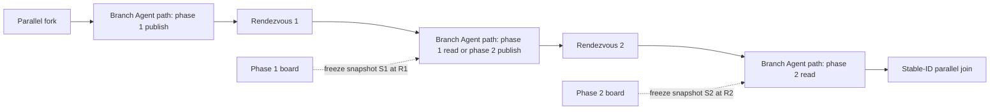

# Two-phase parallel Agent collaboration (schema 1.35)

Schema 1.35 defines exactly two ordered rendezvous phases for one static 2–8 branch region. The Core model, JSON package round-trip, static validation, Agent Framework runtime, journal checks, and passive playback are implemented. Studio authoring integration is separate work. Schema 1.33 remains the original single-rendezvous format, and schemas 1.32–1.34 retain their serialized bytes and established behavior.

## Portable data layout

The workflow has one collaboration region record keyed by the first rendezvous node ID. It names the existing fork, the first rendezvous (`rendezvousNodeId`), the second rendezvous (`secondRendezvousNodeId`), the existing join, configured channel IDs, an optional finite timeout in seconds, and grants grouped by stable branch ID. Each rendezvous node declares the same stable branch IDs as the fork and join. Branch labels and display order do not identify participants.

A schema-1.35 grant names one exact Agent node, one phase (`phase1` or `phase2`), one role (`publish` or `read`), and one or more configured channel IDs. An Agent node receives one role/phase grant. Workflows that need an Agent to perform another collaboration operation use a separate Agent invocation node. A grant never propagates to profile delegates, team children, or other nodes.

The ordered layout is:

Each branch crosses R1 and then R2 exactly once before entering its matching stable-ID join input. All paths are straight-line Agent paths between the fork, barriers, and join. Conditions, Boolean routing, nested or repeated barriers, loops, retries, recovery, dynamic participants, and conditional topology are unsupported.

## Phase and snapshot semantics

Phase 1 publish Agents may append to the phase-1 board before arriving at R1. R1 waits for every branch, then freezes its immutable snapshot S1. Phase 1 read Agents may read S1 only on the segment between R1 and R2. Phase 2 publish Agents may append to a separate phase-2 board on that same middle segment. R2 waits for every branch, then freezes its immutable snapshot S2. Phase 2 read Agents may read S2 only after R2.

The boards and snapshots are phase-scoped. Reusing the same channel ID in both phases does not alias the boards or snapshots: `(phase, channel ID)` identifies a channel. Snapshot values are immutable after release. Cumulative limits apply across both phases and snapshots; creating a second snapshot does not reset the region budget.

Core validation uses these existing bounds: at most 8 configured channel IDs per region; 4,000 characters per message; 32 messages per channel ID across both phases; 64 messages across the region; and 65,536 canonical UTF-8 bytes total across both released snapshots. Messages are not truncated. The encoded snapshot size includes JSON escaping and UTF-8 encoding. The existing per-Agent model, turn, token, and tool limits remain independent.

## Timeout, abort, and recorded evidence

One finite region deadline starts when the fork activation is admitted and covers both rendezvous waits. Either barrier waits for all branches. A workflow timeout may provide the limit; otherwise the host must resolve and record a finite default before admission. Timeout, cancellation, branch failure, or join failure aborts the region, cancels siblings where possible, and suppresses the join value. Already released snapshots, recorded reads, and completed external side effects remain as evidence; they are not rolled back. The contract promises no retry, recovery, or transactional rollback.

Evidence must distinguish the two rendezvous and their snapshots, including phase, fork activation, stable branch ID, exact Agent node and invocation, authorized operation, messages and observed append order, arrivals, release identity/digest/bytes/value, snapshot references and returned reads, branch outputs, and abort reason. Playback must check each read against the referenced phase snapshot and retain an earlier release if a later phase aborts. Digests detect inconsistency; they do not authenticate a journal or make it tamper-proof. Host redaction or missing payloads must be shown as incomplete evidence rather than exact model-visible input.

## Compatibility and validation

Schema 1.33 keeps its original single `rendezvousNodeId` and grants whose `phase` is `publish` or `read`; it omits `secondRendezvousNodeId` and `role`. Schema 1.35 requires the second rendezvous and explicit phase/role fields. The additive model members are omitted when null, preserving the schema-1.33 canonical JSON and hash. Schema 1.32, 1.33, and 1.34 definitions keep their prior serialization and runtime interpretation.

Core rejects missing or duplicate rendezvous nodes, mismatched fork/barrier/join branch IDs, reversed or bypassed barriers, cross-branch pins, path escapes, non-Agent nodes or conditions on a collaboration route, loop re-entry, and grants whose Agent, phase, role, or channels do not match the static path. Draft serialization may preserve incomplete topology for editing; strict workflow and package serialization require full validation.

The original [schema 1.33 collaboration contract](parallel-agent-collaboration.md) remains applicable only to schema 1.33. General fork, join, and branch semantics are in [parallel graphs](parallel-graphs.md); package and architecture context is in [architecture](architecture.md).
