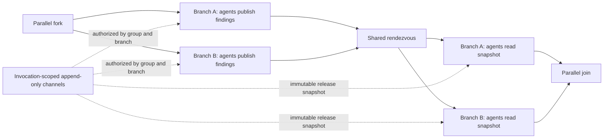

# Parallel agent collaboration

This document defines the proposed first graph-level collaboration contract. It is a design specification, not an implemented feature; the current schema 1.32 runner does not expose shared channels or synchronization barriers between visible branches.

## First release: one shared rendezvous

The first release uses a new workflow schema (proposed: 1.33) and leaves all earlier schemas, including 1.32, unchanged. A collaboration region reuses a visible 2–8 branch fork and join, adds one explicit rendezvous to every branch, and declares one collaboration group for that region. Branch IDs are stable participant IDs. Branches are static and acyclic, and every path must cross the rendezvous exactly once. Conditions, loops, nested regions, bypasses, and repeated rendezvous are rejected.

The collaboration group names the channel set and exact branch participants. A node receives channel tools only when the workflow explicitly assigns it to that group and the branch's current phase permits the operation. Before the rendezvous, assigned agents may append messages and cannot read the live board. After release, assigned agents may read the release snapshot and cannot append to that completed exchange. Agents that are not assigned to the group receive no channel tools. The board is scoped to one run and one fork activation; names are routing labels, not security boundaries.

The rendezvous accepts one arrival for each declared branch ID. An arrival parks the branch without holding an execution permit. When every participant arrives, the runtime freezes each channel's ordered message prefix and releases every branch. All post-rendezvous readers receive the same immutable snapshot, regardless of which branch finishes first. Concurrent writes are ordered by the runtime's observed append order; that order is evidence of observation, not a claim about causal order. This first exchange is one-way. Repeated rounds and writes after release require a later schema and a separately specified scheduling contract.

The first version reuses the existing collaboration board's message bounds: 4,000 characters per message, 32 messages per channel, and 64 messages per board. It also bounds snapshot size and persisted read evidence so a large channel set cannot multiply the existing per-message limits without limit. The precise aggregate cap is a schema/host option and must be validated before activation; it is not inferred from the per-message cap.

## Failure, limits, and audit

The region has a configurable positive timeout with no arbitrary upper bound. If omitted, the host must supply a finite collaboration timeout; a host with neither a region timeout nor a finite default must refuse execution rather than leave branches parked indefinitely. Timeout, cancellation, a failed member, a duplicate/unknown arrival, or a missing participant aborts the entire region. The runtime cancels waiting or active sibling branches where possible, emits no partial join result, and records the reason. Already completed external side effects are not rolled back. The first version does not retry participants, recover an interrupted barrier, or resume a partially completed collaboration. Existing per-agent model, token, turn, and tool limits remain independent; no team-wide cost reservation is implied.

Run evidence records the region and fork activation IDs, stable branch and agent invocation IDs, authorized channel operations, bounded message values and observed append order, each arrival, the release event, snapshot identity and exact snapshot values, reads, branch outputs, and abort reason. Playback reconstructs the recorded view without contacting a model or MCP server. Secrets remain governed by the host's existing evidence-redaction policy. A snapshot or read record that exceeds its configured bound fails the region before releasing members; evidence must not be silently truncated in a way that changes what an agent saw.

## Runtime requirements before release

The runtime must prove that barrier waiters release execution capacity and that a region completes when the host's active-agent limit is below its participant count. Required tests cover all supported branch counts, stable identity across reorder/label edits, one arrival per participant, bypass and duplicate-arrival rejection, isolation across runs and fork activations, membership and phase authorization, identical immutable snapshots for all readers, message and evidence caps, timeout/cancellation/failure without partial output, and playback with inference disabled. Studio must show group membership, phase-appropriate tools, incomplete wiring, current arrivals, and the exact captured snapshot during replay. This feature must remain distinct from the profile-based `team_0` tool, which performs model-directed fan-out inside one agent invocation.

## Design review

The clean-context proponent, opponent, and adjudicator review favored an explicit rendezvous contract and a new schema. A live shared board without a synchronization boundary would expose schedule-dependent reads; changing schema 1.32 would risk its existing validation, execution, hashing, and replay behavior. The review recommended starting with one rendezvous and deferring repeated phases until scheduler, audit, and failure semantics have evidence. See [bounded parallel graphs](parallel-graphs.md), [agent profiles and delegation](agent-profiles.md), and the [roadmap](roadmap.md).
