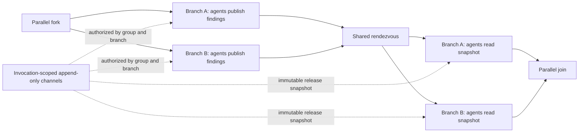

# Parallel agent collaboration

This document defines the proposed first graph-level collaboration contract. The Core library contains a tested non-blocking exchange state machine. There is also an internal friend-test-only plan that overlays a one-rendezvous topology on real schema-1.32 definitions and exercises the actual `WorkflowRunner`; it is inaccessible to normal consumers and is never serialized. That adapter proof covers 3- and 8-branch graphs with one active Agent call, publish/read phase grants, targeted release, pre/post-release failure, timeout and cancellation around release, and exact event capture/JSON replay. It uses deterministic fake agents, not live model calls. The normal schema-1.32 runner still does not expose graph-level shared channels or synchronization barriers, and Studio and durable audit/playback presentation are not implemented.

## First release: one shared rendezvous

The first release uses a new workflow schema (proposed: 1.33) and leaves all earlier schemas, including 1.32, unchanged. A collaboration region reuses a visible 2–8 branch fork and join, adds one explicit rendezvous to every branch, and declares one collaboration group for that region. Branch IDs are stable participant IDs. Branches are static and acyclic, and every path must cross the rendezvous exactly once. Conditions, loops, nested regions, bypasses, and repeated rendezvous are rejected.

The collaboration group names the channel set and exact branch participants. A node receives channel tools only when the workflow explicitly assigns it to that group and the branch's current phase permits the operation. Before the rendezvous, assigned agents may append messages and cannot read the live board. After release, assigned agents may read the release snapshot and cannot append to that completed exchange. Agents that are not assigned to the group receive no channel tools. The board is scoped to one run and one fork activation; names are routing labels, not security boundaries.

The rendezvous accepts one arrival for each declared branch ID. An arrival parks the branch without holding an execution permit. When every participant arrives, the runtime freezes each channel's ordered message prefix and releases every branch. All post-rendezvous readers receive the same immutable snapshot, regardless of which branch finishes first. Concurrent writes are ordered by the runtime's observed append order; that order is evidence of observation, not a claim about causal order. This first exchange is one-way. Repeated rounds and writes after release require a later schema and a separately specified scheduling contract.

The first version reuses the existing collaboration board's message bounds: 4,000 characters per message, 32 messages per channel, and 64 messages per board. The Core exchange primitive caps the serialized immutable snapshot at 16,384 characters, matching the existing parallel-result bound; the workflow schema must preserve that bound in persisted read evidence rather than silently truncating what an agent saw.

## Failure, limits, and audit

The region has a configurable positive timeout with no arbitrary upper bound. If omitted, the host must supply a finite collaboration timeout; a host with neither a region timeout nor a finite default must refuse execution rather than leave branches parked indefinitely. Timeout, cancellation, a failed member, a duplicate/unknown arrival, or a missing participant aborts the entire region. The runtime cancels waiting or active sibling branches where possible, emits no partial join result, and records the reason. Already completed external side effects are not rolled back. The first version does not retry participants, recover an interrupted barrier, or resume a partially completed collaboration. Existing per-agent model, token, turn, and tool limits remain independent; no team-wide cost reservation is implied.

Run evidence records the region and fork activation IDs, stable branch and agent invocation IDs, authorized channel operations, bounded message values and observed append order, each arrival, the release event, snapshot identity and exact snapshot values, reads, branch outputs, and abort reason. Playback reconstructs the recorded view without contacting a model or MCP server. Secrets remain governed by the host's existing evidence-redaction policy. A snapshot or read record that exceeds its configured bound fails the region before releasing members; evidence must not be silently truncated in a way that changes what an agent saw.

## Runtime requirements before release

The raw pinned-framework fixture demonstrates non-blocking fan-in and branch-specific release. The separate runner prototype builds on a valid schema-1.32 graph with a hidden internal plan that identifies each branch's publish and read Agent. It substitutes a runtime rendezvous executor for the authored edge between those two nodes, grants phase callbacks only to the matching Agent, records message/snapshot/arrival/release/abort events, and targets the released branch message back to its corresponding read Agent. Tests prove 3 and 8 branches at a fake Agent concurrency cap of one; the immutable snapshot matches across readers. Pre-phase and post-phase failures, a timeout before and after release, and cancellation before and immediately after release produce no completed/partial join output. Test plan timeout/cancellation hooks are internal and do not change ordinary schema-1.32 execution. The JSON event round-trip checks captured evidence fields and order; it does not establish a durable schema or a collaboration-aware visual graph playback UI. This prototype is evidence for a future public design, not shipped collaboration support. This feature must remain distinct from profile-based `team_0` fan-out.

## Design review

The clean-context proponent, opponent, and adjudicator review favored an explicit rendezvous contract and a new schema. A live shared board without a synchronization boundary would expose schedule-dependent reads; changing schema 1.32 would risk its existing validation, execution, hashing, and replay behavior. The review recommended starting with one rendezvous and deferring repeated phases until scheduler, audit, and failure semantics have evidence. See [bounded parallel graphs](parallel-graphs.md), [agent profiles and delegation](agent-profiles.md), and the [roadmap](roadmap.md).
