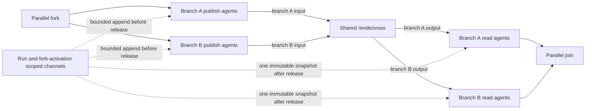

# Parallel agent collaboration

This document describes the first shipped graph-level collaboration slice in schema 1.33. The schema, ordinary workflow runner, bounded exchange, host timeout configuration, durable run-journal validation, passive playback, and Studio authoring are implemented. The contract below remains the source for its boundaries and limitations. It is distinct from profile-based `team_0` fan-out and schema 1.12 delegate channels.

## First release: one shared rendezvous

Schema 1.33 adds one static collaboration region to a workflow. Schema 1.32 and earlier retain their existing serialization, hashes, validation, execution, and playback behavior. A 1.33 definition has one region record binding the existing parallel fork and join to a visible rendezvous node, the region's channels, its timeout policy, and explicit per-branch Agent grants. Branch IDs are the stable IDs already declared by the schema-1.32 fork; labels and display order never identify participants or affect pins.

The rendezvous is a first-class execution node with one branch-keyed input and one branch-keyed output for every fork branch. A branch arrives only on the input bearing its stable ID and resumes only on the matching output. The input parks the branch without holding an execution permit. The final valid arrival freezes one immutable release snapshot and makes it available to every branch's post-rendezvous segment. The outputs then route each branch independently to the matching join input, which continues to produce the existing stable-ID-keyed JSON result after complete fan-in.

The workflow-level region record names the fork, rendezvous, and join node IDs; configured channel IDs; an optional positive finite timeout in seconds; and grants grouped by stable branch ID. Every grant names an exact Agent node ID, a phase (`publish` or `read`), and the permitted channels. Validation requires each granted Agent to be reachable on that branch in the named pre- or post-rendezvous segment. An Agent outside the region, on another branch, or on the wrong side of the rendezvous cannot receive a grant. Multiple explicitly listed Agent nodes may participate in a phase when the static branch path permits it. The runtime derives the branch identity from the execution activation; the model cannot supply or change it.

The rendezvous and every execution route must agree with the region record and fork descriptors. Each branch path crosses the matching rendezvous exactly once and terminates at its corresponding join input. Reject cross-branch edges, bypasses, orphan or duplicate rendezvous nodes, mismatched branch pins, unsupported joins, and paths that do not terminate at the named join. Branch paths are acyclic and cannot contain conditions, loops, nested parallel regions, or a second rendezvous. Draft authoring may preserve incomplete layouts and graph state with actionable diagnostics; publication and execution reject every unresolved structural or grant issue.

The board is scoped to one run and one fork activation. Channel IDs are routing labels, never security principals. Assigned publish-phase Agents may append bounded messages before arrival and cannot read the live board. Assigned read-phase Agents may read only after release and cannot append. Agents without an exact grant receive no collaboration tools. Access is limited to the named Agent invocation and is never inherited by a profile delegate, a `team_0` child, or another nested call; each child only receives its own separately authorized capabilities.

Concurrent messages are ordered by the runtime's observed append sequence; that sequence is evidence of observation, not causal order. The snapshot uses canonical UTF-8 JSON bytes with ordinal channel and branch ordering and message order preserved by observed sequence. The first release retains bounds of 4,000 characters per message, 32 messages per channel, 64 messages per region, and 8 channels. It also imposes a 65,536-byte canonical snapshot cap. The runtime measures the actual canonical serialization, including UTF-8 encoding and JSON escaping, and rejects an append that would exceed any bound; it checks the finalized bytes again before release. It never truncates a message, snapshot, or value the agent has read.

## Timeout, failure, and audit semantics

The timeout clock starts when the host admits the fork activation and resolves the region's effective finite timeout. A workflow may specify a positive timeout; otherwise the host must supply a finite default and records the resolved value and deadline in run metadata. A host without a finite effective timeout must refuse execution. Timeout, cancellation, append, arrival, release, and abort participate in one atomic state transition. When timeout/cancellation races with the final arrival, the first transition accepted by that state machine determines the result and is written to the ordered run journal.

Release ends the rendezvous wait, not the region's success/failure lifetime. If a post-release Agent, branch, or join later fails or the run is cancelled, the region aborts, active siblings are cancelled where possible, and no join value is emitted. The release remains a fact: previously recorded reads and external side effects are not rolled back. Reads not yet performed are rejected once abort wins. Playback shows both the release and subsequent abort instead of rewriting the release as a failure. The first version has no retries, interrupted-barrier recovery, or resumption; external effects already completed are not undone. Existing per-agent model, token, turn, and tool limits remain independent, with no implied team-wide cost reservation.

Collaboration evidence is versioned and sequenced with the normal run journal. It links the run/revision, region, fork activation, stable branch ID, exact Agent node and invocation, authorized channel operation, bounded message and observed append sequence; each arrival; the canonical release snapshot identity, digest, bytes, and exact value; each read's snapshot reference and exact returned view; branch outputs; and any abort reason. Playback validates that sends form the snapshot, each read references that snapshot and matches its recorded view, and outputs/abort events follow the recorded region state. It performs no model or MCP calls. A digest detects accidental inconsistency; it does not authenticate a host journal or make it tamper-proof.

If host evidence policy redacts or omits a message, snapshot, or read, playback marks the affected collaboration evidence redacted/incomplete and does not claim to reproduce the exact model-visible input. If the exact bounded evidence cannot be recorded, release or execution fails before asserting a complete playback record; data is never silently truncated. Existing host retention and access controls apply to collaboration payloads.

## Implemented behavior and verification

Schema 1.33 persists one region contract and branch-keyed rendezvous pins. Core rejects malformed identities, topology, phase grants, channels, timeout, branch mismatches, and loops before publish or execution. `SerializeDraft` deliberately preserves incomplete collaboration configuration and route topology so users can add the rendezvous, configure it, and rewire in stages. Draft saves do not weaken strict revision or run validation.

The ordinary runner derives branch identity from its execution activation, attaches only the exact granted send/read capability to an Agent invocation, and strips those capabilities from profile delegates. Sends and arrivals are serialized through a non-blocking exchange; the last arrival freezes a bounded canonical JSON snapshot. The workflow's timeout or finite host default governs the barrier. Timeout and cancellation after release abort the region and suppress a joined value while retaining the release and subsequent abort as separate facts.

Versioned events record activation identity, effective timeout/deadline, exact grants and actions, canonical snapshot bytes/hash/value, reads, branch arrivals, join results, and aborts. The run store verifies journal ordering, identities, grants, snapshot digest, exact read views, and terminal consistency on append and when loading history. Playback renders these recorded events and exact recorded values without calling a model or MCP server. Unknown payload versions and deliberately incomplete prefixes remain available as explicitly unavailable or partial evidence.

The Studio adds a rendezvous without any wires or other nodes. The author then chooses its fork/join, shared channels, optional timeout, branch pins, and exact Agent grants. The route wiring is manual. A disconnected or invalid configuration remains saveable as a draft, with diagnostics and publish/run gating. Undo/redo applies to the graph edits. Browser coverage verifies one-node creation, stable branch pins, no automatic wiring, invalid draft save/reload, grant persistence, undo/redo, and publication after the user authors a valid route. The package codec round-trips schema 1.33 and schema 1.32 graph contracts; it includes workflow definitions, not model endpoints, credentials, or host grants. Older runtimes reject schema 1.33 instead of ignoring its data.

Deterministic adapter tests execute two-, three-, and eight-branch regions with a single active-Agent permit and cover authorization, timeout before/after release, cancellation, failure, and result suppression. Store tests exercise both file and SQLite journals, round-trip valid and partial evidence, and reject tampered records on write/read. Playback component tests cover valid, unsupported, malformed, and prefix-without-collaboration cases. Studio browser checks cover authoring and publication. The first release does not support repeated barriers, loops, nested collaboration, dynamic participants, retries, interrupted-run recovery, shared writes after release, or transaction rollback; completed external effects remain completed if a later branch fails.

The public first release is deliberately one one-way publish/read phase: no repeated barriers, post-release writes, branch-local conditions, loops, nested regions, dynamic participants, retry, recovery, child-grant inheritance, or claim of distributed atomicity. It remains distinct from profile-based `team_0` model-directed fan-out. See [bounded parallel graphs](parallel-graphs.md), [agent profiles and delegation](agent-profiles.md), and the [roadmap](roadmap.md).

## Design review

The clean-context proponent, opponent, and adjudicator reviewed the authored representation and persisted playback contract. The decision is to proceed with one schema-1.33 region record, branch-keyed rendezvous I/O, exact Agent-node phase grants, explicit race and abort semantics, portable canonical snapshot bounds, and durable versioned evidence delivered with playback. Schema 1.32 remains unchanged. The review rejects shipping a public collaboration schema before durable audit and playback integrity are implemented together.
