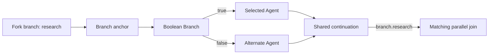

# Branch-local Boolean routing

Schema 1.34 adds bounded Boolean control flow inside static schema 1.32 parallel regions. A fork still starts each configured branch once, each branch still contributes one string result, and the existing join still waits for every stable branch ID before publishing its JSON value.

Each branch may contain at most one existing `core.branch.boolean` node. Its `condition` data input must have one compatible Boolean source. Both `true` and `false` execution outputs must connect within the same owning branch. Every statically possible route must reach that branch's matching `branch.<id>` join pin exactly once. Routes cannot escape to another branch, reach the join of another branch, bypass the join, loop, or enter another fork.

The validator explores both possible outcomes even when connected data currently evaluates to a constant. The graph may route both outcomes to one shared continuation node. At runtime the Boolean Branch activates one outgoing edge, so that continuation receives one message; it does not wait for the other outcome and it does not create another fan-in. The region join remains the only barrier and still emits one result per configured branch or no result if a branch fails or the run is cancelled.

Loops, approvals, merge nodes, nested or repeated forks, terminals, standalone MCP nodes, cross-branch execution edges, and conditional routes in schema 1.33 collaborative regions are unsupported. Schema 1.32 and 1.33 definitions retain their prior serialization and behavior. A 1.32 authoring edit that adds a Boolean Branch upgrades the draft to schema 1.34.

Decision and execution-activation events retain the selected port or connection ID along with the fork activation ID and stable branch ID. They identify the actual path taken without inferring delivery from node completion. Playback presents recorded events only; it does not reevaluate branch data or invoke an Agent, MCP tool, or model.

Incomplete 1.34 topology remains editable and saveable as a draft with validation diagnostics. Strict definition serialization, publication, and run admission reject invalid topology. The interactive flow and current node controls are documented in [the user guide](user-guide.md#route-within-a-parallel-branch); broader parallel behavior is in [parallel graphs](parallel-graphs.md).

The shared continuation is reached through exactly one selected path. It is exclusive routing and does not wait for both arms.
