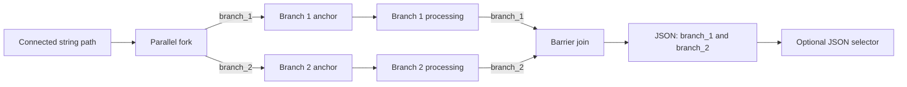

# Bounded parallel graph blocks

Schemas 1.14–1.31 support up to four sequential, explicit two-branch blocks. Schema 1.32 adds a configurable 2–8 branch region in an explicit execution graph. In either form a parallel block is a visible fork and barrier, not an arrangement of nodes that happen to sit side by side. Each branch receives the same incoming string and produces one string result. Nested or independently concurrent regions remain unsupported.

Choose **Parallel block** from the node library while an ordinary string connection is selected. Studio inserts a fork, two named branch anchors, and a matching join. If the old path continued into a string node, Studio adds a root JSON selector after the join so that continuation remains valid. If the old path ended at Output, Output becomes JSON typed. The first block uses schema 1.14 or preserves a newer existing schema. Adding a second block upgrades the draft to schema 1.20, which supports up to four sequential blocks while leaving earlier schema definitions limited to one.

To add another block, select a string connection after the previous block's selector and insert **Parallel block** again. Each block has its own join, progress events, and JSON result. Selecting a fork, branch, or join and choosing **Remove parallel block…** previews and removes only that block, preserving the other blocks and reconnecting the surrounding path.

Add deterministic text operations, agent nodes, or MCP tools after either branch anchor. The branch anchors must remain the first nodes after the fork, and each path must connect to the join input with the same branch name. Branch paths are acyclic and cannot contain conditions, approvals, merges, another parallel block, or terminals. Existing compatible pin rewiring is available; drafts with incomplete or mismatched paths show validation issues and cannot be published or run. The JSON selector can turn the complete result or one named field back into text.

The runner maps the fork to explicit Agent Framework messages and uses the framework's concurrent in-process execution environment. It maps the join to a fan-in barrier that waits for one result from both branch endpoints. Join output is a deterministic JSON object with `branch_1` and `branch_2`, capped at 16,384 serialized characters. Node, transfer, join-progress, completion, and failure events preserve the values and actual connections for playback; replay performs no agent or tool calls.

If a branch fails or the run is cancelled, the workflow does not produce a joined result. External effects already completed by another branch are not rolled back. Agent/MCP services must tolerate concurrent calls when authors place them in separate branches. The current bound is four sequential parallel blocks per workflow, two branches per block, 256 total graph nodes, and 16,384 characters per joined result. There are no loops, dynamic branch counts, nested joins, branch-local conditional routing, or distributed transactions.

Each block can be removed by selecting any of its fork, branch, or join nodes and choosing **Remove parallel block…**. Studio previews the complete affected region before confirmation, reconnects the original incoming path to the following node, and makes the edit undoable. Published workflow revisions and recorded runs remain immutable.

See [architecture](architecture.md), [the user guide](user-guide.md#run-two-paths-in-parallel), and [roadmap](roadmap.md) for implementation status.

## Configurable parallel regions in schema 1.32

The current fork/join is fixed to two branches and is implemented on the legacy data-edge scheduler. Modern explicit graph schemas schedule through `ExecutionConnections`; their data `Connections` are not activation routes. A safe N-way extension must therefore use a new schema contract, not widen legacy pins. Existing two-branch definitions keep their exact serialization, hash, validation, and replay behavior.

Schema 1.32 now has engine-level support for one static fork-to-join region with 2–8 fork-owned branch descriptors. Each descriptor has a stable machine ID, presentation label, and branch-anchor node ID. Execution pin IDs derive from the stable ID, never from array position or editable label. Fork outputs activate their matching anchor; each anchor and branch path carries the ID to the corresponding join input. Branch routes are straight acyclic paths whose terminal activation supplies that branch's final string result. The join waits for one result per descriptor and emits a bounded JSON object keyed by stable branch ID; property order is ordinal ID order, not completion or presentation order.

Data wires remain lazy and do not schedule. The completed join is an explicit runtime data producer, like an Agent's recorded runtime output: after all arrivals are correlated and the result size is checked, its JSON value becomes available to downstream pure data consumers. The workflow Output can then return that value, and a later selector can pick a field. This contract avoids hiding branch scheduling in data edges. A new runtime join value is never visible while the join is incomplete.

Runtime arrivals are keyed by run, fork activation, and stable branch ID. Duplicate, unknown, or mismatched arrivals fail the region. A branch failure cancels siblings where possible and produces no aggregate; cancellation likewise records no partial output. Completed external side effects are not rolled back. The initial schema excludes nested or repeated fork activations, loops, conditionals within branch regions, cross-join paths, bypasses, and concurrent approval branches. Keep the established 16,384-character aggregate bound for the first release. The eight-arm scheduler must be shown to complete without a barrier waiter holding scarce execution capacity; the schema's eight-branch ceiling does not silently promise unlimited host resources.

Core validates this region, projects stable named execution pins, and runs branches concurrently through Microsoft Agent Framework. Runtime join arrivals use the same invocation ID as the fork and are keyed by branch ID; an incomplete or failed fan-in never produces a partial value. The aggregate remains capped at 16,384 characters. A deterministic three-branch and eight-branch runtime test covers concurrent completion, named JSON results and failure without output. Existing schemas retain their original pins and scheduling behavior.

Studio can create a 1.32 region from a valid 1.31 graph whose Input first activates an Agent or Boolean Branch and whose Output still returns the input text. The author chooses 2–8 branches; Studio inserts the fork, named anchors, and join as one undoable edit and routes the join's JSON result to Output. Labels can be edited without changing stable IDs or wire endpoints. The fork inspector can append branches up to the eight-branch limit, reorder branch pins, and remove an empty branch while at least two remain. Each edit updates the fork descriptors, anchor and matching join pins atomically. Populated branches cannot be removed until their Agent nodes have been moved or deleted; Studio does not silently discard authored work. Removing the complete region restores the original Input-to-Output value path and is undoable. After creation, users can add Agent nodes and rewire each anchor through its branch to the join pin with the same ID. Branches do not yet support conditions, loops, nested regions, or standalone MCP nodes.

Playback remains event-based and never invokes live agents or tools. Existing schemas retain their original pins and scheduling behavior. Shared-channel agent phases and repeated barriers remain separate until their scheduling, timeout, retry, budget, and partial-failure policies are defined. Tests cover stable named pins, branch-count limits, add/remove/reorder, label changes, removal/undo, concurrent three/eight-arm execution, and failure without partial output. See [the user guide](user-guide.md#run-configurable-parallel-branches) for the Studio authoring flow.

Collaborative teams build on these visible branches. The first region contract should be a bounded static DAG with stable branch IDs and one stable participant identity per Agent node invocation. Reject conditions, loops, nested forks, and any graph shape that can bypass or repeat a barrier. Group members share an append-only bounded board scoped to a region invocation. At each barrier generation, record arrivals and park them without holding an execution permit; admit work in bounded waves when the host cap is below group size. Release the next phase only after every declared participant arrives. Capture an ordered message snapshot at release so all agents in that phase read the same prefix; phase writes become visible only in the next snapshot. Record observed append order without implying causal order. The final join returns named results that can feed ordinary downstream graph paths. Before implementation, define timeout, cancellation, member-failure and partial-result behavior, retry/restart limits, budget reservation, and treatment of completed external side effects. Audit/playback must persist participant invocation IDs, barrier generations, snapshot boundaries, exact reads/writes, arrivals/releases and outputs without live calls. The current profile-based `team_0` remains available for model-directed fan-out, but it is not a substitute for visible graph branches and barriers.
