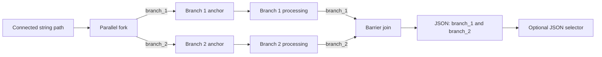

# Bounded parallel graph blocks

The current visual graph supports one explicit, two-branch parallel block. It is a visible fork and barrier, not an arrangement of nodes that happen to sit side by side. Branch 1 and branch 2 each receive the same incoming string and produce one string result.

Choose **Parallel block** from the node library while an ordinary string connection is selected. Studio inserts a fork, two named branch anchors, and a matching join. If the old path continued into a string node, Studio adds a root JSON selector after the join so that continuation remains valid. If the old path ended at Output, Output becomes JSON typed. The block is saved as schema 1.14.

Add deterministic text operations, agent nodes, or MCP tools after either branch anchor. The branch anchors must remain the first nodes after the fork, and each path must connect to the join input with the same branch name. Branch paths are acyclic and cannot contain conditions, approvals, merges, another parallel block, or terminals. Existing compatible pin rewiring is available; drafts with incomplete or mismatched paths show validation issues and cannot be published or run. The JSON selector can turn the complete result or one named field back into text.

The runner maps the fork to explicit Agent Framework messages and uses the framework's concurrent in-process execution environment. It maps the join to a fan-in barrier that waits for one result from both branch endpoints. Join output is a deterministic JSON object with `branch_1` and `branch_2`, capped at 16,384 serialized characters. Node, transfer, join-progress, completion, and failure events preserve the values and actual connections for playback; replay performs no agent or tool calls.

If a branch fails or the run is cancelled, the workflow does not produce a joined result. External effects already completed by another branch are not rolled back. Agent/MCP services must tolerate concurrent calls when authors place them in separate branches. The current bound is one parallel block per workflow, two branches, 256 total graph nodes, and 16,384 characters for the joined result. There are no loops, dynamic branch counts, nested joins, branch-local conditional routing, or distributed transactions.

The block can be removed by selecting any fork, branch, or join node and choosing **Remove parallel block…**. Studio previews the complete affected region before confirmation, reconnects the original incoming path to the following node, and makes the edit undoable. Published workflow revisions and recorded runs remain immutable.

See [architecture](architecture.md), [the user guide](user-guide.md#run-two-paths-in-parallel), and [roadmap](roadmap.md) for implementation status.
