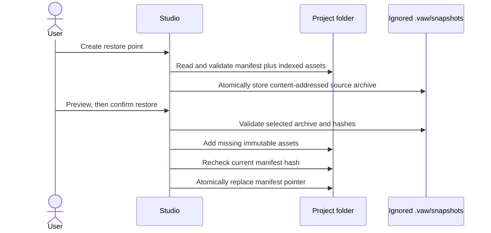
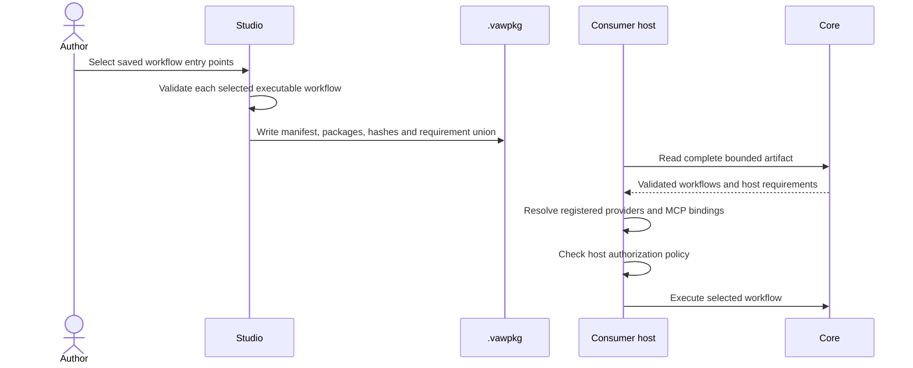
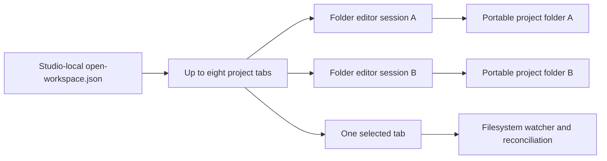
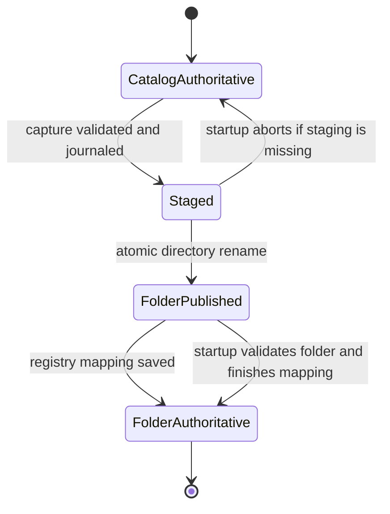

# Project folders and workspaces

## Current implementation

Studio offers a local project registry and project selection for catalog-backed and folder-backed projects. Catalog-backed workflows live in a project-scoped SQLite catalog; skills, agent profiles, and graph functions use JSON catalogs under the Studio data directory. Folder-backed projects are registered by canonical root path and reopen in the source editor. Studio supports up to eight folder roots open as tabs, each with a separate mounted editor session and project tree. Folder projects do not use catalog publication; Studio can run a validated saved workflow or test a workflow directly from a validated restore point.

The IDE activity bar and Explorer navigate project assets. The title bar's **Studio settings** menu holds user-specific model and MCP connection configuration, while the project sidebar stays focused on files and workflow authoring. Workflow tabs have explicit close buttons and support middle-click; closing unsaved work prompts before discarding it. Workflow settings open as an overlay so configuration does not replace or shift the graph canvas. In catalog projects, right-click a workflow for **Open**, **Duplicate**, **Copy**, **Rename**, and **Delete**. **Copy** snapshots the saved draft and layout; right-click `workflows/` and choose **Paste workflow** to create a new workflow from it. Rename preserves the workflow ID used by references. Duplicate and paste create a new workflow ID and draft/layout copy without published revisions or run history. Delete moves the item to **Deleted workflows**, where it can be restored with its revisions, audit evidence, and run history intact. Save or discard unsaved editor changes before using these actions. Right-clicking an asset category or blank Explorer space opens creation actions; folder projects also support filesystem-backed nested folder and file operations.

The Projects page offers **Download source snapshot** and **Import as new project**. The deterministic `.vawsrc.zip` contains a versioned `vaw.project.json` index with stable IDs and SHA-256 for each indexed file. Workflow files use a source-only definition/layout format that accepts disconnected drafts; skills, agent profiles, and graph functions are separate JSON assets. New graph-function source files have the Studio format `{ "formatVersion": "1.0", "item": <catalog entry>, "layout": <validated WorkflowLayout> }`. The manifest SHA-256 covers the full asset, including layout; the embedded `item.function.contentHash` remains the semantic hash of the executable function definition only. Project manifest format 1.2 adds ordinary UTF-8 Markdown documentation (`kind: documentation`, `.md`) and explicit directory entries. Earlier 1.0 and 1.1 manifests remain readable; saving through current Studio upgrades them to 1.2. Markdown is editable project source, not executable workflow content, and is excluded from `.vawpkg` consumer releases. The bounded archive reader rejects unsafe or case-colliding paths, duplicate manifest entries, unlisted/missing files, hash mismatches, and oversized content without extracting files. Import validates all content before creating a new project, then restores definitions/layouts and reusable assets. It does not overwrite or merge into an existing project. Tests verify deterministic export, round trips, and isolated project import.

The Studio has a bounded source-directory reader/writer for the same manifest and asset format. It validates directory content through the archive contract, rejects symbolic links/reparse points and oversized files, writes a `.gitignore` for `.vaw/`, and refuses to overwrite an existing destination. The **Open folder** page validates an explicitly entered absolute path, registers it in the Studio project selector, and displays manifest-indexed files in a hierarchical project tree. Open folders appear as project tabs; within a project, opened source assets appear in document tabs and can be switched without losing a clean editor buffer. The workflow workspace has a dedicated IDE titlebar and activity rail, a read-only `vaw.project.json` tree item, and a compact Explorer beside the graph. The Explorer highlights the active workflow and keeps the highlight synchronized with the workflow selector. Right-click the project root or a folder and use **New file** to create a workflow, agent, skill, function, or Markdown document; use **New subfolder** to add directories. The same menu offers file operations (open, cut, copy, paste, duplicate, rename/move, delete) and folder operations (cut, copy, paste, rename, or delete when empty). Folders can be nested by domain; the familiar `workflows/`, `agents/`, `skills/`, and `functions/` roots are defaults rather than required destinations. Markdown opens in the locally bundled Monaco editor with Markdown syntax highlighting, word wrap, theme-aware colors, and `Ctrl+S` / `Cmd+S` save; the plain-text fallback remains available if Monaco cannot start. The editor bundle loads only when a Markdown document opens and has no runtime CDN dependency. Its source and pinned build tooling live in `tools/monaco/`, and CI builds the committed static assets. Documents can be saved, renamed, moved, copied, and deleted like other indexed files. Open folders appear in tabs; within a project, opened source assets appear in document tabs. Selecting a workflow opens it in the graph editor; selecting a skill or agent profile opens a typed revision form; selecting a graph function opens its typed interface and pure dataflow graph editor. The workflow workspace has a compact Explorer beside the graph, docks run controls, validation issues, and execution output below the graph, and reveals the node library from **Add node** when needed. The selector and project list reopen a registered root. Newly written executable files use `.workflow`, `.skill`, `.agent`, and `.function` extensions while retaining JSON contents and manifest hashes; Markdown uses `.md`; previously indexed `.json` files remain readable. Workflow source and new skill/profile/function revisions use immutable content-addressed files and an atomically replaced manifest pointer; saves perform optimistic manifest-hash checks and report detected stale edits. This check is not atomic against an arbitrary external Git/editor writer; there is a narrow compare/replace race. Old content-addressed files are retained so concurrent readers of an earlier manifest can finish. Skills, agent profiles, and graph functions are added as new versions; an existing revision is never mutated. Graph-function source assets use a versioned Studio envelope containing the function catalog entry and validated canvas layout. The executable function hash still covers only its definition; the project manifest hash covers the source file including layout. Legacy raw catalog entries load with a generated layout because their former layout was not recorded. Graph-function editing supports the current pure string/Boolean/integer node subset, including signed integer constants, checked addition, and equality. Folder profile, skill, and graph-function sources are supplied to folder-backed workflow editing, while profile tools and providers remain logical requirements resolved by the Studio/consumer host. Folder project IDs route back to this source editor; project-scoped catalog APIs fail with HTTP 409 rather than silently selecting a separate SQLite catalog. A folder project's **Download source snapshot** action packages its validated manifest and files. It also offers manual local restore points and previewed source restoration under ignored `.vaw/snapshots/`; these contain only one complete validated manifest state and its indexed files. Restore writes missing immutable assets and atomically switches `vaw.project.json`, leaving unindexed and newer files untouched. The first restore point adds `/.vaw/` to `.gitignore` without replacing existing rules. Sidecar data is bounded to 20 points and 256 MiB; capture does not silently prune older points. Corrupt, missing, or deleted sidecar data disables local restore only and does not affect project validity or source export. **Run workflow** freshly validates the complete manifest, checks the editor's expected manifest and asset hashes, captures the selected definition/layout in memory, and queues that immutable capture through the host runtime. **Test selected workflow** does the same from a validated `.vaw/snapshots/` archive without switching the active project manifest. Both actions require executable definitions; dirty edits block execution, and stale current source must be reloaded. Runs record their definition hash plus project ID, manifest hash, asset hash, and layout hash in the host run store. The captured layout is saved with run evidence for playback; no run data is written to the folder. This is not a cross-process filesystem lock: source changes after capture do not alter an admitted run, while changes before capture are rejected by the hash check. Only the active root has a file watcher; inactive roots stop watching and revalidate their manifest and indexed hashes when selected again. The active editor listens for file changes and periodically validates the complete manifest-indexed snapshot every 20 seconds. Watcher events are hints, not locks. Closing a dirty project tab requires explicit discard confirmation. Tab order and active project ID are saved in Studio-local `open-workspace.json`; absolute folder paths are not written into project files. Editor buffers are held in the current browser circuit and are not restored after a browser refresh or Studio restart. Runs remain in the host-level run store.

The folder editor also has a **Build consumer package** form. Select one or more saved workflow entry points and download a deterministic `.vawpkg`. Only selected workflows need to be executable; incomplete unselected drafts remain source-only. The release manifest wraps one validated `WorkflowPackageJson` per selected workflow and derives a sorted union of their host requirements. Skills, profiles, graph functions, and nested calls already embedded as immutable snapshots remain authoritative and are not copied into a second location. The bundle omits Git and `.vaw/` state, endpoints, credentials, grants, and run history. User-authored workflow text remains included and should be reviewed before sharing.

The browser smoke `scripts/folder_execution_smoke.py` opens a temporary source folder, executes its saved workflow, changes the active source, and then executes the older restore point. It checks the two results and source hashes differ as expected, the current manifest remains active after snapshot testing, no canvas/editor alerts appear, and no run history is created inside the project. Start Studio and run `python3 scripts/folder_execution_smoke.py --base-url http://127.0.0.1:5099`; pass `--browser-executable` when Chromium is installed outside Playwright's default browser cache.

The first access to the deterministic Default Project copies a legacy workflow database with SQLite backup and copies legacy JSON libraries, preserving the source files. Existing tests verify migrated workflow definitions, revision IDs and hashes, layouts, generations, head/active pointers, audit order, and skills. Model-provider and MCP registrations, endpoints, protected credentials, grants, and run history are host-wide. Project selection does not authorize runtime capabilities.

## Target project contract

The portable project directory is the canonical editable source. It must be openable and understandable without Studio, SQLite, or `.vaw/`. Studio opens up to eight folders together in tabs and shows each project’s real files in its own tree; selecting a workflow opens it in the graph editor. Git runs through the user's normal tooling. Studio will not provide multi-user editing or an in-app Git client.

The current source tree may use familiar defaults, while the manifest permits nested domain-oriented folders and Markdown documentation:

```text
my-project/
  .gitignore                 # excludes .vaw/
  vaw.project.json           # format version, stable ID, name, relative indexes
  domains/
    customer-support/
      workflows/
        support-triage.workflow
      agents/
        support-specialist.agent
      skills/
        research.skill
      functions/
        normalize-ticket.function
      README.md              # developer-facing project notes
  docs/                      # optional project-wide documentation
  .vaw/                      # optional local-only restore points, test snapshots and indexes
```

Paths in manifests are relative and must remain under the project root after canonicalization. Reject path traversal, unsupported links that leave the root, duplicate IDs, case-colliding paths, oversized files, and unknown format versions with actionable diagnostics. Save one source file atomically. When an external Git/editor change conflicts with an open unsaved editor buffer, preserve both versions and ask the operator to reload or compare; never overwrite the external edit silently.

Git is authoritative for source history. `.vaw/` is optional disposable client state and must be ignored by Git and omitted from all exports. Studio can manually save a validated source snapshot and preview/restore it for Git review. A selected snapshot can also be run directly from its validated archive without changing the active manifest. Project files must not contain model endpoints, API keys, MCP access tokens, host grants, or local run evidence. Host-owned run history records the immutable definition and layout plus manifest, asset, and archive hashes independently of the active Git branch. Consumers configure the single authoritative `IWorkflowRunStore`; runtime writes and read-only observation use that same store. A second write-only run sink is not planned because it could diverge from replay, pause, approval, and interruption evidence.

Studio keeps its configurable run store in app-local host data outside portable project roots so the Run inspector remains useful across sessions. A temporary directory can be selected for a disposable demo or test, with the understanding that the operating system may remove it. Temporary storage does not provide a retention policy. Checkpoint recovery is separate and opt-in; native checkpoint state and matching event/cursor evidence must use the same checkpoint-capable store.

Restore capture and materialization follow a single-manifest commit boundary:



## Consumer artifact

The `.vawsrc.zip` is editable source transport, not a consumer package. Importing one creates a separate catalog-backed project; it does not connect that project to an extracted Git folder.

The `.vawpkg` is a bounded release wrapper, not NuGet and not an installer. Its strict versioned `vaw.release.json` manifest identifies the project, explicitly selected workflow entry points, inner package paths and hashes, and the derived requirement union. Each inner payload uses the existing validated workflow package contract, including its executable definition, layout, embedded snapshots, and requirements. The project source manifest is not included wholesale, so unselected drafts and assets do not leak into the release. Core validates paths, bounds, duplicate/case-colliding entries, hashes, package semantics, and derived requirements in memory; it never extracts archive paths. Hashes detect mismatch but do not authenticate a publisher or grant permissions.

The standalone WorkflowService sample can read a `.vawpkg`, select an entry workflow, validate it, resolve its required node/provider/MCP registrations from host-supplied services, enforce host grants, and execute without Studio or a project catalog. Its sample revision ID is derived from the artifact digest and selected workflow ID; the run record retains the selected definition hash and revision ID. Package availability is not authorization: the MCP smoke proves a required tool is denied until the consumer supplies an explicit host grant. The bundle does not install code, configure endpoints, activate a deployment, or provide publisher signatures. Immutable staging/activation, trusted publisher verification, and catalog-backed project export remain future work. Existing single-workflow package APIs remain available.



## Local data and version behavior

The target has no project-local in-app revision history. Users use Git branches, commits, and reverts. Implemented `.vaw/` restore points are content-addressed local conveniences with explicit capture, preview, run, restore, and deletion; they can be deleted without losing source. A run stores the content hashes of the selected immutable source state, not a mutable folder path or current branch. The host run store owns execution evidence and retention.

The Studio’s open-project state is local IDE state rather than part of any portable project. Up to eight registered project IDs and the selected ID are saved to `open-workspace.json` under Studio’s host data directory. Each project tab holds its editor component and buffer for the active browser circuit; only the selected tab watches the filesystem. Reopening an inactive tab revalidates its current source tree. A dirty tab must be explicitly discarded before it can be closed. Refreshing the browser restores the tab list from disk but loses unsaved in-memory edits.



Migration from the current SQLite-backed catalog must preserve stable workflow/asset IDs and produce ordinary source files. Existing audit/revision data may be retained in local `.vaw/` history for recovery and old run inspection, but it is not copied into project source or represented as Git history. There must be one clear source-of-truth rule at each migration phase; avoid unsignaled dual writes.

### Catalog-to-folder cutover contract

Cutover migrates the **current editable source snapshot**: each workflow's current draft definition and layout plus the current skill, agent-profile, and graph-function assets with their IDs, versions, and content hashes. It does not migrate SQLite workflow revision/audit history, publication history or pointers, prior run evidence, or Git history. The CLI and user guide state this scope; the original catalog and host run store remain outside the folder as local recovery data. The bounded ZIP import path is not the migration primitive because it creates a new catalog project, omits those histories, and applies archive size limits.

The command runs with Studio stopped. An exclusive lock prevents a second Studio host from opening the same data directory while capture or activation is in progress:



The original catalog remains local recovery data after activation. The registry mapping is the authority switch; the journal lets startup finish that switch before it creates writable project services.

The source catalog must be held stable for capture. Because Blazor circuits retain direct references to mutable catalog and library objects, HTTP middleware cannot make live cutover safe. Migration is therefore an offline operation: Studio must be stopped, and the migration command and web host share an exclusive lock on the Studio data directory so a second Studio process cannot start during the cutover. Materialize the current editable source snapshot into a new sibling staging directory, validate it with the bounded project-source reader, and compare its manifest hash with the captured source. A durable journal lets startup recover an interruption: if the folder has been published but the mapping has not, startup verifies the folder and completes the mapping before exposing writable APIs; if the staged folder is missing, the catalog remains authoritative. Once mapped, the folder is the sole editable authority and the catalog remains intact as local recovery data. Do not dual-write. This is a single-host guarantee; arbitrary external Git/editor changes remain outside the lock.

Rollback to the old catalog is safe only while the folder manifest still matches the cutover hash. Once folder edits occur, returning to the stale catalog requires explicit reconciliation or a new catalog materialized from the selected folder state; it must never silently discard folder edits. Existing folder mode still has a documented cross-process manifest compare-and-replace race, so activation and later writes must not claim protection against arbitrary simultaneous Git/editor processes. Provider endpoints, credentials, MCP grants, and run/audit storage remain host-owned throughout.

The initial project-to-folder routing and offline cutover are implemented. Opened roots are persisted in the local project registry, and `--migrate-project-to-folder <project-id> <new-folder>` converts the selected catalog project in place while preserving its project ID. The command migrates the current editable draft and asset snapshot; it does not copy workflow revision/audit history, publication history, or runs, which remain in the Studio data directory. It stages and validates the folder, records a journal, then switches the mapping. Startup recovers an interrupted journal before registering writable workspace APIs. The web host holds the same exclusive data-directory lock for its lifetime, so migration cannot run against a live host and a second Studio instance cannot open the same data directory. Folder-backed catalog publishing and catalog history in `.vaw/` remain unimplemented; direct saved-source and restore-point runs use host-owned evidence instead.

## Roadmap sequence

1. Define and test deterministic project-file schemas, manifest validation, source snapshot build/import, stable IDs, and content hashes. **Done for schema 1.0 and the first workflow/skill source editors.**
2. Extend folder-backed authoring to profiles and graph functions while preserving a single authority rule; define an explicit migration/cutover from the current local catalogs. **Immutable profile and graph-function source authoring, project-library wiring, graph-function layout persistence, and offline catalog cutover with startup recovery are implemented.**
3. Support multiple folder roots open side by side with independent project tabs, editor buffers, and trees. **Implemented:** up to eight roots, saved local tab order/selection, per-root mounted editor sessions, dirty-close protection, and active-root-only file watching with revalidation on tab activation.
4. Add optional ignored `.vaw/` snapshots and restore/test selection, proving that deleting the sidecar does not affect project validity. **Implemented:** bounded manual capture, preview, manifest-pointer restore, deletion, and in-memory test execution from a selected point without switching the active manifest.
5. **Implemented:** build the deterministic `.vawpkg` from explicitly selected executable workflows and prove clean headless consumer execution with host-supplied dependencies and policy. Immutable staging/activation, trusted publisher verification, and catalog-backed project export remain future work.

6. **Implemented:** run a saved folder workflow from a freshly validated immutable source capture. Persist its definition/layout and manifest, asset, and layout hashes in the configured host run store; keep project/catalog files and folder state free of run evidence.

The source editor uses validated manifest-listed paths and requires an explicitly entered local folder path. Open-tab order and selected folder are recorded in Studio-local `open-workspace.json` (maximum eight roots); this is machine-local UI state, not a portable project workspace file. This local Development-only host is not an authenticated production file service. The current implementation does not prove Git merge behavior, compare-and-swap against arbitrary external editors, consumer installation, or migration of catalog revision/audit/run history into `.vaw/`.
