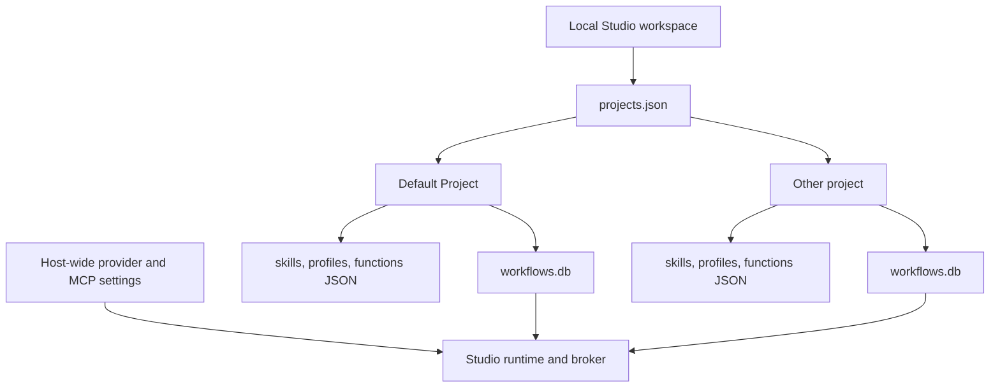

# Local project workspaces

Studio now has a local project registry that organizes workflow authoring. This is a single-operator feature for the loopback development app, not multi-user authorization or a workspace collaboration service.

## Current behavior

The **Projects** page creates projects, opens them, archives them, and restores archived projects. The project selector is available beside the workflow editor, Agent Designer, Skill library, and Function library. Each project gets a separate data directory and workflow catalog. The project-aware API is available under `/api/projects/{projectId}`; the older `/api/workflows` routes select **Default Project**.

Workflow definitions, drafts, layouts, immutable revisions, catalog audit, and active/head pointers stay in the selected project's SQLite catalog. Skills, agent profiles, and pure graph functions use project-local JSON libraries. Workflow and asset identifiers are unchanged by the legacy migration. Published workflows continue embedding exact skill/profile/function snapshots; moving between projects does not rewrite a published workflow.

On first use, Studio creates the deterministic `default` project. If it finds legacy `workflows.db`, `skills.json`, `agent-profiles.json`, or `graph-functions.json` at the root of the configured Studio data directory, it copies each missing destination into the Default Project. SQLite uses the backup API so a consistent database snapshot is copied. Legacy files are retained as recovery copies; future writes go to the project directory. The copy is repeatable and never overwrites an already-created project catalog. It is not an all-files transaction, so if interrupted, the next open retries any missing file.

Archiving hides a project from the selector while retaining its files. Restoring it makes it selectable again. The Default Project cannot be archived. Project IDs are local catalog keys; they do not authenticate a user or grant access.

## Host-wide settings and permission boundary

Model-provider registrations, endpoints, protected keys, MCP endpoints/tokens, broker registrations, grants, and run history remain local Studio environment data. This prevents a project selection or project import from silently granting a tool. The current Studio process is a development host with a local operator policy; it does not yet expose per-project environment binding manifests or separate multiple secured execution environments. Workflows and projects must not be treated as an authorization boundary.

Workflow parameters remain workflow-owned inputs with per-run overrides. There are no mutable project-global variables. Runtime execution and history remain independent of the browser, but run history is currently host-wide rather than filtered by project.

## Git and sharing limits

Studio does not yet have a Git-native project format, project bundle import/export, Git commit UI, or project-level merge semantics. The workflow catalog is SQLite and project metadata is in a local JSON registry, so these local database files are not reviewable line-by-line like ordinary source files. Use the existing workflow package export for a portable, hash-validated workflow artifact. Do not assume copying project database files to another host will safely remap provider/MCP endpoints, credentials, or grants.

The planned source-controlled format should serialize deliberate project snapshots into ordinary versioned files, retain stable asset IDs and immutable content hashes, and keep environment bindings external. Git will provide version control and sharing; Studio will need explicit import/export and conflict handling before a project directory is a supported interchange contract.

## Validation

`StudioProjectWorkspaceTests` verifies deterministic project metadata, archive/restore behavior, project isolation, and legacy migration of workflow definitions, revision IDs/hashes, layout, generations, head/active pointers, audit entries, and skills. These tests do not establish Git mergeability, cross-project references, or project-aware run-history filtering. Multi-user editing is out of scope; Git-friendly serialization remains planned.
