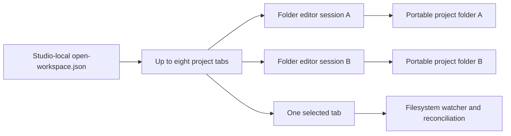
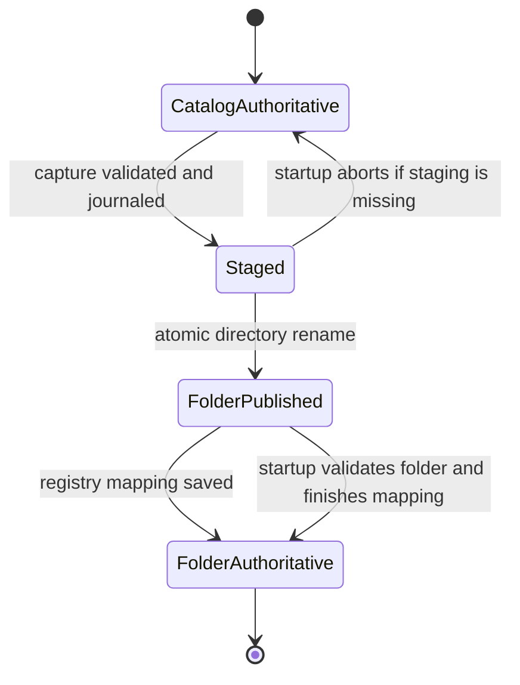

# Project folders and workspaces

## Current implementation

Studio offers a local project registry and project selection for catalog-backed and folder-backed projects. Catalog-backed workflows live in a project-scoped SQLite catalog; skills, agent profiles, and graph functions use JSON catalogs under the Studio data directory. Folder-backed projects are registered by canonical root path and reopen in the source editor. Studio now supports up to eight folder roots open as tabs, each with a separate mounted editor session and project tree; folder projects still do not provide catalog publication or runtime execution.

The Projects page offers **Download source snapshot** and **Import as new project**. The deterministic `.vawsrc.zip` contains a versioned `vaw.project.json` index with stable IDs and SHA-256 for each ordinary JSON asset. Workflow files use a source-only definition/layout format that accepts disconnected drafts; skills, agent profiles, and graph functions are separate JSON assets. New graph-function source files have the Studio format `{ "formatVersion": "1.0", "item": <catalog entry>, "layout": <validated WorkflowLayout> }`. The manifest SHA-256 covers the full asset, including layout; the embedded `item.function.contentHash` remains the semantic hash of the executable function definition only. The bounded archive reader rejects unsafe or case-colliding paths, duplicate manifest entries, unlisted/missing files, hash mismatches, and oversized content without extracting files. Import validates all content before creating a new project, then restores definitions/layouts and reusable assets. It does not overwrite or merge into an existing project. Tests verify deterministic export, round trips, and isolated project import.

The Studio has a bounded source-directory reader/writer for the same manifest and asset format. It validates directory content through the archive contract, rejects symbolic links/reparse points and oversized files, writes a `.gitignore` for `.vaw/`, and refuses to overwrite an existing destination. The **Open folder** page validates an explicitly entered absolute path, registers it in the Studio project selector, and displays manifest-indexed files in a hierarchical project tree. Open folders appear as tabs and can be switched without discarding each root’s in-session editor buffers. Selecting a workflow opens it in the graph editor; selecting a skill or agent profile opens a typed revision form; selecting a graph function opens its typed interface and pure dataflow graph editor. The selector and project list reopen a registered root. Workflow source and new skill/profile/function revisions use immutable content-addressed JSON files and an atomically replaced manifest pointer; saves perform optimistic manifest-hash checks and report detected stale edits. This check is not atomic against an arbitrary external Git/editor writer; there is a narrow compare/replace race. Old content-addressed files are retained so concurrent readers of an earlier manifest can finish. Skills, agent profiles, and graph functions are added as new versions; an existing revision is never mutated. Graph-function source assets use a versioned Studio envelope containing the function catalog entry and validated canvas layout. The executable function hash still covers only its definition; the project manifest hash covers the source file including layout. Legacy raw catalog entries load with a generated layout because their original placement was not recorded. Graph-function editing supports the existing pure string/Boolean node subset. Folder profile, skill, and graph-function sources are supplied to folder-backed workflow editing, while profile tools and providers remain logical requirements resolved by the Studio/consumer host. Folder project IDs route back to this source editor; project-scoped catalog APIs fail with HTTP 409 rather than silently selecting a separate SQLite catalog. A folder project's **Download source snapshot** action packages its validated manifest and files. Only the active root has a file watcher; inactive roots stop watching and revalidate their manifest and indexed hashes when selected again. The active editor listens for file changes and periodically validates the complete manifest-indexed snapshot every 20 seconds, including asset hashes. A change offers reload when the editor is clean; dirty buffers remain in place until the user explicitly discards them and reloads. Reload always rereads and validates current files. Watcher events are hints, not a cross-process lock, and the periodic check can take up to 20 seconds to notice missed events. Closing a dirty project tab requires an explicit discard confirmation. Tab order and active project ID are saved in Studio-local `open-workspace.json`; absolute folder paths are not written into project files. Editor buffers are held in the current browser circuit and are not restored after a browser refresh or Studio restart. The editor does not publish catalog revisions or run workflows. Folder writes are not mirrored into the catalog-backed libraries. Runs remain in the host-level run store.

The first access to the deterministic Default Project copies a legacy workflow database with SQLite backup and copies legacy JSON libraries, preserving the source files. Existing tests verify migrated workflow definitions, revision IDs and hashes, layouts, generations, head/active pointers, audit order, and skills. Model-provider and MCP registrations, endpoints, protected credentials, grants, and run history are host-wide. Project selection does not authorize runtime capabilities.

## Target project contract

The portable project directory is the canonical editable source. It must be openable and understandable without Studio, SQLite, or `.vaw/`. Studio opens up to eight folders together in tabs and shows each project’s real files in its own tree; selecting a workflow opens it in the graph editor. Git runs through the user's normal tooling. Studio will not provide multi-user editing or an in-app Git client.

The proposed source tree is:

```text
my-project/
  .gitignore                 # excludes .vaw/
  vaw.project.json           # format version, stable ID, name, relative indexes
  workflows/
    support-triage.json      # definition, layout, parameters, exact asset snapshots/references
  skills/
    research/1.0.0.json
  agents/
    support-specialist/1.2.0.json
  functions/
    normalize-ticket/1.0.0.json
  .vaw/                      # optional local-only restore points, test snapshots and indexes
```

Paths in manifests are relative and must remain under the project root after canonicalization. Reject path traversal, unsupported links that leave the root, duplicate IDs, case-colliding paths, oversized files, and unknown format versions with actionable diagnostics. Save one source file atomically. When an external Git/editor change conflicts with an open unsaved editor buffer, preserve both versions and ask the operator to reload or compare; never overwrite the external edit silently.

Git is authoritative for source history. `.vaw/` is optional disposable client state and must be ignored by Git and omitted from all exports. Local restore points can help recover or test a prior snapshot, but restoring one writes source files back for Git review. Project files must not contain model endpoints, API keys, MCP access tokens, host grants, or local run evidence. Host-owned run history records immutable definition/layout hashes and resolved dependency identities independently of the active Git branch. Consumers configure the single authoritative `IWorkflowRunStore`; runtime writes and read-only observation use that same store. A second write-only run sink is not planned because it could diverge from replay, pause, approval, and interruption evidence.

Studio keeps its configurable run store in app-local host data outside portable project roots so the Run inspector remains useful across sessions. A temporary directory can be selected for a disposable demo or test, with the understanding that the operating system may remove it. Temporary storage does not provide a retention policy. Checkpoint recovery is separate and opt-in; native checkpoint state and matching event/cursor evidence must use the same checkpoint-capable store.

## Consumer artifact

The current `.vawsrc.zip` is a project source snapshot, not a consumer-installable package. The folder editor treats manifest-indexed files as source for multiple open project tabs, while existing catalog-backed projects still use their local catalog. Importing a ZIP creates a separate catalog-backed project; it does not connect that project to an extracted Git folder.

The later consumer artifact (proposed extension `.vawpkg`) should be built from validated project source. It contains the project manifest, selected workflow files, exact required graph-function/skill/profile snapshots, and a dependency manifest with format versions, content hashes, node/provider/MCP requirements, and unresolved logical binding IDs. It excludes `.vaw/`, Git metadata, endpoints, credentials, grants, and run history. A consumer application installs the artifact into its own deployment/release mechanism and resolves implementations, provider clients, MCP servers, credentials, and authorization under its own host policy. The archive is not a NuGet package and does not install executable assemblies.

Do not claim this as consumer-installable until a clean consumer sample can load it, resolve declared runtime IDs/versions and hashes, supply host-owned services, and execute a workflow without Studio or its authoring catalog. Existing single-workflow JSON export remains available in the meantime.

## Local data and version behavior

The target has no project-local in-app revision history. Users use Git branches, commits, and reverts. Optional `.vaw/` recovery snapshots are content-addressed, local-only conveniences; they can be deleted without losing source. Studio may list snapshots to allow a user to inspect or materialize one for testing. A run must identify the exact immutable artifact/content hash it used, not a mutable folder path, current branch, or sidecar snapshot ID. The host run store owns execution evidence and retention.

The Studio’s open-project state is local IDE state rather than part of any portable project. Up to eight registered project IDs and the selected ID are saved to `open-workspace.json` under Studio’s host data directory. Each project tab holds its editor component and buffer for the active browser circuit; only the selected tab watches the filesystem. Reopening an inactive tab revalidates its current source tree. A dirty tab must be explicitly discarded before it can be closed. Refreshing the browser restores the tab list from disk but loses unsaved in-memory edits.



Migration from the current SQLite-backed catalog must preserve stable workflow/asset IDs and produce ordinary source files. Existing audit/revision data may be retained in local `.vaw/` history for recovery and old run inspection, but it is not copied into project source or represented as Git history. There must be one clear source-of-truth rule at each migration phase; avoid unsignaled dual writes.

### Catalog-to-folder cutover contract

Cutover migrates the **current editable source snapshot**: each workflow's current draft definition and layout plus the current skill, agent-profile, and graph-function assets with their IDs, versions, and content hashes. It does not migrate SQLite workflow revision/audit history, publication history or pointers, prior run evidence, or Git history. The CLI and user guide state this scope; the original catalog and host run store remain outside the folder as local recovery data. The bounded ZIP import path is not the migration primitive because it creates a new catalog project, omits those histories, and applies archive size limits.

The command runs with Studio stopped. An exclusive lock prevents a second Studio host from opening the same data directory while capture or activation is in progress:



The original catalog remains local recovery data after activation. The registry mapping is the authority switch; the journal lets startup finish that switch before it creates writable project services.

The source catalog must be held stable for capture. Because Blazor circuits retain direct references to mutable catalog and library objects, HTTP middleware cannot make live cutover safe. Migration is therefore an offline operation: Studio must be stopped, and the migration command and web host share an exclusive lock on the Studio data directory so a second Studio process cannot start during the cutover. Materialize the current editable source snapshot into a new sibling staging directory, validate it with the bounded project-source reader, and compare its manifest hash with the captured source. A durable journal lets startup recover an interruption: if the folder has been published but the mapping has not, startup verifies the folder and completes the mapping before exposing writable APIs; if the staged folder is missing, the catalog remains authoritative. Once mapped, the folder is the sole editable authority and the catalog remains intact as local recovery data. Do not dual-write. This is a single-host guarantee; arbitrary external Git/editor changes remain outside the lock.

Rollback to the old catalog is safe only while the folder manifest still matches the cutover hash. Once folder edits occur, returning to the stale catalog requires explicit reconciliation or a new catalog materialized from the selected folder state; it must never silently discard folder edits. Existing folder mode still has a documented cross-process manifest compare-and-replace race, so activation and later writes must not claim protection against arbitrary simultaneous Git/editor processes. Provider endpoints, credentials, MCP grants, and run/audit storage remain host-owned throughout.

The initial project-to-folder routing and offline cutover are implemented. Opened roots are persisted in the local project registry, and `--migrate-project-to-folder <project-id> <new-folder>` converts the selected catalog project in place while preserving its project ID. The command migrates the current editable draft and asset snapshot; it does not copy workflow revision/audit history, publication history, or runs, which remain in the Studio data directory. It stages and validates the folder, records a journal, then switches the mapping. Startup recovers an interrupted journal before registering writable workspace APIs. The web host holds the same exclusive data-directory lock for its lifetime, so migration cannot run against a live host and a second Studio instance cannot open the same data directory. Folder-backed publishing/execution and catalog history in `.vaw/` remain unimplemented.

## Roadmap sequence

1. Define and test deterministic project-file schemas, manifest validation, source snapshot build/import, stable IDs, and content hashes. **Done for schema 1.0 and the first workflow/skill source editors.**
2. Extend folder-backed authoring to profiles and graph functions while preserving a single authority rule; define an explicit migration/cutover from the current local catalogs. **Immutable profile and graph-function source authoring, project-library wiring, graph-function layout persistence, and offline catalog cutover with startup recovery are implemented.**
3. Support multiple folder roots open side by side with independent project tabs, editor buffers, and trees. **Implemented:** up to eight roots, saved local tab order/selection, per-root mounted editor sessions, dirty-close protection, and active-root-only file watching with revalidation on tab activation.
4. Add optional ignored `.vaw/` snapshots and restore/test selection, proving that deleting the sidecar does not affect project validity. **Next.**
5. Build the ZIP consumer artifact and prove clean consumer installation/execution with host-supplied dependencies and policy.

The source editor uses validated manifest-listed paths and requires an explicitly entered local folder path. Open-tab order and selected folder are recorded in Studio-local `open-workspace.json` (maximum eight roots); this is machine-local UI state, not a portable project workspace file. This local Development-only host is not an authenticated production file service. The current implementation does not prove Git merge behavior, compare-and-swap against arbitrary external editors, consumer installation, or migration of catalog revision/audit/run history into `.vaw/`.
