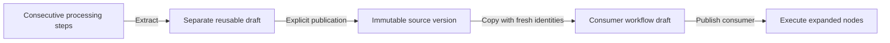
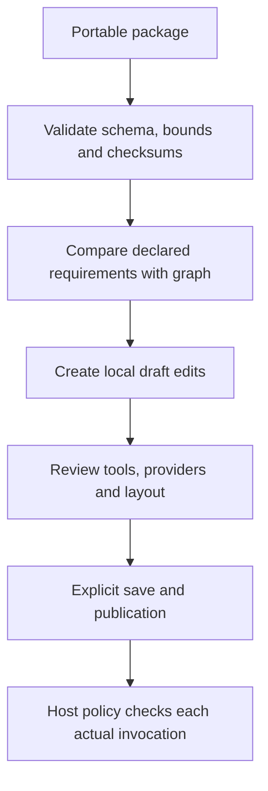

# Reusable pipelines and portable packages

Core supports both copy-on-insert reuse of a published linear pipeline and bounded runtime calls to immutable workflow revisions. The Studio exposes section extraction, published-version insertion or call, requirement review, and package import/export through its existing catalog and draft lifecycle. Runtime call limits and audit scope are specified in [nested workflow calls](nested-workflows.md).

## Identity and execution

A reusable source is an ordinary workflow with immutable numbered publications. Extracting a section creates a separate workflow draft containing its consecutive processing steps between new input/output terminals. Input/output nodes, empty or nonconsecutive selections, unsupported operations, and over-limit expansions are rejected. Existing validation, publication, optimistic concurrency, and audit storage apply.

Inserting a chosen publication copies its processing nodes into the consumer after a selected non-output node. It assigns fresh node and connection identities, preserves surviving consumer identities, copies labels/comments and internal routed wires/sections, and reconnects the linear sequence. MCP binding/contract requirements and agent provider/version/tool requirements remain pinned in the copied configurations. Runtime policy must still authorize the newly created node identities.

Definition schema `1.3` permits optional node `origin` metadata: source workflow, revision, version, definition hash, and source node ID. The existing node constructor and schemas 1.0–1.2 remain supported; absent origin is omitted so older canonical hashes remain unchanged. Provenance records where a copy came from, not an authenticated endorsement or a promise that subsequent local edits match the original. It never resolves code or grants permissions. Changing or removing a source publication cannot rewrite the consumer's expanded nodes. Inserting a workflow's own old publication is a finite copy, not recursion.

Runtime calls embed the exact child definition and revision hash. Calls are bounded to three nested levels and 1,024 expanded nodes; typed ports, explicit input/parameter mappings, and revision upgrades/review are described in [nested workflow calls](nested-workflows.md). Nested approvals are supported with exact root-run and call-path binding, subject to the single-pending-approval constraint. Copy insertion is still explicit versioned template expansion within the 256-node workflow and 64-section layout limits.

## Package format

`WorkflowPackageJson` format `1.0` contains the executable definition, separate layout, their canonical SHA-256 checksums, and the exact derived node implementation, MCP contract, agent-provider, and recursively pinned workflow-revision requirements. It has no host connection factories, credential exports, installation commands, or policy grants. User-authored text remains user content and should be reviewed before sharing.

Imports reject unsupported formats/schemas, unknown or duplicate properties, invalid graphs/layouts, mismatched checksums, and requirement manifests that disagree with the graph. Definition/layout bounds still apply individually; the complete package is bounded to 3 MiB. Requirement arrays are canonicalized as sets, while waypoint order remains meaningful and unchanged. Checksums detect mismatched contents; they are not signatures and do not authenticate an author.

Core tests verify extraction, pinned copies and fresh identities, layout retention, bounds, requirement preservation, schema compatibility, round trips, and tamper rejection. An Agent Framework integration test executes expanded copies without a source catalog or prefab loader.

## Studio workflow

Open **Reusable pipelines**. Under **Save a section**, choose a labeled section of consecutive processing nodes, enter a unique **Reusable pipeline ID** starting with a letter/digit (up to 128 letters, digits, dots, dashes, or underscores), and select **Save section as reusable draft**. This creates an independent draft without replacing the consumer or publishing anything. Save any current edits, open the new workflow, review its tools/layout, and publish it with the normal controls.

Under **Insert a published version**, choose **Reusable workflow**, **Reusable version**, and **Insert pipeline after**. The requirements list reports matching host registrations, not authorization. Select **Insert published pipeline** to create one undoable local edit; save/publish the consumer explicitly. The copies show their source/version and remain independently editable. Choosing a newer source publication affects only new explicit insertions.

Under **Import / export definition**, **Copy workflow package into JSON editor** and **Download workflow package** export the viewed draft or read-only publication. **Import package into draft** validates the pasted package, preserves the current workflow ID, and atomically replaces the local definition/layout as one undoable edit. It does not save, publish, install, authorize, or execute automatically. Existing separate definition/layout import/export controls remain supported. The JSON editor accommodates the 3 MiB package bound; definition/layout validation still enforces their separate 1 MiB limits.

Read-only API exports are `GET /api/workflows/{workflowId}/package` for a saved design and `GET /api/revisions/{revisionId}/package` for an immutable publication. There is no package-install endpoint or implicit permission transfer. Consuming applications can use the Core serializer and composition helpers with their host catalog.

`python3 scripts/pipeline_reuse_smoke.py` tests the actual controls, exact historical version selection, source identity/fresh IDs, undo/redo, real output, package round trips and tamper rejection, extraction without publication/consumer overwrite, selected-workflow identity, and backend denial of an imported unavailable tool. Use `--browser-executable` for an installed Chromium and `--screenshots DIRECTORY` for review images. This supplements existing adapter, catalog, capability, and canvas tests.

## Conditional graph boundary

Schema-1.4 conditional workflows can be shared as complete packages and retain their immutable revision semantics. Pipeline extraction/insertion still requires linear source and consumer graphs; these APIs reject routing graphs instead of flattening topological display order. The designer disables reuse in routing consumers or for a routing source publication. See [conditional graphs](conditional-graphs.md).

Approval nodes in schema 1.5 are also control nodes: whole-workflow packages preserve them, but linear pipeline extraction/insertion rejects them rather than copying an incomplete approval/target binding.
