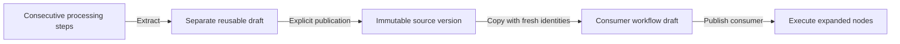
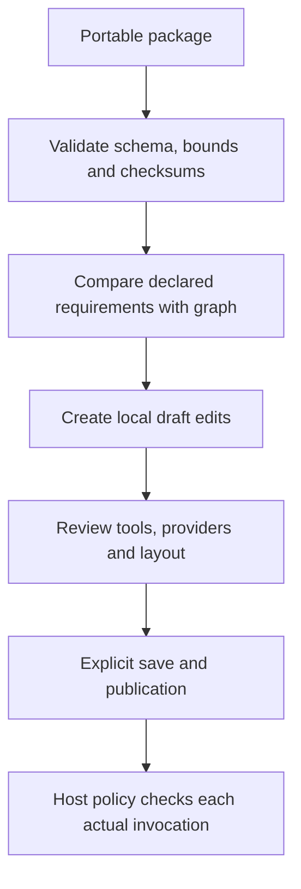

# Reusable pipelines and portable packages

Core now supports copy-on-insert reuse of a published linear pipeline. It does not introduce recursive runtime prefab calls, automatic source upgrades, capability inheritance, or arbitrary graph execution. Studio controls are being added in the following UI milestone; the contracts below are already implemented and tested.

## Identity and execution

A reusable source is an ordinary workflow with immutable numbered publications. Extracting a section creates a separate workflow draft containing its consecutive processing steps between new input/output terminals. Input/output nodes, empty or nonconsecutive selections, unsupported operations, and over-limit expansions are rejected. Existing validation, publication, optimistic concurrency, and audit storage apply.

Inserting a chosen publication copies its processing nodes into the consumer after a selected non-output node. It assigns fresh node and connection identities, preserves surviving consumer identities, copies labels/comments and internal routed wires/sections, and reconnects the linear sequence. MCP binding/contract requirements and agent provider/version/tool requirements remain pinned in the copied configurations. Runtime policy must still authorize the newly created node identities.

Definition schema `1.3` permits optional node `origin` metadata: source workflow, revision, version, definition hash, and source node ID. The existing node constructor and schemas 1.0–1.2 remain supported; absent origin is omitted so older canonical hashes remain unchanged. Provenance records where a copy came from, not an authenticated endorsement or a promise that subsequent local edits match the original. It never resolves code or grants permissions. Changing or removing a source publication cannot rewrite the consumer's expanded nodes. Inserting a workflow's own old publication is a finite copy, not recursion.

Full nested prefab assets, instance upgrade/rebase with overrides, and runtime subworkflow calls remain future work. Current reuse is explicit versioned template expansion within the 256-node workflow and 64-section layout limits.

## Package format

`WorkflowPackageJson` format `1.0` contains the executable definition, separate layout, their canonical SHA-256 checksums, and the exact derived node implementation, MCP contract, and agent-provider requirements. It has no host connection factories, credential exports, installation commands, or policy grants. User-authored text remains user content and should be reviewed before sharing.

Imports reject unsupported formats/schemas, unknown or duplicate properties, invalid graphs/layouts, mismatched checksums, and requirement manifests that disagree with the graph. Definition/layout bounds still apply individually; the complete package is bounded to 3 MiB. Requirement arrays are canonicalized as sets, while waypoint order remains meaningful and unchanged. Checksums detect mismatched contents; they are not signatures and do not authenticate an author.

Core tests verify extraction, pinned copies and fresh identities, layout retention, bounds, requirement preservation, schema compatibility, round trips, and tamper rejection. An Agent Framework integration test executes expanded copies without a source catalog or prefab loader.
