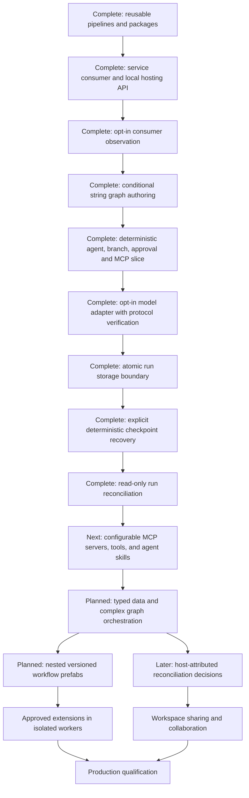

# Roadmap

The goal is a dependable, extensible C# platform for visually designing agent workflows, hosting them as logic inside user-owned services, running them independently of the browser, and inspecting exact historical execution. Studio is an optional IDE; the execution engine must be independently consumable. This document tracks delivery priorities and status. [Architecture](architecture.md) describes what exists, [the user guide](user-guide.md) explains how to use it, and [implementation history](implementation-history.md) retains detailed milestone evidence. [Product design](design.md) records the broader direction.

Statuses mean **Complete** (implemented and verified), **Active** (currently being built), **Next** (next planned increment), or **Planned** (direction with unresolved details). Planned work is not a supported capability. Sequence expresses dependencies rather than dates.

## Current product boundary

The development Studio edits and runs validated linear and conditional string graphs through Microsoft Agent Framework. It has free node placement, edge sockets, reroutes/pinned angles, labels/comments, named sections, immutable publications, restore/activation, persisted local audit/run evidence, and recorded playback, plus reusable published pipelines and portable packages. Agent nodes can configure system instructions/provider/model and select node-scoped MCP tools. Studio now has a local Streamable HTTP MCP library and a text-only versioned skill library; selected skill revisions and structured user-message templates travel in schema 1.7 definitions. Schema 1.6 supports up to 64 user-defined string parameters, explicit workflow-value nodes, per-run overrides and replay evidence. Mutable variables, richer parameter types, reasoning-effort controls and exposed agent-configuration pins remain planned. Model providers can be managed in Studio settings. The default agent provider is a deterministic fixture; the opt-in OpenAI SDK adapter is protocol-verified, while credentialed live-service qualification remains outstanding.

The backend owns execution. Studio/ordinary queued runs still interrupt after host failure; a separate opt-in host explicitly resumes deterministic saved checkpoints. The Studio host is loopback-only and unauthenticated; payloads are plaintext. It is not production ready. Free placement does not imply arbitrary socket rewiring or parallel execution. Conditional routing is an explicit validated operation.

## Latest completed milestone: Provider management and Studio theme refinement

The Settings page can list, add, version, and delete locally saved OpenAI-compatible providers. API credentials are protected in local Studio storage, descriptors remain secret-free, and new provider versions appear immediately in agent nodes. The Studio theme and provider-management layout were refined. Host configuration remains available for consumer services. The Studio remains a loopback-only unauthenticated prototype; multi-user credential management is not implemented. See [provider configuration](model-providers.md) and [design system](design-system.md).

## Previous completed milestone: canvas-first creation workbench

Blank connected drafts, searchable node library, contextual search/actions, drag placement and output-pin creation use validated insertion paths. Compact cards and a selected properties panel prioritize the canvas. Designer/run views preserve state; native fullscreen includes editing/playback controls, with fit, keyboard shortcuts, filtering and clearer recorded paths. Browser validation covers these gestures and existing authoring/version/run flows. Arbitrary existing-node rewiring, explicit branch-block removal and broader graph semantics remain planned. See [graph editor](graph-editor.md) and [user guide](user-guide.md).

## Previous completed milestone: read-only interrupted-run reconciliation

Cursor-bound assessments explain unsettled node/model/tool/approval facts, terminal status and saved/missing/invalid/advanced checkpoint state. New per-call model/tool IDs distinguish repeated calls, with conservative legacy matching. Built-in observers, the protected GET API, bounded HTTP client and embeddable observation panel expose metadata without native state, payloads or mutation controls. Eligibility is suppressed on cursor races and source failures and does not grant ownership. See [run reconciliation](run-reconciliation.md).

## Previous completed milestone: deterministic saved-suspension recovery

An opt-in consumer host saves native Agent Framework JSON checkpoints atomically with audit/state and resumes an exact deterministic suspension after host replacement. Tests and a forced-process-loss proof cover stable revision/identity, both branch paths, no duplicate nodes, ownership exclusion, stale evidence and rollback. Built-in ordinary runtime hosts also enforce exclusive local ownership. SQLite run schema 2 migrates existing evidence. Studio's queue retains interruption semantics; external-node/approval and arbitrary-crash recovery remain excluded. See [checkpoint recovery](checkpoint-recovery.md).

## Previous completed milestone: run storage boundary

The local runtime/controller now consume a host-selected `IWorkflowRunStore`. Atomic bounded batches and expected-sequence checks keep evidence and derived status consistent. File snapshots preserve legacy reads; an optional dedicated SQLite store supplies transactions and independent-connection concurrency checks. Studio/service configuration, observer consistency and rollback/conformance checks are implemented. Runtime ownership remains exclusive; restart still interrupts unfinished work. See [run storage](run-storage.md).

## Previous completed milestone: opt-in host-configured model adapter

Studio and the standalone service can explicitly enable version-pinned OpenAI Chat Completions factories. The optional library owns fresh bounded SDK clients, server-side secrets, cancellation/deadlines, safe categorized failures and no automatic retries. Agent evidence adds response IDs and token usage. Unit and local protocol/browser/service fixtures verify the SDK path without live model calls. Credentialed deployment qualification remains planned; see [model providers](model-providers.md).

## Previous completed milestone: exact-action approvals and deterministic vertical slice

Schema 1.5 adds a backend-owned approval immediately before an explicit MCP tool. Requests bind the pinned revision, exact input/binding/contract and reserved invocation identity; decisions are sequenced and host-attributed. Waiting releases execution ownership, while pause and approval remain independent. Designer/review/playback controls and the scripted Agent → Condition → Approval → MCP → Output browser proof are implemented. Remote observation remains read-only. Restart interrupts unfinished waits; durable approval recovery and live-model validation remain planned. See [approvals](approvals.md).

## Previous completed milestone: conditional string graphs

Schema 1.4 adds approved ordinal predicates, true/false string ports, exclusive merges and bounded acyclic validation. The adapter uses real Agent Framework conditional edges and records decisions separately from actual deliveries. Designer controls insert conditional blocks, edit predicates/arms and preserve undo/version/package/playback behavior. Existing linear schemas/hashes remain supported; linear-only reuse rejects routing graphs. See [conditional graphs](conditional-graphs.md). Richer port types, arbitrary socket rewiring, loops and parallel joins remain planned.

## Previous completed milestone: opt-in consumer observation

Consumers can explicitly map policy-protected read-only summary/snapshot/cursor endpoints. Studio attaches to operator-configured remote sources through a separate HTTP observer; the same `WorkflowObservationPanel` embeds in consumer Blazor apps without execution services. API, lifecycle and two-process browser checks cover read-only access, playback, source replacement and reconnect. The endpoint is disabled by default in the sample. See [consumer observation](observation.md) for authentication, current default-layout/polling limits and host-owned audit requirements.

## Previous completed milestone: standalone service integration and local hosting API

The [standalone consumer](../samples/WorkflowService/README.md) runs reviewed pinned packages directly or through a backend-owned queue without Studio/Blazor or an authoring catalog. It verifies real MCP, independent node grants, missing/drifted dependency rejection and host-stop cancellation. The sample and Studio share the additive [local hosting DI helper](hosting-sdk.md). Project-reference consumption is documented; stable NuGet distribution and minimal worker dependency packaging remain planned. Conditional string graph authoring is now implemented; the deterministic approval/MCP slice is implemented; the opt-in host-owned SDK adapter is protocol-verified; credentialed live qualification remains planned.

## Previous completed milestone: cooperative pause/resume

Process-owned runs can start paused, pause between nodes, resume without reexecuting completed nodes, and cancel while paused. API and optional embedded controls share sequenced audit events; recorded playback includes pause state. Paused contexts release the execution permit so other admitted work can run. The 32-context budget includes paused runs. The ordinary queue interrupts unfinished continuations; the separate deterministic checkpoint host now supports saved-suspension recovery. See [run control](run-control.md).

## Previous completed milestone: reusable pipelines and sharing

Core contracts, Studio controls, and end-to-end validation are complete. The headless service-integration proof and local registration API are complete. Conditional string graph authoring is now implemented; the opt-in host-owned SDK adapter is protocol-verified; credentialed live qualification remains planned.

| Deliverable | Status | Completion evidence |
| --- | --- | --- |
| Extract consecutive processing steps into a separate workflow | Complete | Core extraction preserves annotations and rejects invalid selections |
| Insert an exact published source version with fresh identities | Complete | Copied requirements/source identity, bounded expansion, real framework execution without source lookup |
| Portable definition/layout packages with hashes and requirement manifests | Complete | Canonical round trips, bounds, mismatch/unknown/duplicate-property rejection |
| Save a labeled section as a reusable draft and choose published versions | Complete | Real controls preserve the consumer draft and source history |
| Insert a selected version with shared undo/redo and review requirements | Complete | Browser checks, saved consumer output, reload and immutable source-version behavior |
| Export/import the full package through Studio | Complete | Layout/annotation preservation, local-only import, explicit save/publication, no permission transfer |

This increment uses copy-on-insert template expansion, not recursive runtime prefab calls or automatic instance upgrades. See [reusable pipeline contracts](reusable-pipelines.md).

## Delivery sequence

### Complete: service consumer and local hosting registration

The standalone proof loads pinned artifacts, rejects invalid/missing dependencies, enforces node-scoped host grants, records deterministic and real MCP evidence, and demonstrates cancellation/host lifetime without Studio. The shared DI helper preserves custom registrations and adds no mandatory catalog. See [service integration](service-integration.md) and [local hosting API](hosting-sdk.md).

Supported NuGet distribution remains planned: decide package metadata/licensing, public compatibility baselines, minimal dependency separation and independently restored package-consumer tests before release. Current consumers use project references at a pinned source commit. This packaging work does not change runtime guarantees or provide production durability.

### Complete: opt-in host-configured provider adapter

The SDK adapter and configuration flow are implemented with deterministic protocol fixtures retained for CI. See [model providers](model-providers.md). Credentialed live-service qualification is **Planned**, not complete: no authorized credentials were configured. Approval of model-selected tool calls inside agent loops remains a distinct future capability.

### Complete: local run storage boundary

Host-selected storage, atomic event/state batches, concurrency checks, file compatibility and a transactional SQLite implementation are complete. They establish committed evidence, not recoverable execution. See [run storage](run-storage.md).

### Complete: deterministic checkpoint and recovery contract

Native superstep state, a versioned/bounded recovery envelope, atomic checkpoint/audit commits, exact-cursor admission and local owner exclusion are implemented for explicit deterministic saved suspensions. Ordinary queued runs, arbitrary active-process loss and external effects retain their previous limits. See [checkpoint recovery](checkpoint-recovery.md).

### Complete: read-only interrupted-run reconciliation contract

The assessment distinguishes a saved suspension, advanced checkpoint evidence, unresolved work, invalid/missing frames and terminal status. Consumer and embedded observation paths expose the explanation without making live calls or decisions. See [run reconciliation](run-reconciliation.md).

### In progress: advanced agent authoring and workflow inputs

Schema 1.6 adds workflow-owned string parameters with stable IDs, labels and defaults; visible getter nodes; bounded per-run overrides; exact effective-value persistence in run history; and playback visibility. The execution package remains independent of the Studio, and run clients can opt into the additive `IParameterizedWorkflowClient` contract. Legacy schemas omit the optional parameter fields, preserving their canonical JSON. Parameters are deliberately not secrets, mutable variables or arbitrary provider URLs. User-guide controls and hosting/persistence coverage are now included. Typed values, exposed agent configuration pins and richer data composition remain open parts of this milestone.

### Active: configurable MCP servers, tools, and per-agent skills

The first executable slice now supplies local Streamable HTTP MCP connection/discovery, explicit tool enablement, a versioned text-only skill library, per-agent skill selection, and structured user-message templates in schema 1.7. Published definitions embed assigned skill text and exact hashes; tool endpoints, bearer tokens and host grants stay out of exports. The consumer host still supplies its own registrations and policy. This slice has bounded text inputs and does not complete the broader acceptance criterion below.

The [agent capability library design](agent-capability-libraries.md) records competitor research and the broader Studio flow. Folder organization and literal/input/parameter reference segments are implemented in the first slice. Search, keyboard chip insertion, a standalone text-template node, stdio connection management, richer skill resources, provider capability discovery/reasoning controls, and typed/exposed parameters remain to be built.

Deliver one coherent authoring flow:

1. Add and manage host-owned MCP server connections in Studio settings, then discover and inspect each server's tools, descriptions, and input/output schemas. Start with standard stdio and Streamable HTTP transports only after a compatibility/security spike confirms the pinned client APIs and required limits.
2. Keep server endpoints, process commands, credentials, and policy outside workflow definitions. Studio settings belong to the local operator; consumer services continue to register trusted server connections and authorization policy in their own host. Imported workflow packages may declare logical server/tool requirements but cannot select endpoints, launch processes, or grant credentials.
3. Let authors assign an explicit set of discovered MCP tool contracts to each agent node. Keep that set node-scoped and version-pinned; a catalog listing is discoverability, not permission. The host must authorize each model-selected invocation, and current approval nodes must not be presented as gates for calls made inside an agent loop.
4. Add a versioned skill library and a per-agent skill selector. A skill may carry reviewed instructions, parameters, and bounded supporting resources. Pin exact skill versions in published workflows and preserve them through package export/import and recorded playback. Skill content cannot grant tools, change server policy, or expand the agent's explicit capabilities. Define the skill package and resource-resolution contract before importing external skill formats.
5. Expand agent-node configuration with provider-supported controls such as reasoning effort. Store the setting on the individual agent node and map it through the provider adapter only where the selected provider/model supports it. Discover and expose provider capabilities; validate unsupported values and clearly show when a setting cannot be honored. Do not imply a provider-neutral value has identical semantics across vendors, or silently send unsupported options.
6. Extend the first string-parameter slice with descriptions, validation constraints, named entry-node inputs, and typed getter nodes so values can be wired into graph and explicitly exposed agent configuration inputs. Include parameter contracts and safe defaults when sharing a package; keep runtime overrides out of the immutable definition. Host-resolve special values such as model profiles from the permitted provider catalog. Do not let parameter values choose arbitrary endpoints or contain credentials.
7. Give authors clear diagnostics when servers are unavailable, a tool schema drifts, a pinned skill or parameter contract is missing, or a selected model setting is unsupported. Persist exact resolved server/tool/contract, skill, provider/model, parameter schema, and effective-setting identities in publication/run requirements and bounded audit evidence; never persist credentials as workflow dependencies.

Treat a configured stdio process as trusted code running under the Studio/service process identity. Apply explicit operator consent, allowlisted launch configuration, bounded startup/discovery/invocation, cancellation, and secret isolation. A server connection is not an MCP security boundary. Keep mutable Set/Get variable nodes separate from immutable configuration parameters; add them only with explicit run-state and parallel-write semantics. This milestone remains local-development and host-integrated functionality; it does not make the unauthenticated Studio a multi-user secrets manager or production service.

The milestone is complete when a user can configure an approved MCP server, discover a tool, assign it to one agent, attach a versioned skill and supported reasoning effort to that agent, define a typed workflow parameter, and wire its getter to a compatible data input or explicitly exposed agent configuration pin. The user can share/publish and run the workflow with a per-run override, then replay evidence showing the exact tool, skill, provider/model, parameter schema, and effective setting versions—while a second agent without those assignments cannot access them.

### Planned: typed data and complex graph orchestration

Build on the agent-capability foundation with schema-backed JSON and other reviewed typed ports, mapping and validation nodes, validated arbitrary socket rewiring, deliberate parallel fan-out/fan-in joins, bounded loops, and richer failure/cancellation behavior. These are executable semantics, not just canvas arrangements. Prove representative graphs against the pinned Microsoft Agent Framework adapter before fixing each node or control-flow contract; preserve event ordering, exact-version dependencies, and truthful playback. Keep loops, joins, concurrency, payloads, and tool calls bounded and diagnosable.

### Later: host-attributed reconciliation decision records

After the agent-authoring priority, define explicit operator decisions for recorded uncertain outcomes, bound to the exact run/cursor/call identity with authenticated host-derived actors and append-only evidence. Distinguish a human assertion from a provider's actual response and preserve prior uncertainty. A decision must not silently retry external calls, rewrite history, grant tools, auto-approve or enable recovery of unsupported graphs. Observation stays read-only; production identity and authorization remain prerequisites for public controls.

### Planned: durable execution and security foundations

Define storage ownership, transactional run state/event capture, concurrency, checkpoint boundaries, recovery, and approval persistence. Test worker loss, duplicate delivery, shutdown, and uncertain external outcomes without assuming exactly-once side effects or silently retrying them.

Add workspace identity, backend authorization, authenticated audit actors, payload access/redaction, retention, encryption choices, quotas, and credential handling. Do not expose the current development host as a production service. This foundation precedes claims of dependable production operation or multi-tenant sharing.

### Planned: further reusable assets and specialization

Add explicit conditional-block removal rather than treating canvas movement or topological order as execution edits. Evolve template copies into nested workflow prefab instances with pinned dependencies, declared inputs/outputs, explicit upgrades/overrides, cycle detection, and readable invocation scopes. Preserve historical playback when sources/providers are absent.

### Planned: approved extension workers

Define the approved .NET extension interface, artifact identity, and input/output contracts. Execute user assemblies in isolated workers with brokered capabilities rather than loading them into the Studio/runtime process. Verify direct network/filesystem denial, resource limits, credentials isolation, cancellation, and failure recovery. An interface or AssemblyLoadContext is not a sandbox.

### Planned: collaboration, source control, and promotion

Add authorized workspace sharing, asset discovery, deployment binding remapping, and reviewable portable artifacts. Define ownership between live drafts and Git snapshots, semantic conflict handling, and later simultaneous editing. Test overlapping edit/delete/connect/restore operations; do not describe text merging as safe semantic merging.

### Planned: production qualification

Publish support boundaries only after repeatable recovery/security exercises, load and retention tests, observability/alerting, operational documentation, upgrade/migration checks, and an embedding sample against independently hosted services. Keep deterministic demonstrations and live-provider evidence labeled separately.

## Completed foundations

| Milestone | Delivered capability |
| --- | --- |
| Core contracts | Portable validated definitions, canonical hashes, immutable revisions, and compatibility tests |
| Framework execution | Real executors/edges, receiver-side transfer evidence, cancellation and bounded inputs |
| Local host and playback | Backend-owned queue, persisted local history, event stepping and payload inspection |
| Versioned catalog | Transactional SQLite drafts/revisions/audit, CAS conflicts, publication, restore and activation |
| Visual authoring | Reusable Razor editor, operation changes, insertion/reorder/removal, shared undo/redo |
| MCP and agents | Node-scoped broker, pinned contracts/providers, actual framework agent/tool loop with deterministic fixtures |
| Graph canvas | Free placement, edge sockets, SVG routing, angle pins, comments/sections, versioned layouts and read-only playback |
| Quality and documentation | C#/Blazor/CSS/design skills, dependency boundaries, browser regression checks, architecture/user guides and locally validated Mermaid |
| Exact-action approvals | Schema-1.5 explicit MCP gates, bound requests and decisions, independent pause/cancel, duplicate/stale/owner-loss checks and deterministic vertical-slice UI proof |
| Conditional graphs | Schema-1.4 predicates and ports, exclusive merges, real conditional framework edges, immutable local graph edits and chosen-path playback |
| Consumer observation | Opt-in protected read API, HTTP observer, remote Studio attachment and reusable read-only panel with cursor/lifecycle/reconnect checks |
| Service integration | Standalone pinned-artifact execution, direct/queued MCP proof, host-stop verification, shared optional local-runtime DI registration and consumption contract |
| Reuse and sharing | Schema-1.3 origins, version-pinned expansion, section extraction, exact-version insertion and full design package controls with browser/capability tests |

Detailed tests, limitations, and historical rollout notes are in [implementation history](implementation-history.md).

## Keep the roadmap current

Update this document with each milestone: mark only verified work complete, identify the active increment, record new prerequisites, and link evidence/details from the owning docs. Move retrospective detail into implementation history. Keep architecture and user instructions current in the same change; do not duplicate their full contents here. Do not invent dates or count all roadmap features as one production commitment.
