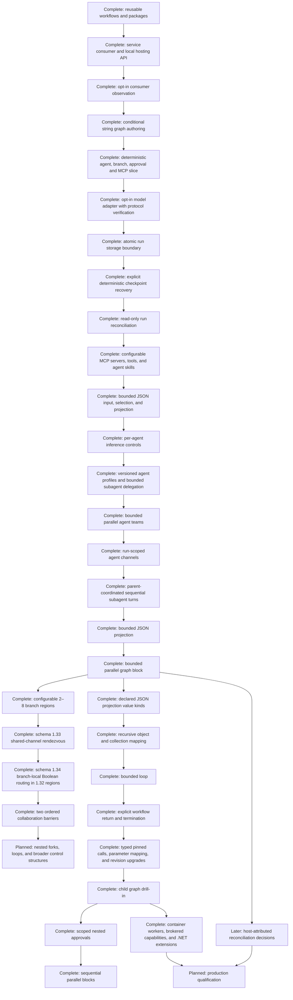

# Roadmap

The goal is a dependable, extensible C# platform for visually designing agent workflows, hosting them as logic inside user-owned services, running them independently of the browser, and inspecting exact historical execution. Studio is an optional IDE; the execution engine must be independently consumable. This document tracks delivery priorities and status. [Architecture](architecture.md) describes what exists, [the user guide](user-guide.md) explains how to use it, and [implementation history](implementation-history.md) retains detailed milestone evidence. [Product design](design.md) records the broader direction.

Statuses mean **Complete** (implemented and verified), **Active** (currently being built), **Next** (next planned increment), or **Planned** (direction with unresolved details). Planned work is not a supported capability. Sequence expresses dependencies rather than dates.

## Current product boundary

The development Studio edits and runs validated linear, conditional, bounded parallel and typed agent graphs through Microsoft Agent Framework. Workflows have optional human-readable names while their generated IDs remain stable for storage, imports, workflow calls, and consumer integrations. Most graph connections carry strings; schema 1.9 adds a bounded JSON entry input and pointer selector that returns text, schema 1.13 adds bounded JSON projection and JSON workflow output, schema 1.14 adds one visible two-branch fork/barrier join returning bounded JSON, schema 1.15 adds declared JSON value kinds to projection fields, schema 1.16 adds recursive object and array-item mapping, schema 1.17 adds one auditable bounded loop with a linear body and a hard iteration cap, schema 1.18 adds no-result termination exits, schema 1.19 adds bounded calls to exact child workflow revisions, schema 1.20 permits up to four sequential bounded parallel blocks and success/failure outcomes for termination nodes, schema 1.21 adds per-agent model-turn/time controls and optional structured JSON results, schema 1.22 adds an optional provider-reported aggregate token budget across the agent and its delegates, schema 1.23 separates execution and data wires, schema 1.24 adds typed Boolean branching, schema 1.25 adds Boolean constants and NOT, schema 1.26 adds bounded nested/reconvergent Boolean routes and multiple exits, schema 1.27 adds embedded pure graph-function snapshots as lazy typed data nodes, schema 1.28 lets agents invoke only exact assigned pure graph-function snapshots as bounded tools, schema 1.29 lets Agent nodes bind bounded output-token and total-token controls to integer workflow parameters, schema 1.30 lets an Agent choose among authored execution pins through an invocation-scoped internal function, schema 1.31 adds typed signed-64-bit integer values and checked arithmetic, schema 1.32 adds one explicit static fork/join region with 2–8 named branches, schema 1.33 adds one collaboration rendezvous with run-scoped channels, exact per-Agent phase grants, bounded immutable message snapshots, durable audit evidence, and passive playback, schema 1.34 permits at most one Boolean Branch per branch in schema-1.32 regions with exclusive reconvergence and complete matching joins, and schema 1.35 adds exactly two ordered collaboration rendezvous with separate bounded snapshots and phase/role grants. Schema 1.33 collaboration paths remain linear in this increment; branch-local conditional collaboration paths remain deferred. Studio's graph editing, themes, route controls, projects, libraries, packages, and playback are documented below. The runtime imposes one finite collaboration-region timeout from either the workflow or its host, and collaborators receive only explicitly granted channel tools for their exact Agent invocations; these grants do not pass to delegated subagents. Collaboration remains limited to one static region with 2–8 branches; schema 1.33 has one barrier and schema 1.35 has two ordered barriers with cumulative message/channel/snapshot bounds. Loops, nested collaboration, retries, and resumption remain unsupported. See [parallel Agent collaboration](parallel-agent-collaboration.md) and [two-phase collaboration](parallel-agent-collaboration-phases.md). Agent nodes configure system instructions and a stable model connection ID, node-scoped MCP and graph-function tools, per-response and aggregate token budgets, model turns that accept any positive limit or `-1` for unlimited, optional timeouts and structured results, and provider-advertised reasoning controls including explicit off. During execution, agent nodes show provider-reported token totals, latest completed prompt usage versus the configured context window (marked as the last completed measurement while another model request is in flight), recorded host context compactions, and an estimated cost when both optional token rates are configured. The current adapter does not configure host-side compaction; provider-internal compactions cannot be observed. Workflows do not pin connection revisions; editing a connection changes future runs, while recorded events retain the model descriptor and usage used for replay. Studio has a local Streamable HTTP and stdio MCP library with a bounded nested argument subset and a text-only versioned skill library; selected skill revisions and structured user-message templates travel in schema 1.7 definitions. Stdio launches trusted local programs with structured arguments, explicit encrypted environment values, disabled environment inheritance, OS-user privileges, and no sandbox; a fresh process starts for discovery and each invocation. Consumer hosts can register digest-pinned container MCP tools through the node-scoped broker and may load one SHA-256-pinned .NET extension inside that isolated worker; these are host-code integrations, not Studio connection forms. Schema 1.6 supports up to 64 typed scalar parameters; schema 1.8 adds integer, number, boolean and choice validation and exposes a reasoning-effort input. Schema 1.11 adds versioned agent profiles and bounded one-level subagent delegation; schema 1.12 adds profile-pinned coordination channels with audited run-scoped exchange. Nested parallelism and nested loops remain planned. Model connections can be managed in Studio settings by stable ID. The default agent connection is a deterministic fixture; the opt-in OpenAI SDK adapter is protocol-verified, while credentialed live-service qualification remains outstanding.

Schema 1.42 adds the bounded `core.number.add` pure data operator to the Blueprint parity track. It has exact finite-number `left`/`right`/`out` pins, no execution pins or coercions, deterministic non-finite-result failure, pure graph-function support, typed direct-MCP argument propagation, and recorded data evaluation evidence. Broader numeric operators, conversions, containers, and generic numeric workflow outputs remain deferred. See [finite number addition](decisions/0010-finite-number-addition.md).

Schema 1.43 is the shipped Sequence parity slice: each ordered output may enter one bounded, acyclic, disjoint direct-MCP path ending at the workflow Output barrier. It is definition-driven and preserves schema 1.38 behavior unchanged. Agent paths, shared descendants, branches, loops, nested workflows, and durable resume remain deferred until their separate lifecycle and evidence contracts are proven. A private Sequence-to-Agent feasibility proof exists, but it is not a persisted schema or a public authoring capability; see [the proof gate decision](decisions/0011-sequence-agent-path-proof.md).

The backend owns execution. Schema 1.32's named 2–8 branch fork/join remains available. Schema 1.33 adds one graph-level shared-channel rendezvous and Studio authoring. Incomplete rendezvous and branch layouts can be saved but cannot publish or execute. The Studio/ordinary queued runs still interrupt after host failure; the separate opt-in host explicitly resumes deterministic saved checkpoints but collaboration regions do not support recovery or resume. The Studio host is loopback-only and unauthenticated; payloads are plaintext. It is not production ready. Socket rewiring is supported for matching typed pins, while incomplete drafts remain non-executable until validation succeeds. Sequential subagent calls, parallel agent-team calls, bounded graph fan-outs, and the first graph-level collaboration slice are explicit; nested collaboration remains planned. Conditional routing and parallel graph execution are validated operations.

## Planned phase: Blueprint-inspired authoring contracts and ergonomics

**Status: Active.** This phase is the result of an audit against [the Unreal Blueprint capability reference](unreal-blueprint-reference.md), [Blueprint authoring guidance](blueprint-authoring-guidance.md), and [product design](design.md). Its current evidence baseline is the [Blueprint capability matrix](blueprint-capability-matrix.md). It is intentionally narrower than “Blueprint parity”: Visual Agent Workflow should borrow Blueprint's explicit, typed, composable authoring model without adopting Unreal's object world, frame/tick semantics, or implicit mutable state.

### Audit baseline

The project already has a substantial Blueprint-inspired foundation: separate execution and data semantics; typed string, Boolean, integer, and bounded JSON values; conditional routing; bounded loops; named bounded fork/join regions; graph functions; pinned child workflows; workflow parameters and getter nodes; stable node/port identities; comments, sections, reroutes, layout persistence; invalid-draft saving with publish/run gates; immutable revisions; host-owned capability grants; and passive recorded playback. These are shipped capabilities, not phase proposals.

The remaining alignment work is primarily contract and authoring work. The current reference identifies broader type/container systems, mutable graph variables, richer control flow, event dispatchers, latent/scheduled work, generalized reuse/templates, and Blueprint-style debugging as future capabilities requiring separate runtime and evidence contracts. This phase must not turn those design targets into supported behavior merely by adding palette entries or card shapes.

### Audit outcome (2026-10-27)

The repository already has this phase; no second Blueprint-parity phase is needed. The audit confirms that the right unit of progress is a bounded vertical slice: a node or authoring affordance is only considered aligned when its portable definition, pin contract, independent validation, backend behavior, compatibility policy, editor behavior, and recorded evidence agree. The current implementation has started that work with a canonical Core node-family catalog and semantic metadata, but it is not yet a complete descriptor registry.

The high-level work is therefore tracked in the checklist below. Items marked as shipped in the capability matrix are evidence for the baseline, not a claim that unrestricted Unreal Blueprint compatibility exists. The next implementation increments should close one unchecked contract boundary at a time and update the matrix, tests, and user documentation together.

The first numeric vertical slice shipped in schema 1.40: a finite number type,
Number constant, top-level numeric direct-MCP pins, and JSON-number
serialization. Integer/number conversion, numeric operators, numeric
parameters, nested numeric pin expansion, and graph-function number ports were
explicitly deferred to the 1.41 slice below. See [finite number primitive](decisions/0006-finite-number-primitive.md).

Schema 1.41 finite-number propagation is now shipped as a bounded vertical
slice: finite number parameters can feed typed Workflow value nodes and the
existing persisted direct-MCP number pins, while pure graph functions can
expose number inputs/outputs and number constants. The Studio exposes an
explicit promotion from schema 1.40 to 1.41. Operators, conversions,
containers, mutable variables, Sequence, nested MCP numbers, and generic
workflow outputs remain deferred. See [finite number propagation](decisions/0007-finite-number-propagation.md).

## Finite-number addition

Schema 1.42 adds `core.number.add` as the next bounded Blueprint-style typed
composition slice. A schema-1.41 draft promotes when the node is inserted; the
Studio exposes number constants, the operator, and number ports in the pure
function editor. Direct-MCP graphs can feed the result into a persisted typed
number argument pin, and pure graph functions can evaluate it when explicitly
allowed by their contract. Existing schemas reject the node and all broader
numeric/container work remains planned. See [finite number addition](decisions/0010-finite-number-addition.md).

The first static pin-descriptor increment is now implemented: schema-independent
descriptors for the approved pure-value node family are resolved by Core's
canonical port APIs, with exact-version lookup and fail-closed unknown-version
behavior. Dynamic/configuration-derived pins and full descriptor-driven
validation/runtime/editor convergence remain unchecked. See [static pure pin
descriptors](decisions/0008-static-pure-pin-descriptors.md).

The next bounded descriptor increment is also implemented without a schema
change: matching live MCP schemas can provide top-level argument descriptions to
transient port descriptors and the selected-node Inputs view. Descriptions are
display-only, bounded, and never persisted or executed. MCP schema defaults
remain annotation-only; authored static values continue to live explicitly in
the node's MCP arguments object. Persisted dynamic metadata, default adoption,
and full dynamic descriptor convergence remain deferred. See [live MCP pin
descriptions](decisions/0009-live-mcp-pin-descriptions.md).

| Workstream | Current audit finding | Required outcome before calling it aligned |
| --- | --- | --- |
| Node and pin contracts | Core has stable node-family metadata and centralized port enumeration, but pin-level defaults, nullability, conversions, multiplicity, and dynamic identity are not one complete contract. | A versioned descriptor can derive editor pins, validator rules, runtime limits, and compatibility diagnostics without duplicating node-family knowledge. |
| Runtime semantics | Current control flow is deliberately bounded; Sequence dispatch and mutable variables remain deferred because ordering, active work, cancellation, and replay contracts are not proven. | Each new control construct has explicit activation, state ownership, failure, cancellation, restart, and side-effect semantics with deterministic runtime tests. |
| Persistence and compatibility | Canonical definitions, revisions, and package validation exist, but migration coverage is not represented by one registry. | Every supported schema/package transition has a round-trip, migration, invalid-draft, and publish/run admission proof. |
| Authoring ergonomics | The editor supports typed wires, context-sensitive discovery, comments, reroutes, layout persistence, and diagnostics; broader Blueprint-style extraction and debugging remain bounded or planned. | Authoring affordances expose real contracts, preserve semantic undo/layout separation, and remain usable and accessible on large graphs. |
| Evidence and debugging | Recorded playback and node/port identities exist, but each future affordance still needs an explicit event/evidence mapping and live-versus-historical boundary. | A run can explain activation, values, failure, cancellation, capability use, and nested identity without re-executing live services. |
| Authority and safety | Host-owned capability grants and secret boundaries are established. | New portable fields never smuggle credentials, endpoints, grants, or authority; denial, redaction, bounds, and audit correlation are tested. |

### Phase purpose

Make every Blueprint-inspired authoring affordance traceable to a stable definition contract, independent validator, backend execution rule, compatibility policy, and recorded-evidence mapping. The phase should produce small vertical proofs and a dependency-aware follow-up roadmap, rather than introducing a second execution model or a wholesale schema replacement.

### High-level work checklist

- [x] **Capability matrix:** inventory shipped, active, planned, deferred, and deliberately different concepts; link each item to its schema, implementation, tests, and user documentation. See [Blueprint capability matrix](blueprint-capability-matrix.md).
- [x] **Bounded numeric operator slice:** ship one pure finite-number operator across definition, typed pins, validator, runtime, evidence, function editor, compatibility, and regression tests. See [finite number addition](decisions/0010-finite-number-addition.md).
- [x] **Contract inventory:** define the identity and compatibility rules for assets, graphs, nodes, ports, types, edges, parameters, dependencies, grants, and immutable revisions. See [Blueprint contract inventory](blueprint-contract-inventory.md). The inventory records the remaining descriptor-registry, type-system, migration, and capability-report gaps without presenting them as shipped.
- [x] **Pin semantics:** preserve the execution-wire/data-wire distinction; specify types, nullability, defaults, conversions, multiplicity, dynamic-port identity, stable labels, and invalid-connection diagnostics. The Core descriptor resolver now projects configured MCP, Agent, Sequence, parallel, and graph-function pins with stable IDs/order and transient discovery descriptions while preserving existing schema/runtime boundaries; nullability, richer defaults, conversions, and dynamic-pin migration remain deferred. See [dynamic pin descriptor resolution](decisions/0012-dynamic-pin-descriptor-resolution.md).
- [ ] **Node descriptors:** document activation behavior, state ownership, side effects, capabilities, limits, cancellation, failure dispositions, persistence, evidence, and editor affordances for each node family. Static descriptor metadata conformance and schema-neutral checks for resolved dynamic pin metadata are now enforced at the Core validation boundary; the typed Boolean Branch is also projected through one canonical static descriptor path. Configuration-specific dynamic identity, schema admission, runtime enforcement, and full cross-layer convergence remain. See [dynamic descriptor conformance](decisions/0016-dynamic-descriptor-conformance.md) and [static Boolean Branch descriptor](decisions/0017-static-boolean-branch-descriptor.md).
- [ ] **Validation boundary:** ensure imported/untrusted definitions are independently validated; cover reachability, boundedness, unsupported cycles, joins, capability requirements, and host admission separately from editor filtering. The first bounded increment validates registered static descriptor metadata without changing schema or requiring live MCP discovery.
- [x] **Proof slice:** exercise one pure value node, one direct MCP node, one conditional route, one workflow parameter getter, and one pinned child workflow through authored editing, definition round-trip, backend execution, and recorded evidence. A passive run-viewer proof renders the recorded conditional route without runtime services; broader per-node playback qualification remains part of the debugging/evidence workstream.
- [ ] **Persistence and compatibility:** prove canonical JSON round trips, stable hashes, layout separation, package round trips, legacy loading, schema migration, invalid-draft persistence, and publish/run rejection. The first bounded increment centralizes exact supported schema identities and selected graph-mode capabilities in a Core catalog. A second bounded increment inventories individually named, non-executable schema promotions and verifies source/hash preservation; historical loading, source-preserving transforms, revision provenance, and broader migration remain unchecked. See [schema promotion inventory](decisions/0015-schema-promotion-inventory.md).
- [ ] **Authoring ergonomics:** improve pin-driven/context-sensitive node creation, readable execution/data pin presentation, explicit conversion nodes, comments/sections/reroutes, grouping, duplication/deletion diagnostics, semantic undo, and measured interaction responsiveness. The explicit-graph picker now carries an output-pin gesture into a typed compatibility filter, explains when no direct target exists, and offers a narrowly gated schema-1.39 string-to-integer insertion action; further conversions remain versioned and bounded. See [explicit conversion insertion](decisions/0018-explicit-conversion-insertion.md).
- [ ] **Reuse boundaries:** distinguish callable workflows, pure graph functions, authoring templates/macros, collapsed views, and interfaces; define extraction behavior, provenance, dependency closure, version pinning, and upgrade diagnostics before exposing each affordance.
- [ ] **Lifecycle semantics:** specify repeated entry, activation identity, joins, waits, cancellation, retries, partial failure, and external side-effect behavior before adding related control nodes.
- [ ] **Debugging and evidence:** map authored node/port identities to actual runtime events; separate live observation from backend control and historical playback; add debugger-like features only when they remain grounded in recorded evidence. The run inspector now exposes invocation and connection identities in its event table and per-node event modal, so repeated activations and actual execution/data paths remain distinguishable; broader evidence projections, breakpoints, and step controls remain planned.
- [ ] **Authority and safety:** keep endpoints, credentials, grants, approvals, and host policy outside portable definitions; define redaction, payload bounds, audit correlation, and failure disclosure for every new capability.
- [ ] **Verification:** add deterministic contract/runtime tests, compatibility and failure cases, browser authoring smokes, package/playback proofs, and responsiveness/accessibility checks for each shipped increment.
- [ ] **Expansion gate:** promote richer containers, mutable variables, events, nested control flow, interfaces, templates, or durable waits into separate roadmap phases only after their contracts, compatibility policy, security boundary, and evidence semantics are reviewed and proven.

Descriptor progress: Core now has a canonical node-family catalog for stable display/category/description, pin-shape, purity, dynamic-pin presence and identity source, host-capability, activation, state ownership, failure disposition, cancellation, evidence metadata, and the existing node-specific runtime limits, and the Studio node library and definition validator consume that catalog for built-in actions and node identity/version admission. The canonical explicit port descriptors now also expose requiredness, connection cardinality, MCP static-value fallback semantics, transient live top-level MCP argument descriptions, and fail-closed null handling for malformed dynamic collections; the explicit-graph validators and Studio canvas consume the same resolver, including live MCP discovery without overriding persisted pin metadata. Core also has a versioned registry for the four currently supported graph data types with exact-identity compatibility and no implicit conversions, and schema-1.39 conversion plus the static text transformations now use static descriptors. Nullability, conversions beyond the explicit string-to-integer contract, authored/default adoption, dynamic-pin persistence/migration, runtime enforcement driven directly from descriptors, and full descriptor-driven validation/configuration remain part of the unchecked descriptor work. See [canonical pin resolution](decisions/0005-canonical-pin-resolution.md).

### Deferred parity decision: bounded Sequence dispatch

The independent proponent/opponent/adjudicator review keeps public Sequence execution bounded to a definition-driven first slice. The proof covers Blueprint-style ordered dispatch with overlapping active descendants, completion-order divergence, cancellation between outputs, distinct failed/cancelled terminal outcomes with skipped later outputs, and deterministic pause/host-stop behavior at the inter-dispatch boundary. That harness now routes descendant start/completion facts through runner-owned active-node accounting, and Core can reconstruct recorded Sequence prefixes passively. Production `GraphMessage` transport also carries a private, non-persisted lineage envelope, and the normal `WorkflowRunner` now consumes persisted schema 1.38 descriptors for the bounded Input → Sequence → Output runtime slice. See [bounded Sequence dispatch boundary](decisions/0003-bounded-sequence-dispatch-boundary.md). Mutable variables remain deferred for the same contract/evidence reasons.

Sequence proof checklist:

- [x] Define a non-public, two-to-four-output activation ledger with stable order and explicit terminal/skipped states.
- [x] Add runner-owned active-node accounting and reject normal terminal runs with unresolved node work.
- [x] Connect the private Sequence continuation proof to runner-owned active-node accounting and prove descendant completion.
- [x] Prove stable Sequence invocation/output/ordinal/connection lifecycle identity in a private coordinator.
- [x] Define a versioned, fail-closed passive evidence payload and reader for Sequence lifecycle events.
- [x] Prove conversion of coordinator lifecycle facts into passive `ExecutionEvent` records.
- [x] Exercise ordered dispatch, overlapping active descendants, and terminal accounting through a private pinned streaming-runner harness.
- [x] Reconstruct ordered Sequence prefixes and terminal output state from passive evidence without live execution.
- [x] Add a private, non-persisted production-message lineage envelope for future Sequence identity propagation.
- [x] Emit that lineage from a private production `WorkflowRunner` Sequence adapter through the normal serialized run recorder.
- [x] Prove partial dispatch, downstream failure, and cancellation outcomes against the private streaming runner proof.
- [x] Prove pause and host-stop behavior at the private inter-dispatch boundary.
- [x] Prove pause and host-stop outcomes against the private production runner adapter.
- [x] Add schema 1.38, persisted ordered output descriptors, stable `then.<outputId>` pins, round-trip coverage, and validator rules for the bounded Input → Sequence → Output slice.
- [x] Register Sequence in the Core node contract catalog and expose it in the schema-gated Studio node library with a safe two-output default.
- [x] Adapt the production runner to consume persisted Sequence descriptors and actual execution-connection identities for the bounded Input → Sequence → Output slice; retain the private proof as a lifecycle regression fixture.
- [x] Promote the next parity slice to schema 1.43 without changing schema 1.38: allow each ordered output to enter one bounded, acyclic, disjoint direct-MCP path ending at the workflow Output barrier.
- [x] Validate schema 1.43 path ownership, one-successor topology, reachability, path length, stable output wiring, and fail-closed unsupported nodes while preserving saveable invalid drafts.
- [x] Execute schema 1.43 paths from persisted execution connections, preserve private Sequence lineage through each hop, and wait for every path terminal before completing the run.
- [x] Add schema 1.43 Core and production regression tests for valid paths and shared-path rejection; preserve the existing private proof and schema 1.38 tests.
- [x] Add Studio schema-promotion and MCP path-authoring controls; existing typed execution wires and stable Sequence output editing remain the authoring surface.
- [x] Add passive playback diagnostics for per-path terminal evidence before considering this parity slice complete. The run inspector now derives each output's recorded dispatched/completed/failed/cancelled/skipped state and execution connection from the lifecycle evidence at the selected playback position; it does not re-execute the path.
- [x] Add a non-public Sequence-to-Agent production proof: one bounded Agent invocation receives Sequence lineage through the normal runner recorder, and nested model/Agent events are correlated without exposing a new persisted schema.
- [x] Extend the private production proof to record descendant Agent failure and in-flight cancellation as Sequence output terminal evidence before the runner propagates the outcome; public multi-output sibling settlement remains gated.
- [x] Extend the private proof to two concurrent Agent invocations and settle the active sibling plus skipped outputs when one descendant fails; public admission and real executor cancellation remain gated.
- [x] Exercise the real Agent executor in the private proof, including missing-provider fail-closed admission, timeout uncertainty, two distinct Agent paths completing out of order, and passive Sequence playback without another live call; public Agent-path admission remains gated.
- [x] Define and test private deterministic final-result selection by authored output ordinal; public multi-Agent result semantics remain gated until the schema-1.44 review gates are complete.
- [x] Re-review public Agent-path promotion with the required adversarial proponent/opponent/adjudicator triad; keep it deferred and record the additive 1.44 candidate plus proof gates in [the Sequence-to-Agent decision](decisions/0011-sequence-agent-path-proof.md).
- [ ] Extend the bounded path contract to approved Agent nodes only after the proof gates for failure settlement, host admission, deterministic result semantics, and passive replay are complete.
- [x] Add Studio configuration/editing for ordered output labels, stable ordering, and connected add/remove operations.
- [x] Add schema promotion and richer Sequence diagnostics for unsupported downstream topology. Schema 1.38 drafts can be explicitly promoted to schema 1.43, and invalid paths identify the affected ordered output, path node, competing owner, and repair constraint without making the draft unsaveable.
- [x] Add public runtime evidence/playback binding for the bounded slice.
- [x] Add compatibility coverage for the bounded 1.38 → 1.43 promotion, including source-hash preservation and invalid-source rejection.
- [ ] Add broader supported downstream node topology and its migration coverage.

### Sequencing and exit criteria

1. Baseline matrix and terminology.
2. Stable descriptor, pin/type, graph, asset, and revision contracts.
3. Narrow persistence/validation/runtime/evidence proof slice.
4. Descriptor-driven authoring ergonomics and diagnostics.
5. Reuse and extraction boundaries with provenance and versioning.
6. Lifecycle and debugging improvements grounded in recorded execution.

The phase is complete only when the resulting authoring behavior is serializable, version-compatible, independently validated, executable by the backend, inspectable in evidence, and replayable without live calls. A visually convincing node or wire is not sufficient evidence of completion.

### Explicit non-goals

This phase does not promise unrestricted Blueprint compatibility, a new replacement schema, general-purpose scripting, Unreal Actors/components/inheritance/replication, implicit shared mutable memory, execution inferred from position or wire curvature, credential-bearing or authority-granting workflow fields, unbounded ticks/polling/latent work, arbitrary nested forks/loops, event-dispatcher subscriptions, production-grade distributed durability, multi-user editing, or “exactly once” external side effects. Mutable Set/Get variables, generalized error-compensation graphs, durable event subscriptions, and broader collaboration remain separate design decisions.

## Completed milestone: shared-channel collaboration across parallel branches

Schema 1.33 adds one static rendezvous to a 2–8 branch fork/join graph. Each branch has stable rendezvous input/output pins; exact Agent-node grants restrict publish/read phases and channel IDs. The runner uses a finite workflow or host timeout, releases one bounded immutable canonical snapshot after all arrivals, and aborts without a join value after post-release failure. Versioned collaboration events are integrity-checked in file and SQLite journals and rendered in passive run playback. Studio adds a single unwired rendezvous, configuration and per-branch grant controls; users manually wire the graph, can save invalid drafts, and cannot publish or execute until diagnostics are resolved. Schema-1.32 package round-trips remain unchanged, and schema-1.33 package export excludes host credentials and grants. Full deterministic Core/runner/store/playback tests and a fresh-browser authoring-to-publish check pass. The first release excludes loops, nested/repeated rendezvous, retries, and interrupted-run recovery. See [the collaboration contract](parallel-agent-collaboration.md) and [user guide](user-guide.md#add-shared-communication-between-parallel-agents).

## Completed milestone: Studio editor responsiveness and connection diagnostics

The editor now renders its workflow before optional MCP/provider catalogs finish loading, shows separate progress and failure states, and loads model choices independently from MCP discovery. MCP discovery connects once per server rather than once per enabled tool. A slow-stdio browser fixture showed the editor in 0.63 seconds and verified that a failing MCP server no longer hides a saved model connection. Model and MCP libraries include non-mutating connection tests during setup and beside saved entries. Local fixture browser tests cover successful OpenAI-compatible requests, stale test cancellation, and stdio initialization/discovery without contacting live endpoints. Testing the user's private model endpoint and stdio servers remains an operator task in that local environment; it is not evidence of an implementation failure.

## Completed milestone: portable selected-workflow releases

The folder editor builds deterministic `.vawpkg` archives from explicit saved workflow selections. Core validates bounded archive structure, hashes, inner workflow packages, and the derived dependency union without extracting files. The standalone WorkflowService can select and execute an entry from the bundle with host-supplied services and policy, independently of Studio/catalog state. A clean-host smoke verifies pure execution and MCP denial until an explicit consumer grant is supplied. The release is not an installer or signed publisher artifact; immutable staging/activation and catalog-backed project export remain future work. See [project releases](project-workspaces.md#consumer-artifact), [service integration](service-integration.md), and [sample commands](../samples/WorkflowService/README.md).

## Completed milestone: bounded agent outcomes and resource budgets

Schema 1.21 adds a configurable model-response limit (positive integer, default 8; `-1` means unlimited), an optional positive whole-number timeout that overrides the model connection default (blank uses the connection default), and structured results. Schema 1.22 adds an optional 1–100,000 provider-reported total-token budget shared across the agent and delegated profiles. The adapter reduces later output allowances and stops before tool execution when a response reports usage above budget; missing usage fails closed. Concurrent requests already in flight and an oversized prompt can exceed the reported-token threshold, so this is not a guaranteed billing cap. The Linux CI model test verifies forced `submit_answer` tool invocation and provider usage under this budget; real-model qualification for structured `submit_result` outcomes remains open. Run-node cost estimates use provider-reported usage and optional configured pricing; hard cost limits need stronger provider guarantees and remain future work. See [agent result and budget design](agent-results-and-budgets.md).

## Completed increment: agent telemetry and timeout precedence

Agent-node timeouts now take priority over model-connection defaults; leaving the node timeout blank uses the connection setting. The node reports the effective timeout in run evidence. Live graph cards show cumulative provider-reported tokens, explicitly reported cache reads/writes, the last completed prompt's context-window usage while another request is in flight, configured component cost estimates, and counts of recorded host context compactions. Regression tests verify a 300-second node timeout over a 120-second connection default, stale in-flight context labeling, context-window-unconfigured behavior, and recorded compaction counts. See [model provider runtime evidence](model-providers.md).

## Completed stage: bounded Boolean branch topologies

Schema 1.26 lifts the one-Branch proof restriction while preserving the explicit execution/data split. It allows 1–8 Boolean Branch nodes and up to 16 success/failure termination nodes; Branch outputs target another Branch, Output, or Terminate. Output, Branch, and Terminate can receive multiple alternative routes, enabling reconvergence without a required Merge. The graph must be acyclic, every executable node statically reachable, and at least one structural route to Output present. Predicate feasibility is data-dependent and not statically guaranteed. A reached shared target executes once. The Studio offers a guarded upgrade from valid schema 1.25 drafts and preserves unconnected-node editing. Adversarial review narrowed the design to this bounded DAG and requires tests for one-time reconvergence. See [implementation history](implementation-history.md#bounded-boolean-branch-topologies), [graph values](graph-values.md), [graph editing](graph-editor.md), and [the user guide](user-guide.md#try-the-typed-graph-preview).

## Completed stage: explicit execution and data semantics

The updated [Blueprint capability reference](unreal-blueprint-reference.md) makes explicit execution and data semantics a prerequisite for the visual-programming toolbox. Legacy graph connections keep their original behavior. Schema 1.23 separates execution edges from data dependencies; schema 1.24 adds typed Boolean equality and a two-output Branch; schema 1.25 adds a configurable Boolean constant and Boolean NOT; schema 1.26 allows bounded nested/reconvergent Boolean routes. Playback uses recorded values, connection identities, route decisions, and activations; draft validation permits incomplete topology while publish/run validation blocks it. Schema 1.27 establishes the pure graph-function runtime contract. Preserve legacy serialization and hashes. See [implementation history](implementation-history.md#typed-boolean-primitives), [visual programming and function design](graph-values.md), [graph editing](graph-editor.md), and the [Blueprint capability reference](unreal-blueprint-reference.md).

## Completed milestone: pure graph-function runtime contract

Schema 1.27 provides embedded, immutable pure-function snapshots with named string/Boolean interfaces and data-only bodies. The runtime, hash validation, package requirements, scoped audit payload, and deterministic evaluation are complete. Calls evaluate lazily and consumer hosts need no Studio function catalog. See [visual programming and function design](graph-values.md).

## Completed milestone: Studio function library and visual editor

Studio now has a local, folder-organized function library with immutable hash-pinned revisions and a graph editor for named typed boundaries and the supported pure string/Boolean node set. Authors can save and copy revisions, move/delete library entries, validate bodies, and add an exact selected snapshot to an upgraded workflow. Calls embed snapshots so package consumers need no external catalog. The library remains local to Studio; standalone function package import/export, collaborative function drafts, and agent-tool exposure are not included. See the [user guide](user-guide.md#create-and-reuse-pure-graph-functions), [architecture](architecture.md), and [implementation history](implementation-history.md#studio-pure-graph-function-library-and-editor).

## Completed milestone: graph-defined tools for agents

Schema 1.28 allows an Agent node to embed up to eight exact immutable pure-function revisions and expose only those selections as model tools. Each invocation validates its declared input contract, evaluates the pure function with bounded calls, node visits, and payload sizes, and records correlated start/completion/failure evidence including the pinned content hash and values. Agent MCP permissions are not inherited by graph functions; functions remain deterministic, data-only, and cannot perform external effects. Workflow packages list graph-function-tool requirements and include the exact snapshots. See [graph-defined function tools](graph-values.md#graph-defined-function-tools) and the [user guide](user-guide.md#expose-pure-graph-functions-as-agent-tools).

## Completed milestone: local project-scoped authoring catalogs

The Studio now supports local project creation, selection, archival/restoration, project-scoped workflow catalogs, skills, agent profiles, and graph functions. Opening the deterministic Default Project migrates legacy workflow DB data through SQLite backup and copies legacy JSON libraries, retaining the sources. Project-aware API routes address the selected project; older unscoped routes remain mapped to Default Project. Regression tests cover migration of workflow IDs, revisions/hashes, layout, generation, active pointers, audit, and skill assets, plus project isolation. See [local project workspaces](project-workspaces.md).

This is local organization for one operator, not a multi-user authorization or simultaneous-editing feature. Model-provider and MCP settings, credentials, broker registrations/grants, and run history remain host-wide. Projects do not yet hold environment binding manifests, so project membership does not change tool permission. This catalog-backed milestone is a transition and is not a portable Git project format. See [current persistence](project-workspaces.md) and the [architecture](architecture.md).

## Completed milestone: multi-folder project workspace

Studio can keep up to eight project folders open in tabs. Each folder has its own mounted editor session and tree, so switching tabs preserves unsaved buffers in the current browser circuit. Closing a dirty tab requires explicit discard confirmation. Tab order and selected project ID persist in Studio-local `open-workspace.json`; only the active project watches for filesystem changes, and inactive projects revalidate on activation. Refresh/restart restores the tab list from disk but not in-memory unsaved edits. No portable workspace descriptor, collaboration, or in-app Git was added. See [project folders and workspaces](project-workspaces.md), [architecture](architecture.md), and [implementation history](implementation-history.md#multi-folder-project-workspace).

## Completed milestone: consistent Studio navigation and responsive page layouts

All Studio pages now render the same full-width navigation with project selection, theme selection, and an active-page marker. Content reflows at phone widths; the graph remains a contained scroll surface, and the function editor adapts its library, canvas, and properties panel to narrower embedded hosts. Browser checks visit every Studio route on desktop and mobile and verify that normal and 200% text do not create page-level horizontal scrolling. This improves consistency and accessibility without changing page-specific capabilities.

## Completed milestone: folder-backed Git projects and workspace explorer

The source format exports deterministic `.vawsrc.zip` snapshots with a versioned manifest, stable asset IDs, per-file SHA-256, and separate workflow definition/layout JSON that preserves disconnected drafts. Manifest format 1.2 supports explicit nested directories and UTF-8 Markdown documentation; Markdown remains project source and is omitted from consumer packages. The Explorer supports root/folder context menus for creating typed assets, Markdown files and subfolders, plus cut/copy/paste, duplicate, rename/move, and delete operations. Graph-function assets use a versioned Studio authoring envelope that preserves their canvas layout while keeping the executable function hash limited to its definition. Validated snapshots import as new isolated Studio projects. The bounded directory reader/writer applies the same manifest/hash rules, rejects link traversal and oversized content, and keeps `.vaw/` ignored. **Open folder** reads manifest-indexed project files and displays a hierarchical tree. Selecting a workflow opens its graph editor; selecting Markdown opens the built-in source editor; selecting a skill or agent profile opens a typed editor; selecting a graph function opens its interface and pure dataflow editor. Workflow drafts and skill/profile/function revisions are written to content-addressed files through a shared per-root lock and an atomically replaced manifest pointer, with stale manifest edits rejected. Existing graph-function revisions remain immutable; edits start from a snapshot and save to a new version. Opened roots are registered in the project selector and reopen through their source editor. Folder-project catalog APIs fail closed with HTTP 409, and the project list downloads a validated snapshot from the selected folder. Folder edits do not write catalog revisions or run evidence into the source project. Existing catalog-backed projects remain SQLite/JSON and are not mirrored from folder mode. Multi-root tabs, external change watching, and host-owned saved/snapshot workflow execution are implemented; see [folder-backed execution](#completed-milestone-folder-backed-project-execution-and-snapshot-testing).

Remaining project work includes immutable consumer staging and activation, trusted publisher verification, and catalog-backed project export. Folder project migrations run offline with a shared single-host lock, staged snapshot validation, a durable mapping journal, and startup recovery; they migrate current drafts/assets only, leaving catalog history and runs in host data. Mutable project-wide variables remain out of scope; workflow parameters remain workflow-owned. Git supplies source control, so there is no planned in-app Git client or multi-user editing. See [folder projects and Git source control](design.md#folder-projects-and-git-based-source-control) and the [migration sequence](project-workspaces.md#catalog-to-folder-cutover-contract).

## Previous completed milestone: Provider management and Studio theme refinement

The Settings page can list, add, edit in place, and delete locally saved OpenAI-compatible model connections by stable ID. API credentials are protected in local Studio storage, descriptors remain secret-free, and edited connection settings apply to future agent runs. The Studio theme and provider-management layout were refined. Host configuration remains available for consumer services. The Studio remains a loopback-only unauthenticated prototype; multi-user credential management is not implemented. See [provider configuration](model-providers.md) and [design system](design-system.md).

## Previous completed milestone: canvas-first creation workbench

Blank connected drafts, searchable node library, contextual search/actions, drag placement, output-pin creation, compatible pin rewiring, and wire disconnection are available. Drafts can be saved while incomplete; visible validation issues block publish and execution. Compact cards and a selected properties panel prioritize the canvas. The canvas supports box selection, grouped movement, pan space around the graph, fit/reset controls, keyboard shortcuts, filtering and clearer recorded paths. Browser validation covers these gestures and existing authoring/version/run flows. Complete branch-block removal is undoable. Broader graph semantics remain planned. See [graph editor](graph-editor.md) and [user guide](user-guide.md).

## Previous completed milestone: versioned agent profiles and bounded delegation

The Agent Designer creates and organizes immutable specialist revisions. Workflow agent nodes can expose selected profile versions as delegate tools; each profile pins its provider, instructions, optional inference settings, MCP bindings, and skill snapshots. The runtime limits each parent to four profiles and four calls, permits one delegation level, applies the profile tool list and host grants, and records child invocation evidence linked to the parent. Package import/export preserves profile dependencies without transferring endpoints, credentials, or grants. Deterministic integration tests cover profile selection, child tool isolation, audit correlation, package requirements, and reusable-workflow insertion. See [agent profiles](agent-profiles.md).

## Previous completed milestone: read-only interrupted-run reconciliation

Cursor-bound assessments explain unsettled node/model/tool/approval facts, terminal status and saved/missing/invalid/advanced checkpoint state. New per-call model/tool IDs distinguish repeated calls, with conservative legacy matching. Built-in observers, the protected GET API, bounded HTTP client and embeddable observation panel expose metadata without native state, payloads or mutation controls. Eligibility is suppressed on cursor races and source failures and does not grant ownership. See [run reconciliation](run-reconciliation.md).

## Previous completed milestone: deterministic saved-suspension recovery

An opt-in consumer host saves native Agent Framework JSON checkpoints atomically with audit/state and resumes an exact deterministic suspension after host replacement. Tests and a forced-process-loss proof cover stable revision/identity, both branch paths, no duplicate nodes, ownership exclusion, stale evidence and rollback. Built-in ordinary runtime hosts also enforce exclusive local ownership. SQLite run schema 2 added checkpoint storage; schema 3 now adds separate reconciliation assertion storage. Studio's queue retains interruption semantics; external-node/approval and arbitrary-crash recovery remain excluded. See [checkpoint recovery](checkpoint-recovery.md).

## Previous completed milestone: run storage boundary

The local runtime/controller now consume a host-selected `IWorkflowRunStore`. Atomic bounded batches and expected-sequence checks keep evidence and derived status consistent. File snapshots preserve legacy reads; an optional dedicated SQLite store supplies transactions and independent-connection concurrency checks. Studio/service configuration, observer consistency and rollback/conformance checks are implemented. Runtime ownership remains exclusive; restart still interrupts unfinished work. See [run storage](run-storage.md).

## Previous completed milestone: opt-in host-configured model adapter

Studio and the standalone service can explicitly enable version-pinned OpenAI Chat Completions factories. The optional library owns fresh bounded SDK clients, server-side secrets, cancellation/deadlines, safe categorized failures and no automatic retries. Agent evidence adds response IDs and token usage. Unit and local protocol/browser/service fixtures verify the SDK path without live model calls. Credentialed deployment qualification remains planned; see [model providers](model-providers.md).

## Previous completed milestone: exact-action approvals and deterministic vertical slice

Schema 1.5 adds a backend-owned approval immediately before an explicit MCP tool. Requests bind the pinned revision, exact input/binding/contract and reserved invocation identity; decisions are sequenced and host-attributed. Waiting releases execution ownership, while pause and approval remain independent. Designer/review/playback controls and the scripted Agent → Condition → Approval → MCP → Output browser proof are implemented. Remote observation remains read-only. Restart interrupts unfinished waits; durable approval recovery and live-model validation remain planned. See [approvals](approvals.md).

## Previous completed milestone: conditional string graphs

Schema 1.4 adds approved ordinal predicates, true/false string ports, exclusive merges and bounded acyclic validation. The adapter uses real Agent Framework conditional edges and records decisions separately from actual deliveries. Designer controls insert conditional blocks, edit predicates/arms and preserve undo/version/package/playback behavior. Branches can route independently to the workflow Output or a successful no-result termination exit; merges remain available for shared downstream work. Existing linear schemas/hashes remain supported; linear-only reuse rejects routing graphs. See [conditional graphs](conditional-graphs.md). Richer port types and nested or variable parallel blocks remain planned; bounded loops are supported only under the constraints in [bounded loop graphs](loop-graphs.md).

## Previous completed milestone: opt-in consumer observation

Consumers can explicitly map policy-protected read-only summary/snapshot/cursor endpoints. Studio attaches to operator-configured remote sources through a separate HTTP observer; the same `WorkflowObservationPanel` embeds in consumer Blazor apps without execution services. API, lifecycle and two-process browser checks cover read-only access, playback, source replacement and reconnect. The endpoint is disabled by default in the sample. See [consumer observation](observation.md) for authentication, current default-layout/polling limits and host-owned audit requirements.

## Previous completed milestone: standalone service integration and local hosting API

The [standalone consumer](../samples/WorkflowService/README.md) runs reviewed pinned packages directly or through a backend-owned queue without Studio/Blazor or an authoring catalog. It verifies real MCP, independent node grants, missing/drifted dependency rejection and host-stop cancellation. The sample and Studio share the additive [local hosting DI helper](hosting-sdk.md). Project-reference consumption is documented; stable NuGet distribution and minimal worker dependency packaging remain planned. Conditional string graph authoring is now implemented; the deterministic approval/MCP slice is implemented; the opt-in host-owned SDK adapter is protocol-verified; credentialed live qualification remains planned.

## Previous completed milestone: cooperative pause/resume

Process-owned runs can start paused, pause between nodes, resume without reexecuting completed nodes, and cancel while paused. API and optional embedded controls share sequenced audit events; recorded playback includes pause state. Paused contexts release the execution permit so other admitted work can run. The 32-context budget includes paused runs. The ordinary queue interrupts unfinished continuations; the separate deterministic checkpoint host now supports saved-suspension recovery. See [run control](run-control.md).

## Previous completed milestone: reusable workflows and sharing

Core contracts, Studio controls, and end-to-end validation are complete. The headless service-integration proof and local registration API are complete. Conditional string graph authoring is now implemented; the opt-in host-owned SDK adapter is protocol-verified; credentialed live qualification remains planned.

| Deliverable | Status | Completion evidence |
| --- | --- | --- |
| Extract consecutive processing steps into a separate workflow | Complete | Core extraction preserves annotations and rejects invalid selections |
| Insert an exact published source version with fresh identities | Complete | Copied requirements/source identity, bounded expansion, real framework execution without source lookup |
| Portable definition/layout packages with hashes and requirement manifests | Complete | Canonical round trips, bounds, mismatch/unknown/duplicate-property rejection |
| Save a labeled section as a reusable draft and choose published versions | Complete | Real controls preserve the consumer draft and source history |
| Insert a selected version with shared undo/redo and review requirements | Complete | Browser checks, saved consumer output, reload and immutable source-version behavior |
| Export/import the full package through Studio | Complete | Layout/annotation preservation, local-only import, explicit save/publication, no permission transfer |

This increment uses copy-on-insert template expansion, not recursive runtime prefab calls or automatic instance upgrades. See [reusable workflow contracts](reusable-workflows.md).

## Previous bounded increment: conditional block removal

The editor can remove an isolated condition, both arms, nested decisions and the matching merge after listing the affected nodes for confirmation. It can also remove a merge to split branch routes toward separate work or the common Output. Core rejects shared incoming paths and reconnects the surrounding graph without changing published revisions. Unit and browser evidence is recorded in [implementation history](implementation-history.md).

## Previous completed milestone: independent condition routes

Conditional arms can now end at the workflow Output or take separate downstream paths. Removing an optional merge leaves a rewritable draft; Output accepts up to 16 alternative routes and returns whichever value reaches it. A merge is still available when branches need to rejoin for shared work. Runs continue to require a string or bounded JSON output; no-result termination remains a separate future capability.

## Delivery sequence

## Previous completed milestone: explicit workflow return and termination

Schema 1.18 keeps Output as the normal workflow result and adds `core.terminate` for successful exits without a result. Conditional paths can independently return a value or terminate; no merge is required unless the paths need shared work. The run store and playback distinguish `run.terminated` from `run.completed`, and the runner exposes a typed outcome while preserving its existing string-returning methods. Termination is bounded to 16 string exits per workflow, does not roll back earlier external effects, and is not yet eligible for checkpoint resume. See [workflow termination](workflow-termination.md).

## Previous completed milestone: bounded JSON projection

Schema 1.13 adds a `Project JSON fields` node that creates a new object from 1–16 named JSON Pointer paths and supports a JSON-typed workflow output. Studio edits mappings in the node properties and offers the node on JSON paths. Validation enforces typed pins and bounded field names/configuration; runtime caps JSON depth and payload sizes and records the exact projected value for playback. Existing agents and MCP nodes remain string-based, so use the JSON selector to convert a chosen value to text before connecting to them. Core schema/package/editing tests and an Agent Framework run test passed. Full .NET suite: 275 passed, one opt-in live-model test skipped. Documentation links and all 24 Mermaid diagrams passed. See [architecture](architecture.md), [user guide](user-guide.md#select-and-project-json-input), and [implementation history](implementation-history.md#bounded-json-projection-and-typed-workflow-output).

## Previous completed milestone: parent-coordinated sequential subagent turns

The parent model now coordinates specialists by choosing when to call each assigned `delegate_N` tool. Sequential delegate calls share bounded coordination channels across child invocations, scoped to that parent agent invocation. The parallel team tool remains fixed fan-out and receives a separate channel board per team call. Profiles pin up to eight channel memberships; each message is limited to 4,000 characters, each channel to 32 messages, and each board to 64 messages. Reads and writes, including the exact messages returned, are recorded under child invocation evidence for replay. Delegation remains one level deep and capped at four child executions per parent invocation; child tools still require both the profile assignment and host authorization. The deterministic regression test verifies manager-selected order, cross-turn message visibility and audit scope. See [agent profiles](agent-profiles.md), [architecture](architecture.md), and [the user guide](user-guide.md#design-reusable-subagents).

### Complete: shallow JSON field contracts

Schema 1.15 lets each JSON projection field declare a scalar or container kind, and the runtime checks the selected value before it emits the projected object. This milestone provided the type foundation for recursive mappings in schema 1.16.

### Complete: recursive schema-backed object and collection mapping

Schema 1.16 adds recursive object/array contracts to projection fields. Users map object fields with relative JSON Pointers, mark optional properties, and define the schema applied to each array item. Runtime output contains only explicitly mapped properties; required path/type errors stop the node with safe playback evidence. Mapping depth, node count, configuration size, field count, array length, and payload size are bounded. Existing schema 1.13–1.15 documents retain pass-through behavior. The Blazor editor, serializer/validator tests, and runtime success/error/evidence tests are implemented. Bounded loops and richer control flow remain separate milestones because they change scheduling, cancellation, and failure semantics.

### Complete: one bounded workflow loop

Schema 1.17 supports one loop node on a string graph, with one linear body, a safe continue-while predicate, and a validated maximum of 1–16 iterations. The runtime uses Agent Framework feedback edges, distinguishes the initial and return messages by source node and pin, and records iteration starts/completions and the predicate/cap stop reason for playback. Studio can insert/configure the loop, add body nodes, and remove it while preserving its body as a one-pass route. Conditions, approvals, parallel blocks, JSON paths, nested loops, and early termination are excluded in this increment. Core and Agent Framework regression tests verify edit/validation/removal, predicate exit, maximum enforcement, and recorded evidence. See [bounded loop graphs](loop-graphs.md).

### Complete: explicit workflow return and termination

Schema 1.18 adds the visible `core.terminate` node for successful exits with no result. Condition paths may finish independently without a merge; normal return paths still finish at the workflow Output. Run history distinguishes `run.terminated` from `run.completed`, the typed runner outcome distinguishes no result from an empty string, and playback shows the terminal route without executing it. Termination is string-only, bounded to 16 exits, and does not roll back prior external work. It is not part of the checkpoint-resume subset. See [workflow termination](workflow-termination.md).

### Complete: typed nested workflow calls and revision upgrades

Schema 1.19 call nodes embed the exact child definition, revision/version, and content hash. Child execution stays in the parent run’s ordered audit stream under scoped event paths, and playback does not re-execute dependencies. Call pins inherit the child Input and Output types (`string` or `json`); parent parameters can map into compatible child parameters while unmapped child values use their defaults. The Studio lists dependencies from the pinned snapshot and compares another published revision across child nodes, connections, parameters, skills, profiles, and package requirements. Applying an accepted upgrade changes only the parent draft, preserves compatible mappings, reports removed mappings, and adds one undo step. The old snapshot remains active until the parent draft is saved and published. Validation limits nesting to three levels and 1,024 expanded nodes, rejects call-path cycles and invalid hashes, and requires host authorization for child capabilities. The child graph view is read-only; scoped nested approvals bind to the exact root call path and action while preserving host authorization boundaries. Core contract/editing and Agent Framework execution tests cover the changes. See [nested workflow calls](nested-workflows.md) and [approvals](approvals.md).

### Complete: child graph drill-in

The Studio can inspect the exact child definition embedded in a selected call and inspect a candidate graph during revision review without leaving the parent design. It uses the stored child layout when the catalog provides one and otherwise generates a temporary read-only layout. Inspection does not edit, execute, or authorize the child. Core execution remains bound to the embedded definition and scoped replay events.

### Complete: scoped nested approvals

Approval actions in pinned child workflows bind to the root run/revision/hash, every exact call-node and child-revision/hash edge, the executing definition, and the immediate MCP action/input/invocation. The request event carries the identical child path scope; stale snapshot, node, action, or scope mismatches are rejected. Child approval details render in the approval panel and highlight the parent call in playback. Host grants remain separate and are checked at dispatch. Validation prevents two concurrent approval-bearing branches because the current run controller admits one pending decision. Nested approvals remain process-owned; restart interrupts them. Focused core, runtime, and rendering tests pass. See [approvals](approvals.md) and [nested workflow calls](nested-workflows.md).

### Complete: sequential bounded parallel blocks

Schema 1.20 supports up to four sequential two-branch fork/barrier blocks. Studio can insert another block on a string path after the preceding join and selector, and remove any selected block independently. Earlier schema versions remain limited to one block. Core rejects nested or independently concurrent blocks and bounds total block count; each join retains its own bounded JSON output, progress evidence, and playback path. Core tests cover insertion/removal, the block cap, schema compatibility, and unrelated condition-arm forks; the Agent Framework test runs two joins in order. Branch-local conditions, nested forks, dynamic branch counts, and loops inside parallel branches remain unsupported. See [parallel graph behavior](parallel-graphs.md).

### Complete: container MCP workers, brokered capabilities, and .NET extensions

Consumer hosts can register digest-pinned MCP servers in disposable Docker workers using the normal broker and node grants. The worker is launched with no network, inherited environment, or writable root, plus non-root identity, capability dropping, resource bounds, and ephemeral temporary storage. When explicitly configured, it receives one read-only mount containing a Unix socket through which it can request up to eight node-assigned MCP tools. Every request is rechecked against the current pinned workflow requirement and host grant; delegation is limited to one level and audit remains host-owned. A worker image can include one approved, versioned .NET extension implementing `IWorkflowExtension`; the host pins its SHA-256, the worker verifies the bytes and declared identity before loading it, and its typed MCP operations execute only inside the container. The Linux image smoke now passes discovery, direct and extension invocation, brokered nested capability calls/audit, and host-secret/path, filesystem, temporary-storage, and network containment probes. It also caught and fixed a Unix-socket bind permission ordering defect and a mismatch between the MCP client's legacy initialize handshake and the SDK's newer default protocol; both host and sample worker now pin `2025-11-25`. Publisher signatures, a Studio assembly catalog, multi-assembly image packaging, Windows workers, pooling, durable retries, and a hostile multi-tenant host boundary remain unsupported. All host-local users must be trusted while a worker capability socket is active; see [containerized MCP workers](extension-workers.md) and [isolated .NET extensions](extension-assemblies.md).

## Recently completed milestone: typed signed-integer graph values

Schema 1.31 adds integer constants, checked signed-64-bit addition, integer equality, and typed string/Boolean/integer workflow-value getters and pure graph-function pins. The Studio exposes the same subset in workflow and function editors. Overflow deterministically fails at the arithmetic node and is recorded in the run audit. Older schemas retain their existing string behavior. Automated Core and Agent Framework tests cover typing, parameter binding, arithmetic, branch selection, audit evidence, and overflow; a Playwright smoke covers the editor, saving, run evidence, and inspector. See [graph values](graph-values.md), [architecture](architecture.md), and [implementation history](implementation-history.md#typed-signed-integer-graph-values).

### Complete: explicit string-to-integer conversion

Adversarial review accepted a revised, bounded conversion slice. Schema 1.39 adds a pure `core.convert.string-to-integer` node with strict invariant parsing, stable failure evidence, and no implicit coercion. Schema 1.38 is reserved for the bounded Sequence contract described above. Existing schemas are unchanged; graph-function bodies and checkpoint recovery deliberately reject the node until their own contracts are reviewed. See [explicit string-to-integer conversion](decisions/0004-explicit-string-integer-conversion.md).

- [x] Add the schema-gated node contract, typed ports, validator, editor insertion, runtime evaluator, package/reuse behavior, and recorded failure evidence.
- [x] Add parser, schema compatibility, legacy hash stability, lazy evaluation, and deterministic failure regression tests.
- [x] Add end-to-end Studio browser coverage for importing schema 1.39, rendering the graph, opening the node library, and verifying the conversion entry without browser errors.
- [x] Update graph-values, architecture, user guide, and implementation history with the shipped grammar and limitations.

## Previous completed milestone: bounded parallel graph block

Schema 1.14 adds one explicit two-branch fork with named branch anchors and a fan-in barrier join. Studio creates, rewires, previews, removes, and undoes the complete block; the join emits bounded JSON and can reconnect to existing text work through a selector. Microsoft Agent Framework 1.26.0 concurrent execution and `AddFanInBarrierEdge` are verified with synchronized deterministic agents. Playback records actual branch transfers, join progress, and the final result without making calls, and the graph card shows which branch result the join is waiting for. Branch failures do not produce a joined value, and external effects are not rolled back. Core/adapter tests and a browser proof passed; the complete .NET suite passed 283 tests with one opt-in live-model test skipped. Nested forks, branch-local conditions, variable branch counts, loops, and distributed transactions remain unsupported. See [parallel graph behavior](parallel-graphs.md), [user guide](user-guide.md#run-two-paths-in-parallel), and [implementation history](implementation-history.md#bounded-parallel-graph-block).

### Complete: service consumer and local hosting registration

The standalone proof loads pinned artifacts, rejects invalid/missing dependencies, enforces node-scoped host grants, records deterministic and real MCP evidence, and demonstrates cancellation/host lifetime without Studio. The shared DI helper preserves custom registrations and adds no mandatory catalog. See [service integration](service-integration.md) and [local hosting API](hosting-sdk.md).

Supported NuGet distribution remains planned: decide package metadata/licensing, public compatibility baselines, minimal dependency separation and independently restored package-consumer tests before release. Current consumers use project references at a pinned source commit. This packaging work does not change runtime guarantees or provide production durability.

### Complete: opt-in host-configured provider adapter

The SDK adapter and configuration flow are implemented with deterministic protocol fixtures retained for CI. See [model providers](model-providers.md). Credentialed live-service qualification is **Planned**, not complete: no authorized credentials were configured. Approval of model-selected tool calls inside agent loops remains a distinct future capability.

### Complete: local run storage boundary

Host-selected storage, atomic event/state batches, concurrency checks, file compatibility and a transactional SQLite implementation are complete. They establish committed evidence, not recoverable execution. See [run storage](run-storage.md).

### Complete: deterministic checkpoint and recovery contract

Native superstep state, a versioned/bounded recovery envelope, atomic checkpoint/audit commits, exact-cursor admission and local owner exclusion are implemented for explicit deterministic saved suspensions. Ordinary queued runs, arbitrary active-process loss and external effects retain their previous limits. See [checkpoint recovery](checkpoint-recovery.md).

### Complete: read-only interrupted-run reconciliation contract

The assessment distinguishes a saved suspension, advanced checkpoint evidence, unresolved work, invalid/missing frames and terminal status. Consumer and embedded observation paths expose the explanation without making live calls or decisions. See [run reconciliation](run-reconciliation.md).

### In progress: advanced agent authoring and workflow inputs

Schema 1.6 adds workflow-owned typed parameters with stable IDs, labels, defaults, optional bounded descriptions, visible getter nodes, bounded per-run overrides, exact effective-value persistence in run history, and playback visibility. Descriptions are editorial help only and travel with shared workflow definitions; empty descriptions remain omitted. The execution package remains independent of the Studio, and run clients can opt into the additive `IParameterizedWorkflowClient` contract. Legacy schemas omit optional parameter fields, preserving their canonical JSON. Parameters are deliberately not secrets, mutable variables or arbitrary provider URLs. Additional exposed agent configuration pins, named entry-node inputs and richer data composition remain open parts of this milestone.

### Complete: direct MCP graph nodes

Schema 1.36 adds direct MCP tool nodes for deterministic workflows, and schema 1.37 adds typed top-level argument pins. A valid linear typed graph can enable the schema, add host-discovered bindings from the node library, connect one pin per supported tool property, configure static fallbacks, and connect each node's text output and execution route without an Agent. The normal broker still enforces node grants, pinned contracts, bounded arguments and audit evidence. Nested argument pins, automatic schema migration, and direct tools inside branches, parallel regions, loops, workflow calls, or approval graphs remain out of scope; existing 1.36 schemas are unchanged.

### Complete: MCP, skill, and agent authoring foundation

Studio supports local Streamable HTTP and stdio MCP discovery with visible compatibility reasons, explicit tool assignment, bounded nested JSON arguments, versioned text skills, per-agent system/user instructions, safe prompt interpolation, provider controls, and typed workflow parameters. Requirements and skill/profile snapshots survive package sharing; provider registrations, endpoints, executable settings, credentials, and host grants remain consumer-owned. Resource-bearing skills, additional model controls, and richer typed graph mapping remain planned. See [agent capability libraries](agent-capability-libraries.md), [agent profiles](agent-profiles.md), and [workflow parameters](workflow-parameters.md).

### Complete: bounded parallel agent teams

An agent node with two or more assigned profiles exposes a team tool. It fans the same bounded task out to each exact profile revision concurrently (maximum four), then returns a bounded JSON array of named profile outputs to the parent. Individual delegation and team calls share a four-child-execution limit per parent invocation. Each child retains its own tools and host authorization. Any member failure cancels siblings where possible and fails the team without returning a partial aggregate; external side effects cannot be undone. Audit writes are serialized to preserve event sequence under concurrency, and child model/tool activity is visible on the parent node with profile identity. See [agent profiles](agent-profiles.md).

### Complete: run-scoped coordination channels

Schema 1.12 adds up to eight pinned channel IDs per profile, with exact membership checks and bounded append-only messages. The current implementation supports manager-directed sequential delegate turns with a parent-invocation board and fixed parallel team calls with an isolated team-call board. Each message is limited to 4,000 characters, each channel to 32 messages and each board to 64. Every send/read is auditable, and playback does not repeat model calls. Deterministic tests cover membership, message exchange, ordering and isolation. Broader manager budgets, durable shared memory and graph-level scheduling remain separate work.

### Complete: graph-level parallel collaboration

Schema 1.33 adds one bounded shared-channel rendezvous to a static 2–8 branch fork/join region. Exact Agent-node grants scope channel and phase access; the runtime records bounded immutable snapshots and integrity-checked audit events, while playback remains passive. Studio authoring, invalid-draft diagnostics, package compatibility, and browser coverage are shipped. The first release excludes repeated or nested rendezvous, loops, retry, and interrupted-run recovery. See [the collaboration contract](parallel-agent-collaboration.md).

### Completed: bounded JSON input, selection, and projection

Schema 1.9 provides a focused typed-data foundation: an entry node may validate bounded JSON input and pass its `json` port to an RFC 6901 property/array selector. Schema 1.13 adds a projection node with 1–16 named pointer mappings and allows bounded JSON output. Schema 1.15 lets projection fields assert their top-level JSON kind, and schema 1.16 adds recursive object and array-item mappings with optional fields and strict bounds. The selector emits text so existing agent, MCP and deterministic nodes remain unchanged; projected JSON can be reduced back to text with the selector. Core type-checks pins, graph edits preserve types, and runtime events record exact selected/projected values for playback. Loops and richer error/cancellation semantics remain planned.

### Completed: per-agent inference controls

Schema 1.10 adds a bounded output-token limit to each agent and an explicit reasoning-off preference. Defaults preserve the prior 1,024-token behavior; selected values are stored with the workflow and captured in model-request evidence. The Studio only exposes reasoning controls for providers that advertise support. Endpoint-specific limits or ignored options remain the provider's behavior.

### Complete: configurable parallel graph authoring and execution

The existing fixed two-branch blocks remain unchanged in older schemas. Schema 1.32 adds a static fork/anchor/join region with 2–8 branch descriptors and stable branch IDs; the completed join is a bounded runtime JSON producer for downstream data consumers. Studio can create the region from a valid schema 1.31 graph, select its initial branch count, add branches up to eight, reorder branches, rename captions without changing IDs, remove empty branches, and remove/undo the complete region. Removal refuses populated branches until their Agent nodes are removed, preserving authored work. Authors can add Agent nodes to a branch and wire them to its matching join pin. The core validator rejects mismatched branch IDs, disconnected anchors, bypasses, overlapping branch paths, cross-join routes and unsupported branch structures. Runtime arrivals correlate by run, fork invocation and branch ID. Failure emits no partial value. The runner executes eight branches concurrently without losing shared evaluator updates. Existing schemas retain their serialization and execution paths. Branch-local conditions, loops, nested regions, and standalone MCP nodes remain unsupported. Shared-channel agent phases and repeated barriers remain separate until their scheduling, timeout, retry, budget and partial-failure policies are defined. See [parallel graph behavior](parallel-graphs.md).

### Complete: branch-local Boolean routing in static parallel regions

Schema 1.34 allows at most one existing Boolean Branch node in each branch of a schema-1.32 static region. Both outcomes stay inside their branch and reach its matching join exactly once; local reconvergence uses exclusive routing, not another fan-in. Nested forks, loops, approvals, cross-branch edges, and branch-local conditions in schema-1.33 collaboration are excluded. Studio upgrades drafts when this node is added, retains invalid drafts through reload with publish/run disabled, and can publish a valid reconvergent route. Old schema 1.32/1.33 package hashes remain unchanged. Release verification passed: Release build with no warnings, 222 Core, 70 Agent Framework, 142 Hosting, 39 Studio, and 83 MCP tests passed; two opt-in MCP tests were skipped. The isolated branch-authoring Playwright smoke, documentation links and all 46 Mermaid diagrams, and `git diff --check` passed. See [branch-local parallel routing](parallel-branch-routing.md).

### Complete: two ordered collaboration barriers

Schema 1.35 adds exactly two sequential publish/read rendezvous phases in a static schema-1.33 collaboration region. Every stable branch crosses both phases once and in order. The phases have distinct immutable snapshots and exact Agent-node, phase, role, and channel grants; one finite deadline and cumulative message/channel/snapshot-byte limits apply to the whole region. Failure, cancellation, or timeout at either barrier aborts the region, preserves prior evidence and completed external effects, and produces no join value. Schemas 1.32–1.34 retain their bytes and behavior; branch-local conditional collaboration paths, nested/repeated barriers, retries, recovery, and team-wide budget reservation remain excluded. Studio upgrades a 1.33 region explicitly, creates the second barrier unwired, supports phase/role-specific grants, and allows incomplete drafts to save while publish/run remain gated. The isolated browser flow verified 1.33 compatibility, phase grant persistence, invalid-draft reload, explicit topology publication, phase-labeled playback, and removal undo/redo. Full Release verification passed: 233 Core, 77 Agent Framework, 145 Hosting, 39 Studio, and 83 MCP tests passed; the two opt-in live-model and container tests were skipped. The branch-authoring and collaboration Playwright smokes, documentation links and all 47 Mermaid diagrams, and `git diff --check` passed. See the [two-phase collaboration contract](parallel-agent-collaboration-phases.md) and [user guide](user-guide.md#add-shared-communication-between-parallel-agents).

### Complete: Agent user-template authoring proof and persistence fix

A representative three-branch research/critique/synthesis workflow proved that structured per-Agent templates plus common workflow input and a declared parameter produce distinct exact model messages, and passive playback preserves them without another provider call. Browser testing found that editing a visible template in a schema-1.32 workflow did not dirty or persist the draft because the editor downgraded newer schema versions while validating the edit. The editor now preserves schema versions at or above 1.7. The focused browser regression failed before the fix and passed through edit, save, reload, publish, run, exact `model.requested` messages for all three agents, and passive playback without another provider call. The Release Studio build passed with no warnings or errors. The broader provider smoke still has a separate pre-existing single-agent/tool output assertion failure. A fork-level per-branch runtime input schema is not justified for this use case; independently caller-supplied payloads per branch remain untested and separate.

### Complete: host-attributed reconciliation assertion storage

Implemented the optional SQLite assertion-store capability and Hosting command service. The append-only table is separate from run events; writes require a terminal run, exact run/revision/hash/cursor/work identity, a uniquely unresolved model/tool target resolved from complete evidence (including items past the 256-item assessment view), and a host-provided actor. Incomplete correlation is rejected rather than treated as a unique target. Exact command retries are idempotent; changed payloads and second assertions for the same target conflict. The decision never changes execution events, run status, unresolved-work assessment, `CanResume`, checkpoint admission, or execution behavior. Focused qualification passes: 8/8 reconciliation decision tests, 153/153 Hosting tests, and 233/233 Core tests. The host-facing example is documented. Protected HTTP or Studio controls remain deferred until a host supplies real authentication, authorization and a suitable user experience; the local development host has placeholder identities. No retry, history rewrite, tool grant, auto-approval, or automatic recovery is in scope.

### Planned: durable execution and security foundations

Define storage ownership, transactional run state/event capture, concurrency, checkpoint boundaries, recovery, and approval persistence. Test worker loss, duplicate delivery, shutdown, and uncertain external outcomes without assuming exactly-once side effects or silently retrying them.

Add workspace identity, backend authorization, authenticated audit actors, payload access/redaction, retention, encryption choices, quotas, and credential handling. Do not expose the current development host as a production service. This foundation precedes claims of dependable production operation or multi-tenant sharing.

## Completed milestone: folder-backed project execution and snapshot testing

Folder-backed projects now run saved executable workflows from a fresh manifest-validated in-memory capture, with dirty and stale editor state blocking the action. Restore points can run a selected workflow from their validated archive without restoring the active manifest. The execution path uses the existing LocalWorkflowRuntime and host-selected IWorkflowRunStore; run evidence stores the executable definition, captured layout, and project manifest/asset/layout/archive hashes. It does not write run history, credentials, grants, or provider configuration into the project. The editor accepts parameter overrides and shows the live/replay run viewer. Project-scoped catalog publication stays unsupported, external Git/editor writers are not locked, and runtime restart retains the existing interruption behavior. Core/UI regression tests and a Playwright smoke cover saved and restore-point execution. See [folder projects and Git source control](design.md#folder-projects-and-git-based-source-control), [project workspace behavior](project-workspaces.md), and [run storage](run-storage.md).

Rollout: (1) manifest and deterministic source files with stable IDs, layouts, and dependency hashes; **done**; (2) safe one-way catalog migration with a single authority and restart recovery; **done**; (3) multiple roots, project tabs, trees, and external edit conflict states; **done**; (4) bounded ignored `.vaw/` restore points with manual capture, preview, restore, deletion, sidecar-isolation checks, and in-memory workflow test runs; **done**; (5) selected-workflow `.vawpkg` export and clean consumer execution with host-supplied requirements and grants; **done**; (6) direct Studio execution of saved folder source with host-owned run evidence and exact source provenance; **done**. Catalog-backed project export, trusted publisher verification, and immutable deployment activation remain open. Mutable project-wide variables remain out of scope; workflow parameters remain workflow-owned.

### Planned: further reusable assets and specialization

Reusable workflow packages, insertion, and read-only child-graph drill-in are complete. Further work is limited to scoped composition controls and preserving historical playback when sources or providers are absent; explicit conditional-block removal is implemented for isolated decision regions, while shared-boundary removal remains unsupported.

### Planned: Git-native mutable project assets

Remove semantic revision histories from editable folder projects. A workflow, agent profile, skill, or graph function should be an ordinary mutable source file with a stable logical ID and explicit references; editing it updates that source file, and Git (or the user's chosen source-control system) owns review, history, branching, and rollback. Do not require Studio publish/activate or per-asset version numbers for normal authoring. Keep this distinct from execution reproducibility: at run start, atomically resolve and retain the exact bytes and hashes for the workflow's complete dependency closure, plus resolver/runtime/config provenance and whether the captured working tree matches `HEAD`. Store those snapshots and run evidence in host-owned storage, outside the project. Keep `.vawpkg` as a separately built frozen consumer artifact containing its full dependency closure and manifest; show when it is stale relative to current source. Define rename/delete/merge conflict behavior, reverse-dependency impact and validation, stale cache handling, and migration from current versioned asset files. Local `.vaw/` restore points remain optional convenience snapshots, not the project's version-control system. This boundary was reviewed adversarially: mutable files simplify normal development, while durable transitive snapshots and explicit source-change visibility preserve reproducible runs and packages.

### Planned: environment promotion

Keep provider endpoints, credentials, and MCP grants outside source-controlled project files. Define explicit environment binding references and promotion between development/test/production. Studio validates project files and reports unresolved asset references before build; consumers resolve bindings under their own policy. Multi-user editing and presence are out of scope.

### Planned: portable model-role slots

Let workflow authors name typed model roles such as “Smart Model” and “Fast Model,” then bind Agent nodes to those roles. Consumers map each required role to one of their own stable model connection IDs in Studio or through a typed host API; the workflow package carries only role IDs and descriptive metadata. Keep these bindings separate from ordinary scalar workflow parameters and from credentials/endpoints, validate all required roles before admission, and record resolved connection identity in run provenance. Preserve existing exact connection-ID workflows until explicit conversion. Define propagation through agent profiles and nested workflow calls before claiming full package portability. Architecture review recommended host-owned typed bindings rather than unrestricted run-time string overrides.

### Planned: production qualification

Publish support boundaries only after repeatable recovery/security exercises, load and retention tests, observability/alerting, operational documentation, upgrade/migration checks, and an embedding sample against independently hosted services. Keep deterministic demonstrations and live-provider evidence labeled separately.

## Completed foundations

| Milestone | Delivered capability |
| --- | --- |
| Core contracts | Portable validated definitions, canonical hashes, immutable revisions, and compatibility tests |
| Framework execution | Real executors/edges, receiver-side transfer evidence, cancellation and bounded inputs |
| Local host and playback | Backend-owned queue, persisted local history, event stepping and payload inspection |
| Versioned catalog | Transactional SQLite drafts/revisions/audit, CAS conflicts, publication, restore and activation |
| Visual authoring | Reusable Razor editor, operation changes, insertion/reorder/removal, shared undo/redo |
| MCP and agents | Node-scoped broker, pinned MCP contracts, stable model connection IDs, actual framework agent/tool loop with deterministic fixtures |
| Graph canvas | Free placement, edge sockets, SVG routing, angle pins, comments/sections, versioned layouts and read-only playback |
| Quality and documentation | C#/Blazor/CSS/design skills, dependency boundaries, browser regression checks, architecture/user guides and locally validated Mermaid |
| Exact-action approvals | Schema-1.5 explicit MCP gates, bound requests and decisions, independent pause/cancel, duplicate/stale/owner-loss checks and deterministic vertical-slice UI proof |
| Conditional graphs | Schema-1.4 predicates and ports, exclusive merges, real conditional framework edges, immutable local graph edits and chosen-path playback |
| Consumer observation | Opt-in protected read API, HTTP observer, remote Studio attachment and reusable read-only panel with cursor/lifecycle/reconnect checks |
| Service integration | Standalone pinned-artifact execution, direct/queued MCP proof, host-stop verification, shared optional local-runtime DI registration and consumption contract |
| Reuse and sharing | Schema-1.3 origins, version-pinned expansion, section extraction, exact-version insertion and full design package controls with browser/capability tests |
| Typed branch topologies | Schema-1.26 bounded decision DAGs, nested/reconvergent branches, multiple success/failure exits, path audit and recorded playback |
| Pure graph-function runtime | Schema-1.27 hash-pinned string/Boolean dataflow functions, lazy evaluation, package requirement, bounded nested-value audit evidence |

Detailed tests, limitations, and historical rollout notes are in [implementation history](implementation-history.md).

## Keep the roadmap current

Update this document with each milestone: mark only verified work complete, identify the active increment, record new prerequisites, and link evidence/details from the owning docs. Move retrospective detail into implementation history. Keep architecture and user instructions current in the same change; do not duplicate their full contents here. Do not invent dates or count all roadmap features as one production commitment.
