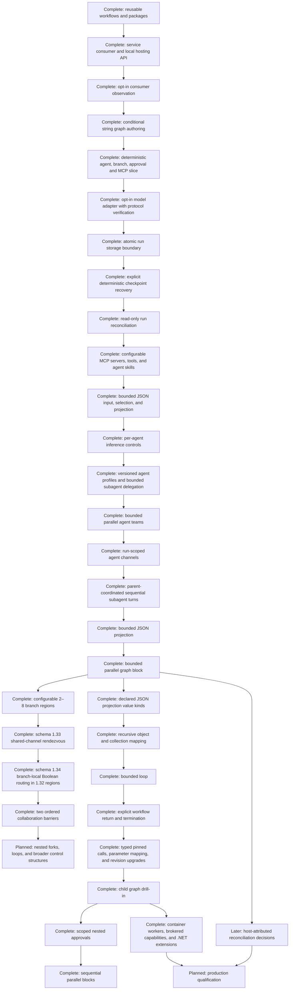

# Roadmap

The goal is a dependable, extensible C# platform for visually designing agent workflows, hosting them as logic inside user-owned services, running them independently of the browser, and inspecting exact historical execution. Studio is an optional IDE; the execution engine must be independently consumable. This document tracks delivery priorities and status. [Architecture](architecture.md) describes what exists, [the user guide](user-guide.md) explains how to use it, and [implementation history](implementation-history.md) retains detailed milestone evidence. [Product design](design.md) records the broader direction.

Statuses mean **Complete** (implemented and verified), **Active** (currently being built), **Next** (next planned increment), or **Planned** (direction with unresolved details). Planned work is not a supported capability. Sequence expresses dependencies rather than dates.

## Current product boundary

The development Studio edits and runs validated linear, conditional, bounded parallel and typed agent graphs through Microsoft Agent Framework. Workflows have optional human-readable names while their generated IDs remain stable for storage, imports, workflow calls, and consumer integrations. Most graph connections carry strings; schema 1.9 adds a bounded JSON entry input and pointer selector that returns text, schema 1.13 adds bounded JSON projection and JSON workflow output, schema 1.14 adds one visible two-branch fork/barrier join returning bounded JSON, schema 1.15 adds declared JSON value kinds to projection fields, schema 1.16 adds recursive object and array-item mapping, schema 1.17 adds one auditable bounded loop with a linear body and a hard iteration cap, schema 1.18 adds no-result termination exits, schema 1.19 adds bounded calls to exact child workflow revisions, schema 1.20 permits up to four sequential bounded parallel blocks and success/failure outcomes for termination nodes, schema 1.21 adds per-agent model-turn/time controls and optional structured JSON results, schema 1.22 adds an optional provider-reported aggregate token budget across the agent and its delegates, schema 1.23 separates execution and data wires, schema 1.24 adds typed Boolean branching, schema 1.25 adds Boolean constants and NOT, schema 1.26 adds bounded nested/reconvergent Boolean routes and multiple exits, schema 1.27 adds embedded pure graph-function snapshots as lazy typed data nodes, schema 1.28 lets agents invoke only exact assigned pure graph-function snapshots as bounded tools, schema 1.29 lets Agent nodes bind bounded output-token and total-token controls to integer workflow parameters, schema 1.30 lets an Agent choose among authored execution pins through an invocation-scoped internal function, schema 1.31 adds typed signed-64-bit integer values and checked arithmetic, schema 1.32 adds one explicit static fork/join region with 2–8 named branches, schema 1.33 adds one collaboration rendezvous with run-scoped channels, exact per-Agent phase grants, bounded immutable message snapshots, durable audit evidence, and passive playback, schema 1.34 permits at most one Boolean Branch per branch in schema-1.32 regions with exclusive reconvergence and complete matching joins, and schema 1.35 adds exactly two ordered collaboration rendezvous with separate bounded snapshots and phase/role grants. Schema 1.33 collaboration paths remain linear in this increment; branch-local conditional collaboration paths remain deferred. Studio's graph editing, themes, route controls, projects, libraries, packages, and playback are documented below. The runtime imposes one finite collaboration-region timeout from either the workflow or its host, and collaborators receive only explicitly granted channel tools for their exact Agent invocations; these grants do not pass to delegated subagents. Collaboration remains limited to one static region with 2–8 branches; schema 1.33 has one barrier and schema 1.35 has two ordered barriers with cumulative message/channel/snapshot bounds. Loops, nested collaboration, retries, and resumption remain unsupported. See [parallel Agent collaboration](parallel-agent-collaboration.md) and [two-phase collaboration](parallel-agent-collaboration-phases.md). Agent nodes configure system instructions and a stable model connection ID, node-scoped MCP and graph-function tools, per-response and aggregate token budgets, model turns that accept any positive limit or `-1` for unlimited, optional timeouts and structured results, and provider-advertised reasoning controls including explicit off. During execution, agent nodes show provider-reported token totals, latest completed prompt usage versus the configured context window (marked as the last completed measurement while another model request is in flight), recorded host context compactions, and an estimated cost when both optional token rates are configured. The current adapter does not configure host-side compaction; provider-internal compactions cannot be observed. Workflows do not pin connection revisions; editing a connection changes future runs, while recorded events retain the model descriptor and usage used for replay. Studio has a local Streamable HTTP and stdio MCP library with a bounded nested argument subset and a text-only versioned skill library; selected skill revisions and structured user-message templates travel in schema 1.7 definitions. Stdio launches trusted local programs with structured arguments, explicit encrypted environment values, disabled environment inheritance, OS-user privileges, and no sandbox; a fresh process starts for discovery and each invocation. Consumer hosts can register digest-pinned container MCP tools through the node-scoped broker and may load one SHA-256-pinned .NET extension inside that isolated worker; these are host-code integrations, not Studio connection forms. Schema 1.6 supports up to 64 typed scalar parameters; schema 1.8 adds integer, number, boolean and choice validation and exposes a reasoning-effort input. Schema 1.11 adds versioned agent profiles and bounded one-level subagent delegation; schema 1.12 adds profile-pinned coordination channels with audited run-scoped exchange. Nested parallelism and nested loops remain planned. Model connections can be managed in Studio settings by stable ID. The default agent connection is a deterministic fixture; the opt-in OpenAI SDK adapter is protocol-verified, while credentialed live-service qualification remains outstanding.

Schema 1.42 adds the bounded `core.number.add` pure data operator to the Blueprint parity track. It has exact finite-number `left`/`right`/`out` pins, no execution pins or coercions, deterministic non-finite-result failure, pure graph-function support, typed direct-MCP argument propagation, and recorded data evaluation evidence. Broader numeric operators, conversions, containers, and generic numeric workflow outputs remain deferred. See [finite number addition](decisions/0010-finite-number-addition.md).

Schema 1.43 is the shipped Sequence parity slice: each ordered output may enter one bounded, acyclic, disjoint direct-MCP path ending at the workflow Output barrier. Schema 1.46 adds a bounded path variant with one terminal plain-text Agent per selected output, schema 1.47 adds a terminal deterministic uppercase step, and schema 1.48 adds a terminal deterministic reverse step. These are definition-driven additive slices that preserve earlier behavior. The Studio exposes guarded promotions and provider-pinned Agent authoring for the bounded Agent slice; Agent tools, skills, delegation, shared descendants, branches, loops, nested workflows, durable resume, and older-runtime/migration compatibility remain gated. See [the proof gate decision](decisions/0011-sequence-agent-path-proof.md), [the topology analyzer decision](decisions/0021-sequence-agent-topology-analyzer.md), [the transform-path decision](decisions/0044-sequence-transform-path.md), and [the reverse-path decision](decisions/0045-sequence-reverse-path.md).

Schema 1.49 extends the bounded Sequence path contract with zero or more direct MCP nodes followed by at most one uppercase and one reverse deterministic text step, in either order, directly into Output. Direct 1.47/1.48 promotions preserve stable graph identities; older schemas retain their terminal-only behavior. See [the transform-chain decision](decisions/0046-sequence-transform-chain.md).

Schema 1.44 is the shipped bounded mutable-variable slice: workflow-local scalar
declarations, explicit typed Get/Set nodes, isolated run stores, variable
evidence, Studio authoring, and passive prefix reconstruction. The inspector
shows the reconstructed value/version and operation history without replaying
the workflow. Schema 1.45 adds one explicit bounded loop body with repeated
variable evidence. Concurrent, Sequence, collaboration, and shared-child
state semantics remain deferred. The separate deterministic checkpoint host
supports schema 1.45 loop recovery only when `EnableLoopCheckpointRecovery` is
explicitly enabled; the frame/runtime compatibility boundary is exact, and
default and Studio recovery remain fail-closed.

The backend owns execution. Schema 1.32's named 2–8 branch fork/join remains available. Schema 1.33 adds one graph-level shared-channel rendezvous and Studio authoring. Incomplete rendezvous and branch layouts can be saved but cannot publish or execute. The Studio/ordinary queued runs still interrupt after host failure; the separate opt-in host explicitly resumes deterministic saved checkpoints but collaboration regions do not support recovery or resume. The Studio host is loopback-only and unauthenticated; payloads are plaintext. It is not production ready. Socket rewiring is supported for matching typed pins, while incomplete drafts remain non-executable until validation succeeds. Sequential subagent calls, parallel agent-team calls, bounded graph fan-outs, and the first graph-level collaboration slice are explicit; nested collaboration remains planned. Conditional routing and parallel graph execution are validated operations.

## Planned phase: Blueprint-inspired authoring contracts and ergonomics

**Status: Active.** This phase is the result of an audit against [the Unreal Blueprint capability reference](unreal-blueprint-reference.md), [Blueprint authoring guidance](blueprint-authoring-guidance.md), and [product design](design.md). Its current evidence baseline is the [Blueprint capability matrix](blueprint-capability-matrix.md). It is intentionally narrower than “Blueprint parity”: Visual Agent Workflow should borrow Blueprint's explicit, typed, composable authoring model without adopting Unreal's object world, frame/tick semantics, or implicit mutable state.

### Audit baseline

The project already has a substantial Blueprint-inspired foundation: separate execution and data semantics; typed string, Boolean, integer, and bounded JSON values; conditional routing; bounded loops; named bounded fork/join regions; graph functions; pinned child workflows; workflow parameters and getter nodes; stable node/port identities; comments, sections, reroutes, layout persistence; invalid-draft saving with publish/run gates; immutable revisions; host-owned capability grants; and passive recorded playback. These are shipped capabilities, not phase proposals.

The remaining alignment work is primarily contract and authoring work. The current reference identifies broader type/container systems, mutable graph variables, richer control flow, event dispatchers, latent/scheduled work, generalized reuse/templates, and Blueprint-style debugging as future capabilities requiring separate runtime and evidence contracts. This phase must not turn those design targets into supported behavior merely by adding palette entries or card shapes. Schemas 1.46 through 1.49 are bounded increments, not complete Blueprint parity.

## Active phase: Consolidate current workflow authoring schema

**Status: Active (2026-10-29).** The reviewed schema-consolidation decision is
[Decision 0060](decisions/0060-unified-authoring-schema.md). New workflows now
identify themselves as schema `2.0`; the work below tracks the remaining
vertical slices needed before the current schema is a complete replacement for
the historical promotion chain.

- [x] Register schema 2.0 as the current authoring identity and make new
  explicit text templates use it.
- [x] Derive unified validation from node contracts, typed pins, configuration,
  and topology rather than exact 1.x capability allowlists.
- [x] Derive runtime execution plans for unified Sequence, MCP, agent,
  workflow-call, variable, JSON, loop, parallel, and collaboration graphs
  without changing historical 1.x dispatch.
- [x] Expose implemented node families and insertion actions in the Studio
  for 2.0 without promotion gates; remove graph-promotion and preview controls
  and their handlers. Property edits and reuse preserve the current schema.
- [ ] Add deterministic explicit normalization from legacy 1.x definitions to
  2.0 with source/target hash, revision, schema, normalizer version, and
  diagnostics provenance. The supported-conversion slice is implemented:
  `NormalizeForEditingWithProvenance` returns a deterministic result envelope; Studio automatically saves successful
  conversions with SQLite drafts, and unsupported conversions remain
  inspectable with structured diagnostics. The original source revision is
  preserved, provenance remains anchored to the initial normalized target
  across later edits, and restoring a revision clears draft conversion
  provenance. The record retains the exact source and initial target snapshots;
  SQLite schema 6 integrity-checks it. Remaining legacy control-flow families,
  effectful loop bodies, and conversion coverage are still open. `NormalizeForEditing` covers explicit
  graphs and verified implicit linear text graphs, including unrouted Agents;
  it preserves source identities and pinned snapshots and leaves pure text
  transforms as lazy data nodes. A schema-1.45 explicitly wired bounded
  loop-variable execution proof now confirms that loop topology, output, and
  recorded iteration events survive normalization without changing the source
  definition. Legacy schema-1.17–1.22 data-carried loops with linear pure
  uppercase/reverse bodies now normalize to 2.0 with their data feedback wires
  preserved and explicit activation wires added; runtime tests verify output,
  per-pass values, and both stop conditions. Conversion provenance is persisted
  with SQLite drafts; broader historical control-flow migrations and effectful
  loop-body translation remain future compatibility work.
  - [x] Normalize legacy conditional schemas 1.4–1.22 when there is exactly
    one Condition, at most one Merge, disjoint linear pure-uppercase/reverse
    arms, and unambiguous pure-text paths around the region. Existing-Merge
    conversions preserve node and data-edge identities. When both arms end at
    Output, normalization inserts a deterministic Merge and retargets the two
    terminal data edges so the unified runtime can select the active route;
    the historical source remains unchanged and provenance captures both
    definitions. Runtime output, selected route, and lazy arm evidence match
    legacy behavior for transformed and empty arms. Other ambiguous control-
    flow topologies remain diagnostic-only.
- [ ] Prove a contract-derived bounded activation-region plan for composed
  current-schema graphs. Keep authored nodes, pins, and connections flat; derive
  ownership from node/pin contracts and topology without node-family allowlists.
  The 2026-11-18 Sequence-completion reviews reject topology-only inference and
  a separate public barrier node as unsupported choices. First prove whether
  the existing Sequence collector can expose a typed, lineage-preserving
  aggregate signal; outcome precedence, sibling draining, persistence
  rejection, and playback without that signal remain unresolved in
  [Decision 0073](decisions/0073-branchable-sequence-output-contract.md).
  Core playback now has a focused regression that treats a settled output with
  no Sequence terminal as a running prefix; file/SQLite tests cover settlement
  append rejection before commit and after a simulated commit with a lost
  acknowledgement. Typed Sequence playback now retains and validates activation
  scope, with production proof events independently reconstructed for nested
  activations in both stores. Coordinator tests cover the Break/admission race
  and current failure cancellation of an active sibling. Production aggregate
  evidence now reconstructs a failed Sequence activation after Break races with
  already-authorized failed and outcome-unknown MCP siblings; run-level
  reconciliation retains both unresolved tool identities. Persistence
  rejection before commit and lost acknowledgment after committed Break
  settlement are now characterized in both stores: playback distinguishes a
  missing terminal from a committed `break-completed` Sequence, while the
  enclosing run remains nonterminal after the lost acknowledgment. Other
  mixed-outcome combinations and enclosing-run recovery still need proof.
  The 2026-11-18 three-role adjudication selects a distinct Loop feedback input
  as the target authoring contract: initial entry and bounded body return have
  separate pins. Unified schema 2.0 now publishes those pins through Core's
  node descriptor and validator; package serialization and Agent Framework
  execution cover the explicit feedback shape. Studio normalizes unambiguous
  existing drafts while preserving authored identities; published revisions
  remain immutable. The previous unified shape remains readable for existing
  saved revisions.
  The proof-only discriminator compares both pin shapes on identical graphs;
  three nested loops with a multi-exit Sequence now produce identical ownership,
  and migration preserves node, data-edge, and execution-edge IDs while only
  retargeting return edges. Focused topology tests pass 32/32. It now also covers
  serialized legacy single-loop definitions from schemas 1.17–1.22:
  each round-trips, normalizes to 2.0, then migrates to the explicit feedback
  target with source bytes and authored identities preserved (6/6 cases).
  Malformed duplicate-return imports from each of schemas 1.17–1.22 now fail
  without a target/provenance, preserve the serialized source, and retain every
  validator code, path, and full message (6/6 cases). The current Core suite passes 695/695.
  Other malformed/ambiguous legacy shapes and nested production authoring,
  validation, runtime, persistence, and playback evidence remain open.
  Sequence/Break production settlement remains a separate gate and cannot be
  inferred from the feedback-pin contract.
  - [x] Add a non-authoritative Core topology/migration discriminator and run
    both feedback-pin shapes over shared nested-loop, Sequence, malformed-route,
    incomplete-draft, and migration cases. The expanded three-loop fixture has
    a Sequence with one normal return and two terminal Break exits; both pin
    shapes derive the same parent ownership and feedback edges. Migration keeps
    node, data-edge, and execution-edge IDs and changes only the return targets.
    Shared routes, fallthrough, cross-owner returns, unowned cycles, incomplete
    feedback, disconnected loops, and ambiguous migration are rejected.
    Focused topology tests pass 32/32; six serialized legacy schema variants
    also pass normalization-plus-migration. Duplicate-return serialized imports
    for all six variants preserve exact validator diagnostics and source bytes;
    Core passes 693/693. Public/package admission still reject the proof
    candidates; additional invalid-legacy shapes, integrated runtime,
    persistence/playback, and full compatibility remain open.
  Reject arbitrary cycles and accept only explicitly declared, bounded loop
  feedback. Exercise nested Sequence/loop/Break composition through public and
  package validation, production dispatch, file/SQLite reopen, passive playback,
  failure/cancellation/persistence races, and identity-preserving migration.
  This is a proof gate, not architecture selection or permission to expose
  public Break. Nested serialized regions remain a fallback only if evidence
  shows the flat representation cannot meet the contract. See the adjudicated
  review in [Decision 0070](decisions/0070-bounded-array-iteration-contract.md).
- [x] Integrate the adjudicated Loop feedback input into unified schema 2.0.
  New/current Loop nodes expose `execute` and `feedback`; validation requires
  one initial activation and one body return on their respective pins. Packages
  preserve the explicit wire, and the Agent Framework executes the schema-2.0
  feedback route. Studio converts an unambiguous old draft copy while retaining
  IDs and preserving published revisions. Previous unified definitions remain
  readable. Core passes 695/695; bounded-loop runtime tests pass 6/6.
- [x] Preserve 2.0 through package, reuse, graph-function, clipboard, and
  nested-workflow editing paths while preserving pinned dependency snapshots.
- [x] Extend bounded `array<json>` in current schema 2.0 with an exact
  zero-based `ArrayGet` topology, typed JSON evidence, node-attributed bounds
  failures, and unchanged historical playback/checkpoint contracts. See
  [Decision 0065](decisions/0065-unified-json-array-get.md).
- [x] Add Core, runtime, Hosting, Studio, package, and browser regressions for
  mixed current-feature graphs, legacy hash/playback stability, normalization,
  and host security boundaries.

The consolidation includes typed MCP arguments combined with agents and scalar
operations, both explicit integer conversions, JSON entry/projection and bounded
array count/selection,
bounded loop processing, ordered Sequence paths, static parallel branches and
one/two-phase collaboration. Checkpoint recovery admits the same proven
deterministic scalar-variable and loop-variable shapes under 2.0, preserving
the host loop opt-in and exact frame/revision integrity; effectful or broader
loop bodies remain outside crash recovery. Browser verification covers node
creation, wiring, save, and deterministic execution with no promotion controls.

### Next parity workstream: first-class collections

**Status: Active; primitive and JSON-valued arrays compose through workflow boundaries, parameters, pure graph functions, direct MCP argument pins, bounded operations, and JSON-array variable Get/Set. Iteration remains a separate increment.**
The capability audit and three-role adversarial review identify containers as a
foundational Blueprint language gap. Existing `array<json>` support is useful
but remains subject to bounded graph shapes and explicit placement contracts.
[Decision 0066](decisions/0066-unified-typed-array-values.md)
sets the staged contract: current schema 2.0, homogeneous bounded primitive
arrays in ordinary pure-data composition and typed workflow input/output
boundaries, then separately proven placements. Maps/sets, workflow interfaces,
iteration, and checkpoint state remain future work. No
feature-specific schema gates, promotion controls, or preview modes will be
introduced.

- [x] Add the schema-2.0 immutable typed-array contract and compose literal,
  length, and indexed-read nodes with existing pure scalar dataflow. Verify
  exact type identity, item and payload bounds, scalar output, node-attributed
  index failures, recorded evaluation evidence, invalid-draft persistence, and
  unchanged historical JSON-array behavior. See [Decision 0066](decisions/0066-unified-typed-array-values.md).
- [x] Prove immutable typed-array data dependencies inside the current-schema
  bounded-loop body: `ArrayGet` supplies a real variable write on every body
  activation; file/SQLite reopen retains those activations and invocation
  evidence. The shared evidence budget rejects the fifth pass before its write
  while preserving the four accepted values. This does not provide array
  iteration or loop-carried immutable state; the integrated iterator/Break
  runtime proof remains active in [Decision 0070](decisions/0070-bounded-array-iteration-contract.md).
- [x] Extend typed arrays through workflow input/output boundaries as JSON text
  on the existing string run API, with exact type validation, shared bounds,
  package/hash/runtime/evidence proofs, and Studio guidance. See
  [Decision 0067](decisions/0067-typed-array-workflow-boundaries.md).
- [x] Extend typed arrays through workflow parameters, exact typed getter pins,
  caller overrides, child-call mappings, and prompt/template text; preserve
  authored defaults and existing string-map APIs. Include bounded `array<json>`
  values while retaining object member order and numeric token spelling through
  resolution, typed pins, runtime evidence, and Studio JSON editors. See
  [Decision 0068](decisions/0068-typed-array-workflow-parameters.md).
- [x] Extend typed arrays through pure graph functions, including direct calls
  and Agent graph-function tools, exact package/hash behavior, runtime input
  validation, and bounded aggregate call evidence recorded in ordinary run events.
  See [Decision 0069](decisions/0069-typed-arrays-in-pure-graph-functions.md).
- [x] Compose bounded primitive and JSON arrays with current-schema direct MCP
  argument pins and Sequence dispatch. Validation admits array-typed MCP pins
  only in schema 2.0; execution serializes the exact evaluated array as a JSON
  argument. A focused regression validates the graph, package round-trips it,
  and verifies both deterministic Sequence calls receive the authored values.
- [x] Implement typed array declarations/defaults, exact Get/Set pins, immutable
  append/insert/replace/remove/concatenate nodes, canonical state and playback
  evidence, with a shared 65,536-byte per-invocation array-value evidence budget.
  Linear and bounded-loop runtime paths have focused execution/playback coverage,
  file/SQLite persistence and reopen tests, and checkpoint snapshot rejection.
  Operation index/type/item bounds and array-variable package/hash round trips
  now have focused Core tests. Browser verification covers declaration creation,
  editing, save/reopen, invalid-default draft persistence, Problems diagnostics,
  and run blocking. Complete historical compatibility remains open. Runner-backed
  bounded-loop and file/SQLite reopen tests reconstruct typed-array values at
  every captured event prefix. Cancellation before/after writes, a fault after a
  committed write, concurrent root-run isolation, and sequential child-invocation
  isolation are now covered.
  See [Decision 0071](decisions/0071-typed-array-run-scoped-variables.md).
- [x] Add bounded `array<json>` mutable-variable defaults and exact Get/Set in
  unified schema 2.0. Preserve compact JSON values, member order, and numeric
  token spelling in variable evidence; enforce the shared aggregate evidence
  budget atomically across reads and writes. Immutable JSON-array transformations
  can feed Set, with whole-value commits; file/SQLite, playback, and failure
  behavior are covered by Decision 0071. Checkpoint snapshots remain rejected,
  and broader historical compatibility remains open. See [Decision
  0071](decisions/0071-typed-array-run-scoped-variables.md).
- [x] Compose the existing `array<json>` type with Array literal, length, get,
  append, insert, replace, remove, and concatenate in unified schema 2.0. Keep
  JSON null, nested values, item order, and exact `json` versus `array<json>`
  typing; apply the 64-item, root-counted depth-32, and 16 KiB input/result
  bounds. Core tests cover preservation and limit behavior; runtime tests cover
  JSON literal/get and append/get execution, plus node-attributed oversized
  result failure. Studio browser coverage verifies JSON literal authoring and
  save/reopen. Pure graph functions also accept exact `array<json>` pins and
  expose all eight existing operations in both function editors. Core coverage
  checks mixed/null/nested values, Get-to-transform composition, member-order
  and number-token preservation, historical validation gates, and invocation
  budgeting. Folder-editor browser coverage checks JSON pin and literal
  controls. Iterator readiness remains governed by [Decision
  0070](decisions/0070-bounded-array-iteration-contract.md).
- [x] Add typed **Array Contains** for `array<string>`, `array<boolean>`,
  `array<integer>`, and `array<number>` in workflow graphs and pure graph
  functions. Share scalar equality with existing string/integer comparison
  nodes; define finite IEEE-754 numeric equality including signed zero. Reject
  `array<json>` because structural equality is not defined. Core passed 635/635
  tests and the focused Agent Framework tests passed 7/7 on 2026-11-17. The full
  Agent Framework suite remains incomplete due to an unrelated nested-Break
  concurrency failure and subsequent stall. Playwright verified the editor
  adds the node, renders its typed operation, and leaves the graph with no
  reported issues. See [Decision 0072](decisions/0072-primitive-array-contains.md).
- [x] Admit bounded, branchable Sequence output regions in unified schema 2.0.
  One bounded Condition or Boolean Branch owns two disjoint arms converging at
  an exclusive Merge, followed by a linear suffix. Public validation rejects
  shared, incomplete, ambiguous, cyclic, unreachable, and multiply-settled
  shapes. Boolean Branch arms require a data-producing execution node before
  Merge so the selected value dependency is unambiguous; a Condition can pass
  its selected string directly. Core validation and package round-trip cover
  both decision forms, and public runner tests exercise both choices while
  confirming one Merge activation and no start on the unselected arm (Core
  SequenceGraphTests 40/40; runner cases 4/4). Failure, unknown outcome,
  cancellation, file/SQLite reopen, and passive playback remain covered by the
  production-runner proof matrix. Historical schemas are unchanged. This closes
  the bounded branch topology item; integrated concurrent Sequence/Break array
  iteration remains a separate open gate. See
  [Decision 0073](decisions/0073-branchable-sequence-output-contract.md).
- [x] Revalidate the current typed-array and direct parallel-MCP implementation
  against the owning suites on 2026-11-02: Core 590/590 and Agent Framework
  252/252 passed. The prior MCP suite result is 98 passed with 2 opt-in tests
  skipped; it was not rerun for this increment.
- [ ] Prove one integrated runtime seam for Blueprint-style typed array
  iteration against pinned Agent Framework 1.26.0. Candidate comparisons now
  cover structured, fresh-subworkflow, and hybrid execution. A private
  VAW-owned coordinator now carries frames, root lifecycle, and atomic
  work/evidence budgets across production Agent Framework body dispatch and
  Agent/MCP nodes. The remaining evidence is the complete supported-body,
  failure/race, shared-budget, persistence, and playback matrix, followed by a
  fresh three-role architecture review. Do not introduce public iterator/Break
  schema or Studio authoring until that seam passes and the review selects the
  architecture. **Private integrated Sequence/Break activation proof — in
  progress; runtime architecture and public contracts unselected.** The
  production Sequence path queues configured outputs through a separate
  source/collector settlement path. Follow the Blueprint contract: ordered
  output admission without waiting for earlier latent descendants; make
  admission-versus-Break atomic, drain admitted scopes, and skip only the
  undispatched suffix. The private Sequence ledger/coordinator now serializes
  `DispatchNext` against `StopAdmission`; dispatched work stays open until it
  settles. A private integrated production-body proof now confirms that a real
  Agent output remains active while the next output is admitted, Break skips
  only the undispatched suffix, and the admitted output drains; file and SQLite
  histories reopen identically. Passive playback now has a distinct
  `sequence.break_completed` terminal with a versioned reason and validates the
  completed-prefix/skipped-suffix shape. Focused Core and integration checks
  also prove that a failure from an admitted Agent overrides Break and remains
  failed through file/SQLite reopen and passive playback (2/2). An admitted
  direct MCP call with an unresolved external outcome also overrides Break and
  retains root `outcome-unknown` through both stores and passive playback (2/2).
  Host cancellation after Break is requested while an Agent is admitted stays
  a cancelled root and Sequence through both stores and playback (2/2).
  A new proof-scoped single-stream dispatch session now passes the central
  A-active/B-Break/C-skipped/drain gate and reopens `break-completed` playback
  through both stores (2/2); the existing structured activation
  Break/failure/unknown/cancellation matrix passes 28/28. The serializer now
  retains the Break reason required by playback. This does not broaden the
  production admission policy or select an architecture. The same-stream
  admitted-Agent failure case now also passes in file and SQLite stores (2/2):
  the failed admitted output overrides Break, the suffix remains skipped, and
  playback reconstructs failure. The Sequence production runner group passes
  58/58. The same-stream unresolved-MCP-outcome and host-cancellation cases now
  pass through both stores (2/2 each), preserving root uncertainty/cancellation
  separately from Sequence playback. Admission races, nested frames, shared
  budgets, and the remaining matrix still need proof and a fresh review. A
  128-iteration coordinator contention test now exercises
  `TryDispatchNext` against `StopAdmission`: either the output dispatches
  before Break and settles, or Break skips it; the suffix is skipped and no
  dispatch follows a skip event. The production dispatch session now performs
  coordinator admission within the same `ActivationAbortScope` lock used by
  Break acceptance, eliminating the stale-read/late-dispatch window identified
  in the review. Graph-dispatched proofs cover both admitted-prefix drain and
  Break-first suffix skipping across file and SQLite stores (2/2 each); the
  admission-first proof holds Break before acceptance while admitted Agent work
  remains active. The separate coordinator contention test still provides the
  exact lock-race stress evidence. This remains private proof-only behavior;
  the full iterator gate, nested frames, shared budgets, and supported-body
  matrix remain open. See
  [Decision 0070](decisions/0070-bounded-array-iteration-contract.md).
  The reviewed activation-local Break proof could not include a sibling Sequence
  continuation under the then-current linear Sequence validator. Unified schema
  2.0 now admits one bounded decision region whose arms converge at Merge, but
  that does not model a selected Break terminal alongside an output path that
  continues through Sequence. The combined case remains an open composition
  gap pending the route-to-output settlement proof in [Decision
  0073](decisions/0073-branchable-sequence-output-contract.md) and the fresh
  architecture review in [Decision
  0070](decisions/0070-bounded-array-iteration-contract.md).
  The existing overlapping Break/Agent proof remains covered, but it does not
  close that gap.
  This remains a private proof path: the
  production guard, public schema, and Studio authoring remain unchanged. Prove
  one VAW owner for frames,
  root lifecycle, and shared budgets, including failure/unknown/cancellation/
  pause/stop races and file/SQLite playback. See the latest review entry in
  [Decision 0070](decisions/0070-bounded-array-iteration-contract.md). A
  2026-11-17 one-output-per-source-invocation integration attempt was reverted
  after 40/55 existing Sequence production tests failed; the detailed failure
  evidence and next constraint are recorded in Decision 0070. A private
  Agent Framework self-continuation proof also confirms that a continuation
  handler can run while an earlier descendant is active, but its next body
  message waits until that superstep drains. A production-path characterization
  also confirms the current Sequence source does not start the first descendant
  until it advances past the later-output dispatch boundary. These tests pass
  as characterization, while the required A-active/B-admitted gate still fails
  for the current production Sequence mechanism. A fresh triad returned
  REVISE: test any new mechanism through production dispatch before selecting
  architecture. A
  follow-up proponent/opponent/adjudicator review on 2026-11-17 reaffirmed a
  private VAW-owned item-coordinator experiment: retain each admitted body
  through branch settlement, serialize Break against later admission, and
  prove typed bindings, nearest-frame targeting, shared budgets, failure and
  external-outcome precedence, cancellation, and file/SQLite playback. This
  selects no production architecture and makes no public schema or Studio
  change; passing the proof only enables another architecture review. See
  [Decision 0070](decisions/0070-bounded-array-iteration-contract.md). The
  proof-only production-body coordinator now admits two typed item activations
  through independent Agent Framework body dispatches: a held Agent in item A
  remains active while item B reaches graph-dispatched Break, and item C is
  never admitted. It drains A before one root completion and produces identical
  persisted/playback evidence after file and SQLite reopen (2/2 focused cases).
  A second proof holds A through B's Break, then fails A; the run waits for A,
  fails instead of completing, skips C, and reopens with the same passive
  playback through both stores (2/2 focused cases). This proves admitted-Agent
  failure precedence for this production-dispatch seam only. A third proof
  drains A's authorized MCP call after B requests Break; the correlated
  unknown outcome wins, the root settles `outcome-unknown`, C remains skipped,
  and both stores reopen the same playback history (2/2 focused cases).
  A fourth proof cancels the host after B's Break while A's Agent is still
  blocked. The admitted Agent records cancellation, the root ends cancelled,
  and C remains suppressed with matching file/SQLite playback (2/2 focused
  cases). The admission winner is now also forced at the reservation boundary:
  if C is reserved before B's Break, C drains and appears in the result while
  only item D is suppressed (2/2); the existing Break-first case suppresses C.
  These ordered cases prove both serialized outcomes, not uncontrolled
  scheduler races. A run-level shared model-dispatch budget is now also tested
  with two concurrently admitted production bodies: the one-request cap admits
  exactly one provider call, fails the other activation before dispatch, and
  reopens with identical failed playback through file and SQLite stores (2/2).
  A byte-cap proof calibrates the serialized MCP authorization prefix and
  pending iteration/outcome reservations from a synchronized two-dispatch
  baseline. Both stores reject the second dispatch before broker invocation,
  settle the admitted sibling, suppress the run result, and reopen the same
  failed history (2/2). This verifies integrated byte contention for this
  direct-MCP body; broader concurrent payload shapes and production budget
  ownership remain open. See [Decision
  0070](decisions/0070-bounded-array-iteration-contract.md).
  The concurrent production-body Sequence proof now also forces an item-0
  MCP failure only after item 1's Sequence completes. All four calls are
  authorized; item 1's full Sequence and iteration completion remain recorded,
  while item 0 records one completed MCP side effect, a failed output, a
  cancelled sibling output, and a failed iteration. Both file and SQLite
  stores reopen and passively render the same mixed prefix (2/2). This proves
  one synchronized failure ordering only; cancellation races, other failure
  positions, and production scheduler ownership remain open. See [Decision
  0070](decisions/0070-bounded-array-iteration-contract.md). A new clean-context
  proponent/opponent/adjudicator review of splitting Sequence outputs into
  separate production body dispatches returned REVISE. This remains an
  experiment candidate only. The next gate must show A's real Agent still
  active when B reaches graph-dispatched Break, while one VAW owner preserves
  Sequence output settlement, root lifecycle, shared budgets, original revision
  identity, and a monotonic event sequence; C must be recorded skipped. No code
  or shipped behavior changed in that review. See [Decision
  0070](decisions/0070-bounded-array-iteration-contract.md).
  The current-checkout characterization plus Sequence composition and failure
  proof filter passed 5/5, confirming the existing dispatch boundary and both
  store variants of the recent proofs. It does not exercise the per-output
  dispatch candidate or satisfy the A-active/B-Break gate. A proof-only
  implementation of per-output concurrent `ExecuteCoreAsync` streaming runs
  then failed its first gate: with output A's Agent held, B was recorded as
  dispatched but its production Sequence source never started (file/SQLite
  0/2); the existing Sequence production filter remained green (56/56). A
  fresh three-role review of the single-stream, bounded-lazy-admission
  alternative returned REVISE pending a same-stream A-active/B-Break/C-skipped
  test and failure, unknown-outcome, cancellation, and playback evidence. No
  architecture or shipped behavior is selected. Details are recorded in
  [Decision 0070](decisions/0070-bounded-array-iteration-contract.md).
  A synchronized two-Agent body now covers both a single outstanding model
  outcome reservation and a calibrated byte cap. In each case, the second
  `model.requested` is rejected before provider dispatch while both iteration
  settlement slots remain held; file/SQLite reopen matches, and the byte-limited
  failed prefix remains within its serialized-event ceiling (2/2). Other
  payload shapes and production budget ownership remain open; see [Decision
  0070](decisions/0070-bounded-array-iteration-contract.md).
  A nested-frame production-body case now confirms that graph-dispatched Break
  targets the inner frame ID rather than its supplied outer frame, suppresses
  the remaining inner suffix, and reopens with matching Break playback through
  both stores (2/2). This proves nearest-frame identity within this body seam;
  nested concurrent composition is now covered by a private coordinator proof
  that passes one root event/budget context and returns scoped child outcomes.
  Inner Break drains an admitted Agent before the parent resumes; the parent
  admits its next outer item only after child settlement. Admitted failure,
  unresolved MCP outcome, and cancellation prevent parent continuation and
  preserve root disposition/evidence; a shared loop-activation cap is enforced
  across parent and child. These five controlled scenarios pass through file
  and SQLite reopen/playback (10/10 focused cases). The proof closes only this
  composition under its bounded 1–8 body-concurrency test parameter; it does
  not select a production scheduling policy or prove nested graph fork regions.
  A further file/SQLite proof now overlaps two parent frames: an inner Break in
  one frame does not cancel or settle its sibling frame, which independently
  dispatches and consumes its own nearest-frame Break; both scopes replay from
  the reopened histories (2/2). This is controlled private-coordinator
  evidence, not public topology, uncontrolled scheduler-race, or production
  ownership proof. See [Decision
  0070](decisions/0070-bounded-array-iteration-contract.md).
  A paired file/SQLite proof now makes the second parent frame fail after the
  first frame has consumed Break. The sibling failure overrides Break for the
  root, and reopened passive playback retains both outcomes (2/2). Cross-frame
  cancellation and persistence-interruption cases remain open; this does not
  select public topology or runtime ownership. See [Decision
  0070](decisions/0070-bounded-array-iteration-contract.md).
  A follow-up lets the first frame's MCP call settle before Break, then holds
  the second frame's MCP call until it reports an unknown outcome. The root
  remains active during dispatch, ends `outcome-unknown`, and both stores reopen
  with correlated uncertainty and Break playback (2/2). Cross-frame cancellation
  and persistence-interruption cases remain open.
  A further synchronized cancellation follows one frame's Break while Agents in
  both parent frames are active. Both invocations settle cancelled, and file/
  SQLite playback preserves the Break and one cancelled root terminal (2/2).
  This closes only that controlled cancellation ordering; interruption races
  remain open. See [Decision 0070](decisions/0070-bounded-array-iteration-contract.md).
  Other remaining gates include byte/event contention, tool/outcome reservation
  races, host-control pause-event integration, uncontrolled production races,
  and the full body compatibility matrix. The proof coordinator
  now also honors `IWorkflowExecutionGate`: after
  two items are admitted and one settles, pause prevents item 3 admission and
  keeps the root nonterminal; resume completes all three exactly once with
  matching file/SQLite playback (2/2). At that point this did not wire host
  `PauseRequested`/`Paused`/`Resumed` evidence into the private coordinator. A
  48-schedule seeded scheduler-yield stress
  test checks the admission lock's recorded stop boundary: each reserved item
  starts and settles, no unreserved suffix starts, output matches the
  successful prefix. The paired deterministic tests force both Break-first
  and pre-reserved-item boundaries; the stress schedules are not required to
  realize both outcomes under suite load. This does not replace an uncontrolled
  production workload race test. Cancellation while paused now cancels the
  admission wait, drains a held Agent activation, records its cancelled
  iteration outcome before the single root cancellation, suppresses the next
  item, and reconstructs identical file/SQLite history and passive playback
  (2/2 focused cases). At that point this closed cancellation-at-paused-boundary
  evidence only; host control-event integration and concurrent MCP cancellation
  races remained open. A separate single-concurrency production-body case
  cancels after a direct MCP dispatch starts: the broker's correlated
  `tool.uncertain` and node cancellation survive, the admitted iteration is
  recorded cancelled, no later item is admitted, and root status remains
  cancelled while reconciliation reports the uncertain tool (2/2 file/SQLite
  cases).
  Concurrent two-item proofs now exercise a root tool-dispatch limit of one
  and an outcome-reservation slot limit of one. In both cases, two bodies are
  admitted, exactly one authorization reaches the broker, the other fails
  before dispatch, and the admitted call settles before the failed run ends
  without admitting a third item. File/SQLite reopen and passive run playback
  agree (4/4 focused cases). Targeted event-count and byte-budget exhaustion is
  now covered in the private concurrent coordinator: accepted starts reserve
  one bounded settlement event before body dispatch, while insufficient
  admission capacity starts no body. The terminal budget rejection records a
  matching failed iteration outcome through file and SQLite reopen; broader
  concurrent/nested contention and a production-owned iterator budget remain
  open. The latest proof increment drives this coordinator through the real
  `ControlledRun` gate and event writer. Across file and SQLite, pause records
  `PauseRequested` then `Paused`, blocks the next item while nonterminal,
  releases the shared execution slot, and resume records one `Resumed` before
  the next iteration is admitted after reacquiring the slot. A second case
  cancels while paused with an admitted Agent still active; the Agent drains as
  cancelled, the suffix stays suppressed, and the root ends cancelled. Reopened
  event histories and passive playback match (4/4 focused store cases). This
  integrates host controls with the private coordinator for these cases only;
  uncontrolled production races, concurrent MCP cancellation races, the full
  body compatibility matrix, and architecture selection remain open.
  The
  production Break guard remains in place. A separate three-role review of
  mixed known-failure and unresolved-MCP outcomes returned REVISE because the
  private candidate paths did not establish stable root semantics. The two
  settlement orders now preserve correlated tool evidence through file/SQLite
  reopen and passive playback (4/4 focused cases). Rejection of either root
  terminal append also preserves both outcomes and the unterminal running
  prefix (4/4); host cancellation after the first outcome drains both calls in
  either order (4/4). The integrated bounded Sequence proof admits two linear
  MCP outputs, requests Break on the third, and skips the fourth while draining
  one known failure plus one unresolved outcome in either order; file/SQLite
  playback preserves both records (4/4). Root status precedence remains
  unselected. The fresh three-role review returned REVISE: preserve root status
  as execution disposition and keep external-effect certainty separately
  observable. A follow-up source audit found that the read-only
  `WorkflowWorkEvidence`/`RunReconciliation` projection already exposes
  correlated unsettled tool calls and incomplete correlation alongside the
  unchanged run status, including after terminal events. Do not add a duplicate
  aggregate API. The mixed failure/unknown projection is now asserted across
  both stores, settlement orders, terminal-append rejection, cancellation, and
  Sequence Break after reopen (12 focused cases). That matrix caught and fixed
  a private proof event that attributed `node.failed` to a virtual loop frame
  absent from the captured definition; the safe failure reason is now carried
  by the root event and all mixed call projections remain fully correlated.
  This projection reports recorded evidence; it is not a detector of
  unrecorded side effects. The private production guard,
  public schema, and Studio authoring remain unchanged. The full Agent
  Framework suite passes 822/822 after the event correction.
  The integrated `array<json>` body proof covers successful
  transforms and an Append result exceeding the 16 KiB bound: the failure is
  attributed to Append, later items and completion are suppressed, and file/
  SQLite reopen preserves the same failed event prefix.
  The final runtime must compose with existing body capabilities, keep Agent
  Framework behind its adapter, preserve the separate predicate-based string
  Loop, and exclude checkpoint recovery until frame restoration is proven. The
  eventual Studio array editor uses one JSON text field validated by the
  declared type.
  The integrated `array<json>` body proof also verifies mutable JSON-array
  variables: each activation starts at the declared default, appends its own
  heterogeneous item, and reconstructs independent scoped state after file and
  SQLite reopen. Array Literal, Length, Get, Append, Insert, Replace, Remove,
  and Concatenate now compose over `array<json>` values inside each activation,
  preserving nested values and numeric token spelling in scoped state after
  both stores reopen. A 16 KiB
  Append overflow in the first activation is attributed
  to Append, commits no variable write, suppresses completion and later items,
  and preserves the same failed prefix after both store reopen paths. JSON-array
  Get, Insert, Replace, and Remove index failures are also attributed to their
  source nodes and suppress writes, completion, and later items in both stores.
  JSON-array variable cancellation before the write records neither a write nor Set
  completion; cancellation after a committed write preserves reconstructable
  state. Both paths suppress later items in both stores. Parallel cancellation
  races remain open. A recorder exception after a committed JSON-array write
  preserves that last event and the scoped value in both stores; the resulting
  expected-sequence conflict leaves an incomplete running prefix and triggers
  no retry or later item. This is evidence preservation, not automatic recovery.
  The architecture review remains open.
  See [Decision 0070](decisions/0070-bounded-array-iteration-contract.md).
- [ ] **Finish proof for typed arrays in run-scoped variables:** complete the
  accepted unified-schema 2.0 contract for typed array declarations, Get/Set,
  and pure append, insert-at, replace-at, remove-at, and concatenate operations.
  Set explicitly commits whole transformed values. Keep current linear and
  bounded-loop ordering; reject parallel, Sequence, collaboration, asynchronous,
  graph-function state, shared child-state, and checkpoint placements. Canonical
  values and the aggregate evidence budget are implemented. Focused file/SQLite
  persistence/reopen and package/hash proofs now pass. Browser verification now
  covers declaration creation/editing, valid and invalid default save/reopen,
  diagnostics, and execution blocking; callable interface choices omit invalid
  drafts. Runner and reopened-store event prefixes reconstruct typed-array state
  without execution. Cancellation before and after writes, a post-commit failure,
  concurrent run isolation, and sequential child-invocation isolation are covered.
  Schema 1.44 and unified scalar Set/Get runs also reconstruct through the
  passive playback reader; broader historical compatibility remains before
  marking this increment shipped. See
  [Decision 0071](decisions/0071-typed-array-run-scoped-variables.md).
  - [x] Verify append/insert/replace/remove/concatenate ordering, empty-array
    insertion, legal index endpoints, invalid indexes and item types, exact
    array type matching, and maximum-item result rejection.
  - [x] Prove Core validation independently rejects typed-array variables in
    Sequence, nested workflow/interface calls, parallel fork/branch/join/
    rendezvous regions, and graph functions. The focused placement matrix
    passes 8/8 cases; these regions remain unsupported by contract.
  - [x] Verify runner-backed every-event-prefix reconstruction for bounded-loop
    typed-array variable state and after file/SQLite store reopen. Cancellation
    tests prove pre-write evidence stays empty and a post-write cancellation keeps
    the committed state reconstructable. A post-commit recorder failure preserves
    the same evidence. The MutableVariableExecutionTests class passed 34/34; the full Agent
    Framework suite passed 644/644 immediately before these additions on
    2026-11-16.
  - [x] Verify folder-backed Studio variable authoring in Playwright: add and
    reopen a typed array declaration, save an invalid typed default as a
    repairable draft, confirm Problems reports it, and confirm execution
    stays blocked. Invalid drafts are excluded from callable interface
    workflow choices; strict package/run validation remains enforced.
  - [x] Verify typed-array variable package round-trip identity and that changing
    the declared default changes the immutable definition hash.
  - [x] Prove `array<json>` variable Get/Set evidence through file and SQLite
    reopen, event-prefix playback reconstruction, compact JSON preservation,
    atomic aggregate-budget rejection, and continued checkpoint exclusion.
  - [x] Enable immutable JSON-array transformations into Set with per-value
    compact UTF-8 accounting shared by data-evaluation and variable-state
    evidence. Repeated values are charged for each retained occurrence. File and
    SQLite regressions verify budget exhaustion stops before the uncommitted
    write, preserves the previous committed value in reopened playback, and
    retains the recorded evidence prefix. The folder-editor browser smoke
    verifies the JSON-array variable guidance, default persistence, and exposed
    transformation/evidence-budget limits. Broader historical compatibility
    remains open. The full Agent Framework suite passed 691/691 after this
    increment; Core variable contracts passed 17/17.
  - [x] Carry a graph-dispatched typed Break result with source and target
    activation identity into the VAW coordinator; have the dispatcher report
    only source identity and derive/consume the target in the coordinator.
    Prove nested outer-loop continuation and rejection of stale or foreign
    requests without changing `core.terminate` semantics.
  - [x] Prove an Agent-to-Agent static-fork path ending in the private Break
    through the production runner, including the Agent Framework superstep
    boundary and file/SQLite persistence/reopen. The sibling must settle
    before downstream nodes in the next superstep are expected to activate.
    See [Decision 0070](decisions/0070-bounded-array-iteration-contract.md#multi-node-static-fork-dispatch-follow-up-2026-11-14).
  - [x] Prove multi-node direct-MCP and mixed Agent/MCP static-fork paths
    through the production runner. Two-MCP and Agent→MCP paths cover success,
    tool failure, unknown outcome, and host cancellation through file and
    SQLite persistence/reopen; HtmlRenderer playback retains the tool/Break
    evidence and confirms join suppression. These remain private proofs using
    a controlled MCP broker, not public iterator behavior or a real-server
    qualification. Broader control flow and deterministic transforms still
    require independent evidence. See [Decision 0070](decisions/0070-bounded-array-iteration-contract.md#multi-node-direct-mcp-and-mixed-path-follow-up-2026-11-14).
  - [x] Compare conditional item routing across structured, fresh-subworkflow,
    and hybrid candidates with each Agent result explicitly wired into its
    exclusive Merge. The candidates produce matching result values, branch
    decisions, invocation events, and scopes, persisted through file and
    SQLite stores (2/2 focused cases). This is proof-matrix evidence only; the
    production iterator contract remains open.
    - [x] Prove a private condition-routed Break through the production Agent
      Framework body workflow and output handoff. The dispatcher records only
      source node/frame/scope; the VAW frame derives and consumes the target
      and stops later items. Existing coordinator termination tests keep
      `core.terminate` on its ordinary path. The typed marker bypasses visible
      Output-node events.
    - [x] Extend the in-memory production proof to one static fork whose
      branches each end directly at the matching join with one Agent, MCP tool,
      or the proof Break. The activation-local abort scope drains work already
      dispatched by the fork, suppresses join/output behavior and later items,
      and lets sibling Agent failure or an unknown direct-MCP outcome win. Host
      cancellation also wins. Sequence, multi-node fork paths, multiple Break
      nodes, and delegated work are not covered; this remains proof-only and
      does not close the parent item.
    - [x] Persist and reopen the production-path static-fork Break history
      through both file and SQLite run stores, with contiguous sequence and
      terminal-state checks. Proof-only revisions use a normalized evidence
      hash; public revision creation still rejects the private node type.
    - [x] Prove nested outer-loop continuation and stale/foreign Break
      rejection at the production body boundary. The production Agent
      Framework body dispatches the inner Break; the VAW coordinator consumes
      its source frame, returns from the inner loop, and runs the next outer
      item. The same coordinator validator rejects mismatched frame, stale
      scope, and unadmitted source requests. File and SQLite histories reopen
      with one root lifecycle and contiguous event sequences. `core.terminate`
      remains on its ordinary path. This closes the private proof gate only;
      public array and Break authoring remain unimplemented.
  - [x] Move root/activation lifecycle and shared atomic reservations behind
    one VAW-owned run context; the body dispatcher returns typed outcomes and
    does not finalize the root. Prove exact-once terminal outcomes, pre-dispatch
    budget rejection, and settlement across model, MCP, and delegated calls.
    - [x] Add the private production-body dispatch boundary: it returns typed
      success, termination, failure, cancellation, timeout, budget-rejection,
      unknown-outcome, and evidence-write-failure dispositions without
      publishing root lifecycle events.
    - [x] Integrate that boundary with a proof-only sequential VAW coordinator.
      One shared run context owns activation frames, root lifecycle, event
      sequencing, and model/MCP dispatch-evidence budgets while production
      Agent Framework body execution handles each item. Scoped evidence and
      terminal histories persist/reopen through file and SQLite. Production
      body proofs cover successful model/MCP work, pre-dispatch model/tool
      budget rejection, delegated model and MCP reservation settlement, and
      workflow termination. Root start/terminal counts and reopened histories
      are checked. This closes the private lifecycle/reservation proof only;
      public schema/Studio authoring and the separate integrated playback,
      race, and store-failure matrix remain open.
  - [ ] Exercise the integrated seam through file and SQLite persistence,
    including scoped playback evidence, joins, cancellation/failure races,
    custom-broker uncertainty, and store append failures. Document the
    persisted-prefix and recovery limits before proposing a public contract.
    - [x] Run current-schema Boolean Branch + exclusive Merge composition
      through the private VAW coordinator and production body dispatcher for
      three items. The yes/no/yes route, exclusive Agent dispatch, merged
      outputs, per-iteration lifecycle, and file/SQLite reopen agree (2/2
      focused cases). This proves conditional composition on the integrated
      path only; broader capability and failure matrices remain open.
    - [x] Route typed Boolean array items directly through Boolean Branch,
      mutually exclusive Agent paths, and Merge in the production body. The
      true/false/true selections, selected Agent inputs, merged output, scoped
      branch evidence, and reopened histories agree in file and SQLite (2/2
      focused cases). Other element types and control-flow compositions remain
      open.
    - [x] Run a successful two-branch Agent fork and join for two items through
      the production body. Each item retains its own branch outputs, both join
      arrivals, and completed join in reopened file/SQLite playback (2/2
      focused cases). Production-body host cancellation is also covered below;
      synchronized Agent branch failure is also covered below; other fork
      races and broader parallel-body compositions remain open.
    - [x] Fail a controlled MCP branch after its Agent sibling enters the
      production body. The Agent settles as cancelled with matching invocation
      evidence, the join and next item are suppressed, and file/SQLite reopen
      preserves the failed prefix (2/2 focused cases). The separate mixed
      production-MCP proof still covers successful execution; this controlled
      broker failure does not qualify real-server failure or close the broader
      parallel-body race matrix.
    - [x] Cancel a mixed production-body fork after its Agent and MCP branches
      are active. Both invocations settle as cancelled, the dispatched MCP
      retains correlated unknown-outcome evidence, the iteration records
      cancellation, and file/SQLite reopen preserves the same prefix (2/2
      focused cases). This deterministic broker proof does not establish
      real-server cancellation behavior or close the broader race matrix.
    - [x] Fail the Agent branch after its MCP sibling dispatches. The root run
      remains failed while the MCP call retains its correlated unknown-outcome
      evidence; the iteration and join remain incomplete, and the next item is
      suppressed. File/SQLite reopen and playback preserve both facts (2/2
      focused cases). This controlled broker case does not qualify real-server
      failure races. Rejecting the `tool.uncertain` append also preserves only
      the accepted event prefix; playback warns that the authorized MCP effect
      may be unknown without claiming an uncertainty event was saved (4/4
      file/SQLite and accepted/rejected matrix cases).
    - [x] Fail a mixed production-body fork through the real stdio MCP broker
      while its Agent sibling is active. The pinned `demo.protocol-failure`
      call records correlated authorization and either classified failure or
      unknown-outcome evidence; the Agent is cancelled, the join and next item
      are suppressed, and file/SQLite reopen and playback preserve the result
      (4/4 focused cases). This qualifies one local protocol-failure fixture
      and classification policy, not arbitrary server failures or the wider
      race/recovery matrix.
    - [x] Cancel a mixed production-body fork after the real stdio MCP call is
      authorized while its Agent sibling is blocked. Both matching
      invocations settle as cancelled, MCP authorization retains correlated
      unknown-outcome evidence, and the join and next item are suppressed;
      file/SQLite reopen and passive playback preserve the cancelled prefix
      (2/2 focused cases). This qualifies one local fixture cancellation point,
      not general remote side-effect or race behavior.
    - [x] Fail the Agent branch after the real stdio `demo.slow` MCP call is
      authorized. The Agent failure determines the failed root status while the
      MCP call retains correlated unknown-outcome evidence; the join and later
      item are suppressed, and both stores reopen/render the same prefix (2/2
      focused cases). This does not assert that the remote tool completed or
      resolve arbitrary side-effect races.
    - [x] Cancel the production-body host after both parallel Agent branches
      enter. Both matching Agent invocations settle as cancelled; the join and
      later item are suppressed, the iteration records a cancelled settlement,
      and file/SQLite reopen preserves the same terminal history (2 focused
      cases). This covers one synchronized fork-cancellation point; failure
      races are separately covered below; other parallel-body compositions
      remain open.
    - [x] Fail one production-body Agent branch after the sibling enters.
      The sibling invocation is cancelled, the join and next item are
      suppressed, and both stores reopen with the same failed root history
      (2 focused cases). Playback retains the failed run without a completed
      join. Other failure races and branch body combinations remain open.
    - [x] Compose a deterministic Agent and the production stdio MCP broker in
      opposite branches of the same fork across two items. Each item reaches
      both branches, receives its correlated MCP authorization/completion and
      Agent lifecycle evidence, and joins the expected values; file/SQLite
      reopen and playback retain both completed joins (2 focused cases). This
      covers one mixed successful branch composition, not mixed failure or
      cancellation races.
    - [x] Run a parallel direct-MCP fork/join with separate typed query pins
      fed by each current array item through the production body. Both
      correlated tool calls complete per item, each join contains that item's
      two results, and file/SQLite histories reopen and render both joins
      (2/2 focused cases). This uses a test broker with reservation-correlated
      evidence; the next check qualifies successful production-broker calls.
    - [x] Repeat the two-item parallel direct-MCP proof with the production
      stdio `McpToolBroker` and pinned `demo.uppercase` contract. Both branches
      receive each item's typed text pin; real authorization/completion
      evidence, uppercase outputs, joined values, and passive playback persist
      through file and SQLite (2/2 focused cases). Failure and cancellation
      qualification is tracked in the following checks.
    - [x] Fail both synchronized direct-MCP branches through the integrated
      coordinator. Correlated tool-failure events settle both reservations,
      suppress the join and iteration completion, prevent the next item, and
      reopen/render as an incomplete failed run through file and SQLite (2/2
      focused cases).
    - [x] Fail one parallel MCP branch after both calls are authorized while
      its dispatched sibling is held in flight. Cancellation records the
      sibling's correlated `tool.uncertain`; the root remains failed, the
      join/iteration completion are suppressed, and the next item is not
      admitted. Both stores reopen the same incomplete prefix (2/2 focused
      cases). This is controlled-broker evidence; the production-broker
      cancellation case is recorded below.
    - [x] Cancel a two-branch parallel body through the integrated coordinator
      after both real stdio MCP calls persist authorization. The production
      broker records correlated `tool.uncertain` outcomes, the root is
      cancelled, and neither join completion nor the next item is admitted;
      reopened file/SQLite playback preserves the uncertainty (2/2 focused
      cases). This proves host cancellation with the real broker, not
      failure-triggered sibling cancellation.
    - [x] Trigger sibling cancellation with a real stdio MCP protocol failure
      after both calls authorize, testing both the default unknown-outcome
      path and a host-classified definitive failure. In both cases the canceled
      `demo.slow` sibling retains its correlated uncertain outcome; the root
      settles respectively as outcome-unknown or failed, and neither join nor
      the next item runs. Only the unknown-outcome case emits an iteration
      terminal event; the definitive failure remains an incomplete iteration.
      File/SQLite reopen and passive playback preserve the evidence (4/4
      focused cases). A rejected sibling `tool.uncertain` append also preserves
      only the accepted authorization prefix in both stores, without persisting
      a false cancellation outcome (8/8 matrix cases). This does not resolve
      possible remote side effects or establish public iterator semantics.
    - [x] Make loop playback surface the exact-scope MCP cause: an unmatched
      authorization warns that the external effect may be unknown, while
      persisted MCP failure/uncertainty events show their safe recorded reason.
      Rendered file/SQLite regression coverage is included in the same 8-case
      production-broker matrix.
    - [x] Qualify one transformed production-body path across two items:
      Variable Set/Get, TextConcat, Uppercase, Agent, and MCP run under fresh
      activation state with correlated values and lifecycle evidence, reopened
      from file and SQLite (2/2 focused cases). Other deterministic node
      families and their compositions remain to be qualified.
    - [x] Compose Array Append, Length, Get, Insert, Replace, Remove, and
      Concatenate inside each item activation, using the typed item and an
      isolated array variable. Each transformed value and per-activation write
      is scoped correctly, and both file/SQLite playback histories reopen
      identically (2/2 focused cases). Other body families and failure races
      remain open.
    - [x] Reject an out-of-range Array Replace during the first activation.
      The safe failure is attributed to Replace and its consuming Variable Set,
      no write or later item is recorded, and the failed file/SQLite prefixes
      reopen consistently (2/2 focused cases).
    - [x] Pass an empty `array<json>` through the integrated production-body
      coordinator. It records only root start/completion, returns the empty
      result without dispatching a body activation, and reopens identically
      through file and SQLite (2/2 focused cases). Candidate behavior was
      already covered; this closes the matching integrated no-item boundary.
    - [x] Append each heterogeneous `array<json>` item to a typed JSON-array
      literal in the production body. Object, null, nested array, and `1.00`
      number tokens remain intact in each scoped output; both file and SQLite
      histories reopen identically (2/2 focused cases).
    - [x] Execute a pinned pure graph function inside the production body for
      two items. Each call receives the current item, emits the expected
      suffixed result and evaluated-value evidence under its own activation
      scope, and the completed history reopens from file and SQLite (2/2
      focused cases). Broader function failure and shared-budget interactions
      remain open.
    - [x] Bind typed integer items and indices through the private coordinator
      into existing WorkflowValue pins at the signed 64-bit boundaries. The
      production Agent body receives each correctly paired item/index, scoped
      data evaluations reopen from file and SQLite, and the root result matches
      (2/2 focused cases). Dedicated authored iterator pins remain unimplemented.
    - [x] Bind finite number items through the coordinator into a typed
      WorkflowValue and NumberAdd graph, verifying item-specific arithmetic,
      scoped data evaluations, and completed file/SQLite histories (2/2 focused
      cases). A finite-input overflow case also attributes a non-finite sum to
      NumberAdd, fails the consumer/root, stops later items, and reopens from
      both stores (2 focused cases). Other numeric compositions remain open.
    - [x] Evaluate a Boolean constant through NOT, Boolean Branch, exclusive
      Agent paths, and Merge for three typed array activations. Each activation
      records its own Boolean evaluation and selected path, and file/SQLite
      histories reopen identically (2 focused cases). This qualifies the
      constant node in this composition; broader deterministic body coverage
      remains open.
    - [x] Fail a pure graph-function ArrayGet during the second activation.
      Function failures identify the visible FunctionCall node and retain the
      inner function node ID plus safe reason; the next item is suppressed and
      file/SQLite histories reopen identically (2 focused cases).
    - [x] Exercise the graph-function aggregate array-evidence budget across
      four outputs in each of two production-body activations. Each activation
      stays below 64 KiB while their combined evidence exceeds it; both file
      and SQLite histories complete and reopen (2 focused cases), proving the
      evaluator budget is activation-scoped. Other shared-budget settlement
      paths remain open.
    - [x] Exceed that aggregate budget inside one activation. The failure is
      attributed to the visible FunctionCall with the internal input boundary
      and safe limit reason; the consumer/root fail, later items do not start,
      and the failed prefix reopens from file and SQLite (2 focused cases).
    - [x] Compose two pinned pure FunctionCall nodes into separate branches of
      a parallel Agent fork for each item. Both transformed inputs, call
      evidence, Agent outputs, and join completion retain the correct item
      scope through file and SQLite reopen (2 focused cases). This qualifies
      one parallel function/Agent composition; failure races and broader body
      coverage remain open.
    - [x] Compose two typed JSON projections with JsonMerge and JsonSelectString
      in the production body seam. Reopened file/SQLite evidence contains each
      merged item value (2/2); duplicate-key failures identify JsonMerge and its
      consumer, fail the root, and stop later items (2/2). Pure data-evaluation
      errors retain their originating projection/merge node identity. This
      closes only the tested JSON composition/failure slice. The following
      checklist item covers malformed input and JSON resource limits; the
      supported-body matrix remains open.
    - [x] Convert nested JSON arrays to bounded `array<json>` values and count
      them through `ArrayLength` per item. Non-empty and empty arrays produce
      scoped lengths and output; a non-array root identifies `JsonToArray` and
      the executing consumer, fails the root, and prevents later items. File
      and SQLite proofs pass (4 focused cases). Other element types remain open;
      malformed JSON and resource boundaries are covered below.
    - [x] Read a fixed zero-based JSON item with `ArrayGet` after `JsonToArray`,
      then select a field. Changing per-item arrays produce matching outputs
      and scoped evidence; an out-of-range index identifies `ArrayGet` and its
      consumer, fails the root, and prevents later items. File/SQLite proofs
      pass (4 focused cases). Negative indices and other element kinds remain
      unproven in this composed body seam.
    - [x] Render an explicit `TextTemplate` from the current item and typed
      index parameter across three changing string items. Output and scoped
      evaluated values agree after file/SQLite reopen (2 focused cases). This
      exercises all three supported template part kinds (`literal`, connected
      `input`, and typed `parameter`) in the private seam. Public iterator
      authoring and broader template/body composition remain open.
    - [x] Compose the existing predicate-based string `Loop` inside each typed
      array activation. Two array items each execute the bounded two-iteration
      loop, retain the item-specific Agent inputs and exact activation scopes,
      and reopen with matching loop history in file and SQLite (2 focused
      cases). This verifies composition only; it does not add nested-loop
      authoring or change the existing Loop contract.
    - [x] Exercise the explicit `Approval` node and direct MCP target inside
      each typed array activation. Each item produces its own exact action,
      matching permit hash and target invocation, and scoped tool evidence;
      file and SQLite histories reopen successfully (2 focused cases). This
      uses a test gate and broker; host approval-request persistence and
      permission-policy behavior remain outside this proof.
    - [x] Cancel while the first item's `Approval` node is waiting. The run
      records cancellation, dispatches no MCP call, admits no later item, and
      reopens as a cancelled activation in file/SQLite playback (2 focused
      cases). The deterministic gate does not qualify host approval persistence.
    - [x] Reject the first item's exact approval request. The approval node
      and root fail, the MCP target and next item are not dispatched, and the
      failed prefix reopens from both stores (2 focused cases). This gate
      throws the typed rejection; host decision-event persistence is separate.
    - [x] Exercise typed mutable array variables inside each activation. Both
      items begin from the declared default, append their own item, and persist
      independent scoped state that reconstructs after file/SQLite reopen
      (2 focused cases). This proves activation-scoped state in the private
      body seam only; public iterator authoring and architecture selection
      remain open.
    - [x] Reject an append that exceeds the typed array item bound inside an
      activation. Failure is attributed to `ArrayAppend`, the run fails with
      an incomplete item and no variable write, and later items do not start;
      file/SQLite prefixes reopen identically (2 focused cases).
    - [x] Build an immutable `array<string>` with `ArrayLiteral` and use each
      typed integer item as the `ArrayGet` index. Returned values and evidence
      persist through both stores (2/2); an out-of-range third item fails at
      `ArrayGet` and prevents further admission (2/2). Other literal element
      types are covered below; mutable-array semantics remain open.
    - [x] Repeat indexed literal reads for `array<boolean>`, `array<integer>`,
      and `array<number>`. Typed results and activation-scoped evidence persist
      through file and SQLite stores (6 cases); all four supported primitive
      literal kinds now have an integrated success proof. Mutability and other
      body compositions remain open.
    - [x] Exercise malformed JSON and nested JSON resource bounds in the
      production body seam. JSON Input failures carry safe, node-attributed
      parse/depth messages; nested-array item overflow is attributed to
      `JsonToArray`. Failures stop before later items and reopen from file and
      SQLite stores (6 focused cases). Broader body support remains open.
    - [x] Exercise the pure `Reverse` node over changing string items including
      an empty string, an accented character, and a supplementary Unicode rune.
      Rune order, scoped output evidence, and reopened file/SQLite histories
      match (2 focused cases).
    - [x] Execute a current-schema two-output Sequence body through the private
      coordinator for two items. Both MCP outputs dispatch and complete per
      activation; Sequence lifecycle, tool authorization, and loop events
      retain exact scopes and reopen from file and SQLite (2/2 focused cases).
      The integrated coordinator also fails one output after its sibling has
      dispatched, records the sibling's cancellation and uncertain MCP outcome,
      attributes failure to the active iteration, stops before the next item,
      and reopens/renders the failed root through both stores as an incomplete
      iteration (2/2 focused cases).
      Broader Sequence failure races and public iterator semantics remain open.
    - [x] Persist and reopen the static-fork Break-versus-admitted-failure
      race through file and SQLite stores. Both retain the descendant failure
      and failed root outcome without completing the join. Sequence Break
      remains an in-memory proof only; its abort marker is not a supported
      passive-playback event. See Decision 0070's 2026-11-14 adjudication.
    - [x] Persist and reopen a static-fork Break race where an already
      authorized direct MCP call reports an unknown external outcome after
      cancellation. The correlated `tool.uncertain` evidence remains attached
      to the same call; the root fails, the join is suppressed, and the next
      array item is not admitted (file and SQLite). This is controlled broker
      proof evidence only; it does not establish arbitrary broker behavior or
      passive playback for Sequence abort.
    - [x] Persist and reopen the host-cancellation-versus-Break race through
      file and SQLite stores. Host cancellation remains the root outcome, with
      no successful terminal event. The production-body nested coordinator is
      also cancelled immediately after it records the consumed inner Break;
      the Break remains in the persisted prefix, while the next inner item and
      outer activation are not admitted (2 focused store cases).
    - [x] Reject a body-activation start when its lifecycle event cannot be
      appended. Both stores retain the failed root, and neither body Agent nor
      MCP work is dispatched.
    - [x] Persist and reopen an explicitly uncertain custom-broker outcome
      through the production-body coordinator in file and SQLite stores. The
      correlated `tool.outcome-unknown` settles its reservation and the root
      records one distinct terminal `outcome-unknown` status; later appends are
      rejected. Raw custom-broker exceptions remain unresolved after
      authorization, with secret exception text excluded; a rejected
      `tool.completed` append preserves the authorized prefix without claiming
      the external effect was settled. File/SQLite histories reopen in both
      cases. The real stdio demo MCP timeout also persists correlated
      uncertainty and a terminal `outcome-unknown` through the production-body
      coordinator. HtmlRenderer now verifies its reopened playback projection
      through both stores, including uncertainty evidence and suppressed join.
      The remaining failure/race/append matrix stays open.
    - [x] Explain terminal `outcome-unknown` in the run inspector and direct
      users to review recorded events before another run, since the external
      operation may already have taken effect. An HtmlRenderer regression
      verifies the warning and ensures the generic retry message is absent.
    - [x] Reject a production-body `model.responded` append through both file
      and SQLite stores. The accepted request remains visible, no response,
      tool dispatch, or later activation is recorded, and the root reopens as
      failed (2 focused cases). Other failure/race/append points remain open.
    - [x] After an accepted root start, best-effort append one root failure if
      a nonterminal append throws; preserve the original exception, and do not
      retry failed or terminal events. File/SQLite tests cover loop-start
      failure with accepted and rejected fallback, root-start failure, and
      terminal-append failure plus commit-then-lost-acknowledgment behavior
      plus iteration-completion append failure after successful tool evidence
      (12 cases). Custom stores that violate sequence/atomicity guarantees
      and other failure/race/append points remain open.
    - [x] Reject the `tool.authorized` append in both run stores. The broker is
      never invoked, the tool node and root fail, no authorization or tool
      outcome is fabricated, and the active iteration remains incomplete after
      reopen (2 focused cases). This qualifies the pre-dispatch authorization
      evidence boundary only; remaining append-failure positions stay open.
    - [x] Reject `tool.failed` after a custom broker records request,
      authorization, and definitive failure. The admitted operation is not
      retried, the accepted prefix contains no fabricated tool outcome, later
      items do not start, and reopened file/SQLite playback warns that the
      external effect may be unknown (2 focused cases). This proves one
      post-dispatch failure-evidence write boundary, not general recovery. The
      full Agent Framework suite passed 651/651 on 2026-11-16.
    - [x] Reject `tool.requested` from the production MCP broker in both run
      stores. The broker opens no MCP connection, the tool and root fail, and
      reopened playback retains the iteration as incomplete (2 focused
      cases). This proves the request-evidence boundary, not general MCP
      recovery or the remaining append-failure positions.
    - [x] Reject the `model.requested` append in both run stores. The provider
      receives no request, the Agent and root fail, later tool work is not
      dispatched, and reopened playback keeps the iteration incomplete (2
      focused cases). Other model/tool evidence-write positions remain open.
    - [x] Add passive Loop activations playback for recorded iteration starts
      and completions, scoped body events, and join-event presence at the
      selected cursor. Production-dispatched nested Break continuation and a
      successful joined-body Break render from reopened file and SQLite
      histories; an incomplete prefix remains in progress until coordinator
      acceptance is recorded. This does not qualify failure/cancellation
      playback, append-failure prefixes, or public iterator authoring.
    - [x] Surface exact-scope node failure and cancellation evidence for
      incomplete activations without inferring an iteration outcome. Root and
      unrelated descendant events do not label the activation. The integrated
      production-body MCP failure/unknown/cancellation proof now verifies
      reopened file and SQLite histories in passive run playback: a failed
      body is shown as `Incomplete · run ended` with exact-scope failure
      evidence and no join event; explicit coordinator outcomes retain their
      `Outcome unknown` or `Cancelled` labels and correlated uncertainty
      evidence. A rendering regression also verifies the terminal run status
      reaches the loop playback component. Append-failure-prefix rendering is
      now checked for rejected model/tool outcomes and iteration completion,
      a committed iteration start with a lost acknowledgment (which remains
      in progress), and a rejected root completion after an accepted iteration
      completion (which remains completed at the iteration level). Other
      append-failure positions and public iterator authoring remain open. The
      real stdio MCP timeout projection is also rendered for the production
      body and both stores.
    - [x] Compose a real local stdio MCP node with nested production-body
      Break. The broker authorizes and completes the call, then the Agent
      Framework fork advances to Break; file and SQLite playback reopen with
      matching completed evidence (2/2 focused cases). This is composition
      coverage, not MCP drain-after-Break proof: that topology settles the
      direct MCP node before scheduling its downstream Break. Keep drain order
      claims grounded in the controlled-broker unknown-outcome proof; public
      iterator authoring and production ownership remain open. See
      [Decision 0070](decisions/0070-bounded-array-iteration-contract.md).
    - [x] Prove the shared settlement boundary with a parallel MCP sibling
      whose admitted outcome is released after graph Break as success,
      definitive failure, or unknown (6 focused cases across file and SQLite).
      In every case, Break precedes settlement, the join and later inner item
      stay suppressed, and one root terminal reflects the sibling result;
      failure/unknown override Break. This is controlled-broker proof evidence,
      not the production architecture selection gate. Broader cancellation,
      budget settlement, and public authoring remain open; see
      [Decision 0070](decisions/0070-bounded-array-iteration-contract.md).
  - [x] Verify typed-array checkpoint exclusion: standalone schema-2.0 array
    dataflow does not match the deterministic checkpoint shape, and typed
    arrays combined with otherwise eligible loop or variable graphs fail Core
    validation even when loop recovery is explicitly enabled. This is existing
    placement/admission behavior; iterator frame recovery remains unimplemented.
  - [x] Compare mutable variable isolation and linear Agent/MCP outputs across
    all three candidates. Each activation observes the declared default, then
    only its own item; Agent inputs, direct MCP outputs, variable events, and
    persisted `data.evaluated` records match and persist in file and SQLite
    (2/2 focused theory cases). Broader cache identity and production frame
    semantics remain open.
  - [x] Compare parallel Agent branch results across all candidates for two
    changing items. Each persisted join payload retains the matching left and
    right Agent outputs under its activation scope, with candidate event/result
    agreement through file and SQLite (2/2 focused theory cases). Other
    parallel runtime-cache behavior and production frame semantics remain open.
  - [x] Compare parallel direct-MCP argument and result scoping across all
    candidates for two changing items. Typed argument values, tool outcomes,
    activation scopes, and join payloads agree through file and SQLite (2/2
    focused theory cases). Other runtime-cache lifetimes and production frame
    semantics remain open.
  - [x] Exercise a pinned WorkflowCall child through the production body
    activation coordinator for each array item. Child input/output and
    lifecycle evidence are isolated to each item scope and file/SQLite histories
    reopen identically (2 focused cases). A failing child stops before the
    next item, and host cancellation during a child records child/root
    cancellation without admitting later items; both paths reopen from file
    and SQLite (4 focused cases). The broader supported-body matrix remains
    open.
    - [x] Fail a pinned child during typed string-to-integer conversion in the
      first activation. Child failure evidence is attributed beneath that
      activation, the root fails, and no later item starts; both stores reopen
      the same prefix (2 focused cases).
    - [x] Cancel the host immediately after the pinned child starts. Child and
      root cancellation are recorded, the current activation is marked
      cancelled, and no later item starts; both stores reopen the same prefix
      (2 focused cases).
    - [x] Invoke a pinned child from each nested outer/inner activation. Four
      child calls return their matching inner item, lifecycle evidence retains
      both activation scopes, and file/SQLite histories reopen identically
      (2 focused cases). Cancelling at the first nested child start records
      child/root cancellation and admits no later inner or outer activation in
      either store (2 more focused cases). A typed conversion failure in the
      first nested child is attributed at its call scope, fails the root, and
      admits no later activation in file and SQLite (2 more focused cases).
    - [x] Compare a pinned WorkflowCall child conversion failure across the
      structured, fresh-subworkflow, and hybrid candidates. All attribute the
      invalid integer input to the child parse node, suppress item completion
      and the next activation, and reopen failed histories whose playback
      reconstructs one failed child call (6 candidate/store executions; 2/2
      focused theory cases).
  - [x] Exercise a pinned `WorkflowInterfaceCall` through the production body
    coordinator for each array item. Typed interface fields pack each item into
    the child JSON input and project it back to the output; exact child lifecycle
    evidence reconstructs as three completed calls after file/SQLite reopen
    (2 focused cases). Interface-call child failure and host cancellation also
    stop before later items, preserve scoped lifecycle evidence, and reopen from
    file and SQLite (4 focused cases). Other failure/race shapes in the broader
    outcome matrix remain open.
    - [x] Fail a pinned interface child while projecting a missing JSON field.
      Exact child failure is replayable and no later item starts; both stores
      reopen the failed prefix (2 focused cases).
    - [x] Cancel the host after a pinned interface child starts. Child and root
      cancellation are replayable and no later item starts; both stores reopen
      the cancelled prefix (2 focused cases).
    - [x] Invoke a pinned interface implementation from four nested
      outer/inner activations. Typed field packing preserves each inner item,
      lifecycle evidence remains nested-scoped, and file/SQLite playback
      reconstructs the completed calls. Nested cancellation and child
      projection failure both stop later activations and reopen with the same
      playback state (6 focused store cases).
    - [x] Compare a pinned interface child projection failure across the
      structured, fresh-subworkflow, and hybrid candidates. All attribute the
      missing-field error to the child projection under the first item scope,
      suppress the next activation, and reopen identical failed histories with
      failed WorkflowCall playback through both stores (6 candidate/store
      executions; 2/2 focused theory cases).
    - [x] Compare host cancellation inside a pinned interface child across
      the three candidates and both stores. Cancellation is triggered while
      the child Agent is blocked; each records the matching cancelled child
      call, suppresses item completion and the next activation, and reopens a
      history whose playback shows one cancelled call (6 candidate/store
      executions; 2/2 focused theory cases).
  - [ ] Complete the non-public production-seam proof before selecting an
    iterator architecture: dispatch typed item/index values through Core's
    existing typed value contracts, consume a nearest-frame `Break`, and
    establish one VAW-owned frame/lifecycle/shared-budget owner. Then cover the
    remaining persisted outcome and custom-broker failure/timeout cases through
    file and SQLite and repeat the three-role readiness review. The latest
    review returned **REVISE**; see [Decision 0070](decisions/0070-bounded-array-iteration-contract.md).
    - [x] Move the structured candidate's item/index parameter binding into its
      VAW-owned activation frame. The frame now retains the array element type,
      verifies the declared item and integer index parameter contracts, and
      resolves the bindings through Core's `WorkflowParameters` validation
      before each body activation. Existing integer-boundary candidate evidence
      exercises that seam; dedicated authored pins, real graph-dispatched
      `Break`, and production lifecycle/shared-budget ownership remain open.
    - [x] Move structured-proof root event sequencing and lifecycle ownership
      into one private run context. It serializes event writes, enforces one
      root start and one terminal outcome, and advances its sequence only after
      the recorder accepts the event. Budget reservations remain owned by the
      proof recorder in the initial lifecycle-only increment; the subsequent
      budget-ledger proof below moves bounded reservations into the run context.
    - [x] Add a private structured-run budget ledger that atomically reserves
      model/MCP outcome count and bytes before dispatch, settles matching
      outcomes by call ID, and applies shared iteration/model/tool dispatch
      caps across activations. Six focused cases pass across file and SQLite:
      serial Agent/MCP outcome settlement, pre-provider and pre-tool rejection,
      and parallel model reservation contention. The original six cases were
      followed by targeted denial, timeout, cancellation, evidence-cap, and
      storage-fault cases below.
      Six additional file/SQLite cases exercise this run context with actual
      MCP timeouts, controlled custom-broker unknown outcomes, and host
      cancellation after dispatch; correlated uncertain outcomes and terminal
      states persist in each case. Two more file/SQLite cases cover parallel
      pre-dispatch denial under a one-call cap, with no authorization or join.
      Event/byte exhaustion and activation/model/tool caps are also exercised
      through the run-context ledger; the persisted prefix remains within its
      configured bounds and ends with failure evidence. Failure-reserve
      exhaustion now rejects failure events before persistence and leaves the
      journal running without a partial terminal. File/SQLite append-failure
      cases also cover model outcome, root completion fallback, and root
      failure append behavior through this context. Nearest-frame Break is now
      coordinator-consumed in the private structured proof; cross-candidate
      lifecycle/budget ownership and architecture selection remain open.
      The production-body coordinator now also rejects a second item at a
      shared one-activation cap after the first item's Agent/MCP work completes;
      both stores reopen the failed root and playback shows only the completed
      first iteration (2/2 focused cases).
      - [x] Calibrate a concurrent production-body byte cap from the serialized
        prefix through the second MCP authorization, including held iteration
        settlement slots, both tool-outcome reservations, and reserved failure
        evidence. The second call is rejected before broker dispatch, the
        admitted sibling settles, and file/SQLite reopen preserves the failed
        history (2/2 focused cases; concurrent coordinator group 39/39). This
        does not establish limits for other payload shapes or a production-owned
        budget contract. See [Decision
        0070](decisions/0070-bounded-array-iteration-contract.md).
      - [x] Exercise concurrent model-outcome reservation-count exhaustion,
        then calibrate byte exhaustion from a synchronized two-activation
        baseline. Each competing request is rejected before provider dispatch
        while both active iteration settlements remain reserved; the byte case
        also includes bounded outcomes and failure evidence in its ceiling.
        File/SQLite histories reopen identically and the byte-limited prefix
        stays within its cap (2/2 focused cases; concurrent coordinator group
        41/41). Other payload shapes and production budget ownership remain
        open. See [Decision
        0070](decisions/0070-bounded-array-iteration-contract.md).
      - [x] Exhaust the failure-byte reserve after one integrated body Agent
        fails while its admitted sibling succeeds. Both iterations settle, but
        the rejected Agent/root failure evidence leaves the reopened run
        nonterminal with its accepted prefix intact (2/2 file/SQLite cases).
        This characterizes undersized-reserve behavior; it does not recover or
        repair the incomplete run. See [Decision
        0070](decisions/0070-bounded-array-iteration-contract.md).
      - [x] Compose a two-output Sequence body across two simultaneously
        active typed array items. Four direct MCP calls are held until all
        authorizations arrive; each activation records ordered Sequence
        dispatch/completion evidence, and file/SQLite reopen and passive
        playback preserve both completed iterations (2/2 focused cases).
        This proves one concurrent Sequence/body composition only; other
        Sequence races and production scheduler ownership remain open. See
        [Decision 0070](decisions/0070-bounded-array-iteration-contract.md).
      - [x] Verify reservation identity extraction for delegated model and
        production-MCP calls through the structured run context. Delegated
        evidence wraps the original call ID inside its `eventData` envelope;
        the run-context ledger now correlates the bounded nested payload and
        settles the exact model/tool outcome. File and SQLite success histories
        reopen with matching request/outcome counts (4 focused cases).
    - [ ] Implement the reviewed ownership split: a VAW activation coordinator
      derives and consumes typed nearest-frame Break outcomes; one run context
      owns lifecycle and atomic shared reservations; the dispatcher returns
      typed body outcomes without finalizing the root. Prove stale/foreign
      Break rejection and coordinator-level cancellation/failure races, then
      repeat the three-role readiness review. Denial, timeout, unknown-outcome,
      cancellation-after-dispatch, ordinary event/byte/work-cap exhaustion,
      undersized failure reserves, and file/SQLite append failures now have
      focused structured-context coverage. The latest review returned
      **REVISE**; see Decision 0070.
      - [x] Move nearest-target selection out of the private structured graph
        dispatcher. It now returns a source-only typed Break request; the VAW
        activation coordinator derives the nearest target and records the
        consumed result. Focused tests reject stale/foreign source identity
        and verify nested nearest-frame selection (8 cases pass, including
        file/SQLite persistence). This is proof-only and does not select or
        ship the iterator architecture.
  - [x] Compare typed item/index `data.evaluated` payloads across candidates.
    Evaluated values, activation scopes, and data connection IDs match and
    persist in both stores (2/2 focused theory cases). Runtime-output cache
    identity is proven for the Agent, direct MCP, and pinned WorkflowCall paths
    below; other runtime-producing node types remain open.
    - [x] Route an Agent's runtime output through `TextConcat` into a second
      Agent across three changing items. All candidates receive matching
      second-Agent inputs and scoped evaluation evidence, persisted and reopened
      through both stores (2/2 focused cases). This proves the tested Agent
      output path, not every runtime-output cache family.
    - [x] Route a direct MCP tool result into a second Agent across three
      changing items. All candidates receive matching tool outputs and scoped
      evaluation evidence, persisted and reopened through both stores (2/2
      focused cases). This proves the tested direct MCP output path; other
      runtime-output cache families remain open.
    - [x] Route an exact pinned child workflow's output into a second Agent
      across three changing items. All candidates receive matching child
      outputs and activation-scoped evaluation evidence, persisted and reopened
      through both stores (2/2 focused cases). This proves the tested
      WorkflowCall output path; other runtime-output cache families remain
      open.
    - [x] Compare a pinned `WorkflowInterfaceCall` output routed into a
      downstream Agent across all three candidates for three changing items.
      Each Agent receives the matching item from the interface output; output
      values and scoped data-evaluation evidence match, and all six
      candidate/store runs reopen identically with three completed child calls
      reconstructed by passive playback. This also corrects the fresh-
      subworkflow and hybrid proof adapters to prefix child scopes and keep
      embedded lifecycle evidence aligned (2/2 focused theory cases).
    - [x] Compare host cancellation inside an exact pinned `WorkflowCall`
      child across the structured, fresh-subworkflow, and hybrid candidates.
      Each cancels the blocked child Agent at `array-loop/0/call`, suppresses
      that item's completion and the next activation, and reopens a history
      whose passive playback shows one cancelled call. File and SQLite cases
      pass (6 candidate/store executions; 2/2 focused theory cases). This
      closes only the pinned-child linear cancellation point; parallel child
      settlement and other cancellation races remain open.
    - [x] Compare a bounded predicate `Loop` inside each array activation
      across the structured dispatcher, fresh Agent Framework subworkflow, and
      hybrid candidates. All three execute two Agent body passes per item,
      reach the same maximum-iteration stop, and match outputs, Agent inputs,
      and scoped loop/Agent lifecycle evidence. File and SQLite histories
      reopen identically (6 candidate/store executions). This qualifies the
      tested Loop composition only; public typed iterator authoring and
      production scheduler selection remain open.
    - [x] Compare Agent failure on the second predicate-Loop pass across all
      three candidates and both stores. Each records the first completed pass,
      the same second-pass inputs and scoped `node.failed` event, and a failed
      root without starting the next array item or emitting LoopStopped; all
      six histories reopen identically (2/2 focused theory cases). This
      qualifies this failure boundary only; broader failure and cancellation
      parity remain open.
    - [x] Compare host cancellation during the second predicate-Loop Agent
      pass across all three candidates and both stores. Each records two Loop
      starts, only the first completed pass, a matching scoped Agent start and
      cancellation, one cancelled root, and no later array item; all six
      histories reopen identically (2/2 focused theory cases). This closes
      only this cancellation point; cancellation races elsewhere remain open.
    - [x] Compare invalid-index failures from Array Get, Insert, Replace, and
      Remove through the typed JSON-array transform body across all three
      candidates and both stores. All record the same scoped failure for each
      operation, suppress Variable Set, iteration completion, and the next
      item, and reopen identically (8/8 focused theory cases). Other
      deterministic-node failure shapes remain open.
    - [x] Compare invalid-index failures from Array Get, Insert, Replace, and
      Remove for typed string arrays across all three candidates and both
      stores. Each records the same node-attributed error, suppresses the
      write, iteration completion, and following item, and reopens identically
      (8/8 focused theory cases). This extends failure parity beyond
      `array<json>`; other typed element types and operation failure modes
      remain open.
    - [x] Compare JSON Array Append payload overflow across all three
      candidates and both stores. All attribute the 16 KiB failure to Append,
      suppress Variable Set, item completion, and the next item, and reopen
      identically (2/2 focused theory cases). This covers one payload-bound
      failure; shared-budget exhaustion and recorder/store failures remain
      distinct.
    - [x] Compare typed string-array Append payload overflow across all three
      candidates and both stores. All attribute the 16 KiB failure to Append,
      suppress Variable Set, item completion, and the next item, and reopen
      identically (2/2 focused theory cases). This extends the payload-bound
      proof to a non-JSON element type; shared-budget exhaustion and
      recorder/store failures remain distinct.
    - [x] Re-run the full Agent Framework suite after the graph-function,
      typed-operation, Append-overflow, interface/WorkflowCall child
      output-routing/failure/cancellation, and production parallel-Agent
      failure/cancellation, mixed Agent/MCP success/failure/cancellation and
      failure-with-unknown-outcome/store-append and real-stdio MCP/nested-Break
      composition, and Break/MCP settlement-matrix proofs:
      795/795 passed, 0 failed or skipped
      (6m41s, 2026-11-17). This validates
      the current suite snapshot;
      it does not close the remaining iterator lifecycle, budget, playback, or
      architecture-review gates.
  - [x] Compare a pinned graph-function result and nested evaluation evidence
    over three changing items. All candidates agree on output, function inputs,
    evaluated values, and per-item scopes; file and SQLite persistence passes
    (2/2 focused theory cases). Broader runtime-output cache identity remains
    open.
    - [x] Compare failure inside a pinned graph function across all three
      candidates. The invalid Array Get is attributed to the outer FunctionCall
      and internal `get`, prior iteration completion is retained, and later
      items are suppressed; file/SQLite histories reopen identically (2/2
      focused theory cases). Other graph-function failures and budget
      interactions remain open.
    - [x] Exercise parallel Agent graph-function tool calls in a two-branch
      fork for two changing array items across all three candidates. A test
      barrier proves overlapping Agent requests, and matching function input/
      output evidence persists through file and SQLite stores (2/2 focused
      cases). Production-provider concurrency remains open.
    - [x] Exercise direct pure `FunctionCall` nodes as data inputs to both
      parallel Agent branches for two changing items across all candidates.
      The branch barrier confirms concurrent dispatch after graph evaluation;
      function evidence agrees and survives file/SQLite reopen (2/2 focused
      cases). Broader cache identity and arbitrary-scheduler concurrency remain
      open.
  - [x] Candidate subworkflow proof: fresh per-item AF 1.26.0 workflow bindings
    preserve exclusive routing and parallel barrier state across sequential
    items. A nested test workflow returns a typed Break control signal with
    source and nearest target activation IDs; its owning test loop verifies and
    consumes it. A separate production-backed case now runs the same
    `NestedBodyDefinition` used by the structured and hybrid cases through a
    fresh Agent Framework child workflow per inner activation. This proves the
    child workflow transports the signal and the outer loop consumes the
    nearest target; it remains test-owned loop control. A separate proof runs
    the production VAW Input → Variable Set/Get
    → Uppercase → Agent → direct MCP → Output body through a fresh
    `WorkflowRunner` per item, with fake providers and a scoped event bridge.
    Each per-item index is bound as an integer workflow parameter and read
    through a typed Workflow Value node, proving the item/index pair reaches
    the Agent and MCP nodes through current contracts; this is not an iterator
    index pin or activation-frame proof.
    A separate body proof runs a real two-branch configurable Agent fork/join
    for each item and persists the joined outputs and join events through both
    file and SQLite stores. Current schema 2.0 also admits direct MCP nodes in
    these static regions; Core and Agent Framework proofs cover concurrent
    calls, file/SQLite persistence, denial, failure, and cancellation without
    publishing a partial join. Branch-local approvals remain unsupported
    because guarded-tool routing is not yet implemented end-to-end.
    The failure proof preserves the failed Agent's node/invocation evidence
    while stopping subsequent items. Scoped events and one root terminal
    outcome persist through both file and SQLite run stores. Synchronized
    cancellation during a blocked Agent records the matching evidence and prevents
    later items. Empty input completes without activating the body. The current
    Agent Framework suite passes (257/257). These tests do
    not establish authored For Each/Break graph semantics, process-loss
    recovery, cancellation dispatch/publication races, typed iterator item/index
    pins, retained-runner cache isolation, budget accounting, or scheduler
    parity.
    See `ArrayIterationSubworkflowProofTests` and
    `ArrayIterationVawBodyProofTests`.
  - [ ] Compare the structured scheduler, fresh Agent Framework subworkflow,
    and newly added hybrid proof candidate on the same full capability and
    shared-budget matrix. The 2026-11-13 three-role review returned REVISE and
    selected no production architecture. A fresh three-role review on
    2026-11-18 prefers the hybrid as the next proof target, but does not select
    it: production ownership of frames, lifecycle, and shared reservations is
    still unproven. The adjudicator confirmed that commit `955151a` admits a
    bounded Condition/BooleanBranch → Merge region, but does not represent a
    selected Break arm while a sibling continues through Sequence. A second
    three-role review of the typed Break terminal returned REVISE: before
    public authoring or architecture selection, prove which Sequence output
    owns Break, how queued and admitted siblings settle, and how failures,
    unknown outcomes, cancellation, and persistence rejection take precedence.
    A follow-up three-role review returned PROCEED for a narrowly scoped
    proof-only contract (Decision 0070): correlate Break with the exact
    Sequence invocation/output/activation; serialize it against both item and
    output admission; use existing output completion plus the Sequence-level
    Break terminal, without a fake Output value or Merge arrival; and resolve
    global outcomes as unknown > failure > accepted cancellation > Break >
    success after admitted work settles. A rejected append leaves the gate
    closed and the persisted prefix nonterminal. The proof must use public
    unified validation and production-body dispatch, reject malformed topology,
    and produce identical file/SQLite passive playback. Existing private Break
    projection and synthetic Output handoff do not meet this gate. A pass
    permits another architecture review only. Core confirms the current public boundary:
    a successful Terminate arm is rejected as `sequence.branch.nested`, and an
    arm that bypasses the required Merge is `sequence.branch.ambiguous-terminal`
    (SequenceGraphTests 41/41). Terminate cannot stand in for iterator Break,
    which must settle only its nearest activation and resume its parent. See
    [Decision 0070](decisions/0070-bounded-array-iteration-contract.md).
    - [x] Run the same current-schema integer item/index data graph through all
      three candidates. Both values flow through typed `WorkflowValue` nodes,
      integer-to-string conversions, and the Agent input; outputs, activation
      scopes, and node lifecycle ordering match, and all three histories pass
      persisted-prefix checks in file and SQLite stores (6 candidate/store
      executions). This proves typed parameter dataflow across candidates, not
      dedicated iterator pins or `Break` dispatch.
    - [x] Compose all eight typed JSON-array operations across two item
      activations in the structured, fresh-subworkflow, and hybrid candidates.
      Each candidate returns identical transformed JSON, 19 per-item data
      evaluations, and one scoped variable write; file and SQLite histories
      reopen with matching lifecycle and evaluation evidence (6 candidate/store
      runs). This proves successful operation parity only; failure races and
      the authored iterator contract remain open.
    - [x] Bind actual `array<boolean>` items through the candidate-owned item
      parameter and into Boolean Branch + exclusive Merge. All three
      candidates select the same true/false routes, return matching values,
      and preserve item-scoped branch and data-evaluation evidence after file
      and SQLite reopen (2/2 focused store cases). This extends typed item
      comparison beyond integer parameters; it remains proof-only and does not
      add authored iterator pins or select the production architecture.
    - [x] Bind actual finite `array<number>` items through the candidate-owned
      item parameter and NumberAdd. All three candidates return the same
      arithmetic results and preserve item-scoped operand/result evidence after
      file and SQLite reopen (2/2 focused store cases). This extends the
      matched primitive-type comparison; overflow and broader numeric behavior
      remain separate proof cases.
    - [x] Exercise the nested typed Break control result against the structured
      production node dispatcher, in addition to the hybrid and fresh
      subworkflow harnesses. Each candidate-specific body dispatch stops at
      the inner activation and allows the outer item to continue, with scoped
      Agent/MCP evidence persisted in file and SQLite stores. The structured
      case uses a test-owned activation coordinator and the shared private
      control graph; this is not yet the adjudicated matched graph contract or
      a production iterator. See [Decision 0070](decisions/0070-bounded-array-iteration-contract.md).
    - [x] Extend the hybrid candidate with nested immutable activation frames
      and parent parameter inheritance around the production Agent/MCP body;
      verify scoped events, variable state, and a production parallel join
      through file and SQLite stores (4/4), with the Agent Framework suite
      passing 320/320.
    - [x] Add controlled nested cancellation and parallel failure cases: cancel
      an active production Agent under a child frame, and fail one joined
      branch after its sibling completes; verify failure attribution, join
      suppression, and no next-item dispatch in file and SQLite stores (4/4).
    - [x] Cancel after both nested parallel Agent branches have entered; verify
      each child invocation is cancelled under the right scope, the join does
      not complete, and no later item starts in file and SQLite stores (2/2).
      All five hybrid proof theories pass (10/10); the full Agent Framework
      suite passes 324/324.
    - [x] Replace the hybrid candidate's magic string result with an explicit
      test-only graph condition and Break node. The Break node emits a typed
      result carrying its node ID and nearest target activation; the hybrid
      loop consumes it, skips later inner items, and lets the outer loop
      continue. Production Agent/MCP evidence retains nested scopes in file
      and SQLite stores (2/2). This remains synthetic harness behavior, not an
      authored workflow node or a cross-candidate proof. See
      [Decision 0070](decisions/0070-bounded-array-iteration-contract.md).
    - [x] Prove serial cross-activation model evidence reservation in the
      hybrid test harness: one run-scoped recorder meters root/iteration
      lifecycle and body evidence across two fresh Agent/MCP activations; the
      second model request is rejected before provider dispatch while reserved
      failure evidence persists through file and SQLite stores (2/2). This
      does not establish production budget ownership, work-counter limits,
      concurrent/delegated reservations, or a complete evidence-shape bound.
      Later candidate comparisons below add serial work counters and delegated
      reservations; concurrent work quotas and production ownership remain open.
      The Agent Framework suite passes 328/328. See
      [Decision 0070](decisions/0070-bounded-array-iteration-contract.md).
    - [x] Exercise a current-schema two-path Sequence body in repeated hybrid
      activations. Both MCP paths dispatch and complete per item, return the
      expected result, and retain activation-scoped Sequence evidence in file
      and SQLite stores (2/2); the Agent Framework suite passes 330/330. This
      verifies Sequence composition in the candidate harness, not Sequence
      behavior in a selected iterator runtime.
    - [x] Compare that same two-path Sequence body across the structured
      dispatcher, fresh Agent Framework subworkflow, and hybrid candidates.
      All three produce matching outputs, tool queries, Sequence event shapes,
      and per-item completion evidence through file and SQLite stores (focused
      theory: 2/2). This remains proof-harness evidence; it does not select or
      ship a production iterator architecture. The Agent Framework suite passes
      382/382.
    - [x] In the structured proof candidate, propagate one Sequence output's
      failure cancellation to an already-dispatched sibling and verify failed
      plus cancelled output evidence in file and SQLite stores (focused theory:
      2/2). This does not establish cross-candidate failure parity or production
      iterator behavior.
    - [x] Compare that Sequence failure across the structured, fresh
      subworkflow, and hybrid candidates. All six candidate/store runs record
      the same failed output, cancelled sibling, failed Sequence terminal,
      uncertain in-flight tool outcome, and failed root status (focused theory:
      2/2). This remains proof-harness evidence, not production iterator
      behavior.
    - [x] Exercise single-phase and two-phase collaboration in repeated hybrid
      activations using the unified workflow schema. Each activation reads only
      its own branch messages, and scoped evidence persists through file and
      SQLite stores (4/4); journal validation selects the contract from region
      shape and validates each invocation independently while preserving the
      root terminal outcome. The Agent Framework suite passes 334/334. This
      proves compatibility in the candidate harness, not production iterator
      integration.
    - [x] Extend the structured scheduler proof to single-phase and two-phase
      collaboration using production grant/exchange/timeout/evidence state and
      proof-owned rendezvous dispatch. Repeated activations preserve isolated
      messages, event scopes, unique region identities, and file/SQLite
      histories; ungranted channels are denied. Failure before/after release,
      cancellation, and timeout abort once, suppress the join, and stop before
      the next item (16 focused cases pass). This is not production iterator
      support; typed item/index pins, actual `Break` dispatch, broader release
      races, and shared budget ownership remain open. See
      [Decision 0070](decisions/0070-bounded-array-iteration-contract.md).
    - [x] Compare production MCP timeout settlement across structured,
      fresh-subworkflow, and hybrid candidates using the real stdio `demo.slow`
      tool and both file and SQLite stores. Post-dispatch timeouts retain
      `tool.uncertain`, suppress the join, fail the root run, and settle both
      outcome reservations (6/6 candidate-store cases); see
      [Decision 0070](decisions/0070-bounded-array-iteration-contract.md).
      The Agent Framework suite passes 346/346; custom brokers are covered by
      the separate proof below.
    - [x] Compare event-count exhaustion for parallel direct-MCP authorization
      across all three candidates and both stores. The limit admits one
      authorization/outcome and failure reserve, rejects the competing call
      before broker dispatch, suppresses the join, and keeps the failed trace
      within the configured event ceiling (focused theory: 2/2). This is
      controlled-broker proof evidence; production budget ownership and
      universal payload bounds remain open. See
      [Decision 0070](decisions/0070-bounded-array-iteration-contract.md).
    - [x] Repeat MCP event-count exhaustion through the production broker and
      real stdio `demo.slow` registration across all candidates and stores.
      Reject the second authorization before MCP dispatch, release the admitted
      sibling deterministically, suppress the join, and persist root failure
      evidence (focused theory: 2/2; Agent Framework suite: 380/380). Budget
      accounting is still test-owned;
      see [Decision 0070](decisions/0070-bounded-array-iteration-contract.md).
    - [x] Exercise a custom `INodeToolBroker` whose parallel calls record
      authorization, hit a broker-owned post-dispatch deadline, persist
      `tool.outcome-unknown`, and fail. All three candidates settle reservations
      and suppress the join through file and SQLite stores (6/6). This proves
      the path for a contract-compliant custom broker, not arbitrary broker
      conformance or a production budget owner. The suite passes 348/348; see
      [Decision 0070](decisions/0070-bounded-array-iteration-contract.md).
    - [ ] Add authored typed array item/index pins and a real Break node, then
      continue the hybrid comparison for broader external-outcome boundaries,
      other join/cancellation races, and complete evidence bounds. Keep
      production architecture unselected until the shared lifecycle and budget
      owner is proven. The 2026-11-18 review confirms the bounded Sequence
      branch admission only covers arms that converge at Merge; it does not yet
      model a Break terminal competing with continued sibling Sequence work.
    - [x] Run the same production nested body and private typed Break graph
      through the structured dispatcher, a fresh Agent Framework subworkflow
      per item, and the hybrid runner. Item and zero-based index values reach
      the production Agent/MCP nodes through graph pins; the Break signal
      targets the nearest nested activation, skips later inner items, and lets
      the outer iteration continue. Outputs, graph-node dispatch scopes, and
      lifecycle event shapes match; persisted prefixes pass in file and SQLite
      stores (6 candidate/store executions). The structured/hybrid paths use
      test-owned loop coordination, and this proof adds no production iterator
      or authoring contract. It selects no architecture. See
      [Decision 0070](decisions/0070-bounded-array-iteration-contract.md).
    - [x] Add a non-production candidate-1 contract fixture proving nested frame
      identity, activation-scoped runtime values and variables, nearest-loop
      lookup, one-shot concurrent fork release, and cancellation before the
      following item. The fixture's focused Agent Framework tests pass (2/2).
      It does not execute `WorkflowRunner` or prove adapter, recorder, store, or
      shared-budget integration; see [Decision 0070](decisions/0070-bounded-array-iteration-contract.md).
    - [x] Separate `StringExecutor` node behavior from its fork-dispatch
      mechanism with an internal caller-owned dispatch callback. The current
      Agent Framework runner forwards that callback to its existing context;
      its full suite passes (254/254). No structured scheduler uses the callback
      yet.
    - [x] Add an internal structured-dispatch proof using production node
      handlers. It executes the same Agent → direct MCP body, matches ordinary
      runner inputs/output/event kinds, executes a configurable parallel Agent
      join, and cancels a blocked sibling after MCP failure. Three focused
      tests pass; the full Agent Framework suite passes (257/257). This remains
      a single activation and is not a public runtime path.
    - [x] Add a proof-only VAW-owned sequential activation coordinator around
      the production structured dispatcher. It runs the Agent/direct-MCP body
      for three input items with zero-based typed parameter indices, isolates
      evaluator and variable state per activation, and records correlated node
      events under one root lifecycle and monotonic sequence. Success evidence
      persists through both file and SQLite stores; focused success, failure,
      and persistence tests pass. The owning Agent Framework suite passes
      (261/261). It runs the same body composition/input matrix as the fresh
      subworkflow candidate. This remains a string-array proof adapter, not an
      authored typed iterator or crash-recovery proof.
    - [x] Prove one nested production-handler activation frame inherits its
      parent's workflow parameters, gets a nested scope identity, resolves its
      nearest loop frame, and runs the Agent/MCP body with activation-scoped
      evaluator and variable state. The focused regression passes (1/1), and
      the full Agent Framework suite passes (318/318).
    - [x] Exercise graph-dispatched nearest-loop `Break` in the private
      structured VAW dispatcher without a per-item child Workflow. The
      proof-only node returns a typed source/frame/scope signal, and the nearest
      frame consumes it. Sequence and static fork settle admitted descendants,
      suppress normal completion evidence, and propagate Break to that frame.
      Focused tests cover sibling cancellation, admitted descendant failure and
      host-cancellation races, stale/foreign frame rejection, and no later
      item admission. A test-only dispatch override also persists and reopens
      the root/branch event prefix through file and SQLite stores (10 focused
      cases). This remains a private proof: authored iterator item/index pins,
      a public Break node, passive playback compatibility, and a
      production-selected scheduler are not implemented.
    - [ ] Exercise authored typed array item/index pins and integrated
      production runtime dispatch, then qualify the complete lifecycle,
      budget, adapter, file/SQLite, and playback matrix. The private frame
      binds typed parameter values, but does not establish authored pin
      contracts or production-owned lifecycle/budget semantics.
      - [x] Pass `array<json>` object items through the private production-body
        coordinator into the existing JSON-typed Input pin while binding the
        integer index through the existing typed parameter contract. Nested
        null, array, object, and numeric-token content plus scoped index
        evaluation persist and reopen through file and SQLite (2/2 focused
        cases). This proves JSON item transport only; JSON-typed workflow
        parameters, public iterator pins, Break authoring, and architecture
        selection remain open.
      - [x] Compare JSON object items across the structured,
        fresh-subworkflow, and hybrid candidates using the existing
        JSON-typed Input pin, field selection, typed integer index, and Agent
        invocation. Nested null, array, object, and `1.00` number-token
        content is preserved; outputs, Agent inputs, scoped evaluation
        evidence, and reopened file/SQLite histories match (2/2 focused store
        cases). JSON workflow parameters, authored iterator pins, and
        production architecture remain separate.
      - [x] Compare all valid JSON root kinds—null, booleans, an integer
        boundary, a number retaining `1.00`, a string, an array, and an
        object—through a JSON-typed Input/Output body across the three
        candidates. Outputs, exact-scope evaluations, lifecycle evidence, and
        file/SQLite reopen match (2/2 focused store cases). This proves value
        transport only, not JSON parameters or public iterator behavior.
    - [x] Extend the matched structured, fresh-subworkflow, and hybrid proof
      from string arrays to a validated JSON integer array, including signed
      64-bit minimum, zero, and maximum values. Items flow through typed
      integer workflow parameters and graph-value getters; all candidates
      match output and lifecycle evidence through file and SQLite stores
      (2/2 focused theory cases). This does not prove authored iterator pins
      or a Break node. See
      [Decision 0070](decisions/0070-bounded-array-iteration-contract.md).
    - [x] Compare empty `array<integer>` input across all three candidates.
      Each candidate completes with an empty result, emits no iteration or
      body-node start, and persists the matching lifecycle shape through file
      and SQLite stores (2/2 focused theory cases). This closes the empty
      typed-input proof case only; it does not establish iterator authoring or
      production scheduling. See
      [Decision 0070](decisions/0070-bounded-array-iteration-contract.md).
    - [x] Run a current-schema `Boolean Branch` and exclusive `Merge` body for
      three items across all candidates. The `yes/no/yes` values select only
      the corresponding Agent arm; outputs, branch decisions, node lifecycle,
      and activation scopes match and persist in file and SQLite stores (2/2
      focused theory cases). This proves conditional composition in the proof
      harness, not production iterator scheduling. See
      [Decision 0070](decisions/0070-bounded-array-iteration-contract.md).
    - [x] Compare a current-schema parallel fork, two Agent branches, and join
      across all three candidates for two items. Outputs, scoped branch/join
      evidence, join-arrival connection IDs, and Agent invocation boundaries
      match and persist through file and SQLite stores (2/2 focused theory
      cases). This proves successful parallel composition in the proof
      harness; failure races, production scheduler ownership, and recovery
      remain separate gates. See
      [Decision 0070](decisions/0070-bounded-array-iteration-contract.md).
    - [x] Compare explicit typed iterator item/index pin bindings and a
      distinct nearest-loop Break proof node across all three candidates. Item
      values feed each body's run input, zero-based indices feed its typed
      integer parameter, and the graph-dispatched Break stops only the inner
      activation. Pin values, body/tool inputs, scoped lifecycle events, and
      persisted prefixes match through file and SQLite stores (6
      candidate/store executions). This remains private harness evidence; no
      public node or production scheduler is selected. See
      [Decision 0070](decisions/0070-bounded-array-iteration-contract.md).
    - [x] Add an integrated production-body coordinator proof combining
      typed item/index graph pins, real Agent and MCP dispatch, and
      graph-requested nearest-inner-loop Break. The outer loop resumes after
      each inner Break, later inner items are skipped, and matching event
      histories reopen through file and SQLite stores (2 focused cases). This
      remains private proof evidence and does not select public iterator
      authoring or a production scheduler. See
      [Decision 0070](decisions/0070-bounded-array-iteration-contract.md).
    - [x] Extend nested production-body Break evidence to an admitted parallel
      MCP call with an unknown external outcome. The run waits for the tool
      settlement, records the uncertainty, suppresses the join and every later
      outer activation, and reopens with the same terminal history through
      file and SQLite stores (2 focused cases). This does not yet prove the
      production budget/lifecycle owner or full race matrix. See
      [Decision 0070](decisions/0070-bounded-array-iteration-contract.md).
    - [x] Verify the nested production-body coordinator shares its model
      dispatch cap across outer activations. With a one-dispatch limit, the
      first body's Agent/MCP work completes and the second activation is
      rejected before another model dispatch; both stores preserve the same
      failed terminal history (2 focused cases). This demonstrates shared
      proof-context accounting, not production scheduler ownership. See
      [Decision 0070](decisions/0070-bounded-array-iteration-contract.md).
    - [x] Cancel the host immediately after a graph-dispatched inner Break.
      The nested coordinator records root cancellation, does not start another
      inner item or outer activation, and reopens the same cancelled history in
      file and SQLite stores (2 focused cases). This keeps host cancellation
      distinct from activation-local Break in this proof path. See
      [Decision 0070](decisions/0070-bounded-array-iteration-contract.md).
    - [x] Compare synchronized parallel Agent failure across all three
      candidates. Both branches enter, the left branch fails, the right
      sibling records cancellation with its matching invocation, the join is
      suppressed, and the next item never starts. Normalized branch lifecycles
      match and failed histories persist through file and SQLite stores (6
      candidate/store executions). Other join, cancellation, publication, and
      process-loss races remain open; see
      [Decision 0070](decisions/0070-bounded-array-iteration-contract.md).
    - [x] Extend the structured proof to reuse one production graph-data
      evaluator across sequential activations while scoping runtime outputs,
      graph-function array-value evidence budgets, workflow parameters, input
      values, and production variable stores by immutable activation-frame
      identity. Regression
      coverage verifies three production Agent/MCP body activations read their
      own values and each variable starts from its declared default. This
      closes the retained evaluator/variable isolation slice.
    - [x] Reuse production node executors across sequential activation frames
      and scope parallel join arrivals and invocation identity by both frame
      and fork activation. The production-backed candidate comparison verifies
      joined Agent outputs and join evidence for repeated items, and asserts
      that only one executor set is created. File and SQLite regression cases
      pass (2/2); the full Agent Framework suite passes (317/317). Store-reopen
      recovery, nested frame dispatch, typed pins, Break, and shared
      work/evidence budgets remain open.
    - [x] Compare both candidates on the same three-item Agent/direct-MCP body
      and parameter-index matrix. Both candidates produce matching outputs,
      model/tool inputs, event shape, activation scope, and invocation
      boundaries; their full event streams persist through file and SQLite
      stores. The comparison exposed and fixed dropped connection IDs in the
      structured event bridge. A persisted failure comparison now checks that
      both candidates stop at the same failing activation, preserve the failed
      Agent's scoped lifecycle, and never dispatch the following item in both
      file and SQLite stores. This failure prefix comparison passes in both
      store variants. A synchronized cancellation comparison also passes for
      both stores: both candidates cancel the active Agent at index 1, preserve
      its scoped lifecycle, and do not dispatch index 2. Joined-body outcomes
      also now match for a two-branch Agent fork/join: each item completes both
      branches and the barrier, with equivalent scoped evidence in both stores.
      A fork-failure comparison confirms both candidates suppress the join and
      stop before the next item. Its unsynchronized sibling event prefix varies
      with dispatch timing, so the controlled gate cases below define the
      comparable lifecycle boundaries; do not infer a cancellation contract
      from whichever sibling events win this race. Resolve remaining branch
      lifecycle differences before selecting an architecture. A synchronized
      follow-up makes the right Agent enter and block before the left Agent
      fails; both candidates then persist matching
      failed/cancelled node lifecycles and suppress the join in file and SQLite
      stores. The lifecycle contract and architecture remain open. A pre-admission
      gate also confirms all three candidates cancel a delivered sibling before
      its `node.started` event or Agent adapter entry, without synthesizing a
      `node.cancelled` event; branch lifecycle shapes match in both stores.
      Immediate failure before structured dispatch is retained as a separate,
      not-yet-controlled case. Dispatch/evidence
      budgets and join-cancellation cases also remain open. The initial
      controlled lifecycle comparisons pass in file and
      SQLite stores; the full Agent Framework suite passed 309/309 at that
      point. A post-start
      gate now holds the right branch after its persisted `node.started` event
      but before the Agent adapter. Left-branch failure produces matching
      right-node cancellation evidence across structured, fresh-subworkflow,
      and hybrid candidates in both stores, without entering the right adapter.
      With the right target ordered first and
      synchronized to complete before left failure, both candidates retain the
      same failed run and suppress the next item; the structured candidate
      records one partial join arrival, while the AF fan-in barrier has not yet
      invoked the join. Queue-then-run remains a proof candidate, not a selected
      contract. The staged candidate dispatches both branches only after all
      targets have been staged; file and SQLite runs reach the join. Fault
      injection after the first of two targets confirms no branch begins and
      no join or next item runs in either store. The fork's `node.completed`
      remains before its dispatch callbacks, and injected failure then records
      `node.failed` for that invocation. A separate three-role review rejected
      changing this durable production event order: proof buffering does not
      demonstrate atomic publication by Agent Framework. A production staging
      event/contract, cancellation during preparation, and partial publication
      semantics remain open. The broader budget/state/recovery matrix remains
      unproven. These additions and the post-start/reversed-order comparisons
      pass in file and SQLite variants; see [Decision 0070](decisions/0070-bounded-array-iteration-contract.md).
    - [x] Compare cancellation at the persisted node-completion callback after
      one parallel Agent finishes and before its output resumes graph routing.
      At the paused callback, the structured candidate has not delivered the
      left target or entered its handler; both Agent Framework candidates have
      delivered the target and entered its handler, and their branch lifecycle
      shapes match. All stores preserve the completed branch, cancellation,
      suppressed join, and no next item (6 candidate/store executions). This
      measures candidate scheduling at this harness boundary; it does not
      select a scheduler or establish a production cancellation contract or
      atomic publication. Broader delivery, admission, cancellation, and
      publication races remain open.
    - [x] Compare serial shared event-count and serialized-byte exhaustion
      across the structured, fresh-subworkflow, and hybrid proof candidates.
      Each cap is calibrated from its two-item baseline; the second model
      request is rejected before provider dispatch, its Agent fails, the
      second tool is not called, and both stores retain a contiguous failed
      prefix with reserved failure evidence (2/2 file/SQLite cases). This
      event/byte proof does not itself meter work counters, and neither proof
      establishes production budget ownership.
    - [x] Compare concurrent model outcome reservations across all three proof
      candidates. At capacity two, both requests/responses complete and the
      join runs; at capacity one, only one provider call occurs, the second
      request is rejected, and the join is suppressed. File and SQLite cases
      pass (2/2 each).
    - [x] Compare concurrent direct-MCP outcome reservations across all three
      proof candidates using a synchronized broker and shared event recorder.
      At capacity two, both calls dispatch, complete, and reach the join; at
      capacity one, the competing authorization is rejected before simulated
      dispatch, the admitted call settles, and the join is suppressed. File
      and SQLite cases pass (2/2); the full Agent Framework suite passes
      (342/342). At this stage it did not exercise concurrent reservations
      through delegated tools or byte caps under concurrency. Later entries
      below cover those reservations and serial work counters; production
      budget ownership and concurrent work quotas remain open. See Decision
      0070.
    - [x] Exercise production `McpToolBroker` concurrent authorization with
      two synchronized stdio `demo.slow` nodes against both stores. Baseline
      admits two pending outcomes and completes the join; a one-reservation
      limit records one authorization, rejects the competing call before the
      broker's dispatch point, retains the admitted call as uncertain after
      sibling cancellation, and suppresses the join. File and SQLite cases
      pass (2/2); the full MCP suite passes (104 passed, 2 opt-in skips). This
      validates the production broker boundary with a test-only reservation
      recorder, not a production budget implementation.
    - [x] Compare production `McpToolBroker` outcome and byte reservations across structured,
      fresh-subworkflow, and hybrid candidates. Each runs a parallel
      direct-MCP body using synchronized real `demo.slow` stdio tools against
      file and SQLite. Capacity two completes both outcomes and the join;
      capacity one admits one call, rejects its sibling before dispatch,
      records uncertain completion after cancellation, and suppresses the
      join. A prefix-calibrated concurrent byte cap likewise permits one
      reservation and rejects the second before dispatch (6/6 candidate-store
      cases). The full Agent Framework suite passes 348/348. This remains
      proof-only accounting, not production budget ownership; see Decision
      0070.
    - [x] Compare delegated model outcome-byte reservations across the
      structured, fresh-subworkflow, and hybrid candidates, using the real
      `AgentNodeExecutor` team fan-out and file/SQLite stores. A synchronized
      baseline records both delegated requests; under a prefix-calibrated cap,
      the competing request is rejected before provider dispatch, the admitted
      sibling is canceled with its unresolved outcome reservation retained,
      and the run fails with a contiguous persisted prefix (6/6
      candidate-store cases).
    - [x] Compare concurrent sibling-model outcome-byte reservations across
      the same candidates and stores. A prefix-calibrated cap rejects the
      second parallel request before provider dispatch; the admitted call
      settles, failure evidence persists, and the join is suppressed (6/6
      candidate-store cases).
    - [x] Compare delegated production-MCP count and byte reservations across
      the same candidates and stores, using real `McpToolBroker` scopes and
      stdio `demo.slow` tools. Capacity two completes both calls; count and
      byte caps reject the competing delegated call before dispatch, persist a
      host failure for that call, allow the agent to recover, and complete the
      team and workflow (18 baseline/limited candidate-store executions).
    - [x] Compare serial aggregate work caps across structured,
      fresh-subworkflow, and hybrid candidates in file and SQLite stores.
      Shared test-only limits reject the next activation before its body starts,
      the next model request before provider dispatch, and the next tool
      authorization before MCP dispatch (18 limited candidate/store/cap cases;
      six baselines). Focused tests pass (2/2); the full Agent Framework suite
      passes (354/354). This does not establish a production budget owner,
      concurrency-safe work quotas, or broader external-outcome boundaries;
      see [Decision 0070](decisions/0070-bounded-array-iteration-contract.md).
      Each baseline and limited trace is also read through a new FileRunJournal
      or SqliteWorkflowRunStore instance; exact event order and terminal state
      survive reopening in all 24 candidate/store executions.
    - [x] Compare model-outcome append failure across the structured,
      fresh-subworkflow, and hybrid candidates in file and SQLite stores. The
      provider runs once, rejected `model.responded` evidence leaves its
      reservation pending, the failed activation is attributed, and neither
      its MCP node nor the next item runs. All six candidate/store cases pass;
      each persisted failure prefix also survives a new store instance. The
      full Agent Framework suite passes (356/356); see
      [Decision 0070](decisions/0070-bounded-array-iteration-contract.md).
    - [x] Compare MCP tool-outcome append failure across the structured,
      fresh-subworkflow, and hybrid candidates in file and SQLite stores. A
      real `demo.slow` dispatch whose `tool.completed` append is rejected is
      recorded as `tool.uncertain`; the failed activation stops before the
      next item, no parallel join completes, and all reservations settle.
      All six candidate/store cases pass and their contiguous failed histories
      survive reopening. Process-loss/interrupted-execution recovery remains
      open; store reopening is not execution recovery, and candidate
      reservations are not production
      budget ownership. The focused test passes 2/2 and the full Agent
      Framework suite passes (358/358); see [Decision 0070](
      decisions/0070-bounded-array-iteration-contract.md).
    - [x] Compare root-terminal append failures across the same candidates and
      stores. If `run.completed` is rejected after both items finish, each
      candidate records the runner's `run.failed` fallback. If `run.failed`
      itself is rejected, no terminal event is persisted and the store remains
      running. All twelve candidate/store/outcome cases pass, including exact
      prefix reads after reopening. The focused tests pass 4/4 and the full
      Agent Framework suite passes (362/362); see [Decision 0070](
      decisions/0070-bounded-array-iteration-contract.md).
    - [x] Compare a derived-data event append failure across all three
      candidates and both stores. Rejecting the `uppercase` node's
      `data.evaluated` event stops Agent/MCP dispatch and later items; the
      rejected event is absent and the contiguous failed prefix matches after
      reopening (6/6 cases). Focused tests pass 2/2 and the full Agent
      Framework suite passes 366/366. This covers one data evaluator failure
      point; broader graph/function-call evidence failures, process-loss
      recovery, and production budget ownership remain open. See [Decision
      0070](decisions/0070-bounded-array-iteration-contract.md).
    - [x] Compare delegated function-call response append failure across the
      three candidates and both stores. Rejecting the parent model response
      containing the team call prevents child dispatch, keeps its outcome
      reservation unsettled, and preserves the contiguous failed prefix after
      reopening. Candidate event shapes match after normalizing the hybrid's
      outer activation prefix (6/6 cases; focused tests 2/2; full Agent
      Framework suite 368/368). Later function-call evidence failures and
      crash recovery remain open. See [Decision 0070](
      decisions/0070-bounded-array-iteration-contract.md).
    - [x] Compare delegated child response append failure after provider
      dispatch. A controlled sibling remains active until the researcher
      response is rejected, so all candidates record team/root failure, retain
      the unsettled outcome reservation, and stop before the next item.
      Normalized event shapes match and both stores reopen to the exact prefix
      (6/6 cases; focused tests 2/2; full Agent Framework suite 370/370).
      Broader crash recovery and production budget ownership remain open. See
      [Decision 0070](
      decisions/0070-bounded-array-iteration-contract.md).
    - [x] Compare caller cancellation after confirmed MCP dispatch. All three
      candidates record `tool.uncertain` before `node.cancelled` and the
      cancelled root, do not complete the item or start another, and settle
      the reservation only after uncertainty evidence persists. Both stores
      reopen to the exact prefix (6/6 cases; focused tests 2/2; full Agent
      Framework suite 372/372). Production broker publication races and crash
      recovery remain open. See [Decision
      0070](decisions/0070-bounded-array-iteration-contract.md).
    - [x] Reject concurrent production-body iteration settlement appends in
      both file and SQLite stores while one sibling Agent completes and another
      is cancelled during drain. The run fails without inventing completion
      evidence; reopening preserves the exact event prefix and playback marks
      both started iterations incomplete. Focused cases pass 2/2 and the
      concurrent coordinator group passes 37/37. This is proof-only behavior;
      production budget ownership and interrupted-run recovery remain open.
      See [Decision 0070](decisions/0070-bounded-array-iteration-contract.md).
    - [x] Treat rejected Break-request and final Break-settlement evidence as
      interrupted writes: preserve the exact accepted prefix, leave the run
      nonterminal, and do not synthesize Sequence skips or root failure events.
      File and SQLite proofs cover both rejection points for structured
      dispatch (4/4), plus concurrent production-body Break-request rejection
      (2/2). The adjacent Sequence/coordinator regressions pass 87/87. This
      does not prove process-loss recovery or select a production architecture.
      See [Decision 0070](decisions/0070-bounded-array-iteration-contract.md).
    - [ ] Complete process-loss/interrupted-execution recovery and the
      remaining evidence matrix. Store reopening does not recover or resume
      execution; candidate reservations are not production budget ownership.
      A 2026-11-16 three-role sequencing review returned REVISE: keep typed
      array recovery excluded until the iterator lifecycle and shared-budget
      owner are selected, then prove activation-frame capture/restoration
      against that design. This preserves recovery as a required parity gate;
      it does not authorize schema gates or a reduced body capability set. See
      [Decision 0070](decisions/0070-bounded-array-iteration-contract.md).
    - [x] Measure representative maximum-shaped `model.responded`,
      `tool.completed`, and `data.evaluated` event envelopes through the actual
      file snapshot and SQLite event-row serializers. The measured envelope
      sizes match across stores: 306,284, 16,848, and 16,830 UTF-8 bytes.
      Hosting tests pass (260/260). These are per-event fixture measurements;
      they do not select aggregate limits.
    - [x] Persist a synchronized two-branch MCP case where both maximum-sized
      outputs complete before the aggregate join fails. Both stores retain the
      successful tool outcomes and terminal failure: 31 events and 76,611–
      76,612 serialized event bytes. Agent Framework tests pass (265/265).
    - [x] Measure two synchronized production `AgentNodeExecutor` model
      requests with maximum-sized prompt instruction/input evidence. File and
      SQLite runs retain 40 events and about 263.6 KB total serialized event
      evidence, including about 50.5 KB for both model-request events. The
      deterministic model proof and full Agent Framework suite pass (269/269).
      This does not cover live inference, delegated fan-out, function-call
      arguments, response maxima, or reservation limits.
    - [x] Measure synchronized concurrent model-request failure after
      maximum-shaped request capture. File and SQLite retain the requests and
      terminal failure without synthetic response events: 28 events and about
      257.9 KB serialized. Focused cases pass (2/2); the complete Agent
      Framework suite passes (269/269).
    - [x] Measure a production parent Agent's maximum-sized team function call
      and concurrent maximum-sized delegated requests/responses. Both stores
      retain 33 events: about 154.5 KB of request envelopes, 52.7 KB of
      response envelopes, and 404.5 KB total event evidence. The full Agent
      Framework suite passes (273/273). See
      [Decision 0070](decisions/0070-bounded-array-iteration-contract.md).
    - [x] Measure a synchronized delegated child failure, sibling cancellation,
      and parent recovery failure. File and SQLite retain all 26 team/agent/run
      events, including 4.8 KB of failure evidence; no completed team aggregate
      is emitted. The full Agent Framework suite passes (273/273).
    - [x] Verify a failed `model.requested` append stops provider dispatch and
      leaves a terminal failure in both stores. This covers only the pre-call
      recorder callback boundary, not a store append failure. Agent Framework
      tests pass (275/275).
    - [x] Prove post-dispatch store append failure after a local MCP tool has
      completed. The broker records an uncertain outcome, and both file and
      SQLite stores retain contiguous tool/sequence/root failure evidence.
      Focused regression cases pass (2/2); see [Decision 0070](decisions/0070-bounded-array-iteration-contract.md).
    - [x] Add a proof-only model-call reservation harness: a request is rejected
      before provider dispatch when the event-count ceiling cannot cover both
      its outcome and the three-record agent/node/run failure chain. File and
      SQLite retain 10 events and 4,239–4,240 serialized UTF-8 bytes. The
      focused proof cases pass (10/10); the full Agent Framework suite passes
      (289/289) with byte and delegated reservation proofs included.
    - [x] Independently exhaust the byte ceiling while keeping event capacity
      ample: reject `model.requested` before provider dispatch when the byte
      reserve is 256 bytes short of covering the request, measured response,
      and failure allowance. Both stores preserve failure evidence (2/2
      focused cases); this covers one measured response shape, not worst-case
      envelopes.
    - [x] Prove one-at-a-time admission under synchronized parallel Agent
      requests, accepted-outcome settlement and unused-reservation release in
      both stores (27 events in the race case; 16 events and 7,256–7,257 bytes
      for completed settlement).
    - [x] Distinguish post-dispatch outcome append failure from budget
      exhaustion: retain the pending reservation while failure evidence is
      persisted (11 events, 4,991–4,992 bytes). Also reject `run.failed` at the
      actual store boundary and confirm an in-memory reserve cannot overcome
      that outage (9-event nonterminal prefix, 4,011–4,012 bytes).
    - [x] Exercise MCP admission against the real stdio broker: reject
      authorization when the combined event-count/byte threshold cannot
      reserve the outcome and failure evidence, then confirm both stores
      retain a failed run without authorization or a claimed tool outcome
      (2/2 cases).
    - [x] Hold an MCP outcome reservation across a rejected `tool.completed`
      store append, then settle it only after `tool.uncertain` is accepted by
      each store (2/2 cases).
    - [x] Run maximum-shaped parallel delegate success, failure/cancellation,
      child-response append-failure, and one-slot admission-race paths through
      the shared reservation recorder. Success holds two child reservations
      concurrently and settles all four model calls; failed/unpersisted calls
      remain reserved until an accepted outcome exists. The competing call is
      rejected before provider dispatch (8/8 store cases).
    - [x] Reject the parent `model.responded` append containing a delegated
      team function call at the file/SQLite store boundary. The call is not
      dispatched, no child starts, terminal failure evidence persists, and
      its reservation remains unsettled (2/2 store cases).
    - [x] Cancel after both delegated model calls are synchronized in flight.
      File and SQLite retain both child identities, team cancellation, and the
      cancelled run; both unanswered child calls retain their reservations
      (2/2 store cases).
    - [x] Exercise the maximum safe provider-failure shape in the delegated
      path, using `int.MaxValue` for the HTTP status. Both stores persist the
      provider error and complete failure envelope within the proof reserve
      (2/2 store cases).
    - [x] Implement the reviewed typed failure envelope at the MCP broker:
      stable safe categories/reasons, no raw MCP/host exception text in durable
      failure events or model correction feedback by default, and preserved
      fatal/recoverable/uncertain and cancellation dispositions. Tests inspect
      both persisted evidence and model feedback.
    - [x] Prove custom-broker timeout and post-authorization exception
      behavior across the three candidates and file/SQLite stores. A
      contract-conforming timeout broker persists `tool.uncertain` and settles
      reservations; an arbitrary exception leaks no raw message, leaves its
      correlated `tool.authorized` outcome unresolved, and retains the
      reservation. The focused exception test passes 2/2 (six candidate/store
      runs); the full Agent Framework suite passes (364/364). This does not let
      the runtime enforce a custom broker's event contract or select
      production-wide evidence caps. See [Decision 0070](
      decisions/0070-bounded-array-iteration-contract.md).
    - [x] Close the structured proof coordinator's cancellation race between
      the final iteration completion and the root terminal event. A
      deterministic focused test cancels when the final iteration completion
      is recorded and verifies a cancelled root with no completed event (1/1).
      This remains proof-only and does not resolve typed graph-dispatched
      `Break` or select a production architecture; see [Decision 0070](
      decisions/0070-bounded-array-iteration-contract.md).
- [x] Extend the integrated production-body matrix with typed signed-integer
  items composed through checked `IntegerAdd`, `IntegerEquals`, Boolean Branch,
  exclusive Agent paths, and Merge. File and SQLite histories verify item and
  arithmetic values, route evidence, output, and reopened iteration completion
  (2/2); a checked-add overflow proof verifies node attribution, failed root
  persistence, and suppression of the next item (2/2). This advances
  deterministic composition and one failure boundary only; architecture,
  broader failure/race, shared-budget, and full-body gates remain.
- [x] Compose typed string array items through strict string-to-integer parsing,
  checked integer addition, invariant integer-to-string formatting, and the
  workflow output. File/SQLite histories verify scoped values and output (2/2);
  malformed input is attributed to the conversion node and prevents later-item
  admission (2/2). Other conversion boundaries and the integrated iterator
  architecture remain open.
- [x] Compose typed Boolean array items through `BooleanNot` and Boolean Branch,
  preserving the direct-item branch proof separately. Both outcomes, scoped
  negated values, merge results, and reopened file/SQLite histories pass (2/2).
  This verifies a Boolean transform composition, not the complete body matrix.
- [x] Compose typed string items containing JSON records through a JSON-typed
  Input and JSON Pointer selection to the workflow output. Selected values and
  source JSON persist as scoped evidence with file/SQLite reopen (2/2). This
  proves one JSON-input composition; projection, merge, and failure cases remain.
- [x] Requalify evidence-write interruption across the structured,
  fresh-subworkflow, and hybrid proof candidates. File and SQLite tests now
  assert that rejected evidence appends preserve the accepted nonterminal
  prefix, stop later admissions, and never fabricate a root failure; a dedicated
  budget-exhaustion signal still uses its reserved failure settlement. The full
  Agent Framework suite passes 933/933. This updates proof coverage only; the
  production scheduler and integrated typed-iterator contract remain open.
- [ ] Implement the selected scheduler and full typed iterator contract only
  after the architecture proof and budget/evidence contract are adjudicated.
- [ ] Revisit records, maps, and sets after stable field identity and portable
  key/equality/order rules are demonstrated.
- [ ] Extend mutable collection variables only after snapshot, loop, parallel
  isolation/merge, checkpoint recovery, and cancellation contracts pass review.
- [ ] Re-audit event entry points, latent/scheduled work, reusable templates,
  and Blueprint-style debugging against the complete parity criteria; keep the
  full Blueprint parity goal open until every matrix gap is evidenced.

### Audit outcome (2026-10-27)

The repository already has this phase; no second Blueprint-parity phase is needed. The audit confirms that the right unit of progress is a bounded vertical slice: a node or authoring affordance is only considered aligned when its portable definition, pin contract, independent validation, backend behavior, compatibility policy, editor behavior, and recorded evidence agree. The current implementation has started that work with a canonical Core node-family catalog and semantic metadata, but it is not yet a complete descriptor registry.

The high-level work is therefore tracked in the checklist below. Items marked as shipped in the capability matrix are evidence for the baseline, not a claim that unrestricted Unreal Blueprint compatibility exists. The next implementation increments should close one unchecked contract boundary at a time and update the matrix, tests, and user documentation together.

The first numeric vertical slice shipped in schema 1.40: a finite number type,
Number constant, top-level numeric direct-MCP pins, and JSON-number
serialization. Integer/number conversion, numeric operators, numeric
parameters, nested numeric pin expansion, and graph-function number ports were
explicitly deferred to the 1.41 slice below. See [finite number primitive](decisions/0006-finite-number-primitive.md).

Schema 1.41 finite-number propagation is now shipped as a bounded vertical
slice: finite number parameters can feed typed Workflow value nodes and the
existing persisted direct-MCP number pins, while pure graph functions can
expose number inputs/outputs and number constants. The Studio exposes an
explicit promotion from schema 1.40 to 1.41. Operators, conversions,
containers, mutable variables, Sequence, nested MCP numbers, and generic
workflow outputs remain deferred. See [finite number propagation](decisions/0007-finite-number-propagation.md).

## Finite-number addition

Schema 1.42 adds `core.number.add` as the next bounded Blueprint-style typed
composition slice. A schema-1.41 draft promotes when the node is inserted; the
Studio exposes number constants, the operator, and number ports in the pure
function editor. Direct-MCP graphs can feed the result into a persisted typed
number argument pin, and pure graph functions can evaluate it when explicitly
allowed by their contract. Existing schemas reject the node and all broader
numeric/container work remains planned. See [finite number addition](decisions/0010-finite-number-addition.md).

The first static pin-descriptor increment is now implemented: schema-independent
descriptors for the approved pure-value node family are resolved by Core's
canonical port APIs, with exact-version lookup and fail-closed unknown-version
behavior. Dynamic/configuration-derived pins and full descriptor-driven
validation/runtime/editor convergence remain unchecked. See [static pure pin
descriptors](decisions/0008-static-pure-pin-descriptors.md).

The next bounded descriptor increment is also implemented without a schema
change: matching live MCP schemas can provide top-level argument descriptions to
transient port descriptors and the selected-node Inputs view. Descriptions are
display-only, bounded, and never persisted or executed. MCP schema defaults
remain annotation-only; authored static values continue to live explicitly in
the node's MCP arguments object. Persisted dynamic metadata, default adoption,
and full dynamic descriptor convergence remain deferred. See [live MCP pin
descriptions](decisions/0009-live-mcp-pin-descriptions.md).

| Workstream | Current audit finding | Required outcome before calling it aligned |
| --- | --- | --- |
| Node and pin contracts | Core has stable node-family metadata and centralized port enumeration, but pin-level defaults, nullability, conversions, multiplicity, and dynamic identity are not one complete contract. | A versioned descriptor can derive editor pins, validator rules, runtime limits, and compatibility diagnostics without duplicating node-family knowledge. |
| Runtime semantics | Current control flow and schema 1.44 variables are deliberately bounded; richer Sequence dispatch, loop-variable ordering, cancellation, checkpoint, and shared-state semantics remain unproven. | Each new control construct has explicit activation, state ownership, failure, cancellation, restart, and side-effect semantics with deterministic runtime tests. |
| Persistence and compatibility | Canonical definitions, revisions, and package validation exist, but migration coverage is not represented by one registry. | Every supported schema/package transition has a round-trip, migration, invalid-draft, and publish/run admission proof. |
| Authoring ergonomics | The editor supports typed wires, context-sensitive discovery, comments, reroutes, layout persistence, and diagnostics; broader Blueprint-style extraction and debugging remain bounded or planned. | Authoring affordances expose real contracts, preserve semantic undo/layout separation, and remain usable and accessible on large graphs. |
| Evidence and debugging | Recorded playback and node/port identities exist, but each future affordance still needs an explicit event/evidence mapping and live-versus-historical boundary. A Hosting HtmlRenderer proof now confirms bounded-loop activity changes with each recorded iteration-start prefix and renders from the snapshot without invoking a runtime. | A run can explain activation, values, failure, cancellation, capability use, and nested identity without re-executing live services. |
| Authority and safety | Host-owned capability grants and secret boundaries are established. | New portable fields never smuggle credentials, endpoints, grants, or authority; denial, redaction, bounds, and audit correlation are tested. |

### Phase purpose

Make every Blueprint-inspired authoring affordance traceable to a stable definition contract, independent validator, backend execution rule, compatibility policy, and recorded-evidence mapping. The phase should produce small vertical proofs and a dependency-aware follow-up roadmap, rather than introducing a second execution model or a wholesale schema replacement.

### High-level work checklist

- [x] **Recorded loop activation correlation:** passive playback pairs ordinary bounded-loop lifecycle events by loop node, scope, and explicit iteration number because loop activation invocation IDs change between body passes. Older histories without iteration metadata retain invocation-ID pairing, and missing or ambiguous records remain incomplete. Regression coverage runs the real Agent Framework loop and renders the playback component. See [bounded loop graphs](loop-graphs.md) and the [user guide](user-guide.md#add-a-bounded-loop).
- [x] **Capability matrix:** inventory shipped, active, planned, deferred, and deliberately different concepts; link each item to its schema, implementation, tests, and user documentation. See [Blueprint capability matrix](blueprint-capability-matrix.md).
- [x] **Bounded numeric operator slice:** ship one pure finite-number operator across definition, typed pins, validator, runtime, evidence, function editor, compatibility, and regression tests. See [finite number addition](decisions/0010-finite-number-addition.md).
- [x] **Unified direct JSON-array count:** allow schema 2.0 caller JSON input to flow through the bounded array refinement and length operator to an integer Output, without schema promotion; preserve the historical 1.x topology path. Broader array placements remain gated on independent runtime/evidence proofs. See [Decision 0061](decisions/0061-unified-json-array-input-chain.md).
- [x] **Contract inventory:** define the identity and compatibility rules for assets, graphs, nodes, ports, types, edges, parameters, dependencies, grants, and immutable revisions. See [Blueprint contract inventory](blueprint-contract-inventory.md). The inventory records the remaining descriptor-registry, type-system, migration, and capability-report gaps without presenting them as shipped.
- [x] **Pin semantics:** preserve the execution-wire/data-wire distinction; specify types, nullability, defaults, conversions, multiplicity, dynamic-port identity, stable labels, and invalid-connection diagnostics. The Core descriptor resolver now projects configured MCP, Agent, Sequence, parallel, and graph-function pins with stable IDs/order and transient discovery descriptions while preserving existing schema/runtime boundaries; the MCP layer also exposes a bounded normalized schema descriptor for richer nested metadata without flattening it into pins. Nullability, richer defaults, conversions, nested typed pins, and dynamic-pin migration remain deferred. See [dynamic pin descriptor resolution](decisions/0012-dynamic-pin-descriptor-resolution.md) and [MCP schema descriptor](decisions/0020-mcp-schema-descriptor.md).
- [x] **Sequence Agent topology proof seam:** analyze persisted Sequence output paths for direct-MCP-only or single terminal plain-text Agent shapes, with stable diagnostics for mixed paths, sharing, cycles, unsupported capabilities, and unreachable nodes. This is intentionally non-authoritative: public Agent-path admission, Studio admission, runtime plan derivation, package compatibility, and playback proof remain deferred to a newly reviewed additive schema (currently expected to be 1.46). See [Sequence Agent topology analyzer](decisions/0021-sequence-agent-topology-analyzer.md).
- [x] **Node contract metadata increment:** add advisory side-effect and editor-neutral authoring flags to the canonical node catalog without changing serialized definitions, hashes, schema admission, runtime behavior, or authority. The non-serialized capability projection and Core-aware node-library entries expose the same metadata without a second family catalog. Conformance tests cover catalog relationships, lifecycle relationships between activation/state/failure/evidence, mutation drift, and compatibility boundaries. Full descriptor convergence remains unchecked. See [node effect and authoring metadata](decisions/0022-node-effect-and-authoring-metadata.md).
- [ ] **Node descriptors:** document activation behavior, state ownership, side effects, capabilities, limits, cancellation, failure dispositions, persistence, evidence, and editor affordances for each node family. The [node contract reference](node-contracts.md) documents every canonical family, its authority boundary, and current bounds. Static descriptor metadata conformance and schema-neutral checks for resolved dynamic pin metadata are enforced at the Core validation boundary; fixed pure-value pins, Boolean Branch, JSON projection, Text template, Condition, Merge, Approval, Loop, and Loop body use the registered descriptor as their sole static pin definition. Duplicate fallback pin declarations for those families have been removed. `Terminate` and `ParallelBranch` remain on schema-specific projections because historical and explicit graphs expose different data-pin shapes. The registry remains non-serialized and grants no runtime or host authority; graph editing and validation project the same descriptor-backed pin shape. A versioned capability projection composes the family catalog with configured Agent, Sequence, parallel, graph-function, MCP, and variable pins. Configuration-specific dynamic identity, historical normalization/playback compatibility, broader descriptor coverage, and full cross-layer conformance remain. This increment adds no author-facing schema or capability gate. See [dynamic descriptor conformance](decisions/0016-dynamic-descriptor-conformance.md), [static Boolean Branch descriptor](decisions/0017-static-boolean-branch-descriptor.md), [node capability projection](decisions/0019-node-capability-projection.md), [node effect and authoring metadata](decisions/0022-node-effect-and-authoring-metadata.md), [static pin descriptor registry hardening](decisions/0024-static-pin-descriptor-registry-hardening.md), and [fail-closed node descriptor resolution](decisions/0026-fail-closed-node-descriptor-resolution.md).
- [x] **Persisted-definition descriptor audit:** add a read-only Core audit that resolves persisted node configuration without live discovery, compares descriptor pins with the existing Core projections, recursively covers child definitions, and reports deterministic node/port diagnostics for unsupported versions, unresolved descriptors, malformed metadata, and MCP mapping drift. The audit is advisory and does not change schema admission, hashes, runtime dispatch, grants, or playback. See [persisted-definition descriptor audit](decisions/0039-persisted-definition-descriptor-audit.md).
- [x] **Fail-closed resolution states:** expose typed persisted descriptor outcomes for resolved, unsupported node type, unsupported node version, and malformed configuration; never represent unsupported nodes as an empty valid pin set. Discovery remains reserved for transient authoring and outside persisted resolution. See [persisted-definition descriptor audit](decisions/0039-persisted-definition-descriptor-audit.md).
- [x] **Schema-qualified descriptor projection:** add non-serialized minimum-schema metadata for the static pure/Boolean descriptor slice and reject legacy or too-early schema combinations through a typed resolution result, while leaving schema admission and runtime authority unchanged. See [persisted-definition descriptor audit](decisions/0039-persisted-definition-descriptor-audit.md).
- [x] **Advisory descriptor conformance audit:** compare canonical descriptors with configured Core pin projections and capability projections across every default node family, with injected-drift regression coverage. The audit is diagnostic only and cannot change hashes, admission, grants, or runtime dispatch. See [advisory node descriptor conformance audit](decisions/0033-advisory-node-descriptor-conformance-audit.md).
- [x] **Sequence/MCP failure evidence gate:** qualify schema-1.43 Sequence behavior against the real stdio MCP broker for host denial and post-dispatch timeout. The fixture and regression tests preserve distinct `tool.denied` versus `tool.outcome-unknown` evidence and settle both runs as failed during passive playback; this does not promote the deferred public Sequence-to-Agent path. See [advisory node descriptor conformance audit](decisions/0033-advisory-node-descriptor-conformance-audit.md).
- [x] **Descriptor-driven MCP argument convergence:** use one derived pin/property mapping for schema-1.37 requiredness, cardinality, connected-over-static precedence, and runtime JSON reconstruction. Malformed or duplicate mappings fail closed without changing the serialized schema. See [descriptor-driven direct-MCP argument convergence](decisions/0034-mcp-argument-descriptor-convergence.md).
- [x] **Input binding visibility:** the selected-node Inputs inspector uses the resolved pin contract to show connected, static, optional, required-missing, and over-connected data inputs; connected values are explicitly documented as taking precedence over static MCP values, with cardinality guidance for invalid drafts.
- [x] **Descriptor authority boundary review:** the Blueprint parity audit now records the safe boundary for resolved pin shape and the migration gates required before any descriptor becomes authoritative. Dynamic descriptor resolution and legacy compatibility projections now share one Core pin-shape catalog, while the current descriptor remains non-serialized and non-authoritative for schema admission, family validation, runtime, host authority, persistence, and historical playback. See [descriptor authority boundary](decisions/0036-descriptor-authority-boundary.md).
- [x] **Pure pin insertion:** add a strict, atomic “insert between” authoring transformation for one existing typed data edge and one unary pure node. Right-clicking a typed data wire now carries its exact endpoints into the contextual picker; the picker offers only candidates accepted by the Core operation, and the replacement is emitted as one definition/layout edit. Focused Core, graph-rendering, Studio-build, and headless-browser checks pass. See [pure node insertion between pins](decisions/0037-pure-node-insertion-between-pins.md).
- [ ] **Validation boundary:** ensure imported/untrusted definitions are independently validated; cover reachability, boundedness, unsupported cycles, joins, capability requirements, and host admission separately from editor filtering. The first bounded increment validates registered static descriptor metadata without changing schema or requiring live MCP discovery. Core has a deterministic host-admission report, configured Hosting runtimes run it before journal creation and queue admission, malformed or ambiguous provider/MCP host facts fail closed before comparison, and schema 1.46 terminal Agents now require an exact host-owned provider contract fact and workflow/node-bound grant with invocation-time replacement revalidation. Core and Hosting regressions now prove a matching provider fact without the exact grant is rejected before journal creation, while the persisted runner proves aggregate-token limits and real terminal-Agent failure/cancellation settlement through the Sequence path. Passive nested playback now also accepts legacy Sequence evidence without inventing Agent/model calls. The preflight grants no permissions; the broker still rechecks every live invocation. Atomic run-scoped provider leases, broader call-path policy, historical compatibility proofs, and older-runtime package compatibility remain deferred; the bounded Studio admission/picker slice is now implemented. See [host-admission report and preflight](decisions/0025-advisory-host-admission-report.md) and [Sequence-to-Agent path proof](decisions/0011-sequence-agent-path-proof.md).
- [x] **Proof slice:** exercise one pure value node, one direct MCP node, one conditional route, one workflow parameter getter, and one pinned child workflow through authored editing, definition round-trip, backend execution, and recorded evidence. A passive run-viewer proof renders the recorded conditional route without runtime services; broader per-node playback qualification remains part of the debugging/evidence workstream.
- [ ] **Persistence and compatibility:** prove canonical JSON round trips, stable hashes, layout separation, package round trips, legacy loading, schema migration, invalid-draft persistence, and publish/run rejection. The first bounded increment centralizes exact supported schema identities and selected graph-mode capabilities in a Core catalog. A second bounded increment inventories individually named, non-executable schema promotions and verifies source/hash preservation; schema 1.44 now also has focused package/hash/layout and invalid-draft persistence proofs for its variable declarations and typed nodes. **New folder-created built-in text templates now use unified schema 2.0 and emit explicit execution/data topology, including deterministic uppercase/reverse data nodes; legacy definitions remain readable and are not silently rewritten.** Catalog-backed migrated revisions persist explicit provenance with legacy schema-4 upgrade coverage, and migrated packages use the explicit format-1.1 provenance envelope; package/revision identity policy and broader migration remain unchecked. See [schema promotion inventory](decisions/0015-schema-promotion-inventory.md) and [migration registry](decisions/0048-explicit-workflow-migration-registry.md).
- [ ] **Authoring ergonomics:** improve pin-driven/context-sensitive node creation, readable execution/data pin presentation, explicit conversion nodes, comments/sections/reroutes, grouping, duplication/deletion diagnostics, semantic undo, and measured interaction responsiveness. The explicit-graph picker now carries an output-pin gesture into a typed compatibility filter, explains when no direct target exists, and offers a narrowly gated schema-1.39 string-to-integer insertion action; node duplication now has a Core contract that copies configuration/presentation without copying wires; the first bounded pure-data clipboard slice now has Core validation and Studio selection-aware context-menu and Ctrl/Cmd+C/V copy/paste with typed same-workflow boundary hints, fresh IDs, and atomic application; schema 1.46 now has a guarded Studio promotion and bounded terminal-Agent picker with provider-contract pinning and static limits; the repository now also provides a reusable [workflow-authoring skill](agent-skills.md) for translating user requests into validated graph edits without hardcoding project policy; further conversions remain versioned and bounded. See [explicit conversion insertion](decisions/0018-explicit-conversion-insertion.md) and [authoring-only graph clipboard](decisions/0038-authoring-only-graph-clipboard.md).
- [x] **Selected graph-function extraction:** prepare a typed immutable graph-function snapshot and full caller replacement, persist the immutable revision through the active authoring catalog, and apply the replacement as one editor history entry. The context-menu action shows derived pins, rejects stale source drafts, and reports a saved revision if caller application fails. Core and catalog tests pass; browser verification covers multi-selection, invalid selection rejection, undo/redo, and save/reload. Provenance and upgrade diagnostics remain. See [Decision 0062](decisions/0062-selected-data-subgraph-function-extraction.md).
- [ ] **Reuse boundaries:** distinguish callable workflows, pure graph functions, authoring templates/macros, collapsed views, and interfaces; define extraction behavior, provenance, dependency closure, version pinning, and upgrade diagnostics before exposing each affordance. A Core pure graph-template proof now extracts selected workflow data subgraphs through explicit typed boundaries, expands them with fresh IDs/remapped connections, provides a strict versioned JSON envelope with hash/import/expansion bounds, and supports transactional insertion into an existing validated workflow with exact typed bindings, boundary rewiring, incoming-edge replacement, fresh IDs, and an undo-ready delta. The separate Core clipboard proof now has a Studio single-node context-menu surface for pure stateless data fragments with explicit boundaries and per-node layout; it remains transient and is not a reusable asset. Catalog-backed Studio persistence stores exact immutable revisions with folder moves and strict load validation, and the Studio editor exposes those revisions through a typed binding dialog with replacement preview and one editor change. Selected graph-function extraction now has a context action, immutable catalog save, exact embedded call snapshot, and atomic caller history edit. **Workflow interfaces have Core schema 1.0 single-payload contracts, schema 1.1 named fields, bounded JSON packing/projection, and a schema-2.0 runtime node that executes its exact pinned child once and reuses nested workflow evidence. Package and run dependency manifests identify interface, implementation, and child revisions. Catalog project storage and source archive import/export preserve immutable interface and implementation revisions; folder manifest 1.3 indexes `.interface` and `.implementation` files. Folder and catalog projects now share a storage-neutral typed interface authoring form with source-specific immutable save behavior and an exact-revision graph call picker. Studio also provides an explicit advisory project audit for missing, same-version drifted, or ambiguous interface and implementation assets, including bounded nested call paths and navigation to the owning workflow. Newer revisions alone are not drift; findings do not alter embedded snapshots or block saving/execution. Core package and project-release tests now prove that calls carry their exact interface, implementation, and child revision requirements and embedded snapshots without depending on project asset libraries. Remaining interface work: cross-project packaging and broader playback coverage. See [pure graph-template proof seam](decisions/0023-pure-graph-template-proof.md), [authoring-only graph clipboard](decisions/0038-authoring-only-graph-clipboard.md), [selected graph-function extraction](decisions/0062-selected-data-subgraph-function-extraction.md), and [workflow interface contract foundation](decisions/0063-workflow-interface-contract-foundation.md).
- [ ] **Lifecycle semantics:** specify repeated entry, activation identity, joins, waits, cancellation, retries, partial failure, and external side-effect behavior before adding related control nodes.
- [x] **Bounded agent tool-failure correction:** explicitly opted-in MCP server-declared failures and trusted definitive server failures are returned to the model as bounded, sanitized correction feedback (three attempts per agent invocation); no tool call is automatically retried, and timeout, cancellation, transport, authorization, contract, and outcome-unknown failures remain non-recoverable. Reconciliation settles only the recoverable failed attempt. General retry, external-effect recovery, and crash recovery remain planned. See [bounded agent tool-failure feedback](decisions/0032-bounded-agent-tool-failure-feedback.md).
- [ ] **Debugging and evidence:** map authored node/port identities to actual runtime events; separate live observation from backend control and historical playback; add debugger-like features only when they remain grounded in recorded evidence. The run inspector now exposes invocation and connection identities in its event table and per-node event modal, so repeated activations and actual execution/data paths remain distinguishable. Provider failures preserve safe kind/status guidance in agent evidence and Studio connection tests instead of collapsing to a generic message. Core's read-only run reconciliation separately exposes terminal execution disposition, correlated unresolved tool/model work, and incomplete correlation; this describes recorded evidence and cannot detect unrecorded effects. The mixed MCP/Sequence proof now reconstructs Sequence failure playback and unresolved-tool reconciliation from the same reopened file/SQLite event histories (4/4). Broader evidence projections, breakpoints, and step controls remain planned. See [actionable provider failure evidence](decisions/0043-actionable-provider-failure-evidence.md) and [run reconciliation](run-reconciliation.md).
- [ ] **Authority and safety:** keep endpoints, credentials, grants, approvals, and host policy outside portable definitions; define redaction, payload bounds, audit correlation, and failure disclosure for every new capability.
- [ ] **Verification:** add deterministic contract/runtime tests, compatibility and failure cases, browser authoring smokes, package/playback proofs, and responsiveness/accessibility checks for each shipped increment.
- [x] **Workflow interfaces — project authoring and source audit:** catalog and folder projects store immutable revisions and round-trip them through source archives. A shared storage-neutral authoring form uses separate persistence adapters: folder saves enforce the expected manifest hash, while catalog saves use the locked immutable revision library. Folder bindings capture saved workflow snapshots; catalog bindings select an exact published workflow revision. The graph inspector selects an exact implementation operation and embeds that revision in the call node. Archived catalog projects do not expose authoring controls. Core schema 2.0 executes the embedded child snapshot without mutable catalog lookup. Keep interface definitions separate from workflow-specific prompt policy and keep host grants outside assets. The explicit advisory project audit reports missing, same-version drift, and ambiguous assets across bounded nested calls; findings do not alter embedded snapshots or block saving/execution. Package closure is covered by a Core release round-trip regression for interface, implementation, child revision, and embedded snapshot identity. Remaining work: cross-project packaging and broader playback/browser coverage. See [Decision 0063](decisions/0063-workflow-interface-contract-foundation.md) and [Decision 0064](decisions/0064-workflow-interface-asset-storage.md).
- [ ] **Expansion gate:** promote richer containers, mutable variables, events, nested control flow, interfaces, templates, or durable waits into separate roadmap phases only after their contracts, compatibility policy, security boundary, and evidence semantics are reviewed and proven.

The first descriptor-convergence slice now makes pinned FunctionCall data ports
identical through legacy and explicit Core projections and removes generic
fallback pins for missing or unsupported function configuration. The broader
descriptor item remains unchecked.

The next bounded slice aligns the editor's selected-output and insertion
controls with the same resolved authoring descriptor used by the graph canvas.
The selected-output controls already consume that projection; the insertion
picker now does too, including its legacy-schema fallback. This keeps
configured Agent routes and other dynamic output pins consistent between what
is rendered and what the editor offers for insertion, while preserving legacy
schema fallback and leaving runtime/serialization authority unchanged. The
broader descriptor item remains unchecked pending validator, runtime,
compatibility, and evidence convergence.

### Active parity phase: run-scoped mutable variable proof

**Status: Shipped bounded slice; follow-up proofs remain planned.** The required
adversarial proponent/opponent/adjudicator review completed on 2026-10-28. The
first proof is schema 1.44: run-scoped scalar declarations, explicit typed
Get/Set nodes, isolated stores, bounded evidence, fail-closed validation, and
Studio authoring for a linear graph. Schema 1.45 now adds one bounded explicit
loop body with repeated variable evidence and a maximum-iteration stop. It does
not claim concurrent, Sequence, checkpoint, or shared-child semantics. See [the
run-scoped variable proof gate](decisions/0027-run-scoped-variable-proof-gate.md).

- [x] Add a new schema version with an explicit variable declaration contract;
  preserve all pre-variable hashes and behavior.
- [x] Define stable variable IDs, scalar types, bounded defaults,
  non-nullability/size rules, descriptions, and non-secret classification.
- [x] Define ordered `Get variable` data and `Set variable` execution pin
  contracts without relying on canvas order or implicit scheduler edges.
- [x] Define run/call ownership, linear ordering, cancellation/failure boundary,
  and the checkpoint admission boundary.
- [x] Reject variable writes in parallel, Sequence, collaboration,
  asynchronous, graph-function, and shared child-workflow regions until their
  separate ordering and merge contracts are proven; regression coverage proves
  the schema boundary fails closed when loop, parallel, function, or child-call
  nodes are introduced.
- [x] Implement the store and evidence only after the preceding contracts are
  reviewed; prove default reads, ordered overwrites, isolated runs, and
  cancellation with deterministic runtime tests.
- [x] Add bounded loop-order proofs. Schema 1.45 admits one explicit loop body;
  the evidence seam carries additive non-negative loop-iteration identity
  through variable read/write events and passive playback. Runtime coverage
  proves repeated Set/Get operations and maximum-iteration stopping.
  Cancellation/failure-after-write and playback-prefix proofs are shared with
  the 1.44 slice.
- [x] Characterize native checkpoint boundary lifecycle and runtime cursor
  pairing with a test-only probe. Actual loop transitions are paired with
  Agent Framework pre-save and native checkpoint callbacks, and active or
  unstable boundaries fail closed; each captured observation has one native
  checkpoint identity. This does not change schema 1.45 production admission.
- [x] Add loop-aware checkpoint state and recovery as an explicit opt-in host
  capability. A versioned composite frame
  now binds native JSON, loop cursor, variable state, and the exact evidence
  prefix with component/composite hashes. A test-only seam now persists that
  frame with the SQLite checkpoint/evidence transaction and resumes through the
  real Agent Framework serializer from independent processes, including two
  successive suspensions and owner process loss after publication, without
  duplicating committed loop-body writes. A deterministic cancellation-position
  regression distinguishes cancellation before capture from cancellation after
  a saved suspension. The frame validator now binds the outer checkpoint
  envelope to the exact native payload, evidence sequence, variable snapshot,
  and evidence-recorded loop iteration, rejecting component substitution before
  recovery. Cursor validation now also requires the declared source port to
  target the declared next activation in the authored execution graph. Schema
  validation also binds recorded loop limits to the authored cursor. Schema
  1.45 remains outside default and Studio checkpoint admission; the explicit
  host option requires exact frame/runtime compatibility and is limited to local
  saved-suspension recovery. See
  [loop checkpoint proof frame](decisions/0031-loop-checkpoint-proof-frame.md).
  Cancellation position is proven at the atomic variable-store boundary: a
  pre-cancelled write cannot mutate state or advance its version; separate
  runtime regressions now prove cancellation or recorder failure after a
  committed write preserves the recorded passive prefix, and Core playback
  coverage reconstructs every valid operation prefix without execution. The
  loop-specific SQLite publication-failure proof now also verifies that a
  failed frame transaction leaves no capture marker, checkpoint pointer, or
  resumable boundary. Frame validation also compares any recorded variable
  read/write prefix with the captured scalar snapshot, rejecting a
  hash-consistent but evidence-inconsistent state. The bounded
  durable-loop proof also covers cancellation immediately after publication;
  the saved suspension remains resumable. Cancellation during a resumed loop
  advances evidence without replaying a body write, and the older checkpoint
  is conservatively rejected as stale. The bounded
  linear schema 1.44 checkpoint frame captures a hashed variable snapshot with
  native state, validates it against the pinned definition, and restores it
  before resumed execution. A focused host regression also asserts that schema
  1.44 checkpoints retain the legacy variable-state envelope without a loop
  frame and resume through the unchanged public API. Failure-injection, cancellation-race around durable
  publication, and process-loss proofs remain. See [loop-variable
  evidence seam](decisions/0029-loop-variable-evidence-seam.md), [loop-variable
  topology proof](decisions/0030-loop-variable-topology-proof.md), and
  [variable checkpoint frame](decisions/0028-variable-checkpoint-frame.md).
  A lifecycle probe now pairs actual loop transitions with the framework
  pre-save callback and native checkpoint callback, rejecting active or
  unstable boundaries. The production
  promotion decision is recorded in [loop checkpoint production adjudication](decisions/0035-loop-checkpoint-production-adjudication.md): the
  runtime now reports this boundary explicitly instead of presenting schema
  1.45 as a generic unsupported graph. An explicit host capability exercises
  frame persistence and repeated suspension through replacement hosts; it is
  not enabled by Studio or the default checkpoint host and does not claim
  automatic failover or external-effect recovery.
  The shared checkpoint sink now receives the paired quiescent observation and
  binds the loop frame to its native checkpoint ID/payload before commit;
  this closes the boundary-capture subgate for the opt-in host. The
  opt-in host regression now persists two successive frames and reconstructs
  the resulting variable evidence prefix passively; race and final
  compatibility boundary remains exact and fail-closed.
  A fresh-process opt-in-host regression now survives owner termination and
  resumes twice without duplicate variable writes; checkpoint validation uses
  the exact saved evidence prefix rather than later appended history.
  A two-process replacement-host race now qualifies the supported local
  ownership contract: exactly one process resumes and no duplicate variable
  writes occur; distributed fencing remains out of scope.
  Recovery assessment is now total at the persisted-state boundary: malformed
  snapshots and checkpoint envelopes fail closed as ineligible instead of
  escaping through the run inspector or resume path. Publication/acknowledgement
  races now have an exact-identity reconciliation guard and deterministic
  lost-acknowledgement and pre-commit publication-failure host/store
  regressions. Public-host cancellation is now qualified on both sides of the
  commit boundary: cancellation before publication leaves a cancelled run with
  no checkpoint, while cancellation during a successful commit preserves the
  resumable suspension. Active-resume crash windows and disposal during active
  execution/publication are now covered by a blocking-publication host
  regression: disposal waits for the commit, preserves the suspension, and
  releases local ownership for a replacement host. Active-resume crash windows
  are also covered before publication: a killed owner leaves no checkpoint or
  resumable boundary. The final promotion gate remains deferred by the
  2026-10-29 adversarial adjudication until the native checkpoint compatibility
  contract and public API support status are explicit; default and Studio
  schema 1.45 admission remain closed. The adapter now also requires the framework's
  `OnCheckpointRestoredAsync` callback on resumed loop graphs before accepting
  a subsequent capture; frame/runtime version mismatches remain non-resumable
  with no implicit native-payload migration.
- [x] Add passive playback and prefix reconstruction for variable reads/writes
  without re-execution; the run inspector renders the reconstructed value,
  version, and operation history.
- [x] Add Studio declaration editing and typed nodes only after Core/runtime
  proof, compatibility, and invalid-draft tests pass.

Descriptor progress: Core now has a canonical node-family catalog for stable display/category/description, pin-shape, purity, dynamic-pin presence and identity source, host-capability, activation, state ownership, failure disposition, cancellation, evidence metadata, and the existing node-specific runtime limits, and the Studio node library and definition validator consume that catalog for built-in actions and node identity/version admission. The canonical explicit port descriptors now also expose requiredness, connection cardinality, MCP static-value fallback semantics, transient live top-level MCP argument descriptions, and fail-closed null handling for malformed dynamic collections; the explicit-graph validators and Studio canvas consume the same resolver, including live MCP discovery without overriding persisted pin metadata. The bounded static descriptor registry now validates its complete internal slice and has independently authored pin-shape drift tests, but remains non-serialized and does not replace configuration-specific or schema-specific authorities. Core also has a versioned registry for the four currently supported graph data types with exact-identity compatibility and no implicit conversions, and schemas 1.39 and 1.58 now provide explicit string/integer conversion nodes through static descriptors. Nullability, authored/default adoption, dynamic-pin persistence/migration, historical descriptor compatibility, runtime enforcement driven directly from descriptors, and full descriptor-driven validation/configuration remain part of the unchecked descriptor work. See [canonical pin resolution](decisions/0005-canonical-pin-resolution.md) and [static pin descriptor registry hardening](decisions/0024-static-pin-descriptor-registry-hardening.md).

### Deferred parity decision: bounded Sequence dispatch

The independent proponent/opponent/adjudicator review keeps public Sequence execution bounded to a definition-driven first slice. The proof covers Blueprint-style ordered dispatch with overlapping active descendants, completion-order divergence, cancellation between outputs, distinct failed/cancelled terminal outcomes with skipped later outputs, and deterministic pause/host-stop behavior at the inter-dispatch boundary. That harness now routes descendant start/completion facts through runner-owned active-node accounting, and Core can reconstruct recorded Sequence prefixes passively. Production `GraphMessage` transport also carries a private, non-persisted lineage envelope, and the normal `WorkflowRunner` now consumes persisted schema 1.38 descriptors for the bounded Input → Sequence → Output runtime slice. See [bounded Sequence dispatch boundary](decisions/0003-bounded-sequence-dispatch-boundary.md). Mutable variables remain deferred for the same contract/evidence reasons.

Checkpoint proof progress: the loop frame now has direct regressions for
malformed, oversized, foreign, stale/advanced, terminal, and unsettled
boundaries; production schema-1.45 checkpoint admission remains closed pending
native promotion semantics and exact public-admission review.

Sequence proof checklist:

- [x] Define a non-public, two-to-four-output activation ledger with stable order and explicit terminal/skipped states.
- [x] Add runner-owned active-node accounting and reject normal terminal runs with unresolved node work.
- [x] Connect the private Sequence continuation proof to runner-owned active-node accounting and prove descendant completion.
- [x] Prove stable Sequence invocation/output/ordinal/connection lifecycle identity in a private coordinator.
- [x] Define a versioned, fail-closed passive evidence payload and reader for Sequence lifecycle events.
- [x] Prove conversion of coordinator lifecycle facts into passive `ExecutionEvent` records.
- [x] Exercise ordered dispatch, overlapping active descendants, and terminal accounting through a private pinned streaming-runner harness.
- [x] Reconstruct ordered Sequence prefixes and terminal output state from passive evidence without live execution.
- [x] Add a private, non-persisted production-message lineage envelope for future Sequence identity propagation.
- [x] Emit that lineage from a private production `WorkflowRunner` Sequence adapter through the normal serialized run recorder.
- [x] Prove partial dispatch, downstream failure, and cancellation outcomes against the private streaming runner proof.
- [x] Prove pause and host-stop behavior at the private inter-dispatch boundary.
- [x] Prove pause and host-stop outcomes against the private production runner adapter.
- [x] Add schema 1.38, persisted ordered output descriptors, stable `then.<outputId>` pins, round-trip coverage, and validator rules for the bounded Input → Sequence → Output slice.
- [x] Register Sequence in the Core node contract catalog and expose it in the schema-gated Studio node library with a safe two-output default.
- [x] Adapt the production runner to consume persisted Sequence descriptors and actual execution-connection identities for the bounded Input → Sequence → Output slice; retain the private proof as a lifecycle regression fixture.
- [x] Promote the next parity slice to schema 1.43 without changing schema 1.38: allow each ordered output to enter one bounded, acyclic, disjoint direct-MCP path ending at the workflow Output barrier.
- [x] Validate schema 1.43 path ownership, one-successor topology, reachability, path length, stable output wiring, and fail-closed unsupported nodes while preserving saveable invalid drafts.
- [x] Execute schema 1.43 paths from persisted execution connections, preserve private Sequence lineage through each hop, and wait for every path terminal before completing the run.
- [x] Add schema 1.43 Core and production regression tests for valid paths and shared-path rejection; preserve the existing private proof and schema 1.38 tests.
- [x] Add Studio schema-promotion and MCP path-authoring controls; existing typed execution wires and stable Sequence output editing remain the authoring surface.
- [x] Add passive playback diagnostics for per-path terminal evidence before considering this parity slice complete. The run inspector now derives each output's recorded dispatched/completed/failed/cancelled/skipped state and execution connection from the lifecycle evidence at the selected playback position; it does not re-execute the path.
- [x] Add a non-public Sequence-to-Agent production proof: one bounded Agent invocation receives Sequence lineage through the normal runner recorder, and nested model/Agent events are correlated without exposing a new persisted schema.
- [x] Extend the private production proof to record descendant Agent failure and in-flight cancellation as Sequence output terminal evidence before the runner propagates the outcome; public multi-output sibling settlement remains gated.
- [x] Extend the private proof to two concurrent Agent invocations and settle the active sibling plus skipped outputs when one descendant fails; public admission and real executor cancellation remain gated.
- [x] Exercise the real Agent executor in the private proof, including missing-provider fail-closed admission, timeout uncertainty, two distinct Agent paths completing out of order, and passive Sequence playback without another live call; public Agent-path admission remains gated.
- [x] Define and test private deterministic final-result selection by authored output ordinal; public multi-Agent result semantics remain gated until the schema-1.44 review gates are complete.
- [x] Re-review public Agent-path promotion with the required adversarial proponent/opponent/adjudicator triad; keep it deferred and record the additive 1.46 candidate plus proof gates in [the Sequence-to-Agent decision](decisions/0011-sequence-agent-path-proof.md).
- [x] Extend the bounded path contract to approved Agent nodes only after the proof gates for failure settlement, host admission, deterministic result semantics, and passive replay are complete. The public schema-1.46 persisted path now has a regression that admits its finite static model-turn limit and executes through the real `AgentNodeExecutor`; broader multi-turn/tool-driven limit semantics remain outside this bounded subset.
- [x] **Bounded terminal-Agent backend slice:** schema 1.46 validates mixed direct-MCP/terminal-plain-text-Agent paths and the normal runner records success, failure, cancellation, and Sequence lineage. Host-admission, run-store/tamper, passive nested replay, package, and Studio authoring gates remain open; this is not marked as full parity.
- [x] **Bounded MCP-to-Agent composition:** a persisted schema-1.46 path may pass through zero or more direct MCP nodes before one terminal plain-text Agent. Core validation, package topology, runtime lifecycle ordering, and evidence-flow regressions cover the first mixed path; Agent-owned tools, branches/joins, and broader downstream topology remain open.
- [x] **Bounded terminal-Agent provider admission:** package requirements derive the schema-1.46 Agent provider, exact host snapshots admit it, and missing-provider preflight rejects before journal/run creation. Provider contract identity, grant/authorization denial, run-store/tamper, passive nested replay, package, and Studio authoring gates remain open.
- [x] **Bounded terminal-Agent passive persistence:** file and SQLite run stores reopen schema-1.46 mixed paths for success, Agent failure, and host cancellation, and Core reconstructs the nested Sequence/Agent/model lineage without live provider, tool, or executor calls. Cancellation remains distinct from generic Agent failure, and tampered lineage is rejected; schema 1.38/1.43 compatibility and the remaining public gates are still open.
- [x] **Schema 1.46 package round trip:** Agent configuration, execution topology, provider requirement, and definition hash survive package JSON serialization without reinterpretation; migration, older-runtime, tamper, and Studio compatibility remain open.
- [x] **Schema 1.46 Studio authoring slice:** a valid 1.43 Sequence path can be promoted in the editor; provider-backed terminal Agents appear in the explicit picker with a pinned provider contract and finite static defaults, while unsupported bounded-slice capabilities are not offered. Invalid topology remains saveable but is blocked by the validator at publish/run boundaries.
- [x] **Schema 1.47 deterministic transform path slice:** a valid 1.43 path graph can be promoted to admit the explicit `Sequence uppercase` node after zero or more direct MCP nodes. The typed node has `string` data pins plus `execute`/`then` execution pins, must terminate directly at Output, preserves Sequence lineage in the production runner, and is covered by Core/runtime regressions. Generic transforms, child workflow calls, Agent-after-transform paths, branches, loops, and arbitrary expressions remain outside this slice. See [the transform-path decision](decisions/0044-sequence-transform-path.md).
- [x] **Schema 1.48 deterministic reverse transform path slice:** a valid 1.47 transform path can be promoted to admit the explicit `Sequence reverse` node. It reuses the typed execution/data/evidence contract, must terminate directly at Output, and is covered by Core/runtime regressions; generic transforms, child workflow calls, Agent-after-transform paths, branches, loops, and arbitrary expressions remain outside this slice. See [the reverse-path decision](decisions/0045-sequence-reverse-path.md).
- [x] **Schema 1.49 deterministic transform-chain slice:** valid 1.47 or 1.48 paths can be promoted to admit at most one `Sequence uppercase` and one `Sequence reverse` step in a linear suffix after direct MCP nodes. Zero-transform paths remain valid, duplicate transform kinds and nodes after transforms are rejected, and stable graph identities are preserved by guarded promotion. Core topology, runtime ordering, and schema catalog regressions cover the slice. Generic transforms, child workflow calls, Agent-after-transform paths, branches, loops, and arbitrary expressions remain outside this slice. See [the transform-chain decision](decisions/0046-sequence-transform-chain.md).
- [x] **Sequence-to-WorkflowCall proof seam:** the production runner now proves one private Sequence output can invoke an exact pinned string child revision, preserve scoped child lifecycle evidence, settle child failure and successful termination into Sequence state, and complete or fail the parent without premature completion. This is deliberately not a public schema, migration, package, or Studio capability; schema 1.50 remains gated on the broader topology, sibling-barrier, tamper/playback, and migration proofs. See [the proof-only decision](decisions/0047-sequence-workflow-call-proof.md).
- [x] **Shared call-bearing topology contract:** Core now analyzes the deferred bounded call path (direct MCP prefix → one terminal pinned string WorkflowCall → Output), reports stable topology/binding/terminal/share diagnostics, and is consumed by both public Sequence validation and the proof runner. It does not admit the path or change schema 1.49. See [the proof-only decision](decisions/0047-sequence-workflow-call-proof.md).
- [x] **Core call settlement and identity evidence:** Core now owns the per-call settlement state machine, which rejects duplicate/late child outcomes and only allows output settlement after a child terminal state. Production nested lifecycle events also emit separate replayable child workflow/revision/content-hash evidence while preserving the existing raw lifecycle payload. This remains proof-only and does not admit schema 1.50.
- [x] **Controlled two-child barrier scheduling:** the proof now controls a unique child boundary, dispatches both child calls concurrently through the production runner, verifies sibling completion while the first child is held, and verifies the parent remains incomplete until the held child settles. Child failure and successful no-result termination remain covered by the existing proof cases.
- [x] **Fail-closed child uncertainty:** an explicitly classified MCP `OutcomeUnknown` in a pinned child propagates as `subworkflow.outcome-unknown`, settles the call as `Unknown`, fails the Sequence output, and prevents parent success or termination. Core retains the accepted disposition after output settlement; ordinary exceptions remain failures. This remains proof-only.
- [x] **Parent cancellation propagation:** cancellation at a deterministic running-child boundary reaches the nested child scope, settles the active Sequence output as cancelled, emits the root cancellation, and cannot produce parent success. Child-local cancellation is covered by the child-local cancellation settlement increment below.
- [x] **Nested-call passive playback foundation:** Core reconstructs pinned child identity and terminal disposition from `subworkflow.evidence` without executing a child, rejects unknown work followed by parent success and late terminal outcomes, and file/SQLite reopen tests verify the recorded identity survives storage. Tamper-hardening and full crash-prefix semantics remain open.
- [x] **Bounded child capability denial:** a denied child MCP capability remains a distinct child failure, settles the Sequence call as failed, and never gets classified as an uncertain external outcome.
- [x] **Child-local cancellation settlement:** each call may hold its own scope token; when that scope fires while the parent run is still live, the runner settles the call as `Cancelled` without an OCE escape — the child emits scoped `subworkflow.cancelled`, late or duplicate child root events are rejected at the evidence boundary before any journal write, the Sequence output settles cancelled, and the parent run fails deterministically with no result. The coordinator projects each pending output's own call settlement before cascade-cancelling in-flight outputs, so a sibling whose child already completed is projected `Completed` rather than cascade-cancelled and both evidence levels agree regardless of collector ordering. This remains proof-only and does not admit schema 1.50.
- [x] **Crash-prefix and tamper hardening:** Core playback rejects nested evidence after a root terminal, treats `run.interrupted` as a playback terminal while preserving last-known child states, rejects identity/hash/envelope tampering and duplicate/late lifecycle evidence, and ignores unrelated scoped events. File and SQLite store tests verify interrupted-prefix replay and the thin-store contract: structurally valid tampered bytes remain readable but playback rejects them. This remains proof-only and does not admit schema 1.50; store semantic read-path rejection and payload-size limits remain deferred.
- [x] **Explicit migration registry foundation:** Core now executes only three explicitly named, forward-only public Sequence promotions (1.47 → 1.48/1.49 and 1.48 → 1.49), validates each exact transition, preserves the source revision/hash and layout, returns a new parent-linked candidate with migration provenance, and fails closed on unknown, duplicate, or non-contiguous operations. It does not auto-migrate, persist, publish, admit schema 1.50, or touch the proof-only WorkflowCall seam. See [the migration registry decision](decisions/0048-explicit-workflow-migration-registry.md).
- [x] **Catalog migration provenance:** an explicit migrated-publication boundary persists the immutable provenance envelope transactionally in SQLite, upgrades legacy catalogs to schema 4, validates target/source identity and operation chains on reopen, and treats absent provenance as legacy. Older-reader behavior and package/revision identity compatibility remain open; this does not admit schema 1.50.
- [x] **Package migration provenance:** packages created from explicit migration results now carry canonical source-package bytes plus a hash and the existing operation provenance in format 1.1; import rejects non-canonical, tampered, mismatched, nested, or invalid source packages while legacy format 1.0 packages remain unchanged. Older readers reject 1.1 rather than silently dropping provenance. This remains historical evidence, not authorization or automatic migration.
- [x] **WorkflowCall identity policy:** WorkflowCall now exposes and tests one immutable child identity tuple (workflow ID, revision ID, release version, and content hash); package round trips preserve the tuple and embedded snapshot while dependency requirements remain summaries. This is prerequisite infrastructure only; it does not admit schema 1.50. See [the identity policy decision](decisions/0049-workflow-call-identity-policy.md).
- [x] **Nested child host-grant admission:** provider-contract grants are now checked recursively against each embedded child workflow's content identity and Agent node, so nested Agents cannot inherit a top-level grant accidentally. This remains admission infrastructure, not schema 1.50 promotion.
- [x] **Bounded public WorkflowCall slice:** schema 1.50 now admits the reviewed direct-MCP-prefix → terminal pinned string WorkflowCall → Output topology, keeps ordinary direct-MCP sibling paths valid, validates recursive child identity and host grants, exposes an explicit 1.49 → 1.50 migration, and executes serialized revisions through the normal runner. See [Decision 0050](decisions/0050-sequence-workflow-call-public-slice.md).
- [x] **WorkflowCall draft promotion boundary:** invalid schema 1.49 drafts containing the bounded WorkflowCall shape can be canonically enveloped with diagnostics, promoted only when the schema 1.50 target validates, published transactionally through the catalog, and reopened/exported with distinct draft-promotion provenance (SQLite schema 5 and package format 1.2). Studio exposes the guarded promotion action. Invalid drafts remain saveable but cannot become revisions or run.
- [x] **WorkflowCall authoring controls:** Studio now exposes an output-scoped action for appending an exact published string child revision to an eligible direct-MCP Sequence path, preserves the schema 1.49 invalid-but-saveable draft boundary, and reuses the same pinned-node identity for draft revision editing. The UI explains eligibility and the explicit promotion step; transforms, Agents, shared paths, and broader Blueprint composition remain deferred.
- [x] **Schema 1.50 compatibility and evidence qualification:** public call-bearing packages preserve the exact child identity, layout, hashes, and draft-promotion envelope across round trips; unsupported post-call topology remains saveable as a draft but is rejected by strict serialization/publish admission. Core, Hosting, and both run stores cover child success/failure/cancellation/uncertain outcomes, interrupted prefixes, duplicate/late evidence, identity/hash tampering, and passive replay without child execution. Post-call transforms, Agents, branches, loops, and shared descendants remain explicitly deferred pending a separate topology contract review.
- [x] **Schema 1.51 one-transform WorkflowCall slice:** after the reviewed topology contract, a pinned string WorkflowCall may be followed by exactly one deterministic uppercase or reverse step. Core uses a dedicated analyzer, the runtime distinguishes an actual empty child result from no result, and draft editing/promotion plus the 1.50→1.51 catalog migration are explicit. Studio now exposes the guarded call-path and transform controls; two transforms, post-call Agents/MCP/branches/loops, and shared descendants remain deferred. See [Decision 0051](decisions/0051-sequence-workflow-call-transform.md).
- [x] **Schema 1.52 terminal-Agent WorkflowCall slice:** after the reviewed topology contract, a pinned string WorkflowCall may be followed by exactly one bounded plain-text Agent or one deterministic text step, with direct MCP nodes remaining before the call. Core uses a dedicated analyzer, the 1.51→1.52 migration preserves graph identity, packages declare the Agent provider contract, and the normal runner passes an available child result to the terminal Agent while preserving no-result/failure/cancellation disposition. Studio authoring, Agent-owned tools, post-call MCP/control flow, shared descendants, and richer typed result composition remain deferred. See [Decision 0052](decisions/0052-sequence-workflow-call-agent.md).
- [x] **Schema 1.53 JSON WorkflowCall composition authoring slice:** Studio can add a pinned JSON-bound child to a new output on a clean direct-MCP schema 1.52 draft, then append exactly one JSON selector or projection node to a direct call path. The edit preserves the execution barrier, uses typed data edges, and leaves mixed post-call topology blocked. Core tests cover child-boundary rejection, stable pinning, selector/project output typing, and validation. See [Decision 0053](decisions/0053-sequence-workflow-call-json-composition.md).
- [x] **Schema 1.54 bounded JSON composition chains:** after the reviewed topology contract, a pinned JSON WorkflowCall may retain the direct/one-node forms and optionally feed a linear `JsonProject → JsonProject` or `JsonProject → JsonSelectString` chain. A dedicated analyzer rejects fan-out, sharing, cycles, selectors with successors, and all effectful/control-flow nodes. The explicit 1.53→1.54 migration preserves graph/layout/child identity and provenance; the runtime records both typed data evaluations, and Studio exposes the guarded second-node edit. See [Decision 0054](decisions/0054-sequence-workflow-call-json-chains.md).
- [x] **Schema 1.55 bounded JSON multi-consumer merge:** after the reviewed topology contract, a pinned JSON WorkflowCall may feed one projection and one object merge consumer, with the projection feeding the merge’s second input and the merge feeding JSON Output. The dedicated analyzer, runtime, evidence, bounds, explicit 1.54→1.55 promotion, and Studio authoring action cover one shallow object union with deterministic duplicate-key failure; arbitrary fan-out, arrays/scalars, effects, and merge chains remain blocked. See [Decision 0055](decisions/0055-sequence-workflow-call-json-merge.md).
- [x] **Schema 1.56 bounded typed JSON-array refinement:** after the reviewed topology contract, a pinned JSON WorkflowCall may feed one explicit root-array refinement and one array-length node before integer Output. The `array<json>` value is immutable and bounded to 64 items plus the existing JSON depth/payload limits; schema-only 1.55→1.56 promotion preserves existing graphs, and Studio exposes guarded array-length authoring. Runtime evaluation and typed evidence cover successful counts and invalid/non-array boundaries. Data-driven control flow, mutable containers, arbitrary fan-out, and mixing the array chain with object merge remain deferred. See [Decision 0056](decisions/0056-sequence-workflow-call-json-arrays.md).
- [x] **Sequence descendant-termination collection proof:** the production Sequence builder now routes descendant `Terminate` signals through the same lineage-aware collector as Output and maps failure termination to one settled `SequenceOutputFailed` activation and a failed parent outcome. This is proof-only: no schema is admitted and successful no-output termination remains deferred until its result contract is separately reviewed. See [Decision 0057](decisions/0057-sequence-descendant-termination-collection.md).
- [x] **Schema 1.57 bounded JSON-array predicate route:** after the reviewed termination-collection prerequisite, a pinned JSON WorkflowCall array length can feed one fixed integer equality predicate and Boolean Branch. The true route returns the integer length; the false route reaches a failure Terminate and settles the Sequence through the production collector. Existing 1.56 array graphs remain valid under explicit schema-only promotion, while guarded authoring adds the predicate as one edit. General data-driven control flow, arbitrary predicates, loops, mutation, and successful no-result branches remain deferred. See [Decision 0058](decisions/0058-sequence-workflow-call-json-control.md).
- [x] **Schema 1.58 explicit integer-to-string conversion:** a pure, visible `core.convert.integer-to-string` node formats signed Int64 values with invariant decimal output. Core descriptors, validation, atomic typed-wire insertion, lazy runtime evidence, schema promotion, and Studio library/context actions are covered; graph functions and checkpoint recovery remain excluded. See [Decision 0059](decisions/0059-explicit-integer-string-conversion.md).
- [x] Add Studio configuration/editing for ordered output labels, stable ordering, and connected add/remove operations.
- [x] Add schema promotion and richer Sequence diagnostics for unsupported downstream topology. Schema 1.38 drafts can be explicitly promoted to schema 1.43, and invalid paths identify the affected ordered output, path node, competing owner, and repair constraint without making the draft unsaveable.
- [x] Add public runtime evidence/playback binding for the bounded slice.
- [x] Add compatibility coverage for the bounded 1.38 → 1.43 promotion, including source-hash preservation and invalid-source rejection.
- [x] Qualify schema 1.43 success, failure, and cancellation evidence through both persisted run stores, reopen it without executors, and passively reconstruct the terminal path state; package round-trip and tampered invocation/connection identity regressions are included. Provider-specific uncertain/timeout and host-denial fixtures are now qualified for the bounded Sequence/MCP evidence gate; public Agent-path promotion remains gated by host admission, settlement, deterministic result, and replay requirements.
- [ ] Add broader supported downstream node topology and its migration coverage beyond the bounded schema 1.55 pure-JSON merge proof, beginning with additional typed node families, richer multi-consumer contracts, and explicit failure/authority/replay semantics.

### Sequencing and exit criteria

1. Baseline matrix and terminology.
2. Stable descriptor, pin/type, graph, asset, and revision contracts.
3. Narrow persistence/validation/runtime/evidence proof slice.
4. Descriptor-driven authoring ergonomics and diagnostics.
5. Reuse and extraction boundaries with provenance and versioning.
6. Lifecycle and debugging improvements grounded in recorded execution.

The phase is complete only when the resulting authoring behavior is serializable, version-compatible, independently validated, executable by the backend, inspectable in evidence, and replayable without live calls. A visually convincing node or wire is not sufficient evidence of completion.

### Explicit non-goals

This phase does not promise unrestricted Blueprint compatibility, a new replacement schema, general-purpose scripting, Unreal Actors/components/inheritance/replication, implicit shared mutable memory, execution inferred from position or wire curvature, credential-bearing or authority-granting workflow fields, unbounded ticks/polling/latent work, arbitrary nested forks/loops, event-dispatcher subscriptions, production-grade distributed durability, multi-user editing, or “exactly once” external side effects. Mutable Set/Get variables, generalized error-compensation graphs, durable event subscriptions, and broader collaboration remain separate design decisions.

## Completed milestone: shared-channel collaboration across parallel branches

Schema 1.33 adds one static rendezvous to a 2–8 branch fork/join graph. Each branch has stable rendezvous input/output pins; exact Agent-node grants restrict publish/read phases and channel IDs. The runner uses a finite workflow or host timeout, releases one bounded immutable canonical snapshot after all arrivals, and aborts without a join value after post-release failure. Versioned collaboration events are integrity-checked in file and SQLite journals and rendered in passive run playback. Studio adds a single unwired rendezvous, configuration and per-branch grant controls; users manually wire the graph, can save invalid drafts, and cannot publish or execute until diagnostics are resolved. Schema-1.32 package round-trips remain unchanged, and schema-1.33 package export excludes host credentials and grants. Full deterministic Core/runner/store/playback tests and a fresh-browser authoring-to-publish check pass. The first release excludes loops, nested/repeated rendezvous, retries, and interrupted-run recovery. See [the collaboration contract](parallel-agent-collaboration.md) and [user guide](user-guide.md#add-shared-communication-between-parallel-agents).

## Completed milestone: Studio editor responsiveness and connection diagnostics

The editor now renders its workflow before optional MCP/provider catalogs finish loading, shows separate progress and failure states, and loads model choices independently from MCP discovery. MCP discovery connects once per server rather than once per enabled tool. A slow-stdio browser fixture showed the editor in 0.63 seconds and verified that a failing MCP server no longer hides a saved model connection. Model and MCP libraries include non-mutating connection tests during setup and beside saved entries. Local fixture browser tests cover successful OpenAI-compatible requests, stale test cancellation, and stdio initialization/discovery without contacting live endpoints. Testing the user's private model endpoint and stdio servers remains an operator task in that local environment; it is not evidence of an implementation failure.

## Completed milestone: portable selected-workflow releases

The folder editor builds deterministic `.vawpkg` archives from explicit saved workflow selections. Core validates bounded archive structure, hashes, inner workflow packages, and the derived dependency union without extracting files. The standalone WorkflowService can select and execute an entry from the bundle with host-supplied services and policy, independently of Studio/catalog state. A clean-host smoke verifies pure execution and MCP denial until an explicit consumer grant is supplied. The release is not an installer or signed publisher artifact; immutable staging/activation and catalog-backed project export remain future work. See [project releases](project-workspaces.md#consumer-artifact), [service integration](service-integration.md), and [sample commands](../samples/WorkflowService/README.md).

## Completed milestone: bounded agent outcomes and resource budgets

Schema 1.21 adds a configurable model-response limit (positive integer, default 8; `-1` means unlimited), an optional positive whole-number timeout that overrides the model connection default (blank uses the connection default), and structured results. Schema 1.22 adds an optional 1–100,000 provider-reported total-token budget shared across the agent and delegated profiles. The adapter reduces later output allowances and stops before tool execution when a response reports usage above budget; missing usage fails closed. Concurrent requests already in flight and an oversized prompt can exceed the reported-token threshold, so this is not a guaranteed billing cap. The Linux CI model test verifies forced `submit_answer` tool invocation and provider usage under this budget; real-model qualification for structured `submit_result` outcomes remains open. Run-node cost estimates use provider-reported usage and optional configured pricing; hard cost limits need stronger provider guarantees and remain future work. See [agent result and budget design](agent-results-and-budgets.md).

## Completed increment: agent telemetry and timeout precedence

Agent-node timeouts now take priority over model-connection defaults; leaving the node timeout blank uses the connection setting. The node reports the effective timeout in run evidence. Live graph cards show cumulative provider-reported tokens, explicitly reported cache reads/writes, the last completed prompt's context-window usage while another request is in flight, configured component cost estimates, and counts of recorded host context compactions. Regression tests verify a 300-second node timeout over a 120-second connection default, stale in-flight context labeling, context-window-unconfigured behavior, and recorded compaction counts. See [model provider runtime evidence](model-providers.md).

## Completed stage: bounded Boolean branch topologies

Schema 1.26 lifts the one-Branch proof restriction while preserving the explicit execution/data split. It allows 1–8 Boolean Branch nodes and up to 16 success/failure termination nodes; Branch outputs target another Branch, Output, or Terminate. Output, Branch, and Terminate can receive multiple alternative routes, enabling reconvergence without a required Merge. The graph must be acyclic, every executable node statically reachable, and at least one structural route to Output present. Predicate feasibility is data-dependent and not statically guaranteed. A reached shared target executes once. The Studio offers a guarded upgrade from valid schema 1.25 drafts and preserves unconnected-node editing. Adversarial review narrowed the design to this bounded DAG and requires tests for one-time reconvergence. See [implementation history](implementation-history.md#bounded-boolean-branch-topologies), [graph values](graph-values.md), [graph editing](graph-editor.md), and [the user guide](user-guide.md#try-the-typed-graph-preview).

## Completed stage: explicit execution and data semantics

The updated [Blueprint capability reference](unreal-blueprint-reference.md) makes explicit execution and data semantics a prerequisite for the visual-programming toolbox. Legacy graph connections keep their original behavior. Schema 1.23 separates execution edges from data dependencies; schema 1.24 adds typed Boolean equality and a two-output Branch; schema 1.25 adds a configurable Boolean constant and Boolean NOT; schema 1.26 allows bounded nested/reconvergent Boolean routes. Playback uses recorded values, connection identities, route decisions, and activations; draft validation permits incomplete topology while publish/run validation blocks it. Schema 1.27 establishes the pure graph-function runtime contract. Preserve legacy serialization and hashes. See [implementation history](implementation-history.md#typed-boolean-primitives), [visual programming and function design](graph-values.md), [graph editing](graph-editor.md), and the [Blueprint capability reference](unreal-blueprint-reference.md).

## Completed milestone: pure graph-function runtime contract

Schema 1.27 provides embedded, immutable pure-function snapshots with named string/Boolean interfaces and data-only bodies. The runtime, hash validation, package requirements, scoped audit payload, and deterministic evaluation are complete. Calls evaluate lazily and consumer hosts need no Studio function catalog. See [visual programming and function design](graph-values.md).

## Completed milestone: Studio function library and visual editor

Studio now has a local, folder-organized function library with immutable hash-pinned revisions and a graph editor for named typed boundaries and the supported pure string/Boolean node set. Authors can save and copy revisions, move/delete library entries, validate bodies, and add an exact selected snapshot to an upgraded workflow. Calls embed snapshots so package consumers need no external catalog. The library remains local to Studio; standalone function package import/export, collaborative function drafts, and agent-tool exposure are not included. See the [user guide](user-guide.md#create-and-reuse-pure-graph-functions), [architecture](architecture.md), and [implementation history](implementation-history.md#studio-pure-graph-function-library-and-editor).

## Completed milestone: graph-defined tools for agents

Schema 1.28 allows an Agent node to embed up to eight exact immutable pure-function revisions and expose only those selections as model tools. Each invocation validates its declared input contract, evaluates the pure function with bounded calls, node visits, and payload sizes, and records correlated start/completion/failure evidence including the pinned content hash and values. Agent MCP permissions are not inherited by graph functions; functions remain deterministic, data-only, and cannot perform external effects. Workflow packages list graph-function-tool requirements and include the exact snapshots. See [graph-defined function tools](graph-values.md#graph-defined-function-tools) and the [user guide](user-guide.md#expose-pure-graph-functions-as-agent-tools).

## Completed milestone: local project-scoped authoring catalogs

The Studio now supports local project creation, selection, archival/restoration, project-scoped workflow catalogs, skills, agent profiles, and graph functions. Opening the deterministic Default Project migrates legacy workflow DB data through SQLite backup and copies legacy JSON libraries, retaining the sources. Project-aware API routes address the selected project; older unscoped routes remain mapped to Default Project. Regression tests cover migration of workflow IDs, revisions/hashes, layout, generation, active pointers, audit, and skill assets, plus project isolation. See [local project workspaces](project-workspaces.md).

This is local organization for one operator, not a multi-user authorization or simultaneous-editing feature. Model-provider and MCP settings, credentials, broker registrations/grants, and run history remain host-wide. Projects do not yet hold environment binding manifests, so project membership does not change tool permission. This catalog-backed milestone is a transition and is not a portable Git project format. See [current persistence](project-workspaces.md) and the [architecture](architecture.md).

## Completed milestone: multi-folder project workspace

Studio can keep up to eight project folders open in tabs. Each folder has its own mounted editor session and tree, so switching tabs preserves unsaved buffers in the current browser circuit. Closing a dirty tab requires explicit discard confirmation. Tab order and selected project ID persist in Studio-local `open-workspace.json`; only the active project watches for filesystem changes, and inactive projects revalidate on activation. Refresh/restart restores the tab list from disk but not in-memory unsaved edits. No portable workspace descriptor, collaboration, or in-app Git was added. See [project folders and workspaces](project-workspaces.md), [architecture](architecture.md), and [implementation history](implementation-history.md#multi-folder-project-workspace).

## Completed milestone: consistent Studio navigation and responsive page layouts

All Studio pages now render the same full-width navigation with project selection, theme selection, and an active-page marker. Content reflows at phone widths; the graph remains a contained scroll surface, and the function editor adapts its library, canvas, and properties panel to narrower embedded hosts. Browser checks visit every Studio route on desktop and mobile and verify that normal and 200% text do not create page-level horizontal scrolling. This improves consistency and accessibility without changing page-specific capabilities.

## Completed milestone: folder-backed Git projects and workspace explorer

The source format exports deterministic `.vawsrc.zip` snapshots with a versioned manifest, stable asset IDs, per-file SHA-256, and separate workflow definition/layout JSON that preserves disconnected drafts. Manifest format 1.2 supports explicit nested directories and UTF-8 Markdown documentation; Markdown remains project source and is omitted from consumer packages. The Explorer supports root/folder context menus for creating typed assets, Markdown files and subfolders, plus cut/copy/paste, duplicate, rename/move, and delete operations. Graph-function assets use a versioned Studio authoring envelope that preserves their canvas layout while keeping the executable function hash limited to its definition. Validated snapshots import as new isolated Studio projects. The bounded directory reader/writer applies the same manifest/hash rules, rejects link traversal and oversized content, and keeps `.vaw/` ignored. **Open folder** reads manifest-indexed project files and displays a hierarchical tree. Selecting a workflow opens its graph editor; selecting Markdown opens the built-in source editor; selecting a skill or agent profile opens a typed editor; selecting a graph function opens its interface and pure dataflow editor. Workflow drafts and skill/profile/function revisions are written to content-addressed files through a shared per-root lock and an atomically replaced manifest pointer, with stale manifest edits rejected. Existing graph-function revisions remain immutable; edits start from a snapshot and save to a new version. Opened roots are registered in the project selector and reopen through their source editor. Folder-project catalog APIs fail closed with HTTP 409, and the project list downloads a validated snapshot from the selected folder. Folder edits do not write catalog revisions or run evidence into the source project. Existing catalog-backed projects remain SQLite/JSON and are not mirrored from folder mode. Multi-root tabs, external change watching, and host-owned saved/snapshot workflow execution are implemented; see [folder-backed execution](#completed-milestone-folder-backed-project-execution-and-snapshot-testing).

Remaining project work includes immutable consumer staging and activation, trusted publisher verification, and catalog-backed project export. Folder project migrations run offline with a shared single-host lock, staged snapshot validation, a durable mapping journal, and startup recovery; they migrate current drafts/assets only, leaving catalog history and runs in host data. Mutable project-wide variables remain out of scope; workflow parameters remain workflow-owned. Git supplies source control, so there is no planned in-app Git client or multi-user editing. See [folder projects and Git source control](design.md#folder-projects-and-git-based-source-control) and the [migration sequence](project-workspaces.md#catalog-to-folder-cutover-contract).

## Previous completed milestone: Provider management and Studio theme refinement

The Settings page can list, add, edit in place, and delete locally saved OpenAI-compatible model connections by stable ID. API credentials are protected in local Studio storage, descriptors remain secret-free, and edited connection settings apply to future agent runs. The Studio theme and provider-management layout were refined. Host configuration remains available for consumer services. The Studio remains a loopback-only unauthenticated prototype; multi-user credential management is not implemented. See [provider configuration](model-providers.md) and [design system](design-system.md).

## Previous completed milestone: canvas-first creation workbench

Blank connected drafts, searchable node library, contextual search/actions, drag placement, output-pin creation, compatible pin rewiring, and wire disconnection are available. Drafts can be saved while incomplete; visible validation issues block publish and execution. Compact cards and a selected properties panel prioritize the canvas. The canvas supports box selection, grouped movement, pan space around the graph, fit/reset controls, keyboard shortcuts, filtering and clearer recorded paths. Browser validation covers these gestures and existing authoring/version/run flows. Complete branch-block removal is undoable. Broader graph semantics remain planned. See [graph editor](graph-editor.md) and [user guide](user-guide.md).

## Previous completed milestone: versioned agent profiles and bounded delegation

The Agent Designer creates and organizes immutable specialist revisions. Workflow agent nodes can expose selected profile versions as delegate tools; each profile pins its provider, instructions, optional inference settings, MCP bindings, and skill snapshots. The runtime limits each parent to four profiles and four calls, permits one delegation level, applies the profile tool list and host grants, and records child invocation evidence linked to the parent. Package import/export preserves profile dependencies without transferring endpoints, credentials, or grants. Deterministic integration tests cover profile selection, child tool isolation, audit correlation, package requirements, and reusable-workflow insertion. See [agent profiles](agent-profiles.md).

## Previous completed milestone: read-only interrupted-run reconciliation

Cursor-bound assessments explain unsettled node/model/tool/approval facts, terminal status and saved/missing/invalid/advanced checkpoint state. New per-call model/tool IDs distinguish repeated calls, with conservative legacy matching. Built-in observers, the protected GET API, bounded HTTP client and embeddable observation panel expose metadata without native state, payloads or mutation controls. Eligibility is suppressed on cursor races and source failures and does not grant ownership. See [run reconciliation](run-reconciliation.md).

## Previous completed milestone: deterministic saved-suspension recovery

An opt-in consumer host saves native Agent Framework JSON checkpoints atomically with audit/state and resumes an exact deterministic suspension after host replacement. Tests and a forced-process-loss proof cover stable revision/identity, both branch paths, no duplicate nodes, ownership exclusion, stale evidence and rollback. Built-in ordinary runtime hosts also enforce exclusive local ownership. SQLite run schema 2 added checkpoint storage; schema 3 now adds separate reconciliation assertion storage. Studio's queue retains interruption semantics; external-node/approval and arbitrary-crash recovery remain excluded. See [checkpoint recovery](checkpoint-recovery.md).

## Previous completed milestone: run storage boundary

The local runtime/controller now consume a host-selected `IWorkflowRunStore`. Atomic bounded batches and expected-sequence checks keep evidence and derived status consistent. File snapshots preserve legacy reads; an optional dedicated SQLite store supplies transactions and independent-connection concurrency checks. Studio/service configuration, observer consistency and rollback/conformance checks are implemented. Runtime ownership remains exclusive; restart still interrupts unfinished work. See [run storage](run-storage.md).

## Previous completed milestone: opt-in host-configured model adapter

Studio and the standalone service can explicitly enable version-pinned OpenAI Chat Completions factories. The optional library owns fresh bounded SDK clients, server-side secrets, cancellation/deadlines, safe categorized failures and no automatic retries. Agent evidence adds response IDs and token usage. Unit and local protocol/browser/service fixtures verify the SDK path without live model calls. Credentialed deployment qualification remains planned; see [model providers](model-providers.md).

## Previous completed milestone: exact-action approvals and deterministic vertical slice

Schema 1.5 adds a backend-owned approval immediately before an explicit MCP tool. Requests bind the pinned revision, exact input/binding/contract and reserved invocation identity; decisions are sequenced and host-attributed. Waiting releases execution ownership, while pause and approval remain independent. Designer/review/playback controls and the scripted Agent → Condition → Approval → MCP → Output browser proof are implemented. Remote observation remains read-only. Restart interrupts unfinished waits; durable approval recovery and live-model validation remain planned. See [approvals](approvals.md).

## Previous completed milestone: conditional string graphs

Schema 1.4 adds approved ordinal predicates, true/false string ports, exclusive merges and bounded acyclic validation. The adapter uses real Agent Framework conditional edges and records decisions separately from actual deliveries. Designer controls insert conditional blocks, edit predicates/arms and preserve undo/version/package/playback behavior. Branches can route independently to the workflow Output or a successful no-result termination exit; merges remain available for shared downstream work. Existing linear schemas/hashes remain supported; linear-only reuse rejects routing graphs. See [conditional graphs](conditional-graphs.md). Richer port types and nested or variable parallel blocks remain planned; bounded loops are supported only under the constraints in [bounded loop graphs](loop-graphs.md).

## Previous completed milestone: opt-in consumer observation

Consumers can explicitly map policy-protected read-only summary/snapshot/cursor endpoints. Studio attaches to operator-configured remote sources through a separate HTTP observer; the same `WorkflowObservationPanel` embeds in consumer Blazor apps without execution services. API, lifecycle and two-process browser checks cover read-only access, playback, source replacement and reconnect. The endpoint is disabled by default in the sample. See [consumer observation](observation.md) for authentication, current default-layout/polling limits and host-owned audit requirements.

## Previous completed milestone: standalone service integration and local hosting API

The [standalone consumer](../samples/WorkflowService/README.md) runs reviewed pinned packages directly or through a backend-owned queue without Studio/Blazor or an authoring catalog. It verifies real MCP, independent node grants, missing/drifted dependency rejection and host-stop cancellation. The sample and Studio share the additive [local hosting DI helper](hosting-sdk.md). Project-reference consumption is documented; stable NuGet distribution and minimal worker dependency packaging remain planned. Conditional string graph authoring is now implemented; the deterministic approval/MCP slice is implemented; the opt-in host-owned SDK adapter is protocol-verified; credentialed live qualification remains planned.

## Previous completed milestone: cooperative pause/resume

Process-owned runs can start paused, pause between nodes, resume without reexecuting completed nodes, and cancel while paused. API and optional embedded controls share sequenced audit events; recorded playback includes pause state. Paused contexts release the execution permit so other admitted work can run. The 32-context budget includes paused runs. The ordinary queue interrupts unfinished continuations; the separate deterministic checkpoint host now supports saved-suspension recovery. See [run control](run-control.md).

## Previous completed milestone: reusable workflows and sharing

Core contracts, Studio controls, and end-to-end validation are complete. The headless service-integration proof and local registration API are complete. Conditional string graph authoring is now implemented; the opt-in host-owned SDK adapter is protocol-verified; credentialed live qualification remains planned.

| Deliverable | Status | Completion evidence |
| --- | --- | --- |
| Extract consecutive processing steps into a separate workflow | Complete | Core extraction preserves annotations and rejects invalid selections |
| Insert an exact published source version with fresh identities | Complete | Copied requirements/source identity, bounded expansion, real framework execution without source lookup |
| Portable definition/layout packages with hashes and requirement manifests | Complete | Canonical round trips, bounds, mismatch/unknown/duplicate-property rejection |
| Save a labeled section as a reusable draft and choose published versions | Complete | Real controls preserve the consumer draft and source history |
| Insert a selected version with shared undo/redo and review requirements | Complete | Browser checks, saved consumer output, reload and immutable source-version behavior |
| Export/import the full package through Studio | Complete | Layout/annotation preservation, local-only import, explicit save/publication, no permission transfer |

This increment uses copy-on-insert template expansion, not recursive runtime prefab calls or automatic instance upgrades. See [reusable workflow contracts](reusable-workflows.md).

## Previous bounded increment: conditional block removal

The editor can remove an isolated condition, both arms, nested decisions and the matching merge after listing the affected nodes for confirmation. It can also remove a merge to split branch routes toward separate work or the common Output. Core rejects shared incoming paths and reconnects the surrounding graph without changing published revisions. Unit and browser evidence is recorded in [implementation history](implementation-history.md).

## Previous completed milestone: independent condition routes

Conditional arms can now end at the workflow Output or take separate downstream paths. Removing an optional merge leaves a rewritable draft; Output accepts up to 16 alternative routes and returns whichever value reaches it. A merge is still available when branches need to rejoin for shared work. Runs continue to require a string or bounded JSON output; no-result termination remains a separate future capability.

## Delivery sequence

## Previous completed milestone: explicit workflow return and termination

Schema 1.18 keeps Output as the normal workflow result and adds `core.terminate` for successful exits without a result. Conditional paths can independently return a value or terminate; no merge is required unless the paths need shared work. The run store and playback distinguish `run.terminated` from `run.completed`, and the runner exposes a typed outcome while preserving its existing string-returning methods. Termination is bounded to 16 string exits per workflow, does not roll back earlier external effects, and is not yet eligible for checkpoint resume. See [workflow termination](workflow-termination.md).

## Previous completed milestone: bounded JSON projection

Schema 1.13 adds a `Project JSON fields` node that creates a new object from 1–16 named JSON Pointer paths and supports a JSON-typed workflow output. Studio edits mappings in the node properties and offers the node on JSON paths. Validation enforces typed pins and bounded field names/configuration; runtime caps JSON depth and payload sizes and records the exact projected value for playback. Existing agents and MCP nodes remain string-based, so use the JSON selector to convert a chosen value to text before connecting to them. Core schema/package/editing tests and an Agent Framework run test passed. Full .NET suite: 275 passed, one opt-in live-model test skipped. Documentation links and all 24 Mermaid diagrams passed. See [architecture](architecture.md), [user guide](user-guide.md#select-and-project-json-input), and [implementation history](implementation-history.md#bounded-json-projection-and-typed-workflow-output).

## Completed milestone: bounded JSON composition after a child workflow call

Schema 1.53 preserves valid schema 1.52 call paths and admits one pinned child workflow with JSON input and output. A path may connect the call directly to Output, or use one data-only JSON selector/project between the call's output and the workflow result; execution remains a direct call-to-Output barrier. Core validates the child contract, data topology, bounds, and explicit migration, while the runner records the child JSON as a typed runtime value for downstream evaluation. Studio authors the direct JSON-child path from a clean direct-MCP schema 1.52 draft and can append exactly one selector or projection, reusing the existing node-property editors for pointer and field configuration. Arbitrary JSON chains, implicit coercion, post-call Agents, and broader control-flow composition remain deferred. See [Decision 0053](decisions/0053-sequence-workflow-call-json-composition.md).

## Previous completed milestone: parent-coordinated sequential subagent turns

The parent model now coordinates specialists by choosing when to call each assigned `delegate_N` tool. Sequential delegate calls share bounded coordination channels across child invocations, scoped to that parent agent invocation. The parallel team tool remains fixed fan-out and receives a separate channel board per team call. Profiles pin up to eight channel memberships; each message is limited to 4,000 characters, each channel to 32 messages, and each board to 64 messages. Reads and writes, including the exact messages returned, are recorded under child invocation evidence for replay. Delegation remains one level deep and capped at four child executions per parent invocation; child tools still require both the profile assignment and host authorization. The deterministic regression test verifies manager-selected order, cross-turn message visibility and audit scope. See [agent profiles](agent-profiles.md), [architecture](architecture.md), and [the user guide](user-guide.md#design-reusable-subagents).

### Complete: shallow JSON field contracts

Schema 1.15 lets each JSON projection field declare a scalar or container kind, and the runtime checks the selected value before it emits the projected object. This milestone provided the type foundation for recursive mappings in schema 1.16.

### Complete: recursive schema-backed object and collection mapping

Schema 1.16 adds recursive object/array contracts to projection fields. Users map object fields with relative JSON Pointers, mark optional properties, and define the schema applied to each array item. Runtime output contains only explicitly mapped properties; required path/type errors stop the node with safe playback evidence. Mapping depth, node count, configuration size, field count, array length, and payload size are bounded. Existing schema 1.13–1.15 documents retain pass-through behavior. The Blazor editor, serializer/validator tests, and runtime success/error/evidence tests are implemented. Bounded loops and richer control flow remain separate milestones because they change scheduling, cancellation, and failure semantics.

### Complete: one bounded workflow loop

Schema 1.17 supports one loop node on a string graph, with one linear body, a safe continue-while predicate, and a validated maximum of 1–16 iterations. The runtime uses Agent Framework feedback edges, distinguishes the initial and return messages by source node and pin, and records iteration starts/completions and the predicate/cap stop reason for playback. Studio can insert/configure the loop, add body nodes, and remove it while preserving its body as a one-pass route. Conditions, approvals, parallel blocks, JSON paths, nested loops, and early termination are excluded in this increment. Core and Agent Framework regression tests verify edit/validation/removal, predicate exit, maximum enforcement, and recorded evidence. See [bounded loop graphs](loop-graphs.md).

### Complete: explicit workflow return and termination

Schema 1.18 adds the visible `core.terminate` node for successful exits with no result. Condition paths may finish independently without a merge; normal return paths still finish at the workflow Output. Run history distinguishes `run.terminated` from `run.completed`, the typed runner outcome distinguishes no result from an empty string, and playback shows the terminal route without executing it. Termination is string-only, bounded to 16 exits, and does not roll back prior external work. It is not part of the checkpoint-resume subset. See [workflow termination](workflow-termination.md).

### Complete: typed nested workflow calls and revision upgrades

Schema 1.19 call nodes embed the exact child definition, revision/version, and content hash. Child execution stays in the parent run’s ordered audit stream under scoped event paths, and playback does not re-execute dependencies. Call pins inherit the child Input and Output types (`string` or `json`); parent parameters can map into compatible child parameters while unmapped child values use their defaults. The Studio lists dependencies from the pinned snapshot and compares another published revision across child nodes, connections, parameters, skills, profiles, and package requirements. Applying an accepted upgrade changes only the parent draft, preserves compatible mappings, reports removed mappings, and adds one undo step. The old snapshot remains active until the parent draft is saved and published. Validation limits nesting to three levels and 1,024 expanded nodes, rejects call-path cycles and invalid hashes, and requires host authorization for child capabilities. The child graph view is read-only; scoped nested approvals bind to the exact root call path and action while preserving host authorization boundaries. Core contract/editing and Agent Framework execution tests cover the changes. See [nested workflow calls](nested-workflows.md) and [approvals](approvals.md).

### Complete: child graph drill-in

The Studio can inspect the exact child definition embedded in a selected call and inspect a candidate graph during revision review without leaving the parent design. It uses the stored child layout when the catalog provides one and otherwise generates a temporary read-only layout. Inspection does not edit, execute, or authorize the child. Core execution remains bound to the embedded definition and scoped replay events.

### Complete: scoped nested approvals

Approval actions in pinned child workflows bind to the root run/revision/hash, every exact call-node and child-revision/hash edge, the executing definition, and the immediate MCP action/input/invocation. The request event carries the identical child path scope; stale snapshot, node, action, or scope mismatches are rejected. Child approval details render in the approval panel and highlight the parent call in playback. Host grants remain separate and are checked at dispatch. Validation prevents two concurrent approval-bearing branches because the current run controller admits one pending decision. Nested approvals remain process-owned; restart interrupts them. Focused core, runtime, and rendering tests pass. See [approvals](approvals.md) and [nested workflow calls](nested-workflows.md).

### Complete: sequential bounded parallel blocks

Schema 1.20 supports up to four sequential two-branch fork/barrier blocks. Studio can insert another block on a string path after the preceding join and selector, and remove any selected block independently. Earlier schema versions remain limited to one block. Core rejects nested or independently concurrent blocks and bounds total block count; each join retains its own bounded JSON output, progress evidence, and playback path. Core tests cover insertion/removal, the block cap, schema compatibility, and unrelated condition-arm forks; the Agent Framework test runs two joins in order. Branch-local conditions, nested forks, dynamic branch counts, and loops inside parallel branches remain unsupported. See [parallel graph behavior](parallel-graphs.md).

### Complete: container MCP workers, brokered capabilities, and .NET extensions

Consumer hosts can register digest-pinned MCP servers in disposable Docker workers using the normal broker and node grants. The worker is launched with no network, inherited environment, or writable root, plus non-root identity, capability dropping, resource bounds, and ephemeral temporary storage. When explicitly configured, it receives one read-only mount containing a Unix socket through which it can request up to eight node-assigned MCP tools. Every request is rechecked against the current pinned workflow requirement and host grant; delegation is limited to one level and audit remains host-owned. A worker image can include one approved, versioned .NET extension implementing `IWorkflowExtension`; the host pins its SHA-256, the worker verifies the bytes and declared identity before loading it, and its typed MCP operations execute only inside the container. The Linux image smoke now passes discovery, direct and extension invocation, brokered nested capability calls/audit, and host-secret/path, filesystem, temporary-storage, and network containment probes. It also caught and fixed a Unix-socket bind permission ordering defect and a mismatch between the MCP client's legacy initialize handshake and the SDK's newer default protocol; both host and sample worker now pin `2025-11-25`. Publisher signatures, a Studio assembly catalog, multi-assembly image packaging, Windows workers, pooling, durable retries, and a hostile multi-tenant host boundary remain unsupported. All host-local users must be trusted while a worker capability socket is active; see [containerized MCP workers](extension-workers.md) and [isolated .NET extensions](extension-assemblies.md).

## Recently completed milestone: typed signed-integer graph values

Schema 1.31 adds integer constants, checked signed-64-bit addition, integer equality, and typed string/Boolean/integer workflow-value getters and pure graph-function pins. The Studio exposes the same subset in workflow and function editors. Overflow deterministically fails at the arithmetic node and is recorded in the run audit. Older schemas retain their existing string behavior. Automated Core and Agent Framework tests cover typing, parameter binding, arithmetic, branch selection, audit evidence, and overflow; a Playwright smoke covers the editor, saving, run evidence, and inspector. See [graph values](graph-values.md), [architecture](architecture.md), and [implementation history](implementation-history.md#typed-signed-integer-graph-values).

### Complete: explicit string-to-integer conversion

Adversarial review accepted a revised, bounded conversion slice. Schema 1.39 adds a pure `core.convert.string-to-integer` node with strict invariant parsing, stable failure evidence, and no implicit coercion. Schema 1.38 is reserved for the bounded Sequence contract described above. Existing schemas are unchanged; graph-function bodies and checkpoint recovery deliberately reject the node until their own contracts are reviewed. See [explicit string-to-integer conversion](decisions/0004-explicit-string-integer-conversion.md).

- [x] Add the schema-gated node contract, typed ports, validator, editor insertion, runtime evaluator, package/reuse behavior, and recorded failure evidence.
- [x] Add parser, schema compatibility, legacy hash stability, lazy evaluation, and deterministic failure regression tests.
- [x] Add end-to-end Studio browser coverage for importing schema 1.39, rendering the graph, opening the node library, and verifying the conversion entry without browser errors.
- [x] Update graph-values, architecture, user guide, and implementation history with the shipped grammar and limitations.

## Previous completed milestone: bounded parallel graph block

Schema 1.14 adds one explicit two-branch fork with named branch anchors and a fan-in barrier join. Studio creates, rewires, previews, removes, and undoes the complete block; the join emits bounded JSON and can reconnect to existing text work through a selector. Microsoft Agent Framework 1.26.0 concurrent execution and `AddFanInBarrierEdge` are verified with synchronized deterministic agents. Playback records actual branch transfers, join progress, and the final result without making calls, and the graph card shows which branch result the join is waiting for. Branch failures do not produce a joined value, and external effects are not rolled back. Core/adapter tests and a browser proof passed; the complete .NET suite passed 283 tests with one opt-in live-model test skipped. Nested forks, branch-local conditions, variable branch counts, loops, and distributed transactions remain unsupported. See [parallel graph behavior](parallel-graphs.md), [user guide](user-guide.md#run-two-paths-in-parallel), and [implementation history](implementation-history.md#bounded-parallel-graph-block).

### Complete: service consumer and local hosting registration

The standalone proof loads pinned artifacts, rejects invalid/missing dependencies, enforces node-scoped host grants, records deterministic and real MCP evidence, and demonstrates cancellation/host lifetime without Studio. The shared DI helper preserves custom registrations and adds no mandatory catalog. See [service integration](service-integration.md) and [local hosting API](hosting-sdk.md).

Supported NuGet distribution remains planned: decide package metadata/licensing, public compatibility baselines, minimal dependency separation and independently restored package-consumer tests before release. Current consumers use project references at a pinned source commit. This packaging work does not change runtime guarantees or provide production durability.

### Complete: opt-in host-configured provider adapter

The SDK adapter and configuration flow are implemented with deterministic protocol fixtures retained for CI. See [model providers](model-providers.md). Credentialed live-service qualification is **Planned**, not complete: no authorized credentials were configured. Approval of model-selected tool calls inside agent loops remains a distinct future capability.

### Complete: local run storage boundary

Host-selected storage, atomic event/state batches, concurrency checks, file compatibility and a transactional SQLite implementation are complete. They establish committed evidence, not recoverable execution. See [run storage](run-storage.md).

### Complete: deterministic checkpoint and recovery contract

Native superstep state, a versioned/bounded recovery envelope, atomic checkpoint/audit commits, exact-cursor admission and local owner exclusion are implemented for explicit deterministic saved suspensions. Ordinary queued runs, arbitrary active-process loss and external effects retain their previous limits. See [checkpoint recovery](checkpoint-recovery.md).

### Complete: read-only interrupted-run reconciliation contract

The assessment distinguishes a saved suspension, advanced checkpoint evidence, unresolved work, invalid/missing frames and terminal status. Consumer and embedded observation paths expose the explanation without making live calls or decisions. See [run reconciliation](run-reconciliation.md).

### In progress: advanced agent authoring and workflow inputs

Schema 1.6 adds workflow-owned typed parameters with stable IDs, labels, defaults, optional bounded descriptions, visible getter nodes, bounded per-run overrides, exact effective-value persistence in run history, and playback visibility. Descriptions are editorial help only and travel with shared workflow definitions; empty descriptions remain omitted. The execution package remains independent of the Studio, and run clients can opt into the additive `IParameterizedWorkflowClient` contract. Legacy schemas omit optional parameter fields, preserving their canonical JSON. Parameters are deliberately not secrets, mutable variables or arbitrary provider URLs. Additional exposed agent configuration pins, named entry-node inputs and richer data composition remain open parts of this milestone.

### Complete: direct MCP graph nodes

Schema 1.36 adds direct MCP tool nodes for deterministic workflows, and schema 1.37 adds typed top-level argument pins. A valid linear typed graph can enable the schema, add host-discovered bindings from the node library, connect one pin per supported tool property, configure static fallbacks, and connect each node's text output and execution route without an Agent. The normal broker still enforces node grants, pinned contracts, bounded arguments and audit evidence. Nested argument pins and automatic schema migration remain out of scope for these historical schemas, which retain their linear topology and hashes. Current schema 2.0 separately supports direct MCP steps in static parallel branches; direct MCP in loops, workflow calls, and approval subgraphs remains unsupported.

### Complete: MCP, skill, and agent authoring foundation

Studio supports local Streamable HTTP and stdio MCP discovery with visible compatibility reasons, explicit tool assignment, bounded nested JSON arguments, versioned text skills, per-agent system/user instructions, safe prompt interpolation, provider controls, and typed workflow parameters. Requirements and skill/profile snapshots survive package sharing; provider registrations, endpoints, executable settings, credentials, and host grants remain consumer-owned. Resource-bearing skills, additional model controls, and richer typed graph mapping remain planned. See [agent capability libraries](agent-capability-libraries.md), [agent profiles](agent-profiles.md), and [workflow parameters](workflow-parameters.md).

### Complete: bounded parallel agent teams

An agent node with two or more assigned profiles exposes a team tool. It fans the same bounded task out to each exact profile revision concurrently (maximum four), then returns a bounded JSON array of named profile outputs to the parent. Individual delegation and team calls share a four-child-execution limit per parent invocation. Each child retains its own tools and host authorization. Any member failure cancels siblings where possible and fails the team without returning a partial aggregate; external side effects cannot be undone. Audit writes are serialized to preserve event sequence under concurrency, and child model/tool activity is visible on the parent node with profile identity. See [agent profiles](agent-profiles.md).

### Complete: run-scoped coordination channels

Schema 1.12 adds up to eight pinned channel IDs per profile, with exact membership checks and bounded append-only messages. The current implementation supports manager-directed sequential delegate turns with a parent-invocation board and fixed parallel team calls with an isolated team-call board. Each message is limited to 4,000 characters, each channel to 32 messages and each board to 64. Every send/read is auditable, and playback does not repeat model calls. Deterministic tests cover membership, message exchange, ordering and isolation. Broader manager budgets, durable shared memory and graph-level scheduling remain separate work.

### Complete: graph-level parallel collaboration

Schema 1.33 adds one bounded shared-channel rendezvous to a static 2–8 branch fork/join region. Exact Agent-node grants scope channel and phase access; the runtime records bounded immutable snapshots and integrity-checked audit events, while playback remains passive. Studio authoring, invalid-draft diagnostics, package compatibility, and browser coverage are shipped. The first release excludes repeated or nested rendezvous, loops, retry, and interrupted-run recovery. See [the collaboration contract](parallel-agent-collaboration.md).

### Completed: bounded JSON input, selection, and projection

Schema 1.9 provides a focused typed-data foundation: an entry node may validate bounded JSON input and pass its `json` port to an RFC 6901 property/array selector. Schema 1.13 adds a projection node with 1–16 named pointer mappings and allows bounded JSON output. Schema 1.15 lets projection fields assert their top-level JSON kind, and schema 1.16 adds recursive object and array-item mappings with optional fields and strict bounds. The selector emits text so existing agent, MCP and deterministic nodes remain unchanged; projected JSON can be reduced back to text with the selector. Core type-checks pins, graph edits preserve types, and runtime events record exact selected/projected values for playback. Loops and richer error/cancellation semantics remain planned.

### Completed: per-agent inference controls

Schema 1.10 adds a bounded output-token limit to each agent and an explicit reasoning-off preference. Defaults preserve the prior 1,024-token behavior; selected values are stored with the workflow and captured in model-request evidence. The Studio only exposes reasoning controls for providers that advertise support. Endpoint-specific limits or ignored options remain the provider's behavior.

### Complete: configurable parallel graph authoring and execution

The existing fixed two-branch blocks remain unchanged in older schemas. Schema 1.32 adds a static fork/anchor/join region with 2–8 branch descriptors and stable branch IDs; the completed join is a bounded runtime JSON producer for downstream data consumers. Studio can create the region from a valid schema 1.31 graph, select its initial branch count, add branches up to eight, reorder branches, rename captions without changing IDs, remove empty branches, and remove/undo the complete region. Removal refuses populated branches until their Agent nodes are removed, preserving authored work. Authors can add Agent nodes to a branch and wire them to its matching join pin. The core validator rejects mismatched branch IDs, disconnected anchors, bypasses, overlapping branch paths, cross-join routes and unsupported branch structures. Runtime arrivals correlate by run, fork invocation and branch ID. Failure emits no partial value. The runner executes eight branches concurrently without losing shared evaluator updates. Existing schemas retain their serialization and execution paths. Current schema 2.0 supports direct MCP branch steps with node-scoped grants and all-or-nothing joins; branch-local approvals, loops, and nested regions remain unsupported. Shared-channel agent phases and repeated barriers remain separate until their scheduling, timeout, retry, budget and partial-failure policies are defined. See [parallel graph behavior](parallel-graphs.md).

### Complete: branch-local Boolean routing in static parallel regions

Schema 1.34 allows at most one existing Boolean Branch node in each branch of a schema-1.32 static region. Both outcomes stay inside their branch and reach its matching join exactly once; local reconvergence uses exclusive routing, not another fan-in. Nested forks, loops, approvals, cross-branch edges, and branch-local conditions in schema-1.33 collaboration are excluded. Studio upgrades drafts when this node is added, retains invalid drafts through reload with publish/run disabled, and can publish a valid reconvergent route. Old schema 1.32/1.33 package hashes remain unchanged. Release verification passed: Release build with no warnings, 222 Core, 70 Agent Framework, 142 Hosting, 39 Studio, and 83 MCP tests passed; two opt-in MCP tests were skipped. The isolated branch-authoring Playwright smoke, documentation links and all 46 Mermaid diagrams, and `git diff --check` passed. See [branch-local parallel routing](parallel-branch-routing.md).

### Complete: two ordered collaboration barriers

Schema 1.35 adds exactly two sequential publish/read rendezvous phases in a static schema-1.33 collaboration region. Every stable branch crosses both phases once and in order. The phases have distinct immutable snapshots and exact Agent-node, phase, role, and channel grants; one finite deadline and cumulative message/channel/snapshot-byte limits apply to the whole region. Failure, cancellation, or timeout at either barrier aborts the region, preserves prior evidence and completed external effects, and produces no join value. Schemas 1.32–1.34 retain their bytes and behavior; branch-local conditional collaboration paths, nested/repeated barriers, retries, recovery, and team-wide budget reservation remain excluded. Studio upgrades a 1.33 region explicitly, creates the second barrier unwired, supports phase/role-specific grants, and allows incomplete drafts to save while publish/run remain gated. The isolated browser flow verified 1.33 compatibility, phase grant persistence, invalid-draft reload, explicit topology publication, phase-labeled playback, and removal undo/redo. Full Release verification passed: 233 Core, 77 Agent Framework, 145 Hosting, 39 Studio, and 83 MCP tests passed; the two opt-in live-model and container tests were skipped. The branch-authoring and collaboration Playwright smokes, documentation links and all 47 Mermaid diagrams, and `git diff --check` passed. See the [two-phase collaboration contract](parallel-agent-collaboration-phases.md) and [user guide](user-guide.md#add-shared-communication-between-parallel-agents).

### Complete: Agent user-template authoring proof and persistence fix

A representative three-branch research/critique/synthesis workflow proved that structured per-Agent templates plus common workflow input and a declared parameter produce distinct exact model messages, and passive playback preserves them without another provider call. Browser testing found that editing a visible template in a schema-1.32 workflow did not dirty or persist the draft because the editor downgraded newer schema versions while validating the edit. The editor now preserves schema versions at or above 1.7. The focused browser regression failed before the fix and passed through edit, save, reload, publish, run, exact `model.requested` messages for all three agents, and passive playback without another provider call. The Release Studio build passed with no warnings or errors. The broader provider smoke still has a separate pre-existing single-agent/tool output assertion failure. A fork-level per-branch runtime input schema is not justified for this use case; independently caller-supplied payloads per branch remain untested and separate.

### Complete: host-attributed reconciliation assertion storage

Implemented the optional SQLite assertion-store capability and Hosting command service. The append-only table is separate from run events; writes require a terminal run, exact run/revision/hash/cursor/work identity, a uniquely unresolved model/tool target resolved from complete evidence (including items past the 256-item assessment view), and a host-provided actor. Incomplete correlation is rejected rather than treated as a unique target. Exact command retries are idempotent; changed payloads and second assertions for the same target conflict. The decision never changes execution events, run status, unresolved-work assessment, `CanResume`, checkpoint admission, or execution behavior. Focused qualification passes: 8/8 reconciliation decision tests, 153/153 Hosting tests, and 233/233 Core tests. The host-facing example is documented. Protected HTTP or Studio controls remain deferred until a host supplies real authentication, authorization and a suitable user experience; the local development host has placeholder identities. No retry, history rewrite, tool grant, auto-approval, or automatic recovery is in scope.

### Planned: durable execution and security foundations

Define storage ownership, transactional run state/event capture, concurrency, checkpoint boundaries, recovery, and approval persistence. Test worker loss, duplicate delivery, shutdown, and uncertain external outcomes without assuming exactly-once side effects or silently retrying them.

Add workspace identity, backend authorization, authenticated audit actors, payload access/redaction, retention, encryption choices, quotas, and credential handling. Do not expose the current development host as a production service. This foundation precedes claims of dependable production operation or multi-tenant sharing.

## Completed milestone: folder-backed project execution and snapshot testing

Folder-backed projects now run saved executable workflows from a fresh manifest-validated in-memory capture, with dirty and stale editor state blocking the action. Restore points can run a selected workflow from their validated archive without restoring the active manifest. The execution path uses the existing LocalWorkflowRuntime and host-selected IWorkflowRunStore; run evidence stores the executable definition, captured layout, and project manifest/asset/layout/archive hashes. It does not write run history, credentials, grants, or provider configuration into the project. The editor accepts parameter overrides and shows the live/replay run viewer. Project-scoped catalog publication stays unsupported, external Git/editor writers are not locked, and runtime restart retains the existing interruption behavior. Core/UI regression tests and a Playwright smoke cover saved and restore-point execution. See [folder projects and Git source control](design.md#folder-projects-and-git-based-source-control), [project workspace behavior](project-workspaces.md), and [run storage](run-storage.md).

Rollout: (1) manifest and deterministic source files with stable IDs, layouts, and dependency hashes; **done**; (2) safe one-way catalog migration with a single authority and restart recovery; **done**; (3) multiple roots, project tabs, trees, and external edit conflict states; **done**; (4) bounded ignored `.vaw/` restore points with manual capture, preview, restore, deletion, sidecar-isolation checks, and in-memory workflow test runs; **done**; (5) selected-workflow `.vawpkg` export and clean consumer execution with host-supplied requirements and grants; **done**; (6) direct Studio execution of saved folder source with host-owned run evidence and exact source provenance; **done**. Catalog-backed project export, trusted publisher verification, and immutable deployment activation remain open. Mutable project-wide variables remain out of scope; workflow parameters remain workflow-owned.

### Planned: further reusable assets and specialization

Reusable workflow packages, insertion, and read-only child-graph drill-in are complete. Further work is limited to scoped composition controls and preserving historical playback when sources or providers are absent; explicit conditional-block removal is implemented for isolated decision regions, while shared-boundary removal remains unsupported.

### Active: Git-native mutable workflow assets

Workflow source has now taken the first bounded step toward this model: folder projects write stable, collision-resistant `.workflow` paths, valid external JSON edits refresh the manifest hash, and a pending journal recovers interrupted workflow/manifest switches. Catalog-backed projects and skill/profile/function assets remain unchanged. The full phase remains open: remove semantic revision histories from all editable folder assets, define dependency closure capture and runtime provenance, add reverse-reference and Git conflict UX, and migrate legacy hash-named assets explicitly. Runs still capture a validated in-memory workflow/layout plus current top-level hashes; they do not yet claim complete durable dependency-byte closure evidence. Local `.vaw/` restore points remain optional convenience snapshots, not the project's version-control system. This boundary was reviewed adversarially: mutable files simplify normal development, while durable transitive snapshots and explicit source-change visibility preserve reproducible runs and packages.

The reusable-source refresh below is the exception to the unchanged-asset
boundary: stable skill/profile/function files may have their manifest hash
refreshed after a valid external edit, while their existing immutable revisions
and embedded workflow snapshots remain unchanged.

- [x] **Mutable workflow source slice:** stable paths, valid external-edit hash refresh, optimistic stale checks, and journaled interrupted-save recovery.
- [x] **Reusable source identity refresh:** stable, content-independent paths for skills, agent profiles, and graph functions now validate external edits and refresh only their manifest hashes; content-addressed revisions and embedded workflow snapshots remain unchanged. See [Git-native reusable source refresh](decisions/0040-git-native-reusable-source-refresh.md).
- [x] **Dependency drift diagnostics:** folder workflow Problems audits embedded skill, agent-profile, and graph-function hashes against indexed source bytes and blocks execution for missing, stale, duplicate, or invalid dependencies without silently rebinding the workflow. See [folder dependency drift audit](decisions/0041-folder-dependency-drift-audit.md).
- [x] **Run dependency identity evidence:** folder and restore-point runs now record a bounded, deterministic reusable-dependency manifest and closure hash alongside the embedded executable definition; old runs remain readable and playback never resolves current source files. See [run dependency identity evidence](decisions/0042-run-dependency-identity-evidence.md).
- [ ] **Mutable supporting assets:** apply the same source semantics to skills, agent profiles, and graph functions with explicit compatibility and dependency rules.
- [ ] **Immutable run closure:** persist exact workflow/dependency bytes and hashes plus bounded resolver/runtime provenance before queue admission. The current identity manifest intentionally stops short of duplicating dependency bytes; the embedded run definition remains the authoritative executable snapshot.
- [ ] **Git conflict and migration UX:** explicitly migrate legacy hash-named assets, surface duplicate identities and branch conflicts, and define safe rename/delete/reference diagnostics.

### Planned: environment promotion

Keep provider endpoints, credentials, and MCP grants outside source-controlled project files. Define explicit environment binding references and promotion between development/test/production. Studio validates project files and reports unresolved asset references before build; consumers resolve bindings under their own policy. Multi-user editing and presence are out of scope.

### Planned: portable model-role slots

Let workflow authors name typed model roles such as “Smart Model” and “Fast Model,” then bind Agent nodes to those roles. Consumers map each required role to one of their own stable model connection IDs in Studio or through a typed host API; the workflow package carries only role IDs and descriptive metadata. Keep these bindings separate from ordinary scalar workflow parameters and from credentials/endpoints, validate all required roles before admission, and record resolved connection identity in run provenance. Preserve existing exact connection-ID workflows until explicit conversion. Define propagation through agent profiles and nested workflow calls before claiming full package portability. Architecture review recommended host-owned typed bindings rather than unrestricted run-time string overrides.

### Planned: production qualification

Publish support boundaries only after repeatable recovery/security exercises, load and retention tests, observability/alerting, operational documentation, upgrade/migration checks, and an embedding sample against independently hosted services. Keep deterministic demonstrations and live-provider evidence labeled separately.

## Completed foundations

| Milestone | Delivered capability |
| --- | --- |
| Core contracts | Portable validated definitions, canonical hashes, immutable revisions, and compatibility tests |
| Framework execution | Real executors/edges, receiver-side transfer evidence, cancellation and bounded inputs |
| Local host and playback | Backend-owned queue, persisted local history, event stepping and payload inspection |
| Versioned catalog | Transactional SQLite drafts/revisions/audit, CAS conflicts, publication, restore and activation |
| Visual authoring | Reusable Razor editor, operation changes, insertion/reorder/removal, shared undo/redo |
| MCP and agents | Node-scoped broker, pinned MCP contracts, stable model connection IDs, actual framework agent/tool loop with deterministic fixtures |
| Graph canvas | Free placement, edge sockets, SVG routing, angle pins, comments/sections, versioned layouts and read-only playback |
| Quality and documentation | C#/Blazor/CSS/design skills, dependency boundaries, browser regression checks, architecture/user guides and locally validated Mermaid |
| Exact-action approvals | Schema-1.5 explicit MCP gates, bound requests and decisions, independent pause/cancel, duplicate/stale/owner-loss checks and deterministic vertical-slice UI proof |
| Conditional graphs | Schema-1.4 predicates and ports, exclusive merges, real conditional framework edges, immutable local graph edits and chosen-path playback |
| Consumer observation | Opt-in protected read API, HTTP observer, remote Studio attachment and reusable read-only panel with cursor/lifecycle/reconnect checks |
| Service integration | Standalone pinned-artifact execution, direct/queued MCP proof, host-stop verification, shared optional local-runtime DI registration and consumption contract |
| Reuse and sharing | Schema-1.3 origins, version-pinned expansion, section extraction, exact-version insertion and full design package controls with browser/capability tests |
| Typed branch topologies | Schema-1.26 bounded decision DAGs, nested/reconvergent branches, multiple success/failure exits, path audit and recorded playback |
| Pure graph-function runtime | Schema-1.27 hash-pinned string/Boolean dataflow functions, lazy evaluation, package requirement, bounded nested-value audit evidence |

Detailed tests, limitations, and historical rollout notes are in [implementation history](implementation-history.md).

## Keep the roadmap current

Update this document with each milestone: mark only verified work complete, identify the active increment, record new prerequisites, and link evidence/details from the owning docs. Move retrospective detail into implementation history. Keep architecture and user instructions current in the same change; do not duplicate their full contents here. Do not invent dates or count all roadmap features as one production commitment.
