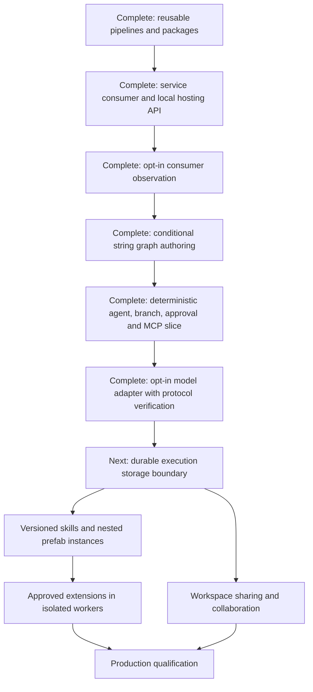

# Roadmap

The goal is a dependable, extensible C# platform for visually designing agent workflows, hosting them as logic inside user-owned services, running them independently of the browser, and inspecting exact historical execution. Studio is an optional IDE; the execution engine must be independently consumable. This document tracks delivery priorities and status. [Architecture](architecture.md) describes what exists, [the user guide](user-guide.md) explains how to use it, and [implementation history](implementation-history.md) retains detailed milestone evidence. [Product design](design.md) records the broader direction.

Statuses mean **Complete** (implemented and verified), **Active** (currently being built), **Next** (next planned increment), or **Planned** (direction with unresolved details). Planned work is not a supported capability. Sequence expresses dependencies rather than dates.

## Current product boundary

The development Studio edits and runs validated linear and conditional string graphs through Microsoft Agent Framework. It has free node placement, edge sockets, reroutes/pinned angles, labels/comments, named sections, immutable publications, restore/activation, persisted local audit/run evidence, and recorded playback, plus reusable published pipelines and portable packages. MCP tools are node-scoped. The default agent provider is a deterministic fixture. An opt-in host-configured OpenAI SDK adapter is protocol-verified; credentialed live-service qualification remains outstanding.

The backend owns execution, but active runs do not resume after host failure. The Studio host is loopback-only and unauthenticated; payloads are plaintext. It is not production ready. Free placement does not imply arbitrary socket rewiring or parallel execution. Conditional routing is an explicit validated operation.

## Latest completed milestone: opt-in host-configured model adapter

Studio and the standalone service can explicitly enable version-pinned OpenAI Chat Completions factories. The optional library owns fresh bounded SDK clients, server-side secrets, cancellation/deadlines, safe categorized failures and no automatic retries. Agent evidence adds response IDs and token usage. Unit and local protocol/browser/service fixtures verify the SDK path without live model calls. Credentialed deployment qualification remains planned; see [model providers](model-providers.md).

## Previous completed milestone: exact-action approvals and deterministic vertical slice

Schema 1.5 adds a backend-owned approval immediately before an explicit MCP tool. Requests bind the pinned revision, exact input/binding/contract and reserved invocation identity; decisions are sequenced and host-attributed. Waiting releases execution ownership, while pause and approval remain independent. Designer/review/playback controls and the scripted Agent → Condition → Approval → MCP → Output browser proof are implemented. Remote observation remains read-only. Restart interrupts unfinished waits; durable approval recovery and live-model validation remain planned. See [approvals](approvals.md).

## Previous completed milestone: conditional string graphs

Schema 1.4 adds approved ordinal predicates, true/false string ports, exclusive merges and bounded acyclic validation. The adapter uses real Agent Framework conditional edges and records decisions separately from actual deliveries. Designer controls insert conditional blocks, edit predicates/arms and preserve undo/version/package/playback behavior. Existing linear schemas/hashes remain supported; linear-only reuse rejects routing graphs. See [conditional graphs](conditional-graphs.md). Richer port types, arbitrary socket rewiring, loops and parallel joins remain planned.

## Previous completed milestone: opt-in consumer observation

Consumers can explicitly map policy-protected read-only summary/snapshot/cursor endpoints. Studio attaches to operator-configured remote sources through a separate HTTP observer; the same `WorkflowObservationPanel` embeds in consumer Blazor apps without execution services. API, lifecycle and two-process browser checks cover read-only access, playback, source replacement and reconnect. The endpoint is disabled by default in the sample. See [consumer observation](observation.md) for authentication, current default-layout/polling limits and host-owned audit requirements.

## Previous completed milestone: standalone service integration and local hosting API

The [standalone consumer](../samples/WorkflowService/README.md) runs reviewed pinned packages directly or through a backend-owned queue without Studio/Blazor or an authoring catalog. It verifies real MCP, independent node grants, missing/drifted dependency rejection and host-stop cancellation. The sample and Studio share the additive [local hosting DI helper](hosting-sdk.md). Project-reference consumption is documented; stable NuGet distribution and minimal worker dependency packaging remain planned. Conditional string graph authoring is now implemented; the deterministic approval/MCP slice is implemented; the opt-in host-owned SDK adapter is protocol-verified; credentialed live qualification remains planned.

## Previous completed milestone: cooperative pause/resume

Process-owned runs can start paused, pause between nodes, resume without reexecuting completed nodes, and cancel while paused. API and optional embedded controls share sequenced audit events; recorded playback includes pause state. Paused contexts release the execution permit so other admitted work can run. The 32-context budget includes paused runs. Restart interrupts unfinished continuations; durable checkpoint recovery remains planned. See [run control](run-control.md).

## Previous completed milestone: reusable pipelines and sharing

Core contracts, Studio controls, and end-to-end validation are complete. The headless service-integration proof and local registration API are complete. Conditional string graph authoring is now implemented; the opt-in host-owned SDK adapter is protocol-verified; credentialed live qualification remains planned.

| Deliverable | Status | Completion evidence |
| --- | --- | --- |
| Extract consecutive processing steps into a separate workflow | Complete | Core extraction preserves annotations and rejects invalid selections |
| Insert an exact published source version with fresh identities | Complete | Copied requirements/source identity, bounded expansion, real framework execution without source lookup |
| Portable definition/layout packages with hashes and requirement manifests | Complete | Canonical round trips, bounds, mismatch/unknown/duplicate-property rejection |
| Save a labeled section as a reusable draft and choose published versions | Complete | Real controls preserve the consumer draft and source history |
| Insert a selected version with shared undo/redo and review requirements | Complete | Browser checks, saved consumer output, reload and immutable source-version behavior |
| Export/import the full package through Studio | Complete | Layout/annotation preservation, local-only import, explicit save/publication, no permission transfer |

This increment uses copy-on-insert template expansion, not recursive runtime prefab calls or automatic instance upgrades. See [reusable pipeline contracts](reusable-pipelines.md).

## Delivery sequence

### Complete: service consumer and local hosting registration

The standalone proof loads pinned artifacts, rejects invalid/missing dependencies, enforces node-scoped host grants, records deterministic and real MCP evidence, and demonstrates cancellation/host lifetime without Studio. The shared DI helper preserves custom registrations and adds no mandatory catalog. See [service integration](service-integration.md) and [local hosting API](hosting-sdk.md).

Supported NuGet distribution remains planned: decide package metadata/licensing, public compatibility baselines, minimal dependency separation and independently restored package-consumer tests before release. Current consumers use project references at a pinned source commit. This packaging work does not change runtime guarantees or provide production durability.

### Complete: opt-in host-configured provider adapter

The SDK adapter and configuration flow are implemented with deterministic protocol fixtures retained for CI. See [model providers](model-providers.md). Credentialed live-service qualification is **Planned**, not complete: no authorized credentials were configured. Approval of model-selected tool calls inside agent loops remains a distinct future capability.

### Next: durable execution storage boundary

Define and implement a host-facing run-store boundary with atomic state/event transitions and concurrency semantics before attempting crash recovery. Preserve existing local journal behavior and recorded playback while establishing persistence conformance tests. Recovery, leases and external effect reconciliation need separate proofs; adding a store interface alone does not make executions durable.

### Planned: durable execution and security foundations

Define storage ownership, transactional run state/event capture, concurrency, checkpoint boundaries, recovery, and approval persistence. Test worker loss, duplicate delivery, shutdown, and uncertain external outcomes without assuming exactly-once side effects or silently retrying them.

Add workspace identity, backend authorization, authenticated audit actors, payload access/redaction, retention, encryption choices, quotas, and credential handling. Do not expose the current development host as a production service. This foundation precedes claims of dependable production operation or multi-tenant sharing.

### Planned: richer no-code workflows and reusable assets

Expand beyond string ports with reviewed typed schemas and authoring diagnostics. Add validated arbitrary socket rewiring and explicit conditional-block removal rather than treating canvas movement or topological order as execution edits. Extend the supported graph patterns with deliberate parallel joins, bounded loops, richer typed data transformations, and versioned skills assigned through the designer. Evolve template copies into nested prefab instances with pinned dependencies, explicit upgrades/overrides, cycle detection, and readable invocation scopes. Preserve historical playback when sources/providers are absent.

### Planned: approved extension workers

Define the approved .NET extension interface, artifact identity, and input/output contracts. Execute user assemblies in isolated workers with brokered capabilities rather than loading them into the Studio/runtime process. Verify direct network/filesystem denial, resource limits, credentials isolation, cancellation, and failure recovery. An interface or AssemblyLoadContext is not a sandbox.

### Planned: collaboration, source control, and promotion

Add authorized workspace sharing, asset discovery, deployment binding remapping, and reviewable portable artifacts. Define ownership between live drafts and Git snapshots, semantic conflict handling, and later simultaneous editing. Test overlapping edit/delete/connect/restore operations; do not describe text merging as safe semantic merging.

### Planned: production qualification

Publish support boundaries only after repeatable recovery/security exercises, load and retention tests, observability/alerting, operational documentation, upgrade/migration checks, and an embedding sample against independently hosted services. Keep deterministic demonstrations and live-provider evidence labeled separately.

## Completed foundations

| Milestone | Delivered capability |
| --- | --- |
| Core contracts | Portable validated definitions, canonical hashes, immutable revisions, and compatibility tests |
| Framework execution | Real executors/edges, receiver-side transfer evidence, cancellation and bounded inputs |
| Local host and playback | Backend-owned queue, persisted local history, event stepping and payload inspection |
| Versioned catalog | Transactional SQLite drafts/revisions/audit, CAS conflicts, publication, restore and activation |
| Visual authoring | Reusable Razor editor, operation changes, insertion/reorder/removal, shared undo/redo |
| MCP and agents | Node-scoped broker, pinned contracts/providers, actual framework agent/tool loop with deterministic fixtures |
| Graph canvas | Free placement, edge sockets, SVG routing, angle pins, comments/sections, versioned layouts and read-only playback |
| Quality and documentation | C#/Blazor/CSS/design skills, dependency boundaries, browser regression checks, architecture/user guides and locally validated Mermaid |
| Exact-action approvals | Schema-1.5 explicit MCP gates, bound requests and decisions, independent pause/cancel, duplicate/stale/owner-loss checks and deterministic vertical-slice UI proof |
| Conditional graphs | Schema-1.4 predicates and ports, exclusive merges, real conditional framework edges, immutable local graph edits and chosen-path playback |
| Consumer observation | Opt-in protected read API, HTTP observer, remote Studio attachment and reusable read-only panel with cursor/lifecycle/reconnect checks |
| Service integration | Standalone pinned-artifact execution, direct/queued MCP proof, host-stop verification, shared optional local-runtime DI registration and consumption contract |
| Reuse and sharing | Schema-1.3 origins, version-pinned expansion, section extraction, exact-version insertion and full design package controls with browser/capability tests |

Detailed tests, limitations, and historical rollout notes are in [implementation history](implementation-history.md).

## Keep the roadmap current

Update this document with each milestone: mark only verified work complete, identify the active increment, record new prerequisites, and link evidence/details from the owning docs. Move retrospective detail into implementation history. Keep architecture and user instructions current in the same change; do not duplicate their full contents here. Do not invent dates or count all roadmap features as one production commitment.
