# Roadmap

The goal is a dependable, extensible C# platform for visually designing agent workflows, hosting them as logic inside user-owned services, running them independently of the browser, and inspecting exact historical execution. Studio is an optional IDE; the execution engine must be independently consumable. This document tracks delivery priorities and status. [Architecture](architecture.md) describes what exists, [the user guide](user-guide.md) explains how to use it, and [implementation history](implementation-history.md) retains detailed milestone evidence. [Product design](design.md) records the broader direction.

Statuses mean **Complete** (implemented and verified), **Active** (currently being built), **Next** (next planned increment), or **Planned** (direction with unresolved details). Planned work is not a supported capability. Sequence expresses dependencies rather than dates.

## Current product boundary

The development Studio edits and runs validated linear, conditional, and bounded two-branch parallel graphs through Microsoft Agent Framework. Most graph connections carry strings; schema 1.9 adds a bounded JSON entry input and pointer selector that returns text, schema 1.13 adds bounded JSON projection and JSON workflow output, schema 1.14 adds one visible two-branch fork/barrier join returning bounded JSON, schema 1.15 adds declared JSON value kinds to projection fields, and schema 1.16 adds recursive object and array-item mapping, schema 1.17 adds one auditable bounded loop with a linear body and a hard iteration cap, schema 1.18 adds successful no-result termination exits, and schema 1.19 adds bounded calls to exact child workflow revisions. The Studio has free node placement, compatible pin rewiring, wire disconnect, saved incomplete drafts with validation gates, edge sockets, multi-selection/group movement, pan/reset/fit, reroutes/pinned angles, labels/comments, named sections, immutable publications, restore/activation, persisted local audit/run evidence, and recorded playback, plus reusable published pipelines and portable packages. Conditional arms can take separate routes to return through the workflow Output or end successfully at a termination node; merges are optional when branches need shared downstream work. Agent nodes configure system instructions/provider/model, node-scoped MCP tools, bounded per-agent output tokens, and provider-advertised reasoning controls including explicit off. Studio has a local Streamable HTTP MCP library with a portable nested argument subset and a text-only versioned skill library; selected skill revisions and structured user-message templates travel in schema 1.7 definitions. Schema 1.6 supports up to 64 typed scalar parameters; schema 1.8 adds integer, number, boolean and choice validation and exposes a reasoning-effort input. Schema 1.11 adds versioned agent profiles and bounded one-level subagent delegation; schema 1.12 adds profile-pinned coordination channels with audited run-scoped exchange. A parent agent can select up to four sequential delegate calls and share messages among assigned profiles; its parallel team tool uses a separate per-team channel scope. Nested parallelism and nested loops remain planned. Model providers can be managed in Studio settings. The default agent provider is a deterministic fixture; the opt-in OpenAI SDK adapter is protocol-verified, while credentialed live-service qualification remains outstanding.

The backend owns execution. Studio/ordinary queued runs still interrupt after host failure; a separate opt-in host explicitly resumes deterministic saved checkpoints. The Studio host is loopback-only and unauthenticated; payloads are plaintext. It is not production ready. Socket rewiring is supported for matching typed pins, while incomplete drafts remain non-executable until validation succeeds. Sequential subagent calls, parallel agent-team calls, and the graph's two-branch block are bounded; broader graph scheduling remains planned. Conditional routing and parallel graph execution are explicit validated operations.

## Previous completed milestone: Provider management and Studio theme refinement

The Settings page can list, add, version, and delete locally saved OpenAI-compatible providers. API credentials are protected in local Studio storage, descriptors remain secret-free, and new provider versions appear immediately in agent nodes. The Studio theme and provider-management layout were refined. Host configuration remains available for consumer services. The Studio remains a loopback-only unauthenticated prototype; multi-user credential management is not implemented. See [provider configuration](model-providers.md) and [design system](design-system.md).

## Previous completed milestone: canvas-first creation workbench

Blank connected drafts, searchable node library, contextual search/actions, drag placement, output-pin creation, compatible pin rewiring, and wire disconnection are available. Drafts can be saved while incomplete; visible validation issues block publish and execution. Compact cards and a selected properties panel prioritize the canvas. The canvas supports box selection, grouped movement, pan space around the graph, fit/reset controls, keyboard shortcuts, filtering and clearer recorded paths. Browser validation covers these gestures and existing authoring/version/run flows. Complete branch-block removal is undoable. Broader graph semantics remain planned. See [graph editor](graph-editor.md) and [user guide](user-guide.md).

## Previous completed milestone: versioned agent profiles and bounded delegation

The Agent Designer creates and organizes immutable specialist revisions. Workflow agent nodes can expose selected profile versions as delegate tools; each profile pins its provider, instructions, optional inference settings, MCP bindings, and skill snapshots. The runtime limits each parent to four profiles and four calls, permits one delegation level, applies the profile tool list and host grants, and records child invocation evidence linked to the parent. Package import/export preserves profile dependencies without transferring endpoints, credentials, or grants. Deterministic integration tests cover profile selection, child tool isolation, audit correlation, package requirements, and reusable-workflow insertion. See [agent profiles](agent-profiles.md).

## Previous completed milestone: read-only interrupted-run reconciliation

Cursor-bound assessments explain unsettled node/model/tool/approval facts, terminal status and saved/missing/invalid/advanced checkpoint state. New per-call model/tool IDs distinguish repeated calls, with conservative legacy matching. Built-in observers, the protected GET API, bounded HTTP client and embeddable observation panel expose metadata without native state, payloads or mutation controls. Eligibility is suppressed on cursor races and source failures and does not grant ownership. See [run reconciliation](run-reconciliation.md).

## Previous completed milestone: deterministic saved-suspension recovery

An opt-in consumer host saves native Agent Framework JSON checkpoints atomically with audit/state and resumes an exact deterministic suspension after host replacement. Tests and a forced-process-loss proof cover stable revision/identity, both branch paths, no duplicate nodes, ownership exclusion, stale evidence and rollback. Built-in ordinary runtime hosts also enforce exclusive local ownership. SQLite run schema 2 migrates existing evidence. Studio's queue retains interruption semantics; external-node/approval and arbitrary-crash recovery remain excluded. See [checkpoint recovery](checkpoint-recovery.md).

## Previous completed milestone: run storage boundary

The local runtime/controller now consume a host-selected `IWorkflowRunStore`. Atomic bounded batches and expected-sequence checks keep evidence and derived status consistent. File snapshots preserve legacy reads; an optional dedicated SQLite store supplies transactions and independent-connection concurrency checks. Studio/service configuration, observer consistency and rollback/conformance checks are implemented. Runtime ownership remains exclusive; restart still interrupts unfinished work. See [run storage](run-storage.md).

## Previous completed milestone: opt-in host-configured model adapter

Studio and the standalone service can explicitly enable version-pinned OpenAI Chat Completions factories. The optional library owns fresh bounded SDK clients, server-side secrets, cancellation/deadlines, safe categorized failures and no automatic retries. Agent evidence adds response IDs and token usage. Unit and local protocol/browser/service fixtures verify the SDK path without live model calls. Credentialed deployment qualification remains planned; see [model providers](model-providers.md).

## Previous completed milestone: exact-action approvals and deterministic vertical slice

Schema 1.5 adds a backend-owned approval immediately before an explicit MCP tool. Requests bind the pinned revision, exact input/binding/contract and reserved invocation identity; decisions are sequenced and host-attributed. Waiting releases execution ownership, while pause and approval remain independent. Designer/review/playback controls and the scripted Agent → Condition → Approval → MCP → Output browser proof are implemented. Remote observation remains read-only. Restart interrupts unfinished waits; durable approval recovery and live-model validation remain planned. See [approvals](approvals.md).

## Previous completed milestone: conditional string graphs

Schema 1.4 adds approved ordinal predicates, true/false string ports, exclusive merges and bounded acyclic validation. The adapter uses real Agent Framework conditional edges and records decisions separately from actual deliveries. Designer controls insert conditional blocks, edit predicates/arms and preserve undo/version/package/playback behavior. Branches can route independently to the workflow Output or a successful no-result termination exit; merges remain available for shared downstream work. Existing linear schemas/hashes remain supported; linear-only reuse rejects routing graphs. See [conditional graphs](conditional-graphs.md). Richer port types and nested or variable parallel blocks remain planned; bounded loops are supported only under the constraints in [bounded loop graphs](loop-graphs.md).

## Previous completed milestone: opt-in consumer observation

Consumers can explicitly map policy-protected read-only summary/snapshot/cursor endpoints. Studio attaches to operator-configured remote sources through a separate HTTP observer; the same `WorkflowObservationPanel` embeds in consumer Blazor apps without execution services. API, lifecycle and two-process browser checks cover read-only access, playback, source replacement and reconnect. The endpoint is disabled by default in the sample. See [consumer observation](observation.md) for authentication, current default-layout/polling limits and host-owned audit requirements.

## Previous completed milestone: standalone service integration and local hosting API

The [standalone consumer](../samples/WorkflowService/README.md) runs reviewed pinned packages directly or through a backend-owned queue without Studio/Blazor or an authoring catalog. It verifies real MCP, independent node grants, missing/drifted dependency rejection and host-stop cancellation. The sample and Studio share the additive [local hosting DI helper](hosting-sdk.md). Project-reference consumption is documented; stable NuGet distribution and minimal worker dependency packaging remain planned. Conditional string graph authoring is now implemented; the deterministic approval/MCP slice is implemented; the opt-in host-owned SDK adapter is protocol-verified; credentialed live qualification remains planned.

## Previous completed milestone: cooperative pause/resume

Process-owned runs can start paused, pause between nodes, resume without reexecuting completed nodes, and cancel while paused. API and optional embedded controls share sequenced audit events; recorded playback includes pause state. Paused contexts release the execution permit so other admitted work can run. The 32-context budget includes paused runs. The ordinary queue interrupts unfinished continuations; the separate deterministic checkpoint host now supports saved-suspension recovery. See [run control](run-control.md).

## Previous completed milestone: reusable pipelines and sharing

Core contracts, Studio controls, and end-to-end validation are complete. The headless service-integration proof and local registration API are complete. Conditional string graph authoring is now implemented; the opt-in host-owned SDK adapter is protocol-verified; credentialed live qualification remains planned.

| Deliverable | Status | Completion evidence |
| --- | --- | --- |
| Extract consecutive processing steps into a separate workflow | Complete | Core extraction preserves annotations and rejects invalid selections |
| Insert an exact published source version with fresh identities | Complete | Copied requirements/source identity, bounded expansion, real framework execution without source lookup |
| Portable definition/layout packages with hashes and requirement manifests | Complete | Canonical round trips, bounds, mismatch/unknown/duplicate-property rejection |
| Save a labeled section as a reusable draft and choose published versions | Complete | Real controls preserve the consumer draft and source history |
| Insert a selected version with shared undo/redo and review requirements | Complete | Browser checks, saved consumer output, reload and immutable source-version behavior |
| Export/import the full package through Studio | Complete | Layout/annotation preservation, local-only import, explicit save/publication, no permission transfer |

This increment uses copy-on-insert template expansion, not recursive runtime prefab calls or automatic instance upgrades. See [reusable pipeline contracts](reusable-pipelines.md).

## Previous bounded increment: conditional block removal

The editor can remove an isolated condition, both arms, nested decisions and the matching merge after listing the affected nodes for confirmation. It can also remove a merge to split branch routes toward separate work or the common Output. Core rejects shared incoming paths and reconnects the surrounding graph without changing published revisions. Unit and browser evidence is recorded in [implementation history](implementation-history.md).

## Previous completed milestone: independent condition routes

Conditional arms can now end at the workflow Output or take separate downstream paths. Removing an optional merge leaves a rewritable draft; Output accepts up to 16 alternative routes and returns whichever value reaches it. A merge is still available when branches need to rejoin for shared work. Runs continue to require a string or bounded JSON output; no-result termination remains a separate future capability.

## Delivery sequence

```mermaid
flowchart TD
    Reuse["Complete: reusable pipelines and packages"] --> Hosting["Complete: service consumer and local hosting API"]
    Hosting --> Observe["Complete: opt-in consumer observation"]
    Observe --> Graph["Complete: conditional string graph authoring"]
    Graph --> Vertical["Complete: deterministic agent, branch, approval and MCP slice"]
    Vertical --> Models["Complete: opt-in model adapter with protocol verification"]
    Models --> Store["Complete: atomic run storage boundary"]
    Store --> Recovery["Complete: explicit deterministic checkpoint recovery"]
    Recovery --> Assess["Complete: read-only run reconciliation"]
    Assess --> Agents["Complete: configurable MCP servers, tools, and agent skills"]
    Agents --> JsonData["Complete: bounded JSON input, selection, and projection"]
    JsonData --> Controls["Complete: per-agent inference controls"]
    Controls --> Delegation["Complete: versioned agent profiles and bounded subagent delegation"]
    Delegation --> Teams["Complete: bounded parallel agent teams"]
    Teams --> Channels["Complete: run-scoped agent channels"]
    Channels --> DelegationRounds["Complete: parent-coordinated sequential subagent turns"]
    DelegationRounds --> JsonProjection["Complete: bounded JSON projection"]
    JsonProjection --> Orchestration["Complete: bounded parallel graph block"]
    Orchestration --> ProjectionTypes["Complete: declared JSON projection value kinds"]
    ProjectionTypes --> TypedMapping["Complete: recursive object and collection mapping"]
    TypedMapping --> Loops["Complete: bounded loop"]
    Loops --> Exit["Complete: explicit workflow return and termination"] --> Calls["Complete: typed pinned calls, parameter mapping, and revision upgrades"]
    Calls --> Assets["Next: child graph drill-in and scoped nested approvals"]
    Orchestration --> Durable["Later: host-attributed reconciliation decisions"]
    Assets --> Extensions["Approved extensions in isolated workers"]
    Durable --> Collaboration["Workspace sharing and collaboration"]
    Extensions --> Production["Production qualification"]
    Collaboration --> Production
```

## Previous completed milestone: explicit workflow return and termination

Schema 1.18 keeps Output as the normal workflow result and adds `core.terminate` for successful exits without a result. Conditional paths can independently return a value or terminate; no merge is required unless the paths need shared work. The run store and playback distinguish `run.terminated` from `run.completed`, and the runner exposes a typed outcome while preserving its existing string-returning methods. Termination is bounded to 16 string exits per workflow, does not roll back earlier external effects, and is not yet eligible for checkpoint resume. See [workflow termination](workflow-termination.md).

## Previous completed milestone: bounded JSON projection

Schema 1.13 adds a `Project JSON fields` node that creates a new object from 1–16 named JSON Pointer paths and supports a JSON-typed workflow output. Studio edits mappings in the node properties and offers the node on JSON paths. Validation enforces typed pins and bounded field names/configuration; runtime caps JSON depth and payload sizes and records the exact projected value for playback. Existing agents and MCP nodes remain string-based, so use the JSON selector to convert a chosen value to text before connecting to them. Core schema/package/editing tests and an Agent Framework run test passed. Full .NET suite: 275 passed, one opt-in live-model test skipped. Documentation links and all 24 Mermaid diagrams passed. See [architecture](architecture.md), [user guide](user-guide.md#select-and-project-json-input), and [implementation history](implementation-history.md#bounded-json-projection-and-typed-workflow-output).

## Previous completed milestone: parent-coordinated sequential subagent turns

The parent model now coordinates specialists by choosing when to call each assigned `delegate_N` tool. Sequential delegate calls share bounded coordination channels across child invocations, scoped to that parent agent invocation. The parallel team tool remains fixed fan-out and receives a separate channel board per team call. Profiles pin up to eight channel memberships; each message is limited to 4,000 characters, each channel to 32 messages, and each board to 64 messages. Reads and writes, including the exact messages returned, are recorded under child invocation evidence for replay. Delegation remains one level deep and capped at four child executions per parent invocation; child tools still require both the profile assignment and host authorization. The deterministic regression test verifies manager-selected order, cross-turn message visibility and audit scope. See [agent profiles](agent-profiles.md), [architecture](architecture.md), and [the user guide](user-guide.md#design-reusable-subagents).

### Complete: shallow JSON field contracts

Schema 1.15 lets each JSON projection field declare a scalar or container kind, and the runtime checks the selected value before it emits the projected object. This milestone provided the type foundation for recursive mappings in schema 1.16.

### Complete: recursive schema-backed object and collection mapping

Schema 1.16 adds recursive object/array contracts to projection fields. Users map object fields with relative JSON Pointers, mark optional properties, and define the schema applied to each array item. Runtime output contains only explicitly mapped properties; required path/type errors stop the node with safe playback evidence. Mapping depth, node count, configuration size, field count, array length, and payload size are bounded. Existing schema 1.13–1.15 documents retain pass-through behavior. The Blazor editor, serializer/validator tests, and runtime success/error/evidence tests are implemented. Bounded loops and richer control flow remain separate milestones because they change scheduling, cancellation, and failure semantics.

### Complete: one bounded workflow loop

Schema 1.17 supports one loop node on a string graph, with one linear body, a safe continue-while predicate, and a validated maximum of 1–16 iterations. The runtime uses Agent Framework feedback edges, distinguishes the initial and return messages by source node and pin, and records iteration starts/completions and the predicate/cap stop reason for playback. Studio can insert/configure the loop, add body nodes, and remove it while preserving its body as a one-pass route. Conditions, approvals, parallel blocks, JSON paths, nested loops, and early termination are excluded in this increment. Core and Agent Framework regression tests verify edit/validation/removal, predicate exit, maximum enforcement, and recorded evidence. See [bounded loop graphs](loop-graphs.md).

### Complete: explicit workflow return and termination

Schema 1.18 adds the visible `core.terminate` node for successful exits with no result. Condition paths may finish independently without a merge; normal return paths still finish at the workflow Output. Run history distinguishes `run.terminated` from `run.completed`, the typed runner outcome distinguishes no result from an empty string, and playback shows the terminal route without executing it. Termination is string-only, bounded to 16 exits, and does not roll back prior external work. It is not part of the checkpoint-resume subset. See [workflow termination](workflow-termination.md).

### Complete: typed nested workflow calls and revision upgrades

Schema 1.19 call nodes embed the exact child definition, revision/version, and content hash. Child execution stays in the parent run’s ordered audit stream under scoped event paths, and playback does not re-execute dependencies. Call pins inherit the child Input and Output types (`string` or `json`); parent parameters can map into compatible child parameters while unmapped child values use their defaults. The Studio lists dependencies from the pinned snapshot and compares another published revision across child nodes, connections, parameters, skills, profiles, and package requirements. Applying an accepted upgrade changes only the parent draft, preserves compatible mappings, reports removed mappings, and adds one undo step. The old snapshot remains active until the parent draft is saved and published. Validation limits nesting to three levels and 1,024 expanded nodes, rejects call-path cycles and invalid hashes, and requires host authorization for child capabilities. An embedded child-graph view, additional graph data types, and nested approvals remain future work. Core contract/editing and Agent Framework execution tests cover the changes. See [nested workflow calls](nested-workflows.md).

### Next: child graph drill-in and scoped nested approvals

Let authors inspect and navigate the embedded child graph from its call node while preserving parent context and scoped replay. Nested approval actions need a root-run and child-graph authorization contract before they can be enabled; root-level grants must not silently authorize child calls.

## Latest completed milestone: bounded parallel graph block

Schema 1.14 adds one explicit two-branch fork with named branch anchors and a fan-in barrier join. Studio creates, rewires, previews, removes, and undoes the complete block; the join emits bounded JSON and can reconnect to existing text work through a selector. Microsoft Agent Framework 1.26.0 concurrent execution and `AddFanInBarrierEdge` are verified with synchronized deterministic agents. Playback records actual branch transfers, join progress, and the final result without making calls, and the graph card shows which branch result the join is waiting for. Branch failures do not produce a joined value, and external effects are not rolled back. Core/adapter tests and a browser proof passed; the complete .NET suite passed 283 tests with one opt-in live-model test skipped. Nested forks, branch-local conditions, variable branch counts, loops, and distributed transactions remain unsupported. See [parallel graph behavior](parallel-graphs.md), [user guide](user-guide.md#run-two-paths-in-parallel), and [implementation history](implementation-history.md#bounded-parallel-graph-block).

### Complete: service consumer and local hosting registration

The standalone proof loads pinned artifacts, rejects invalid/missing dependencies, enforces node-scoped host grants, records deterministic and real MCP evidence, and demonstrates cancellation/host lifetime without Studio. The shared DI helper preserves custom registrations and adds no mandatory catalog. See [service integration](service-integration.md) and [local hosting API](hosting-sdk.md).

Supported NuGet distribution remains planned: decide package metadata/licensing, public compatibility baselines, minimal dependency separation and independently restored package-consumer tests before release. Current consumers use project references at a pinned source commit. This packaging work does not change runtime guarantees or provide production durability.

### Complete: opt-in host-configured provider adapter

The SDK adapter and configuration flow are implemented with deterministic protocol fixtures retained for CI. See [model providers](model-providers.md). Credentialed live-service qualification is **Planned**, not complete: no authorized credentials were configured. Approval of model-selected tool calls inside agent loops remains a distinct future capability.

### Complete: local run storage boundary

Host-selected storage, atomic event/state batches, concurrency checks, file compatibility and a transactional SQLite implementation are complete. They establish committed evidence, not recoverable execution. See [run storage](run-storage.md).

### Complete: deterministic checkpoint and recovery contract

Native superstep state, a versioned/bounded recovery envelope, atomic checkpoint/audit commits, exact-cursor admission and local owner exclusion are implemented for explicit deterministic saved suspensions. Ordinary queued runs, arbitrary active-process loss and external effects retain their previous limits. See [checkpoint recovery](checkpoint-recovery.md).

### Complete: read-only interrupted-run reconciliation contract

The assessment distinguishes a saved suspension, advanced checkpoint evidence, unresolved work, invalid/missing frames and terminal status. Consumer and embedded observation paths expose the explanation without making live calls or decisions. See [run reconciliation](run-reconciliation.md).

### In progress: advanced agent authoring and workflow inputs

Schema 1.6 adds workflow-owned typed parameters with stable IDs, labels, defaults, optional bounded descriptions, visible getter nodes, bounded per-run overrides, exact effective-value persistence in run history, and playback visibility. Descriptions are editorial help only and travel with shared workflow definitions; empty descriptions remain omitted. The execution package remains independent of the Studio, and run clients can opt into the additive `IParameterizedWorkflowClient` contract. Legacy schemas omit optional parameter fields, preserving their canonical JSON. Parameters are deliberately not secrets, mutable variables or arbitrary provider URLs. Additional exposed agent configuration pins, named entry-node inputs and richer data composition remain open parts of this milestone.

### Complete: MCP, skill, and agent authoring foundation

Studio supports local Streamable HTTP MCP discovery with visible compatibility reasons, explicit tool assignment, bounded nested JSON arguments, versioned text skills, per-agent system/user instructions, safe prompt interpolation, provider controls, and typed workflow parameters. Requirements and skill/profile snapshots survive package sharing; provider registrations, endpoints, credentials, and host grants remain consumer-owned. Broader transports, resource-bearing skills, additional model controls, and richer typed graph mapping remain planned. See [agent capability libraries](agent-capability-libraries.md), [agent profiles](agent-profiles.md), and [workflow parameters](workflow-parameters.md).

### Complete: bounded parallel agent teams

An agent node with two or more assigned profiles exposes a team tool. It fans the same bounded task out to each exact profile revision concurrently (maximum four), then returns a bounded JSON array of named profile outputs to the parent. Individual delegation and team calls share a four-child-execution limit per parent invocation. Each child retains its own tools and host authorization. Any member failure cancels siblings where possible and fails the team without returning a partial aggregate; external side effects cannot be undone. Audit writes are serialized to preserve event sequence under concurrency, and child model/tool activity is visible on the parent node with profile identity. See [agent profiles](agent-profiles.md).

### Complete: run-scoped coordination channels

Schema 1.12 adds up to eight pinned channel IDs per profile, with exact membership checks and bounded append-only messages. The current implementation supports manager-directed sequential delegate turns with a parent-invocation board and fixed parallel team calls with an isolated team-call board. Each message is limited to 4,000 characters, each channel to 32 messages and each board to 64. Every send/read is auditable, and playback does not repeat model calls. Deterministic tests cover membership, message exchange, ordering and isolation. Broader manager budgets, durable shared memory and graph-level scheduling remain separate work.

### Completed: bounded JSON input, selection, and projection

Schema 1.9 provides a focused typed-data foundation: an entry node may validate bounded JSON input and pass its `json` port to an RFC 6901 property/array selector. Schema 1.13 adds a projection node with 1–16 named pointer mappings and allows bounded JSON output. Schema 1.15 lets projection fields assert their top-level JSON kind, and schema 1.16 adds recursive object and array-item mappings with optional fields and strict bounds. The selector emits text so existing agent, MCP and deterministic nodes remain unchanged; projected JSON can be reduced back to text with the selector. Core type-checks pins, graph edits preserve types, and runtime events record exact selected/projected values for playback. Loops and richer error/cancellation semantics remain planned.

### Completed: per-agent inference controls

Schema 1.10 adds a bounded output-token limit to each agent and an explicit reasoning-off preference. Defaults preserve the prior 1,024-token behavior; selected values are stored with the workflow and captured in model-request evidence. The Studio only exposes reasoning controls for providers that advertise support. Endpoint-specific limits or ignored options remain the provider's behavior.

### Planned: broader complex graph orchestration

Explore nested forks, nested loops, and branch-local control structures after defining their cancellation, failure, audit, and replay semantics. These are executable semantics, not just canvas arrangements. Prove representative graphs against the pinned Microsoft Agent Framework adapter before fixing each node contract; preserve event ordering, exact-version dependencies, and truthful playback. Keep concurrency, payloads, and tool calls bounded and diagnosable.

### Later: host-attributed reconciliation decision records

After the agent-authoring priority, define explicit operator decisions for recorded uncertain outcomes, bound to the exact run/cursor/call identity with authenticated host-derived actors and append-only evidence. Distinguish a human assertion from a provider's actual response and preserve prior uncertainty. A decision must not silently retry external calls, rewrite history, grant tools, auto-approve or enable recovery of unsupported graphs. Observation stays read-only; production identity and authorization remain prerequisites for public controls.

### Planned: durable execution and security foundations

Define storage ownership, transactional run state/event capture, concurrency, checkpoint boundaries, recovery, and approval persistence. Test worker loss, duplicate delivery, shutdown, and uncertain external outcomes without assuming exactly-once side effects or silently retrying them.

Add workspace identity, backend authorization, authenticated audit actors, payload access/redaction, retention, encryption choices, quotas, and credential handling. Do not expose the current development host as a production service. This foundation precedes claims of dependable production operation or multi-tenant sharing.

### Planned: further reusable assets and specialization

Explicit conditional-block removal is implemented for isolated decision regions, with affected-node confirmation and shared definition/layout undo. Shared-boundary removal remains unsupported. Continue reusable workflow work with embedded child-graph drill-in and scoped composition controls. Preserve historical playback when sources/providers are absent.

### Planned: approved extension workers

Define the approved .NET extension interface, artifact identity, and input/output contracts. Execute user assemblies in isolated workers with brokered capabilities rather than loading them into the Studio/runtime process. Verify direct network/filesystem denial, resource limits, credentials isolation, cancellation, and failure recovery. An interface or AssemblyLoadContext is not a sandbox.

### Planned: collaboration, source control, and promotion

Add authorized workspace sharing, asset discovery, deployment binding remapping, and reviewable portable artifacts. Define ownership between live drafts and Git snapshots, semantic conflict handling, and later simultaneous editing. Test overlapping edit/delete/connect/restore operations; do not describe text merging as safe semantic merging.

### Planned: production qualification

Publish support boundaries only after repeatable recovery/security exercises, load and retention tests, observability/alerting, operational documentation, upgrade/migration checks, and an embedding sample against independently hosted services. Keep deterministic demonstrations and live-provider evidence labeled separately.

## Completed foundations

| Milestone | Delivered capability |
| --- | --- |
| Core contracts | Portable validated definitions, canonical hashes, immutable revisions, and compatibility tests |
| Framework execution | Real executors/edges, receiver-side transfer evidence, cancellation and bounded inputs |
| Local host and playback | Backend-owned queue, persisted local history, event stepping and payload inspection |
| Versioned catalog | Transactional SQLite drafts/revisions/audit, CAS conflicts, publication, restore and activation |
| Visual authoring | Reusable Razor editor, operation changes, insertion/reorder/removal, shared undo/redo |
| MCP and agents | Node-scoped broker, pinned contracts/providers, actual framework agent/tool loop with deterministic fixtures |
| Graph canvas | Free placement, edge sockets, SVG routing, angle pins, comments/sections, versioned layouts and read-only playback |
| Quality and documentation | C#/Blazor/CSS/design skills, dependency boundaries, browser regression checks, architecture/user guides and locally validated Mermaid |
| Exact-action approvals | Schema-1.5 explicit MCP gates, bound requests and decisions, independent pause/cancel, duplicate/stale/owner-loss checks and deterministic vertical-slice UI proof |
| Conditional graphs | Schema-1.4 predicates and ports, exclusive merges, real conditional framework edges, immutable local graph edits and chosen-path playback |
| Consumer observation | Opt-in protected read API, HTTP observer, remote Studio attachment and reusable read-only panel with cursor/lifecycle/reconnect checks |
| Service integration | Standalone pinned-artifact execution, direct/queued MCP proof, host-stop verification, shared optional local-runtime DI registration and consumption contract |
| Reuse and sharing | Schema-1.3 origins, version-pinned expansion, section extraction, exact-version insertion and full design package controls with browser/capability tests |

Detailed tests, limitations, and historical rollout notes are in [implementation history](implementation-history.md).

## Keep the roadmap current

Update this document with each milestone: mark only verified work complete, identify the active increment, record new prerequisites, and link evidence/details from the owning docs. Move retrospective detail into implementation history. Keep architecture and user instructions current in the same change; do not duplicate their full contents here. Do not invent dates or count all roadmap features as one production commitment.
