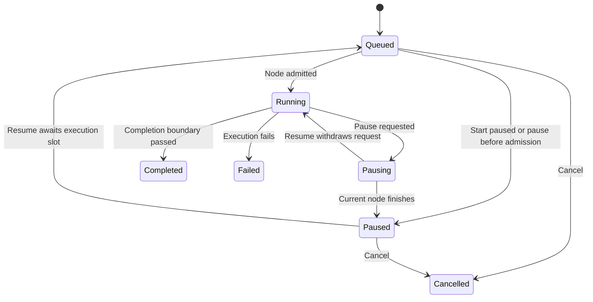

# Pause and resume

The development runtime supports cooperative, process-owned pause/resume for linear pipelines. Execution stays on the backend when the editor closes. A paused run remains paused until explicitly resumed or cancelled, or its host stops. This is not a durable checkpoint across restarts.

## Boundary behavior

**Pause selected run** requests a pause. An admitted node finishes first, including its model rounds and tool calls. The runtime records `run.paused` before admitting the next node; it also checks a boundary before final run completion. A request does not cancel, undo, or interrupt an external operation. The graph highlights the next node when one is known. At the final completion boundary there is no next node to highlight.

The diagram shows common paths; cancellation and failure can also terminate a pending pause. Restart marks any unfinished run interrupted. The snapshot status after resume is `queued` if execution has not started, otherwise `running`, including while awaiting the shared execution slot.

Resume continues the same live Agent Framework execution with the same run ID, immutable revision, and invocation history. Completed nodes are not rerun. It does not load a new definition or rebuild execution from recorded events. Use **Start paused** for quick runs or **Start published run paused** for published runs to avoid racing a fast deterministic pipeline.

The runtime admits at most 32 owned contexts, including queued, running and paused contexts. One shared execution permit serializes active workflow work. Paused continuations release that permit, so another admitted run can execute; they still consume admission capacity. A full or stopping runtime records a failed run. Cancellation unblocks paused waits. Fair scheduling is not guaranteed.

## APIs and embedding

The additive Core interfaces `IWorkflowRunControl` and `IPublishedWorkflowRunControl` expose paused starts and pause/resume commands. Existing clients can keep implementing only `IWorkflowClient`; components show controls only when the corresponding capability is available. Component disposal stops observation, not execution or its pause state. Low-level hosts may supply `IWorkflowExecutionGate` to `PipelineRunner.ExecuteControlledAsync`; they own synchronization, cancellation and persistence policy.

| Request | Behavior |
| --- | --- |
| `POST /api/runs` with `{ "definition": { ... }, "input": "text", "startPaused": true }` | Create an ad-hoc run paused before its first node |
| `POST /api/workflows/{id}/runs` with `{ "input": "text", "startPaused": true }` | Pin the active publication and start paused |
| `POST /api/revisions/{id}/runs` with the same body | Pin that exact publication and start paused |
| `POST /api/runs/{id}/pause` | Request a cooperative pause; return 202 and the current snapshot |
| `POST /api/runs/{id}/resume` | Resume or withdraw a pending pause; return 202 and the current snapshot |

Repeated commands are idempotent while execution is owned and nonterminal. An unknown run returns 404; a terminal or no-longer-owned run returns 409. Development origin restrictions still apply (403 for disallowed origins). HTTP 202 does not promise the current node has finished; observe the snapshot for `paused`.

## Audit, playback and failure

`run.pause-requested`, `run.paused`, and `run.resumed` share one sequenced journal writer with executor/model/tool events. Control data records a boundary and the development actor `local-developer`; this is not authenticated actor identity. Node/model evidence arriving after a pause request does not reset the status to running. Playback derives state from the selected recorded prefix and never invokes execution. The latest status remains visible separately.

Graceful shutdown cancels live waits. Restart marks remaining unfinished journal entries interrupted; their old continuation cannot be resumed. Provider errors may fail a run before its requested pause is acknowledged. Durable checkpoints, recovery of uncertain external effects, distributed ownership and authenticated control authorization remain planned. The adapter uses awaited executor boundaries supported by the pinned Microsoft Agent Framework 1.26.0; it does not claim checkpoint restore support from that integration.

## Verification

`PauseResumeTests` exercises in-flight pause acknowledgement, withdrawal, repeated commands, node boundaries, cancellation, admission limits, independent work while paused, pinned identity and owner loss. Adapter tests cover the final completion boundary. `python3 scripts/pause_resume_smoke.py --browser-executable /usr/bin/chromium` exercises API and Studio controls, browser reload, exact published versions and recorded pause playback using deterministic local data.
