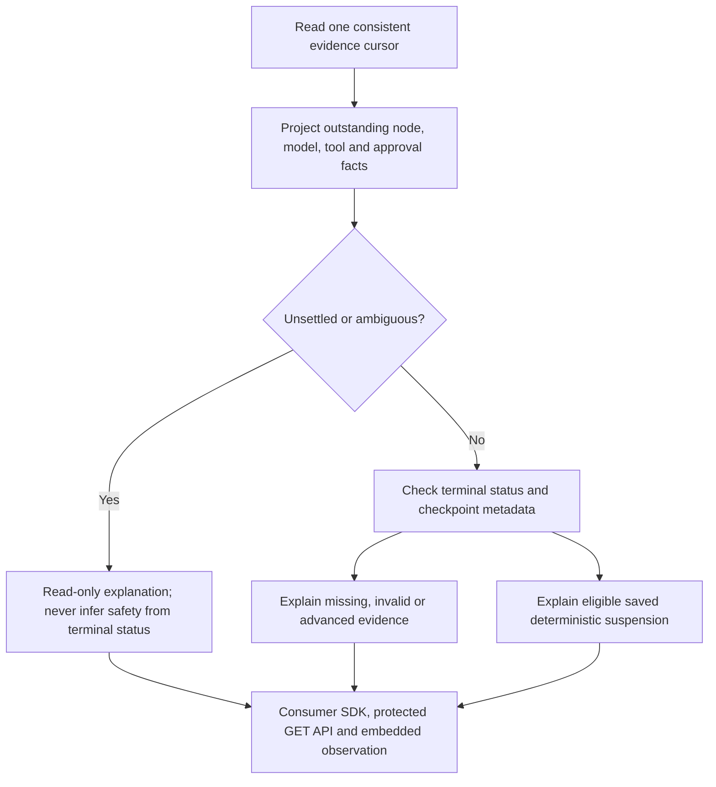

# Read-only run reconciliation

Run reconciliation explains the **recorded disposition** of a run before a host considers recovery or an operator investigates uncertain work. It does not execute a workflow, contact a provider/MCP server, approve anything, alter history or settle an external effect. A terminal `failed`, `cancelled` or `interrupted` status can still contain unsettled external work.

## Read the assessment

`RunReconciliation` in Core contains run/revision/hash identities, the exact evidence cursor, current recorded status, a typed disposition, an explanatory reason and metadata-only checkpoint/unsettled-work details. Disposition, work kind and work state serialize as their stable enum names. It excludes inputs, outputs, instructions, model messages, tool arguments, credentials and native checkpoint JSON. Up to 256 work items are returned, with a separate total so truncation cannot hide the existence of additional unsettled work.

| Disposition | Meaning |
| --- | --- |
| `UnresolvedWork` | Work has no settled recorded outcome, or correlation is incomplete/ambiguous; this takes precedence over terminal status |
| `Terminal` | The run cannot resume; this does not prove effects were rolled back |
| `CheckpointIncompatible` | The saved envelope, version, identity, checksum or JSON is unusable |
| `CheckpointUnavailable` | This source supplies no usable checkpoint; events alone cannot restore execution |
| `EvidenceAdvanced` | Evidence moved beyond the saved frame; replaying it is unsafe |
| `NoSavedSuspension` | A frame exists but the explicit suspension/admission contract is not satisfied |
| `SavedSuspension` | A deterministic saved suspension passes the recorded admission checks |

`CanResume` is true only for `SavedSuspension`. It is **not authorization, proof of worker death, ownership acquisition, or a guarantee execution will succeed**. The exclusive checkpoint host must still revalidate the current checkpoint and cursor. An assessment may describe in-flight work on a live host; this API has no heartbeat/liveness claim.



## How work is correlated

`WorkflowWorkEvidence.Read` is a pure Core projection. It tracks node invocations, model requests/responses, tool requests/authorization/outcomes and approval requests/decisions. Use its node, request sequence and call identity to inspect detailed events through the host's separately authorized snapshot/cursor API. Each item identifies its kind, observed state, node/invocation/call identity where available, request sequence and last relevant sequence. A request without a corresponding outcome remains visible even if its outer node fails or the run becomes terminal. An approval item in a terminated run is historical unresolved evidence, not an actionable approval request.

New model evidence includes a host-generated `modelCallId` on `model.requested` and `model.responded`. New MCP evidence includes `toolCallId` on request, authorization and outcome records. These recording IDs are not provider idempotency keys or exactly-once guarantees. Model IDs identify logical client rounds rather than hidden transport retries. These IDs distinguish repeated calls within one node invocation; they are separate from model protocol function IDs and the approval-reserved node invocation identity. They grant no capabilities. Existing event envelopes and definition hashes remain unchanged.

A recorded tool denial or failure **before any authorization evidence** settles that request as not dispatched according to the broker protocol. A failure after authorization, or an explicit `tool.outcome-unknown`, remains an unknown outcome: a server error does not prove an operation had no effects. A correlated completion can settle the corresponding call. Node failure/cancellation does not close an outstanding model/tool request, and agent failure alone cannot establish whether an unrecorded model response was generated or billed.

Older JSON events without per-call IDs can be matched only when exactly one compatible request is outstanding in that node invocation. Ambiguous overlaps, malformed metadata, missing invocation identities and unmatched completions mark correlation incomplete. A legacy unknown tool outcome is not silently cleared by a later unidentifiable completion. Historical records are not rewritten. This projection is not an authenticated validation of approval decisions or a detector of unrecorded side effects.

## Consumer API and storage consistency

Use the optional capability alongside an observer:

```csharp
var observer = JournalRunObserver.FromStore(store);
var assessment = await observer.GetReconciliationAsync(runId, cancellationToken);
```

`JournalRunObserver` implements Core's additive `IWorkflowRunReconciliationObserver`; existing `IWorkflowRunObserver` implementations do not have to change. File stores derive work evidence from a consistent snapshot and report no checkpoint. SQLite implements `IWorkflowRunReconciliationStore`, reading the run/events and checkpoint pointer in **one read transaction**, then validating the envelope as data without creating a framework runner. Invalid native-envelope data can be explained without exposing it; inability to read the underlying store remains an observation failure rather than invented eligibility.

The existing `WorkflowCheckpointRecovery.Assess` admission also rejects unsettled or ambiguously correlated work. Observation does not override that gate. The sample checkpoint/recover commands now include their metadata-only reconciliation assessment in JSON output. Neither assessment reads nor repeat inspection append events or modify run state. No database, workflow, package, layout or checkpoint-format migration is introduced by this milestone.

## Observation API and embedding

An explicitly enabled `MapWorkflowObservation` route group adds:

```text
GET /runs/{runId}/reconciliation
```

It uses the same named authorization policy and `no-store` response headers as snapshot/cursor reads. Unknown visible runs return 404; a source without the optional assessment capability returns 501. Older servers without the route return 404, which clients handle as an unavailable assessment. Hosts must apply the same tenant/run visibility policy to every observer capability, including guessed-ID assessment requests. Observation-access audit storage remains host-owned.

`HttpWorkflowRunObserver` implements the optional capability with the existing 8 MiB transport bound. It checks report identity, cursor bounds, enum values, bounded item count and internally consistent eligibility claims. It carries no executor/provider dependency and maps unsupported/missing reports without inventing readiness.

`WorkflowObservationPanel`, including Studio's **Observe a consumer service** page, embeds the reusable `WorkflowReconciliationPanel`. The assessment describes **latest recorded evidence**, independently of the playback slider. The panel displays it only when run/revision/hash, cursor and recorded status match the loaded snapshot. Cursor races show a pending message; assessment errors leave the graph available and assert no eligibility. Source replacement cancels waits and ignores late results. Connection failure suppresses the old assessment while marking the retained graph as last received evidence.

The reconciliation component also embeds directly with an `Assessment` parameter and requires no runtime services. It HTML-encodes explanations and offers no recovery, retry, approval or history-edit buttons. Authoring the workflow, controlling the ordinary queue and explicitly recovering a checkpoint remain separate capabilities. Studio's ordinary local-run page does not add reconciliation commands or automatic recovery.

## Verification and next boundary

Tests cover terminal runs with outstanding model/tool calls, distinct per-call identity, pre/post-authorization failure, legacy ambiguity, malformed evidence, interrupted approval holds, bounded details, saved/advanced/incompatible checkpoint reports, secret-free serialization and unchanged history after inspection. HTTP checks include policy denial, no-store, unknown IDs, unsupported sources and rejection of invalid recovery claims. Component checks cover embedding, HTML encoding, cursor mismatch and late source results. Real SDK/MCP integration verifies the generated call IDs.

The consumer-observation browser smoke checks the protected metadata endpoint, rendered assessment, playback independence, source replacement and suppression during an outage. The separate checkpoint process-loss smoke verifies eligible saved-suspension and completed-run assessments. Existing provider and workflow checks remain deterministic; no live model credentials or external effects are used.

Next work is a host-attributed operator reconciliation decision contract bound to an exact run/cursor/call identity, with append-only audit and no implicit execution. This release records **no such decisions**. Authenticated operator controls, effect reconciliation, automatic takeover, external-node recovery, durable approvals and production security remain separate milestones. See [checkpoint recovery](checkpoint-recovery.md), [observation](observation.md) and the [roadmap](roadmap.md).
