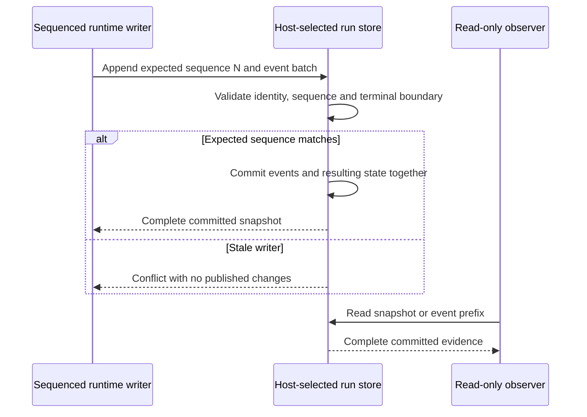

# Run storage boundary

`IWorkflowRunStore` in Hosting is the replaceable **local synchronous** run-persistence boundary. `LocalWorkflowRuntime`, its sequenced controller and the read-only journal observer can use a host-supplied store. Core's workflow, event, client and observation contracts do not change. Network/distributed storage and asynchronous persistence APIs are not established by this local contract.

## Commit contract

| Operation | Guarantee |
| --- | --- |
| `Create(revision, input)` | Publishes one empty queued run with its exact revision, hash and definition; input is bounded to 16,384 characters |
| `Append(runId, expectedSequence, events)` | Atomically publishes 1–256 events and their derived state against the last committed sequence |
| `Get(runId)` | Returns a consistent committed snapshot, or null for an unknown identity |
| `List()` | Returns recorded snapshots without invoking a workflow, model or tool |

A batch must contain consecutive event sequences for the same run and pinned revision. It cannot append to a terminal history or place an event after a terminal outcome within the batch. Validation or an expected-sequence conflict publishes nothing. A stale sequence raises `WorkflowRunStoreConflictException`; it is not an instruction to retry execution. The single-event extension uses the event's sequence minus one as its expectation.



State is derived from committed events, including independent pause and approval holds. SQLite also stores the sequence/status projection in the same transaction and checks it against the event history on reads. Events and persisted state cannot independently advance through this API. The workflow authoring catalog remains a separate store and transaction.

## Select a store in a consumer

The default helper still supplies `FileRunJournal` lazily. To replace it, register an implementation before `AddLocalWorkflowRuntime`:

```csharp
builder.Services.AddSingleton<IWorkflowRunStore>(_ =>
    new SqliteWorkflowRunStore("data/runs.sqlite3"));
builder.Services.AddLocalWorkflowRuntime("data/file-fallback");
builder.Services.AddSingleton<IWorkflowRunObserver>(services =>
    JournalRunObserver.FromStore(
        services.GetRequiredService<IWorkflowRunStore>()));
```

The runtime and observer must use the same store. An explicit store avoids resolving/creating the file fallback. Existing file-journal and runtime constructor signatures remain available. `JournalRunObserver.FromStore` selects a custom store without introducing constructor ambiguity for existing DI registrations. The helper selects the runtime constructor explicitly; custom direct DI registration should do the same when both the legacy file and new store constructor are available. Registration alone enables no observation endpoint, grants no capabilities and creates no authoring catalog.

Studio accepts `WorkflowStudio:RunStore=file|sqlite` (environment `WorkflowStudio__RunStore`), default `file`. SQLite stores runs in `runs.sqlite3` under `WorkflowStudio:DataDirectory`; the authoring catalog stays in `workflows.db`. The standalone sample uses `WorkflowService:RunStore=file|sqlite` and places `runs.sqlite3` inside its journal-directory argument. Direct, queued and optional observation modes use the selected store. Unknown values fail explicitly. Switching stores selects a different history: **there is no automatic file-to-SQLite migration**. Keep the same store/path for ongoing observation and back up old data before switching.

## File implementation and legacy histories

The file store has one writer instance and one runtime owner per directory. It writes a complete `<run-id>.snapshot.json` to a unique same-directory temporary file, flushes it, then publishes by rename. Readers see the old complete snapshot or the new one. Read-only observers allow delete sharing so replacement also works on Windows. Temporary files are ignored; they are not evidence of committed work. This rewrites a run's full history on each commit and is intended for small local workloads.

Legacy `<run-id>.run.json` plus `.events.jsonl` histories remain readable. A successful first append publishes the complete snapshot and leaves the legacy files untouched; subsequent reads prefer the snapshot and listing deduplicates identities. Failed validation does not migrate a run. Truncated/corrupt legacy evidence fails closed rather than being repaired or replayed. Back up journals before upgrading; older binaries do not understand snapshots and must not write an upgraded directory. Old legacy copies become stale after migration and are not a downgrade mechanism.

Atomic rename plus file flushing is not a guarantee against every filesystem/power-loss failure. Only one instance may write the file directory; its process-local lock is not cross-process ownership or a distributed compare-and-swap. Independent read-only observer instances are supported. Do not use network shares or multiple writers as a production deployment strategy.

## SQLite implementation

`SqliteWorkflowRunStore` uses a dedicated database identity and schema version 1, independent of the authoring catalog schema. It refuses another application's database or an unsupported version. Parameterized inserts, foreign keys, unique event sequences and immediate write transactions serialize independent connections. Each batch inserts events and updates expected sequence/status before one commit; an error rolls back both. Snapshot reads use a read transaction. Connections disable pooling and request SQLite `synchronous=FULL`.

Multiple storage clients can detect competing writes; this **does not permit multiple runtime owners**. Each local runtime still interrupts unfinished histories when starting/stopping. Hosts must give the database one exclusive runtime owner. Backup/restore, migrations, filesystem guarantees, retention, encryption, quotas and operational monitoring remain host responsibilities. Current payloads are plaintext; ordinary database/file records are not tamper-proof.

## Failures, restart and future recovery

A storage commit is not atomic with an external model/MCP call. A connection, filesystem or commit-acknowledgement failure can leave the caller uncertain; inspect persisted evidence and reconcile rather than blindly retrying an external action. A failed event write may also prevent recording the failure itself. The store does not claim exactly-once effects or continuous availability.

Graceful stop cancels process-owned continuations. Restart appends interruption evidence to unfinished runs without calling tools/models; approvals and pauses do not regain executable continuations. SQLite evidence persistence does not add checkpoints, leases, worker failover, transactional dispatch/outbox, crash-resumable approvals or distributed recovery. These require separate milestones and failure proofs. See [run control](run-control.md), [approvals](approvals.md) and the [roadmap](roadmap.md).

## Verification

`RunStoreTests` runs shared file/SQLite checks for immutable evidence after reopen, complete batches, invalid-batch rollback, terminal protection, stale-writer conflicts, competing writers, concurrent read-only prefixes, host-selected runtime/observer consistency and restart interruption. SQLite fault injection aborts the state update **after event insertion** and verifies both records/state roll back. Tests reject corrupt state, future schema versions and unrelated databases. Legacy fixture checks cover copy-on-write migration and ignored temporary files.

`python3 scripts/service_smoke.py --dotnet /path/to/dotnet` exercises direct/queued pure and real MCP workflows against both stores. Studio browser suites can run with `WorkflowStudio__RunStore=sqlite`; consumer-observation smoke can run with `WorkflowService__RunStore=sqlite`. These checks exercise local persistence and read-only playback, not recovery of unfinished workflow execution. CI runs .NET tests on Windows/Linux and browser/Python integration checks on Linux. The integration job uses SQLite for the Studio suites and consumer observation; the provider protocol fixture retains the default file-backed path.
