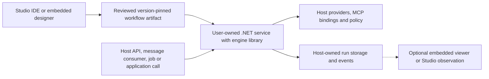
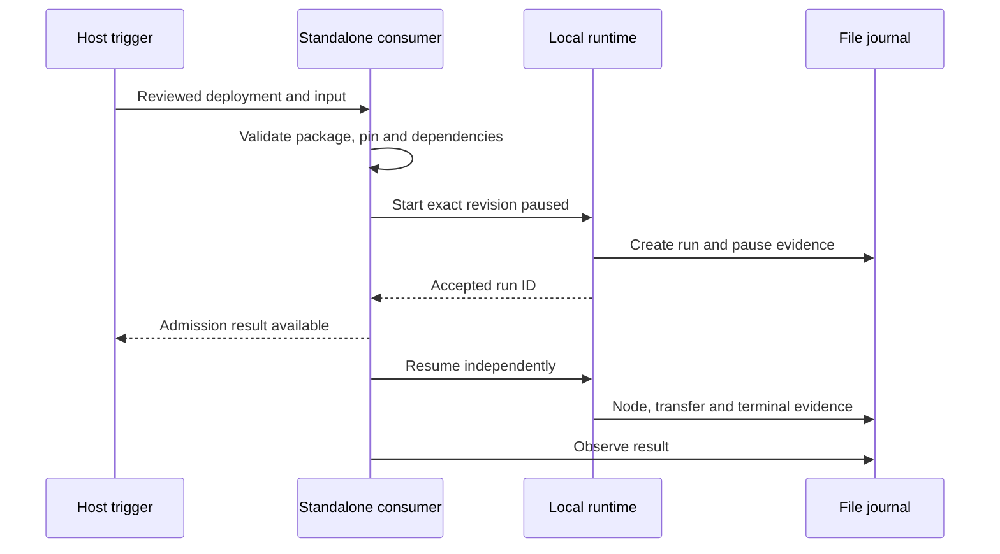

# Run workflows inside your own services

Visual Agent Workflow is intended to provide an execution library for user-owned .NET services and applications, with Studio as an optional IDE. Users can author visually, deploy reviewed workflow artifacts, and invoke those workflows from service code. Embedding the designer is an independent option; it must not be necessary to execute a workflow.

The product goal is agreed. Lower-level headless execution APIs exist today; a separate [service sample](../samples/WorkflowService/README.md) now demonstrates direct and queued execution. The [local runtime DI helper](hosting-sdk.md) is available; a stable production hosting SDK and supported NuGet distribution remain planned. Do not assume package names in this document are already published NuGet packages. The repository currently uses project references and targets .NET 10.

## Author, deploy, invoke

This diagram describes the target integration model, not an already shipped deployment system. The host supplies public entry points and infrastructure. Workflow packages declare behavior and requirements without transferring environment credentials or policy grants.

A service can expose its own REST/RPC API, consume queue messages, handle webhooks, run a schedule, execute background jobs, or call a workflow from ordinary application code. These triggers are host integration points, not arbitrary endpoint/network capabilities granted to graph nodes. Rich typed service contracts require explicit input/output schema support; today's executable workflows accept and return bounded strings.

## Available library entry points

The table below describes implemented public APIs. These are lower-level integration building blocks, not a promise of production hosting guarantees.

| Need | Existing API | Caller responsibility |
| --- | --- | --- |
| Load an executable definition | `WorkflowJson.Deserialize` | Obtain an approved artifact and enforce access/deployment policy |
| Load a portable design package | `WorkflowPackageJson.Deserialize` | Review user text and requirements; checksums do not authenticate the author |
| Capture a run's immutable definition | `WorkflowRevision.Create` or a catalog's stored publication | Retain the approved identity/hash and resolved dependencies; creating a revision gives a new identity |
| Execute directly from .NET code | `PipelineRunner.ExecuteAsync` | Supply run ID, revision, string input, event sink, cancellation, and optional tool/agent adapters |
| Enqueue a stored exact revision in the development host | `LocalWorkflowRuntime.StartRevisionAsync` | Start/stop the background service, provide its journal/adapters, and accept its single-process development limits |
| Start by published revision ID in that host | `PublishedWorkflowClient.StartPublishedRunAsync` | Supply the catalog and local runtime; authorize calls independently |
| Render historical evidence | `WorkflowRunViewer` with a snapshot and optional layout | Optional UI only; it must not invoke the engine during playback |

Core and the Agent Framework adapter do not reference Blazor or Studio. Direct execution does not require a catalog, layout, renderer, or Studio's local database. A package's layout can be used for optional observation; its definition drives execution. The current Hosting project does reference ASP.NET Core support and SQLite, so it should not be confused with a finished minimal worker-hosting SDK.

MCP connections, model client factories, logical binding resolution, credentials, authorization, storage, and application-specific entry points remain host-owned. A matching dependency registration is not a grant. Never load an unavailable provider's substitute silently or execute an imported assembly merely because a package references a type. The current built-in agent is deterministic; there is no shipped live model configuration flow.

## Invocation and lifetime

For short direct work, the calling service controls when it awaits and cancels `ExecuteAsync`. It must persist events according to its guarantees and decide what a successful response means. For background or long-lived work, an API request should enqueue a backend-owned run and return a run identity; request disconnection and UI disposal must not accidentally cancel that run. Cancellation, observation, and host shutdown are separate concerns.

The existing local queue demonstrates that separation but is not durable scheduling. It does not resume active work after process failure. Hosting a workflow in your service does not by itself provide checkpoints, exactly-once external side effects, approvals, authentication, payload redaction, or distributed coordination.

A deployment update selects approved content for future runs. Already-started runs retain their resolved revision and dependencies; historical viewing uses captured evidence without live calls. A portable package carries content hashes and requirements, not an authenticated publication lineage or host credentials. The host must record its own deployment identity and maintain the desired revision mapping.

## Standalone consumer proof

The [WorkflowService sample](../samples/WorkflowService/README.md) consumes a package plus operator-owned revision/content pin, with no Studio/Blazor reference, HTTP connection or authoring catalog. Direct mode awaits `PipelineRunner`; queued mode returns a paused run identity before resuming the same backend continuation. A parked mode demonstrates host-stop cancellation. Pure fixtures and the real local MCP reverse tool run without model credentials. Dependency and node-grant checks fail before admission; the broker repeats enforcement during calls.

The direct/queued example is a console/Generic Host. Its optional `serve` mode now adds a read-only observation endpoint; execution triggers remain host-owned. The admission result is where a user-owned API or message handler can return. `python3 scripts/service_smoke.py` proves direct/queued output, identities, event sequences, tool evidence, denied/unavailable/drifted dependencies, and stopping a paused host, with no Studio running. Current Hosting transitively includes ASP.NET Core support and SQLite, although no catalog/database is created. Minimal dependency packaging remains future work.

## Hosting registration and future distribution

The standalone consumer proof and additive `AddLocalWorkflowRuntime` registration helper are implemented. See [registration and current consumption contract](hosting-sdk.md). The sample and Studio use the same helper; neither registration nor project-reference consumption implies a supported NuGet release. A consuming app should also be able to add the designer or observer independently through the [existing component interfaces](embedding.md).

The subsequent SDK work should make DI/lifecycle configuration, package distribution, stable public execution contracts, error/cancellation behavior, storage adapters, and embedding documentation deliberate and reviewable. It must preserve the architectural separation rather than coupling service execution to the IDE. Production durability/security and richer typed contracts remain distinct milestones with their own acceptance tests.

## Optional pause/resume capability

The development host supports cooperative node-boundary control through `IWorkflowRunControl` / `IPublishedWorkflowRunControl`, paused starts, and HTTP pause/resume routes. Existing client interfaces remain supported. Controls preserve the same live run and pinned revision; browser disposal does not resume or cancel it. Host restart interrupts unfinished continuations. See [run-control semantics and requests](run-control.md).

## Optional remote observation

A consumer can explicitly enable a named-policy-protected read-only observation API and supply its own evidence reader. Studio connects through server-configured sources; consuming Blazor apps can embed the same observation panel. The sample's `serve` mode leaves endpoints disabled unless opted in. See [consumer observation](observation.md) for API, authentication, Studio attachment and limitations.

## Explicit MCP approvals

The controlled local runtime supports schema-1.5 approval waits and exact recorded decisions independent from the browser. Consumer hosts own authenticated control endpoints and actor derivation; opt-in observation alone remains read-only. Direct runner calls without an approval gate fail closed. No process-restart continuation or automatic external-effect retry is added. See [approvals](approvals.md).
