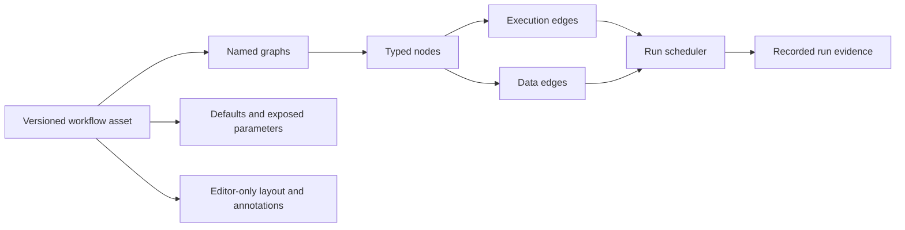

# Unreal Blueprint design reference for Visual Agent Workflow

This is a design and capability reference, not a tutorial for using Unreal Engine. It distills the Blueprint model described in the supplied Unreal Engine 5.7 documentation PDF and turns it into a target architecture for Visual Agent Workflow: a visual programming environment powerful enough to compose complex, reusable, inspectable agent workflows without requiring users to write general-purpose code.

The goal is capability parity at the level of visual programming, not API or runtime compatibility. Visual Agent Workflow should provide the same breadth of authoring concepts that makes Blueprint useful—typed values, event-driven execution, reusable functions, macros, interfaces, object-like composition, exposed configuration, control flow, asynchronous work, debugging, and asset reuse—while specializing those concepts for agent calls, tools, approvals, memory, structured data, human interaction, and durable evidence.

The source basis was the supplied Unreal Engine 5.7 documentation, especially the sections titled **Introduction to Blueprints in Unreal Engine**, **Blueprints Visual Scripting Overview in Unreal Engine**, **Basic Scripting with Blueprints**, **Anatomy of a Blueprint**, **Blueprint Best Practices**, **Blueprint Communication Usage**, and **Blueprint Debugger**. The original compiled PDF is not a repository dependency. The relevant source context is summarized and embedded below, so this document remains useful when the source file is unavailable. Unreal concepts are paraphrased rather than quoted, and every “workflow” requirement is project guidance rather than a claim about Unreal behavior.

## Evidence map

The analysis used targeted text extraction and section-level cross-checking in the supplied UE 5.7 PDF. The following map identifies the primary evidence for each design layer and the kind of conclusion drawn from it.

| Design layer | Primary source sections | Finding type | What the implementation agent should take from it |
| --- | --- | --- | --- |
| Purpose and mental model | **Introduction to Blueprints in Unreal Engine**; **Blueprints Visual Scripting Overview in Unreal Engine** | Source fact + interpretation | Blueprint is presented as a visual programming language, not only a diagramming surface; the workflow system needs a real language/runtime model. |
| Assets and composition | **Blueprints Visual Scripting Overview**; **Anatomy of a Blueprint**; **Blueprint Best Practices** | Source fact + project decision | Reusable assets, class-like composition, data-only variants, libraries, and specialization should have explicit identities and version boundaries. |
| Types and data | **Basic Scripting with Blueprints**; **Blueprint Variables**; **Placing Nodes**; **Connecting Nodes** | Source fact + project decision | Typed pins, references, containers, conversions, defaults, and context-sensitive discovery are first-class authoring concepts. |
| Execution | **Event Graph** material in **Anatomy of a Blueprint**; **Events**; **Flow Control**; **Custom Events** | Source fact + project decision | Execution wires activate work; data wires carry values; entry points and branches need explicit runtime semantics. |
| Reuse and communication | **Functions**; **Making Macros**; **Blueprint Function Library**; **Blueprint Macro Library**; **Event Dispatchers**; **Blueprint Interfaces** | Source fact + interpretation | Functions, expanded graph fragments, interfaces, and broadcasts solve different reuse/communication problems and should not collapse into one opaque “subflow.” |
| Time and external work | **Timelines**; latent/action references in the Blueprint API material | Source fact + project decision | Work that yields, waits, or progresses over time requires a lifecycle and resumption contract; browser timers are not sufficient. |
| Authoring and quality | **Blueprint Editor**; **Blueprint Best Practices**; **Blueprint Basic User Guide** | Source fact + interpretation | Search, context filtering, comments, graph organization, compile feedback, and readable boundaries are part of the system's power. |
| Debugging and evidence | **Blueprint Debugger**; **Blueprint Debugging Example** | Source fact + project decision | Breakpoints, watched values, call stacks, and execution traces should map to recorded workflow evidence without replaying live effects. |

The document deliberately does not treat every Unreal-specific capability as a requirement. Actor replication, engine object lifetime, rendering, animation, physics, and editor-only utilities are source concepts that require separate analysis before they are mapped to agent workflows.

### Source scope and confidence

This reference is a documentation-based reconstruction of the Blueprint programming model. Targeted Blueprint chapters were inspected in a 25,910-page compilation labeled Unreal Engine 5.7; the entire compilation was not reviewed, and no Unreal runtime or compiler was executed. The PDF identifies itself as a compilation downloaded from UnrealDocs.net, so it should be treated as a supplied snapshot of documentation rather than an independently authenticated Epic release artifact. Some chapters retain older engine examples and terminology. Compiler details below describe the documented model and are not a claim of a UE 5.7 source-code audit.

For reproducibility, these are one-based physical page numbers in that supplied PDF: **Blueprint Namespaces**, 10317; **Collapsing Graphs**, 10378; **Blueprint Debugger**, 10409; **Blueprint Compiler Overview**, 10449; **Exposing C++ to Blueprints**, 10460; **Functions**, 10533; **Timelines**, 10575; **Blueprint Variables**, 10658; **Flow Control**, 10693. They are provenance locators only; no implementation step requires this PDF. Section names and the embedded explanations carry the meaning if pagination changes.

Statements describing Unreal are source summaries. Explanations of the value or intent of a pattern are interpretations. Statements using “should,” “target,” or “recommended” for Visual Agent Workflow are design recommendations requiring agreement with [product design](design.md); they do not silently establish a new product decision. [Architecture](architecture.md), [roadmap](roadmap.md), and the focused contract documents own shipped behavior and implementation limits.

## Embedded Unreal source context

This section preserves the source knowledge needed to read the rest of the document without access to the original manual. It is a compact conceptual reference, not a step-by-step Unreal tutorial.

### What Blueprint is

Unreal Blueprint is a visual programming system for creating gameplay behavior inside the Unreal Editor. It uses node graphs rather than handwritten code, but it still exposes programming concepts: typed values, variables, references, functions, events, control flow, reusable libraries, object-like classes, inheritance, and debugging. Blueprint assets are saved in the project's content system and can be edited, compiled, instantiated, and reused.

The most common asset is a Blueprint Class. It derives from an existing gameplay class, combines Components with scripted graphs, and can be placed into a level as multiple instances. Editing the class changes the behavior shared by its instances; exposed defaults can be overridden on an individual instance. A Level Blueprint is instead scoped to one level and is appropriate for level-specific behavior, references to actors in that level, level streaming, or cinematics. A data-only Blueprint changes inherited defaults or components without adding graph logic.

Blueprint also has specialized asset forms. A Blueprint Interface declares function signatures without implementations; implementing Blueprints provide the behavior, and the interface does not add variables, components, or arbitrary graph logic. A Blueprint Function Library contains reusable static functions that operate on supplied inputs rather than hidden instance state. A Blueprint Macro Library contains reusable graph fragments that are expanded into consuming graphs during compilation. Editor Utility Blueprints automate editor-only actions and are not ordinary gameplay assets.

### Components and graph roles

Components are the assembled parts of a Blueprint object, such as collision, rendered geometry, movement, camera, audio, or other engine capabilities. A Blueprint can be useful as a reusable component composition even without scripted behavior. Graphs can reference those Components and change them during construction or gameplay.

Blueprint graphs have distinct roles. A Construction Script runs during actor construction, including runtime spawning, and is also rerun for relevant editor changes to placed actors. It derives components or configured appearance; it is distinct from BeginPlay and ordinary gameplay event handling. An Event Graph contains event entry points and the gameplay behavior that follows them. Function graphs provide callable reusable logic with declared inputs and outputs. Multiple Event Graph views are organizational; their canvas arrangement does not establish runtime order.

### Nodes, pins, and typed data

Nodes represent events, function calls, operators, variable reads/writes, conversions, flow control, and engine operations. Execution pins activate nodes and establish the next action. Data pins carry typed values such as numbers, booleans, text, arrays, structs, enumerations, or object references. A data connection by itself does not cause a node to execute. Wires connect ports; reroute points improve readability without changing behavior.

The editor supports context-sensitive creation. Right-clicking the graph opens a searchable action menu, while dragging from a pin narrows the available nodes to compatible types or targets. Connections normally require compatible pin types; some supported conversions insert a conversion node. The editor's discoverability does not replace validation: a serialized or imported graph still needs independent type, reference, and contract checks.

Variables can hold values or references. Class variables are available across the Blueprint's graphs; local variables are scoped to a function. Public/editable variables expose defaults in the editor and allow placed instances to override those defaults without changing the class asset. Object variables point to existing objects; they do not create new objects merely because a reference variable exists.

### Events, control flow, and time

Events are entry points activated by gameplay or another system. Custom Events provide named graph entry points. Flow-control nodes branch or sequence execution based on data. Blueprint also supports latent operations such as delays and other work that yields and resumes later, plus Timelines that drive values from tracks or curves over time and expose update/completion paths.

The important source principle is that execution flow is explicit. A node does not run because it is visually nearby or because a value happens to be connected. Time-based behavior has a lifecycle, and an operation that yields must have a meaningful completion or cancellation path. Visual Agent Workflow adopts that principle with durable waits, approvals, provider/tool calls, bounded loops, and explicit run evidence.

### Reuse and communication

Functions and macros look similar at a call site but have different semantics. A Function is a callable graph with one entry point and a runtime call boundary. It can be targeted, parameterized, reused across graphs, and overridden in child Blueprints where the contract permits. A Macro is a graph fragment with tunnel inputs/outputs that is expanded into the consuming graph; it can expose multiple execution paths and does not appear as an independent runtime call-stack frame.

Blueprints communicate through direct calls or references, Event Dispatchers, and Interfaces. Direct communication is appropriate when the caller knows a target and operation. Event Dispatchers let one Blueprint notify listeners without hard-coding every listener. Interfaces let different Blueprint types satisfy a common operation contract without sharing implementation. These mechanisms differ in lifetime, coupling, debugging, and ownership; they are not interchangeable “subflow” nodes.

### Compile, save, and debug

Blueprint editing has an authoring lifecycle: create or open an asset, edit Components/graphs/defaults, compile to check and update the executable representation, and save the asset. Compilation is not the same as authorization, publication, or proof that all runtime dependencies are available.

The Blueprint Debugger can pause a Play-In-Editor or Simulate-In-Editor run at breakpoints, step through execution, inspect watched pin values, view a call stack, and inspect an execution trace. A watched value represents the most recent execution of its node; an unexecuted node has no current runtime value. Debugging is tied to actual execution, not to the static appearance of a graph. Visual Agent Workflow carries this principle into recorded evidence and read-only playback.

### Source design philosophy

The source presents Blueprint as a way for designers to access substantial programming power through a visual, discoverable, reusable, and debuggable medium. It favors reusable Blueprint Classes over copying level-specific logic, encourages functions/macros and comments to control graph complexity, recommends event-driven behavior over heavy per-frame work, and treats readability as a maintenance concern. Those principles—not Unreal's actor memory model or engine-specific APIs—are the primary design inspiration for Visual Agent Workflow.

## The central model

Blueprints are a node-based visual programming language. A Blueprint asset contains one or more graphs. Nodes represent events, operations, functions, variables, conversions, or control flow. Wires connect nodes, but not all wires mean the same thing: execution wires schedule work, while data wires carry typed values. This distinction is the foundation of the system.

An Unreal Blueprint can define an object-oriented class or object. A Blueprint Class is saved as an asset, derives from a parent gameplay class, can contain Components, and can be instantiated into a level. All instances inherit the class's components and scripted behavior, while exposed defaults may be overridden per instance. A Level Blueprint is a level-scoped graph for one-off level behavior and references to actors placed in that level.

The useful abstraction for Visual Agent Workflow is not “a graph is a program because it looks like code.” It is:

The graph is a user-facing declaration. The runtime must interpret its explicit contracts; it must not infer scheduling from screen position, topological display order, wire curvature, or the order in which nodes were created.

## Capability target

Blueprint is powerful because it is a complete visual programming environment, not merely a flowchart editor. Visual Agent Workflow should be judged against the same capability categories:

| Capability category | Blueprint provides | Visual Agent Workflow should provide |
| --- | --- | --- |
| Composition | Assets define reusable object/class behavior and can be instantiated many times. | Versioned workflow assets and child-workflow calls with explicit input/output contracts and pinned revisions. |
| Typed programming | Variables, object references, arrays, structs, conversions, and typed pins. | Typed parameters, structured JSON, arrays/maps, references, provider/model profiles, tool results, and visible conversion nodes. |
| Control flow | Events, branches, loops, sequences, gates, timers, and other flow-control nodes. | Triggers, predicates, exclusive routing, bounded loops, parallel fork/barrier regions, retries, waits, approvals, cancellation, and successful termination. |
| Reuse | Functions, macros, function libraries, macro libraries, interfaces, and inheritance. | Callable workflows, deterministic transformation libraries, authoring templates, capability interfaces, and composition without hidden permissions. |
| Configuration | Defaults on assets plus per-instance editable overrides. | Immutable definition defaults plus per-run overrides, host-owned capability resolution, and sensitive-value handling. |
| External interaction | Nodes can act on engine objects, components, input, animation, audio, and level state. | Nodes can invoke approved model providers, MCP tools, skills, services, human approvals, memory stores, and observation endpoints. |
| Runtime inspection | Breakpoints, stepping, watches, call stacks, and execution traces. | Recorded node inputs/outputs, route evidence, child-call nesting, pause/resume boundaries, redaction, historical playback, and controlled debug runs. |
| Asset workflow | Create, edit, compile, save, instance, and reuse assets in a content project. | Draft, validate, publish immutable revisions, run exact revisions, export/import portable definitions, and preserve layout as presentation data. |
| Editor ergonomics | Searchable contextual actions, graph navigation, comments, reroutes, grouping, and clear pin semantics. | The same discoverability, with accessible keyboard alternatives, precise validation, undoable semantic edits, and no hidden execution behavior. |

“Same capability and power” means users should be able to build layered systems rather than only linear prompt chains. A representative workflow should be able to accept structured inputs, select and transform data, branch on predicates, call reusable subflows, invoke approved agent/tool capabilities, wait for a human decision, fan out bounded work, merge results, handle failure or cancellation, and emit a typed result with evidence. Each of those operations needs a first-class contract and editor representation.

The target is not to make every possible behavior a single giant graph. Blueprint's strength comes from moving between levels of abstraction: a compact node can represent a function, a macro, a component, or a class instance while still exposing its meaningful inputs and outputs. Visual Agent Workflow should offer the same progressive disclosure. A user can start with visible nodes, extract a reusable unit when a pattern stabilizes, open that unit when debugging, and inspect the exact revision and capabilities involved in a run.

## Current project boundary

This reference is a capability target, not a claim that Visual Agent Workflow already implements all Blueprint concepts. The current roadmap describes a substantial but deliberately bounded subset: typed scalar parameters and bounded JSON selection/projection, explicit conditional routing, one bounded loop shape, one two-branch fork/barrier shape, successful no-result termination, pinned child-workflow calls, node-scoped MCP and skill capabilities, versioned agent profiles and bounded delegation, approvals, immutable publications, layout-aware authoring, persisted run evidence, and read-only playback. See the [roadmap](roadmap.md) and the focused references linked from it for exact limits and verification status.

The following remain capability targets or open design areas rather than general support: a fully general type/container system, mutable graph variables with defined branch/loop write semantics, arbitrary nested forks and loops, event-dispatcher subscriptions, timeline-like progression, richer stream semantics, broad inheritance/template specialization, generalized error-compensation graphs, multi-user collaboration, and production-grade distributed durability. These features require runtime and evidence contracts; adding a card or wire type alone would not complete them.

## Design philosophies to preserve

### Visual programming should be a real programming model

Blueprints expose programming concepts—types, variables, scope, functions, events, control flow, composition, and debugging—through a visual medium. The canvas is not the semantics; it is the primary authoring surface for a typed program. Visual Agent Workflow should therefore define its language model before adding gestures or styling. Every node, port, edge, graph, asset, and runtime state needs a durable meaning that can also be validated, serialized, executed, inspected, and tested without the browser.

### Discovery and correctness should reinforce each other

Blueprint's context-sensitive menus make the next valid operation discoverable from the selected pin or object. This reduces the amount of terminology users must memorize. Visual Agent Workflow should provide the same affordance for data types, execution context, capability scope, and graph position, while still validating imported definitions independently. A palette filter is a usability feature; it is not a trust boundary or a substitute for schema validation.

### Complexity should be managed through abstraction

Blueprints allow a designer to start with individual nodes, then organize them with comments, collapse them into functions or macros, share libraries, or place the behavior behind an interface. Visual Agent Workflow should make that progression natural. Extraction must preserve behavior, port identity, provenance, and tests. Reuse must reduce duplication without hiding side effects, permissions, retries, approvals, or failure semantics.

### Runtime behavior should remain explainable

Blueprint debugging connects a runtime pause to the graph, the node, the current values, and the call stack. Agent workflows add nondeterministic providers and external side effects, so explainability matters even more. The system should record what was scheduled, what input was supplied, which capability was used, which route was selected, what output was returned, and why the run stopped. Visual highlights are useful only when grounded in that evidence.

### The host owns authority

Blueprint assets can reference engine classes and objects because the Unreal runtime owns the world. A portable agent workflow cannot safely own credentials, invoke arbitrary URLs, install code, or grant tools. Workflow assets declare requirements; the host resolves identities, applies policy, issues approvals, and supplies capability implementations. This is a specialization of the Blueprint asset model for a multi-capability agent runtime, not a reduction in visual power.

## Blueprint asset types and their workflow analogues

Blueprint asset types establish scope and reuse boundaries. Visual Agent Workflow should expose similarly obvious scopes, but keep its portable definitions framework-independent.

| Unreal concept | What it means in Unreal | Workflow interpretation |
| --- | --- | --- |
| Blueprint Class | A reusable class-like asset with components, properties, and graphs; instances can be placed in a level. | A versioned workflow definition with explicit inputs, outputs, dependencies, and optional reusable child calls. |
| Level Blueprint | A graph owned by one level, useful for level-specific events and actor references. | A host- or project-scoped orchestration graph only when the behavior is intentionally non-reusable. Prefer a named workflow for reusable behavior. |
| Data-only Blueprint | A derived asset that changes inherited defaults or components without adding execution logic. | A configuration or template revision with no executable graph changes. Keep it distinct from a runnable workflow. |
| Blueprint Interface | Function signatures without implementation; implementing assets provide the behavior. | A versioned capability or workflow contract containing named typed operations, without granting tools or credentials. |
| Blueprint Function Library | Static reusable functions that operate only on supplied inputs. | A catalog of deterministic, host-approved transformations. The library should not carry hidden run state. |
| Blueprint Macro Library | Reusable graph fragments expanded into consuming graphs during compilation. | A reusable authoring template only if expansion, identity, versioning, and audit behavior are explicitly defined. A callable version-pinned workflow is safer when runtime provenance matters. |
| Editor Utility Blueprint | Editor-only automation that acts on the editor or selected objects. | An authoring-time utility, never a runtime workflow node unless its side effects and trust boundary are separately defined. |

Blueprint Classes and Level Blueprints are not interchangeable. Unreal's own best-practices guidance favors classes for reusable behavior and Level Blueprints for behavior specific to a particular level. Apply the same rule here: reusable graph behavior belongs in a named workflow or reusable pipeline; host-specific coordination belongs at the host boundary or in an explicitly scoped orchestration definition.

## Agent workflow primitives

To reach Blueprint-level expressive power for agent work, the node catalog must cover more than “call a model” and “call a tool.” The following primitives are the minimum conceptual vocabulary for a general-purpose visual agent system:

| Primitive | Contract it needs |
| --- | --- |
| Input/output | Named, typed values with defaults, required status, validation, and redaction policy. |
| Literal and parameter | A safe constant or explicit invocation value; never hidden text substitution into a privileged prompt role. |
| Transform | A deterministic operation over typed values, with declared conversion and failure behavior. |
| Agent/model call | Provider/profile identity, role-separated prompt inputs, structured output schema, timeout/cancellation, usage evidence, and host admission. |
| Tool/MCP call | Exact tool identity and version/contract, typed arguments, approval policy, result schema, timeout, retry policy, and side-effect classification. |
| Memory/context | Explicit read/write scope, retrieval limits, sensitivity policy, and whether the value is run-local, workflow-persistent, or host-owned. |
| Predicate/branch | A typed condition with named exclusive or non-exclusive routes and recorded decision evidence. |
| Loop/retry | A bounded body, termination predicate, iteration budget, backoff policy, and accumulated evidence. |
| Parallel fork/join | Named branches, admission limits, join policy, partial-failure semantics, and a result shape. |
| Human approval/input | Request schema, actor/policy scope, timeout, cancellation, resumption identity, and audit record. |
| Child workflow | Pinned revision, explicit arguments/results, nested evidence, failure propagation, and capability scope. |
| Wait/schedule | A durable suspension contract, wake condition, deadline, and ownership/resume policy. |
| Error/recovery | Typed failure routes, compensation or non-compensation semantics, retry eligibility, and terminal status. |

These primitives should be composable in the same way that Blueprint nodes compose. A user should be able to build a small deterministic subgraph, wrap it in a function-like reusable unit, call it from an event-driven workflow, and inspect it as one node without losing the ability to open its implementation. Agent-specific behavior belongs in node contracts and host adapters, not in special cases embedded in the canvas.

An example of the intended abstraction ladder is a customer-support workflow. At the lowest level it can parse a request, retrieve policy text, call a model, branch on confidence, request approval for a refund tool call, and return a response. The same graph can then be extracted into a versioned “RefundDecision” child workflow, exposed through an interface, and reused by email, chat, and batch-entry workflows. Each caller supplies explicit inputs; each run records the exact child revision and capability decisions.

## Data type system and containers

Blueprint's visual language is useful because types are visible at the point of composition. It supports primitive values, object references, arrays and other containers, structs with named fields, enumerations, and conversions. Struct pins can be split into fields; variables can be read or written through explicit nodes; and context-sensitive actions use the selected type to narrow what can be added.

Visual Agent Workflow should have an equally deliberate type system. At minimum, the portable contract needs primitives for text, numbers, booleans, nullability, structured objects, arrays, maps, and opaque references. Agent-specific types should be explicit where they carry policy or lifecycle semantics: model profiles, tool identities, approval requests, memory records, run handles, and evidence references should not be represented as untyped strings. Struct-like schemas should support field-level validation, redaction, defaults, and evolution.

Generic or wildcard pins can improve authoring ergonomics, but they must resolve to a concrete type before publication. Implicit stringification is not a general-purpose conversion strategy. A conversion from structured data to prompt text, or from model output to a tool argument, should be a visible, testable transformation with bounded size and failure behavior. Serialization must be canonical enough for content identity, revision comparisons, and deterministic validation.

Pure nodes deserve a distinct contract. Unreal pure functions have no execution pins and are evaluated as data is needed; they do not cache results merely because they are pure. In this project, pure nodes should be deterministic and side-effect-free. Model calls, tool calls, memory writes, approvals, waits, and other effectful operations must have explicit execution semantics even when their outputs are consumed as data.

## Control-flow vocabulary and state ownership

The source's **Flow Control** chapter exposes different programming mechanisms. Their differences matter more than the node shapes. Unreal's Sequence dispatches its outputs in order; it is not a parallel fork and does not provide a barrier that waits for latent work launched by an earlier output.

| Blueprint mechanism | Embedded source meaning | Agent-workflow adaptation and invariant |
| --- | --- | --- |
| Branch | Select the true or false execution output from a boolean condition. | Exactly one route is chosen per activation; record the condition outcome separately from downstream delivery. |
| Switch | Select an execution output by a selector such as an integer, string, name, or enumeration. | Validate cases, comparison rules, default behavior, and exhaustiveness; retain stable case-port identities when labels change. |
| Sequence | Dispatch multiple execution outputs in a defined order. | Distinguish ordered dispatch from waiting for each operation's completion and from concurrency. Define which contract the node promises. |
| Loops and loop break | Repeat a body by index or condition and expose completion; a break-capable loop can exit early. | Define iteration values, maximum work, cancellation, early exit, and whether collections are snapshotted. Existing bounded loops support only their documented subset. |
| Gate | Allow or suppress incoming activations according to open/closed state; support open, close, and toggle. | State belongs to a declared scope. A suppressed activation needs a disposition so joins do not wait indefinitely. |
| DoOnce / DoN | Admit one or a limited number of activations until reset. | Persist counter/reset state when its scope survives suspension. DoOnce alone does not guarantee exactly-once external side effects. |
| FlipFlop | Alternate between two outputs across successive activations. | Define initial state and lifetime; state shared across concurrent runs must never be implicit. |
| MultiGate | Route successive activations across outputs, optionally randomly or repeatedly. | Record the selected route, cursor, and randomness policy; playback uses recorded selections. |

These are capability examples rather than a requirement to implement every Unreal node name. Equivalent power can come from fewer well-defined state and routing primitives. State keys must distinguish runs, nested calls, nodes, and activation/iteration/attempt where relevant. A fresh run must not inherit an earlier run's gate, counter, or cached result accidentally.

An exclusive merge accepts the selected alternative's result. A parallel join waits for declared branch completions. A Sequence dispatches in order. Keep these operations distinct in schema, UI, evidence, and tests. Specify whether failure cancels sibling work, whether skipped branches count toward a join, and how duplicate or late branch results are handled before extending scheduling.

## Reference identity, structured values, and availability

Blueprint distinguishes a class/type from an object instance. Its `Self` target refers to the current object, an object-reference variable identifies an existing instance, and a cast checks whether that instance supports a more specific class. Casting does not create an object or transform arbitrary data into that class. A failed cast and an invalid reference need explicit handling.

For workflows, distinguish a definition, its published revision, an invocation of that revision, and a host capability binding. A child-call node is a definition reference plus arguments; a child invocation is an execution scope. A provider profile is a logical catalog selection; its resolved configuration and credentials belong to the host. An identifier that parses correctly may still be missing, unauthorized, expired, or incompatible.

Structs group named fields, arrays preserve indexed elements, sets express unique membership, maps associate keys with values, and enums provide named alternatives. A workflow type system should specify copy versus shared-reference behavior, key equality, element ordering, duplicates, schema identity, and size/depth limits for each supported container. A field extractor must distinguish missing from null and malformed from unavailable; those states must not collapse into an empty string. Make/break struct-style nodes correspond to explicit construction and field projection, not unrestricted object deserialization.

Blueprint functions expose input/output parameters, defaults, visibility such as public/protected/private, and reference-style parameters. Workflow adaptation should default to explicit inputs and outputs with visible ownership. Define aliasing and concurrent-write behavior before supporting reference-style mutation. Definition-level visibility remains separate from host authorization: a public child-workflow interface still requires capability admission.

## Inheritance, templates, and specialization

Blueprint Classes can derive from parent classes. A child inherits components, variables, and behavior, can change defaults, and can override selected functions. This gives teams a way to establish a base actor or system once and create specialized variants without copying the whole graph.

Visual Agent Workflow should support the same specialization capability, but use immutable composition boundaries rather than hidden mutable inheritance wherever possible. A workflow template or base definition may establish a stable interface, default parameters, reusable subflows, and extension points. A specialized workflow should record its base identity and the changes it applies. Published runs must resolve the complete effective revision, so later edits to the base cannot silently change an existing run.

Function override and extension points need explicit rules: which inputs and outputs may change, whether defaults may narrow or widen, how validation is inherited, how capability requirements are merged, and whether an override can add side effects. If those rules are not defined, prefer a child-workflow call or interface implementation over class-like inheritance. The user should always be able to inspect the effective graph and its provenance.

## Asynchronous, latent, and time-based work

Blueprint includes latent operations such as Delay and movement or animation operations that yield and resume later. Timelines drive values from tracks and curves over time, with update and completion execution paths. These features let a graph describe behavior that spans multiple frames without blocking the editor or pretending that the whole operation is instantaneous.

Agent workflows need the same expressive power for provider latency, tool calls, approvals, scheduled work, streaming, and human-in-the-loop pauses. Treat these as durable state transitions, not as an implementation detail of a browser or process:

| Temporal behavior | Workflow contract |
| --- | --- |
| Await an external call | Correlation ID, timeout, cancellation, retry policy, result schema, and evidence for admission/completion. |
| Delay or schedule | Durable wake condition, deadline, owner, persisted cursor, and behavior after restart. |
| Human approval | Request identity, actor/policy scope, allowed responses, expiration, and resumption identity. |
| Stream/update | Ordering, backpressure, partial-result schema, finalization, and replay policy. |
| Timeline-like progression | A bounded state machine or schedule with explicit time source, sampling behavior, cancellation, and output semantics. |

Do not use a client-side timer as the equivalent of a latent node. Closing the Studio must not accidentally erase a run's suspension state, and reconnecting a browser must not duplicate an external effect. A resumed run must re-enter at a defined cursor with the exact published revision and dependency identities it started with.

## Events, dispatchers, and subscriptions

Blueprint Event Dispatchers let one Blueprint broadcast that something happened to listeners without hard-coding every listener into the broadcaster. They are useful for decoupling a producer from consumers, but they also introduce subscription lifetime and ordering concerns.

An agent workflow equivalent can support named event channels, notifications, or outputs that wake subscribed workflows. The contract must define who may publish, who may subscribe, whether subscriptions are definition-scoped or run-scoped, delivery guarantees, ordering, replay, deduplication, and failure handling. A dispatcher must not become an unbounded hidden fan-out mechanism. For most current workflow composition, explicit outputs and child calls remain easier to validate; event subscriptions are an advanced capability that should be added only with durable ownership and audit semantics.

## Resource, cost, and performance boundaries

Unreal's Blueprint guidance favors event-driven behavior and warns against doing heavy work every frame or growing a single graph until it becomes difficult to read and manage. Visual Agent Workflow has different costs, but the same principle applies: node count, graph fan-out, repeated model calls, large payloads, long loops, and excessive parallelism can make a workflow expensive or impossible to operate.

Every effectful or potentially expensive node should declare useful limits: timeout, retry budget, maximum input/output size, concurrency class, rate/cost estimate where available, cancellation behavior, and whether it is safe to repeat. A bounded loop is not safe merely because it has a maximum iteration number if each iteration can spawn unbounded work. A parallel region needs both branch count and downstream admission limits. Compile-time validation should catch obvious unbounded structures; runtime admission should enforce host policy and quotas.

Observability should expose these costs without turning the graph into a monitoring dashboard. Record node duration, queue/wait duration, attempt count, payload sizes where allowed, provider/tool identity, and terminal disposition. Keep secrets and sensitive content redacted. Provide static analysis for unreachable nodes, duplicate work, unsupported cycles, missing joins, likely repeated side effects, and graph regions that exceed configured limits.

## Components, graphs, and scopes

Unreal Components are the assembled parts of an object: collision, mesh, movement, camera, and similar capabilities. A Blueprint may contain only components and still be useful as a reusable level object. Graphs can reference those components and act on them during construction or gameplay.

Visual Agent Workflow has no Unreal actor/component hierarchy. The closest safe mapping is to treat a workflow as a composition of node contracts, not as an object with ambient mutable properties. A node may declare configuration, inputs, outputs, and host capabilities. It should not silently reach into a shared object graph or acquire authority because it is visually near another node.

Keep these scopes separate:

| Scope | Suitable contents |
| --- | --- |
| Definition | Node identities, node types, typed ports, immutable defaults, validation, and declared dependencies. |
| Invocation | Per-run parameter overrides and caller input. These must not rewrite a published definition. |
| Run state | Values and status created for one execution. Mutable variables require explicit ordering and concurrency semantics. |
| Host capability | Provider catalogs, MCP bindings, approvals, credentials, and runtime policy. A workflow may declare requirements but cannot supply or authorize them. |
| Presentation | Coordinates, labels, comments, sections, wire routes, zoom, and selection. These do not execute. |

This separation is the most important adaptation from Blueprint's instance model. Unreal can resolve references through its object world and class instances. Visual Agent Workflow must make every cross-node value, dependency, and permission explicit in its portable contract.

## Graph kinds

Unreal commonly uses three graph roles:

**Construction Script** runs during actor construction, including runtime spawning, and on relevant editor updates. It helps derive configured components and is distinct from BeginPlay. A selective workflow analogue is authoring-time normalization, preview computation, or validation. That adaptation must be labeled as authoring-time and must not make live agent or external service calls. Runtime workflow initialization needs its own explicit contract; it does not inherit Unreal construction behavior automatically.

**Event Graph** contains event entry points and the gameplay logic that responds to them. It can have multiple event graphs for organization; the separate canvases do not establish behavior by themselves. For Visual Agent Workflow, an event-triggered graph should use explicit trigger/entry contracts and should not treat multiple disconnected regions as implicitly ordered.

**Function Graph** is a reusable graph with one entry point, parameters, local variables, and outputs. It can be called from other graphs and can communicate across Blueprint instances through a target reference. The workflow equivalent is a reusable, typed node or version-pinned child workflow with an explicit input/output contract.

Do not reproduce Unreal's permissive “any graph can be placed anywhere” model without a contract. Every graph kind in Visual Agent Workflow should state whether it is executable, authoring-only, callable, resumable, observable, and allowed to contain side effects.

## Nodes, pins, and wires

A Blueprint node can expose execution pins and data pins. Execution pins are usually visually distinct and are responsible for activating the next node. Data pins carry values and can often be read by a node only when that node executes. Some connections insert conversion nodes automatically when a compatible conversion exists.

For the workflow implementation, model a port as a first-class identity rather than just a side and label. A port needs at least a stable ID, direction, kind, data type, multiplicity rule, optional/default behavior, and a user-facing label. Edge records should identify source node/port and target node/port. Layout code should consume those identities to draw wires; it must not use node order or text matching.

Execution and data are different semantic channels:

| Channel | Blueprint meaning | Required workflow rule |
| --- | --- | --- |
| Execution | Activates a node and determines which connected action runs next. | Represent scheduling explicitly. A connected data value alone must never trigger a node. |
| Data | Supplies a typed value to an input or reads a typed output. | Validate types and availability. Define whether values are eager, lazy, snapshot-based, or produced only after execution. |
| Branching | Control-flow nodes choose one or more execution outputs. | Encode branch identity and route evidence. Do not infer a condition from layout or a missing wire. |
| Reroute | A visual control point that improves readability without changing semantics. | Store as presentation data only. Reroutes cannot become executable nodes. |

Unreal's editor supports context-sensitive node creation: dragging from a pin filters available actions to nodes that accept the source type or target context. Visual Agent Workflow should use the same discovery pattern because it reduces invalid graphs and makes the graph vocabulary learnable. The filter must remain an authoring aid, not the sole validator. Imported definitions still require complete schema validation.

Pins should carry enough type information to make errors visible before a run. Start with the project's supported portable types and distinguish strings, numbers, booleans, structured JSON, arrays, and references according to the actual runtime contract. Automatic conversion should be narrow, deterministic, and visible in the graph or inspector. Never insert a conversion that changes meaning silently, especially for prompts, tool arguments, approvals, or secrets.

## Events and execution flow

An Event node has no incoming execution pin because an external or engine event activates it. A connected execution wire then runs downstream nodes in order. Custom Events provide named entry points that can be invoked from graphs. Flow-control nodes such as branches choose the next execution path based on a value.

The workflow analogue should use explicit entry points such as input, trigger, branch arm, loop body, fork branch, and termination. Execution edges must be validated as a semantic graph. The current project already distinguishes data links from execution-like behavior and supports bounded conditional, parallel, loop, and termination contracts; this reference does not expand those contracts.

Blueprint's multiple Event Graph canvases are organizational. Likewise, a workflow may split a large definition into named graph views or reusable subgraphs, but a view must not create hidden execution order. The runtime schedule comes from the validated definition and its node contracts.

Event-driven authoring is preferable to an implicit tick loop for most workflow behavior. Unreal's best-practices material warns that heavy work every frame is a poor fit for Blueprint and recommends event-driven behavior where possible. For Visual Agent Workflow, avoid polling, unbounded retries, and implicit “run every update” semantics. Prefer explicit triggers, bounded loops, cancellation boundaries, and recorded transitions.

## Variables, parameters, and references

Unreal variables can hold primitive values such as numbers and booleans, or references to objects and components. Class variables can be shared across graphs in a Blueprint; local variables are scoped to a function and disappear when that function returns. Public/editable variables expose defaults on placed instances, allowing each instance to override the class default without modifying the class asset.

Use this distinction carefully in Visual Agent Workflow:

* Definition defaults are safe starting values stored with the draft or published revision.
* Invocation inputs are supplied for one run and do not mutate the published asset.
* Graph variables are explicit values with stable IDs and declared types. Getter nodes make reads visible; setters require defined run-state semantics.
* Local values belong to one node or bounded subgraph and should not become hidden shared state.
* References identify declared workflow entities or host-provided capabilities; they are not object handles that grant authority.

An exposed parameter should have a stable ID, name, type, default, description, required/optional status, validation rules, sensitivity classification, and override policy. A model profile, skill, MCP server, or credential is not an arbitrary parameter value. It resolves through host policy and catalog identity. The workflow may request a capability; the host decides whether it is available and approved.

Mutable Set/Get behavior is more complex than a visual pair of nodes suggests. Define write ordering, visibility across branches, behavior at retries, and conflict handling before adding it. In parallel graphs, do not permit ambiguous concurrent writes. In loops, define whether each iteration sees the previous value and how a resumed run restores it.

## Functions, macros, and reusable workflows

Unreal Functions are callable graphs with one entry point. They are appropriate for reusable calculations, checks, and behavior that may be targeted at an object or overridden in a child Blueprint. Functions can communicate across Blueprints through parameters and object targets.

Macros look similar at the call site but are graph fragments. They have tunnel inputs and outputs, can expose multiple execution outputs, and are expanded into the consuming graph during compilation. Because they are expansion rather than runtime calls, Unreal's debugger does not show a macro as its own call-stack frame. Macro changes require consuming Blueprints to compile before the change is reflected.

For this project, the distinction maps to two separate implementation choices:

| Reuse form | Use when | Required identity |
| --- | --- | --- |
| Callable workflow/node | Runtime provenance, independent versioning, approval scope, retry behavior, or observability matters. | Stable reference plus pinned revision and explicit input/output contract. |
| Authoring template/macro | The goal is editor convenience and expansion into the current graph. | Template identity/version plus deterministic expansion and a clear record of the expanded result. |

Do not call an unversioned graph fragment a reusable workflow. If an agent, MCP tool, provider, approval, or external side effect is involved, prefer a callable version-pinned unit so audit and playback can identify what actually ran. Reuse should reduce graph complexity without hiding permissions or changing the meaning of the surrounding graph.

### Collapse, call, and expand are different abstractions

A collapsed graph wraps selected nodes with boundary/tunnel pins to organize one location. It is local encapsulation; duplicating it is not the same as having a shared reusable definition. A function creates a callable boundary with a single entry and return contract. A macro expands its implementation at each use. Comments and sections only organize the display. Extraction should therefore offer an explicit choice and explain identity, update propagation, and debugging consequences.

Blueprint functions cannot contain latent operations such as Delay; macros can support latent operations where the consuming graph permits them. This constraint demonstrates why “reusable node” needs more than a visual wrapper. A workflow child call may legitimately suspend, but its contract must then identify how caller and child persist, resume, cancel, and propagate outputs. Do not import Blueprint's synchronous function restrictions accidentally or assume macro expansion makes any latent operation legal everywhere.

## Native extension model and catalog discovery

Blueprint's expressive power includes cooperation with programmers. Native C++ exposes selected functions and properties through Unreal reflection metadata. `BlueprintCallable` makes operations callable from graphs, `BlueprintPure` exposes data-producing operations without execution pins, `BlueprintImplementableEvent` lets Blueprint provide behavior called by native code, and `BlueprintNativeEvent` supplies a native default that Blueprint can override. An override can explicitly invoke the parent implementation. This creates a two-way boundary: native operations become visual building blocks, and visual behavior customizes designated native extension points.

The design lesson is to expose domain operations at useful abstraction levels. A programmer can package a repeated or expensive graph pattern into a small native operation with a typed signature, useful name, defaults, documentation, category, and failure behavior. Authors retain visual composition while specialists supply additional primitives. Pure exposure alone does not prove determinism or authorization; those require separate contracts.

For this project, approved MCP operations and [isolated .NET extensions](extension-assemblies.md) provide the corresponding extension route. Describe their supported input/output schemas, effect classification, cancellation behavior, and evidence attribution in catalog descriptors. Existing host registration and worker constraints remain authoritative. A new extension operation must not bypass node-scoped grants just because it appears in the palette.

Blueprint Namespaces address editor loading and action/type discovery for libraries. They are a useful precedent for catalog organization and lazy loading, not for security isolation. Large workflow catalogs should support searchable categories, keywords, documentation, compatibility reasons, and explicit dependencies without contacting every external service on each menu opening. Separate availability for authoring from permission to invoke.

## Communication patterns

Unreal documents three major Blueprint communication patterns. Direct communication calls a known function or reads/writes a known variable on a target object. Event Dispatchers let a Blueprint broadcast that something happened to listeners. Blueprint Interfaces define common function signatures that multiple Blueprints implement without sharing implementation.

The corresponding workflow choices are:

* Use a direct child-workflow call or explicit node output when the caller knows the target contract.
* Use an event or notification channel only when subscription lifetime, delivery, ordering, replay, and failure behavior are defined.
* Use an interface or capability contract when multiple implementations should satisfy the same operation. An interface describes shape; it does not authorize invocation or provide credentials.

Blueprint Interfaces cannot add variables, edit implementing graphs, or add Components. Preserve this narrowness. A workflow interface should define operations and types, not smuggle in state, tools, prompts, or host configuration.

## Compilation, validation, and publishing

Unreal's Compile action checks a Blueprint for errors and updates the runtime representation so the latest graph changes work in the level. Save persists the asset. A data-only Blueprint may use a compact editor until it gains graphs or scripted behavior. These affordances suggest a useful workflow lifecycle, but the guarantees must be stronger and explicit:

1. Authoring edits create a draft definition and presentation state.
2. Validation checks node types, port identities, required inputs, reachability, cycles, bounds, dependency references, and policy-sensitive configuration.
3. A successful validation may produce a normalized executable representation, but it does not grant host capabilities.
4. Publishing creates an immutable revision with a stable content identity and captured layout/provenance as appropriate.
5. A run references the exact published revision or an explicitly identified draft; playback reads recorded evidence and never executes live dependencies.

“Compile” should not be presented as equivalent to “safe to run.” Compilation/normalization validates the graph shape. Host admission, approvals, provider availability, and runtime policy remain separate decisions. A graph that is visually connected but lacks a valid capability binding must fail validation or admission with a precise error.

### What the documented Blueprint compiler contributes

The **Blueprint Compiler Overview** describes conversion of asset properties and graphs into a generated class. It collects class properties and functions, combines/processes event graphs, works on temporary graph copies, expands nodes, calculates execution and data dependencies, emits intermediate statements, and translates those statements to VM bytecode. The documented pipeline also copies class defaults and reinstantiates objects after class changes. The exact internal implementation is outside this document's verification scope.

The transferable pattern is a compilation boundary between the editable graph and an executable representation. Visual Agent Workflow may use an interpreter or framework adapter rather than bytecode, but should preserve typed validation, bounded expansion, stable diagnostics, and mappings from runtime instructions back to authored node/port IDs. Template expansion must allocate unique internal identities and preserve source provenance. Do not optimize across a side effect, approval, or observable boundary unless equivalence is defined. Debug traces should still explain the authored graph after normalization.

Unreal's live reinstancing is not a reason to hot-swap a running workflow. Publish and dependency upgrades should create a new immutable effective definition; existing runs retain their recorded revision. See [nested workflows](nested-workflows.md) for the current revision-upgrade contract.

## Debugging and evidence

The Unreal Blueprint Debugger pauses Play-In-Editor or Simulate-In-Editor execution at breakpoints. It supports stepping, watched pin values, a call stack, and an execution trace. Watched values reflect the most recent execution of a node; an unexecuted pin has no current runtime value. Macros appear as part of the calling function rather than as separate call-stack frames.

Visual Agent Workflow should adapt the user experience while respecting its backend-owned run model. Useful equivalents include node-level breakpoints for a controlled local/debug run, recorded node inputs and outputs, route/branch evidence, call-stack-like child-workflow nesting, and an execution trace ordered by actual runtime events. The UI may highlight the node associated with an event, but color or animation must come from recorded evidence, never from wire geometry or selection alone.

Playback must be read-only. It should reconstruct the published revision/layout associated with the run, show which nodes actually executed, and make “not executed,” “blocked,” “failed,” “skipped,” and “value unavailable” distinct states. Do not query a live provider or rerun an MCP call merely to populate a historical view. Redact or omit sensitive values before persistence according to the project's evidence policy.

## Open questions and verification plan

The source documentation explains the user-facing Blueprint model more completely than it specifies every compiler and runtime invariant. The following questions should be resolved before Visual Agent Workflow claims parity for the corresponding capability.

| Question | Why it matters | Required verification |
| --- | --- | --- |
| What is the canonical intermediate representation between an authored graph and the runtime plan? | Prevents editor-only behavior from becoming accidental execution semantics. | Round-trip definitions through validation, publication, execution, and playback while preserving stable node/port identity. |
| Which types are value types, references, handles, or policy-bearing capabilities? | Determines serialization, copying, redaction, lifetime, and authorization. | Contract tests for nullability, containers, schema evolution, reference drift, and imported untrusted values. |
| What does a data read mean when its producing node has not executed, failed, or produced multiple values? | Avoids hidden eager/lazy evaluation and stale-value bugs. | Test unavailable, repeated, branch-skipped, retry, loop, and parallel data states with explicit evidence. |
| How are retries and resumption distinguished from duplicate side effects? | Agent/tool nodes can be externally observable and non-idempotent. | Use invocation identity, idempotency policy, persisted cursors, cancellation, and failure-injection fixtures. |
| Which reusable units are expanded, called, inherited, or interface-dispatched? | Determines revision pinning, provenance, debugging, and upgrade behavior. | Publish parent/child/template changes and verify old runs, new runs, drill-in, and playback use the correct identities. |
| How should event subscriptions, streaming, and timeline-like updates be bounded? | Prevents hidden fan-out, unbounded queues, and non-replayable state. | Define ownership, ordering, backpressure, replay, timeout, cancellation, and recovery tests before implementation. |
| Which editor actions are semantic edits versus presentation edits? | Keeps undo, hashes, publication, and runtime behavior stable. | Assert that movement, comments, sections, reroutes, zoom, and arrangement do not change executable content. |

When a question is answered, update the owning focused reference and this high-level mapping. Do not turn a proposed answer into a current capability claim until its contract and representative runtime/editor tests pass.

## Editor and authoring conventions to borrow

Blueprint's editor conventions are valuable because they make a large graph discoverable:

* Searchable, context-sensitive node creation from the canvas and from pins.
* Visible distinction between execution and data pins.
* Named graph tabs for event, construction, and function scopes.
* A variable/function list that provides a stable inventory outside the canvas.
* Comments and visual grouping for explanation, not execution.
* Reroute points for wire readability without semantic behavior.
* Compact cards for common nodes and a details/inspector surface for complete configuration.
* Compile/save feedback close to the graph, with actionable errors.
* Debug navigation that can jump from an event, function, or recorded runtime event to its graph location.

The project already treats labels, comments, sections, coordinates, wire styles, and reroute waypoints as presentation data. Preserve that boundary. Comments are text rendered as text, not instructions to an agent; user-authored labels must not become executable prompt content or schema fragments.

## Completeness criteria

Consider the visual scripting system Blueprint-level only when a user can move through the full lifecycle without dropping into ad hoc code or hidden host configuration. The system should support authoring a typed graph; extracting reusable logic; specializing a template; composing event, data, conditional, loop, parallel, wait, and approval behavior; invoking approved agent and tool capabilities; validating and publishing an immutable asset; running a precise revision; pausing and resuming where the contract allows; inspecting actual execution; and replaying evidence without re-execution.

The implementation is incomplete if any of these capabilities exists only as a visual placeholder. A node that renders a model call but cannot declare its profile, input roles, output schema, timeout, approval boundary, and evidence contract is not a finished Blueprint-equivalent primitive. A graph that can be drawn but cannot be validated, serialized, versioned, admitted, executed, and debugged is an editor mockup rather than a visual programming system. A reusable node that hides its dependencies or changes behavior when its source is edited is not a safe function or asset.

Use the following questions as a review gate for every new capability. Can a user discover it from the right pin or context? Can the graph explain its inputs, outputs, side effects, and failure routes? Can the runtime execute it without relying on canvas position or browser lifetime? Can a published run identify the exact implementation and capabilities it used? Can the debugger show what happened and what did not happen? Can an imported definition be rejected safely? Can the behavior be tested with deterministic fixtures without claiming that a fixture is a live provider?

## Representative acceptance scenarios

These are proposed acceptance scenarios for capability parity, not claims that the current release supports every graph below. Implement the relevant contract first, then verify its smallest supported form. Existing bounded contracts remain the baseline; broader scenarios require an explicit design increment.

| Scenario | Authoring and execution expectation | Evidence or failure case to verify |
| --- | --- | --- |
| Typed decision | Accept a structured support request, select fields, validate a model-produced decision, and route by an enum-like outcome. | Missing, null, and wrong-type fields have distinct errors. Malformed model output cannot become an approved tool argument implicitly. |
| Reusable decision function | Extract classification into a child workflow with named inputs and a pinned revision; call it from two parents. | Both callers see the same contract. Publishing a new child leaves old parents/runs unchanged until an explicit upgrade. |
| Approval followed by effect | Bind an approval to the precise action and input before invoking a refund tool. | Changed arguments or child scope invalidate the decision. Playback makes zero tool calls. Approval does not grant a missing host capability. |
| Parallel analysis | Run two independent analyses and combine named results at a barrier. | One fast branch does not release the join early; failure, cancellation, and duplicate delivery have defined dispositions. Earlier external effects are not rolled back. |
| Bounded refinement | Repeatedly improve a result until a predicate succeeds or the work budget is exhausted. | Record iteration inputs/outputs and stop reason. A successful cap exit must not be confused with achieving the predicate's goal. |
| Stateful activation | Admit one notification, reset its gate explicitly, then allow another. | Isolate state across runs and child calls; resumption preserves the declared scope rather than resetting accidentally. |
| Suspension and recovery | Wait for a human response or deadline, then continue from a persisted cursor. | Define response-versus-timeout races, duplicate replies, owner loss, and unsupported recovery. Current process-owned approval waits do not satisfy durable recovery. |
| Native capability reuse | Register a typed approved extension operation and compose it with a transformation and agent call. | Catalog metadata matches dispatch validation; missing grants fail at admission; errors retain invocation and source-node identity. |
| Editor semantics | Move, group, comment, and reroute the same valid workflow, then undo an extraction/edit. | Presentation changes preserve executable identity; compound semantic/layout edits undo together; invalid drafts remain editable. |
| Historical inspection | Open a run after its provider or child source is unavailable. | Inspect the recorded revision, values, routes, and nesting; distinguish unavailable/redacted/unexecuted values without querying live dependencies. |

For example, the support decision scenario should make the data contract visible: a request contains a case identifier, message, and allowed action category; classification returns a validated decision and rationale; the selected route either returns advice, requests an exact approved operation, or escalates for a human response. The model's text is data to validate, not authority to grant a tool. A reusable child owns classification behavior, while the parent owns its routing and effect policy. These boundaries let an implementer reason about a concrete graph without needing the Unreal PDF.

## Implementation handoff by subsystem

The analysis points to a set of collaborating subsystems rather than one “Blueprint feature.” The boundaries below are the recommended handoff points for implementation planning.

| Subsystem | Owns | Must not own |
| --- | --- | --- |
| Definition/schema | Stable asset, graph, node, port, type, edge, parameter, dependency, and revision contracts. | Browser coordinates, transient selection, host credentials, or runtime leases. |
| Graph authoring | Contextual creation, connection validation, extraction/reuse operations, comments, sections, reroutes, undo, and presentation layout. | Runtime scheduling, capability authorization, or inferred execution order. |
| Compiler/validator | Canonicalization, type checking, reachability/route rules, boundedness checks, dependency validation, and executable-plan preparation. | Host approval, live provider calls, or mutation of published revisions. |
| Runtime scheduler | Events, data availability, control flow, waits, child calls, retries, cancellation, limits, and terminal states. | Visual layout or browser connection lifetime. |
| Capability host | Provider/model/tool/skill catalogs, credentials, approvals, policy, isolation, and external-effect admission. | Workflow-authored authority or arbitrary URL/credential resolution. |
| Persistence/evidence | Immutable revisions, run state, event batches, redaction, checkpoints where supported, and playback reads. | Rerunning effects during playback or silently changing a historical revision. |
| Debugger/observer | Breakpoints or controlled debug hooks, recorded trace navigation, watches, call-stack-like nesting, and evidence inspection. | Inventing runtime events from geometry or allowing observation to grant execution control. |
| Test fixtures | Deterministic node/capability doubles, contract tests, route evidence, failure cases, and authoring smoke flows. | Claims about live model quality or production provider behavior. |

This decomposition also prevents a common failure mode: implementing a convincing node card and canvas interaction before defining how the node is serialized, admitted, resumed, observed, and tested. A capability is complete only when all affected subsystem contracts agree.

## Deliberate deviations from Unreal

Visual similarity is useful only when it preserves the workflow's stronger trust and durability requirements. These deviations are intentional:

| Unreal pattern | Visual Agent Workflow decision |
| --- | --- |
| A Blueprint can refer to objects in the engine's live world. | Portable definitions use explicit IDs and host-resolved capabilities; references do not grant authority. |
| A placed instance can override exposed defaults. | A run may override invocation parameters, but published definition defaults remain immutable. |
| A macro expands into a consuming graph during compilation. | Use expansion only for authoring templates with provenance; use pinned callable child workflows when runtime identity or audit matters. |
| A latent node can resume inside a live game/editor world. | Suspensions require durable cursor, correlation, timeout, ownership, and restart semantics. |
| Blueprint execution can mutate actors/components directly. | External effects require explicit capability contracts, policy admission, approvals where applicable, and evidence. |
| Editor debugging can pause a local simulation. | Historical playback must be evidence-only; live pause/resume is a separate backend-owned control contract. |
| Engine/editor behavior may be versioned by project assets and generated code. | Workflow runs reference exact immutable revisions and dependency identities. |

## Design constraints for Visual Agent Workflow

The following constraints are the practical implementation checklist derived from the source material and this project's existing contracts:

1. Make execution edges and data edges visually and structurally distinct.
2. Give every node and port a stable identity independent of position, label, or display order.
3. Require explicit typed contracts for inputs, outputs, parameters, conversions, and defaults.
4. Keep reusable behavior versioned and distinguish callable units from authoring-time expansion.
5. Separate definition defaults, per-run inputs, run state, host capabilities, and presentation metadata.
6. Treat interfaces and catalogs as descriptions; host policy supplies authority, credentials, and approvals.
7. Prefer events and bounded operations over implicit polling or unbounded tick-like execution.
8. Validate imported graphs as untrusted declarations, even when the editor would have prevented the same error.
9. Preserve immutable published revisions and make playback evidence-only.
10. Make runtime status and failure semantics visible in the graph inspector and recorded evidence.
11. Keep comments, sections, labels, and reroutes organizational; never infer execution from them.
12. Prefer small, readable, reusable graphs over a single sprawling canvas, but do not hide important side effects inside opaque nodes.

These constraints complement [Blueprint-inspired workflow authoring guidance](blueprint-authoring-guidance.md), [graph editor](graph-editor.md), [workflow parameters](workflow-parameters.md), [conditional graphs](conditional-graphs.md), [parallel graphs](parallel-graphs.md), [bounded loop graphs](loop-graphs.md), and [nested workflows](nested-workflows.md). They are implementation guidance for Visual Agent Workflow, not a claim that the project implements Blueprint compatibility.
