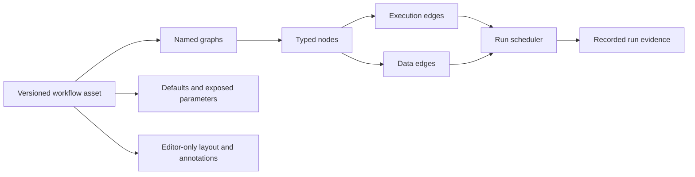

# Unreal Blueprint design reference for Visual Agent Workflow

This is a design and capability reference, not a tutorial for using Unreal Engine. It distills the Blueprint model described in the supplied Unreal Engine 5.7 documentation PDF and turns it into a target architecture for Visual Agent Workflow: a visual programming environment powerful enough to compose complex, reusable, inspectable agent workflows without requiring users to write general-purpose code.

The goal is capability parity at the level of visual programming, not API or runtime compatibility. Visual Agent Workflow should provide the same breadth of authoring concepts that makes Blueprint useful—typed values, event-driven execution, reusable functions, macros, interfaces, object-like composition, exposed configuration, control flow, asynchronous work, debugging, and asset reuse—while specializing those concepts for agent calls, tools, approvals, memory, structured data, human interaction, and durable evidence.

The source material is `/home/xorberax/ebooks/01_unreal-engine-5-7-documentation.pdf`, especially the sections titled **Introduction to Blueprints in Unreal Engine**, **Blueprints Visual Scripting Overview in Unreal Engine**, **Basic Scripting with Blueprints**, **Anatomy of a Blueprint**, **Blueprint Best Practices**, **Blueprint Communication Usage**, and **Blueprint Debugger**. The PDF is a large compiled documentation volume, so page numbers are not stable enough to use as durable anchors; use the section titles when cross-checking it. Unreal concepts below are summarized rather than quoted, and every “workflow” requirement is project guidance rather than a claim about Unreal behavior.

## The central model

Blueprints are a node-based visual programming language. A Blueprint asset contains one or more graphs. Nodes represent events, operations, functions, variables, conversions, or control flow. Wires connect nodes, but not all wires mean the same thing: execution wires schedule work, while data wires carry typed values. This distinction is the foundation of the system.

An Unreal Blueprint can define an object-oriented class or object. A Blueprint Class is saved as an asset, derives from a parent gameplay class, can contain Components, and can be instantiated into a level. All instances inherit the class's components and scripted behavior, while exposed defaults may be overridden per instance. A Level Blueprint is a level-scoped graph for one-off level behavior and references to actors placed in that level.

The useful abstraction for Visual Agent Workflow is not “a graph is a program because it looks like code.” It is:

The graph is a user-facing declaration. The runtime must interpret its explicit contracts; it must not infer scheduling from screen position, topological display order, wire curvature, or the order in which nodes were created.

## Capability target

Blueprint is powerful because it is a complete visual programming environment, not merely a flowchart editor. Visual Agent Workflow should be judged against the same capability categories:

| Capability category | Blueprint provides | Visual Agent Workflow should provide |
| --- | --- | --- |
| Composition | Assets define reusable object/class behavior and can be instantiated many times. | Versioned workflow assets and child-workflow calls with explicit input/output contracts and pinned revisions. |
| Typed programming | Variables, object references, arrays, structs, conversions, and typed pins. | Typed parameters, structured JSON, arrays/maps, references, provider/model profiles, tool results, and visible conversion nodes. |
| Control flow | Events, branches, loops, sequences, gates, timers, and other flow-control nodes. | Triggers, predicates, exclusive routing, bounded loops, parallel fork/barrier regions, retries, waits, approvals, cancellation, and successful termination. |
| Reuse | Functions, macros, function libraries, macro libraries, interfaces, and inheritance. | Callable workflows, deterministic transformation libraries, authoring templates, capability interfaces, and composition without hidden permissions. |
| Configuration | Defaults on assets plus per-instance editable overrides. | Immutable definition defaults plus per-run overrides, host-owned capability resolution, and sensitive-value handling. |
| External interaction | Nodes can act on engine objects, components, input, animation, audio, and level state. | Nodes can invoke approved model providers, MCP tools, skills, services, human approvals, memory stores, and observation endpoints. |
| Runtime inspection | Breakpoints, stepping, watches, call stacks, and execution traces. | Recorded node inputs/outputs, route evidence, child-call nesting, pause/resume boundaries, redaction, historical playback, and controlled debug runs. |
| Asset workflow | Create, edit, compile, save, instance, and reuse assets in a content project. | Draft, validate, publish immutable revisions, run exact revisions, export/import portable definitions, and preserve layout as presentation data. |
| Editor ergonomics | Searchable contextual actions, graph navigation, comments, reroutes, grouping, and clear pin semantics. | The same discoverability, with accessible keyboard alternatives, precise validation, undoable semantic edits, and no hidden execution behavior. |

“Same capability and power” means users should be able to build layered systems rather than only linear prompt chains. A representative workflow should be able to accept structured inputs, select and transform data, branch on predicates, call reusable subflows, invoke approved agent/tool capabilities, wait for a human decision, fan out bounded work, merge results, handle failure or cancellation, and emit a typed result with evidence. Each of those operations needs a first-class contract and editor representation.

The target is not to make every possible behavior a single giant graph. Blueprint's strength comes from moving between levels of abstraction: a compact node can represent a function, a macro, a component, or a class instance while still exposing its meaningful inputs and outputs. Visual Agent Workflow should offer the same progressive disclosure. A user can start with visible nodes, extract a reusable unit when a pattern stabilizes, open that unit when debugging, and inspect the exact revision and capabilities involved in a run.

## Design philosophies to preserve

### Visual programming should be a real programming model

Blueprints expose programming concepts—types, variables, scope, functions, events, control flow, composition, and debugging—through a visual medium. The canvas is not the semantics; it is the primary authoring surface for a typed program. Visual Agent Workflow should therefore define its language model before adding gestures or styling. Every node, port, edge, graph, asset, and runtime state needs a durable meaning that can also be validated, serialized, executed, inspected, and tested without the browser.

### Discovery and correctness should reinforce each other

Blueprint's context-sensitive menus make the next valid operation discoverable from the selected pin or object. This reduces the amount of terminology users must memorize. Visual Agent Workflow should provide the same affordance for data types, execution context, capability scope, and graph position, while still validating imported definitions independently. A palette filter is a usability feature; it is not a trust boundary or a substitute for schema validation.

### Complexity should be managed through abstraction

Blueprints allow a designer to start with individual nodes, then organize them with comments, collapse them into functions or macros, share libraries, or place the behavior behind an interface. Visual Agent Workflow should make that progression natural. Extraction must preserve behavior, port identity, provenance, and tests. Reuse must reduce duplication without hiding side effects, permissions, retries, approvals, or failure semantics.

### Runtime behavior should remain explainable

Blueprint debugging connects a runtime pause to the graph, the node, the current values, and the call stack. Agent workflows add nondeterministic providers and external side effects, so explainability matters even more. The system should record what was scheduled, what input was supplied, which capability was used, which route was selected, what output was returned, and why the run stopped. Visual highlights are useful only when grounded in that evidence.

### The host owns authority

Blueprint assets can reference engine classes and objects because the Unreal runtime owns the world. A portable agent workflow cannot safely own credentials, invoke arbitrary URLs, install code, or grant tools. Workflow assets declare requirements; the host resolves identities, applies policy, issues approvals, and supplies capability implementations. This is a specialization of the Blueprint asset model for a multi-capability agent runtime, not a reduction in visual power.

## Blueprint asset types and their workflow analogues

Blueprint asset types establish scope and reuse boundaries. Visual Agent Workflow should expose similarly obvious scopes, but keep its portable definitions framework-independent.

| Unreal concept | What it means in Unreal | Workflow interpretation |
| --- | --- | --- |
| Blueprint Class | A reusable class-like asset with components, properties, and graphs; instances can be placed in a level. | A versioned workflow definition with explicit inputs, outputs, dependencies, and optional reusable child calls. |
| Level Blueprint | A graph owned by one level, useful for level-specific events and actor references. | A host- or project-scoped orchestration graph only when the behavior is intentionally non-reusable. Prefer a named workflow for reusable behavior. |
| Data-only Blueprint | A derived asset that changes inherited defaults or components without adding execution logic. | A configuration or template revision with no executable graph changes. Keep it distinct from a runnable workflow. |
| Blueprint Interface | Function signatures without implementation; implementing assets provide the behavior. | A versioned capability or workflow contract containing named typed operations, without granting tools or credentials. |
| Blueprint Function Library | Static reusable functions that operate only on supplied inputs. | A catalog of deterministic, host-approved transformations. The library should not carry hidden run state. |
| Blueprint Macro Library | Reusable graph fragments expanded into consuming graphs during compilation. | A reusable authoring template only if expansion, identity, versioning, and audit behavior are explicitly defined. A callable version-pinned workflow is safer when runtime provenance matters. |
| Editor Utility Blueprint | Editor-only automation that acts on the editor or selected objects. | An authoring-time utility, never a runtime workflow node unless its side effects and trust boundary are separately defined. |

Blueprint Classes and Level Blueprints are not interchangeable. Unreal's own best-practices guidance favors classes for reusable behavior and Level Blueprints for behavior specific to a particular level. Apply the same rule here: reusable graph behavior belongs in a named workflow or reusable pipeline; host-specific coordination belongs at the host boundary or in an explicitly scoped orchestration definition.

## Agent workflow primitives

To reach Blueprint-level expressive power for agent work, the node catalog must cover more than “call a model” and “call a tool.” The following primitives are the minimum conceptual vocabulary for a general-purpose visual agent system:

| Primitive | Contract it needs |
| --- | --- |
| Input/output | Named, typed values with defaults, required status, validation, and redaction policy. |
| Literal and parameter | A safe constant or explicit invocation value; never hidden text substitution into a privileged prompt role. |
| Transform | A deterministic operation over typed values, with declared conversion and failure behavior. |
| Agent/model call | Provider/profile identity, role-separated prompt inputs, structured output schema, timeout/cancellation, usage evidence, and host admission. |
| Tool/MCP call | Exact tool identity and version/contract, typed arguments, approval policy, result schema, timeout, retry policy, and side-effect classification. |
| Memory/context | Explicit read/write scope, retrieval limits, sensitivity policy, and whether the value is run-local, workflow-persistent, or host-owned. |
| Predicate/branch | A typed condition with named exclusive or non-exclusive routes and recorded decision evidence. |
| Loop/retry | A bounded body, termination predicate, iteration budget, backoff policy, and accumulated evidence. |
| Parallel fork/join | Named branches, admission limits, join policy, partial-failure semantics, and a result shape. |
| Human approval/input | Request schema, actor/policy scope, timeout, cancellation, resumption identity, and audit record. |
| Child workflow | Pinned revision, explicit arguments/results, nested evidence, failure propagation, and capability scope. |
| Wait/schedule | A durable suspension contract, wake condition, deadline, and ownership/resume policy. |
| Error/recovery | Typed failure routes, compensation or non-compensation semantics, retry eligibility, and terminal status. |

These primitives should be composable in the same way that Blueprint nodes compose. A user should be able to build a small deterministic subgraph, wrap it in a function-like reusable unit, call it from an event-driven workflow, and inspect it as one node without losing the ability to open its implementation. Agent-specific behavior belongs in node contracts and host adapters, not in special cases embedded in the canvas.

An example of the intended abstraction ladder is a customer-support workflow. At the lowest level it can parse a request, retrieve policy text, call a model, branch on confidence, request approval for a refund tool call, and return a response. The same graph can then be extracted into a versioned “RefundDecision” child workflow, exposed through an interface, and reused by email, chat, and batch-entry workflows. Each caller supplies explicit inputs; each run records the exact child revision and capability decisions.

## Data type system and containers

Blueprint's visual language is useful because types are visible at the point of composition. It supports primitive values, object references, arrays and other containers, structs with named fields, enumerations, and conversions. Struct pins can be split into fields; variables can be read or written through explicit nodes; and context-sensitive actions use the selected type to narrow what can be added.

Visual Agent Workflow should have an equally deliberate type system. At minimum, the portable contract needs primitives for text, numbers, booleans, nullability, structured objects, arrays, maps, and opaque references. Agent-specific types should be explicit where they carry policy or lifecycle semantics: model profiles, tool identities, approval requests, memory records, run handles, and evidence references should not be represented as untyped strings. Struct-like schemas should support field-level validation, redaction, defaults, and evolution.

Generic or wildcard pins can improve authoring ergonomics, but they must resolve to a concrete type before publication. Implicit stringification is not a general-purpose conversion strategy. A conversion from structured data to prompt text, or from model output to a tool argument, should be a visible, testable transformation with bounded size and failure behavior. Serialization must be canonical enough for content identity, revision comparisons, and deterministic validation.

Pure nodes deserve a distinct contract. Unreal pure functions have no execution pins and are evaluated as data is needed; they do not cache results merely because they are pure. In this project, pure nodes should be deterministic and side-effect-free. Model calls, tool calls, memory writes, approvals, waits, and other effectful operations must have explicit execution semantics even when their outputs are consumed as data.

## Inheritance, templates, and specialization

Blueprint Classes can derive from parent classes. A child inherits components, variables, and behavior, can change defaults, and can override selected functions. This gives teams a way to establish a base actor or system once and create specialized variants without copying the whole graph.

Visual Agent Workflow should support the same specialization capability, but use immutable composition boundaries rather than hidden mutable inheritance wherever possible. A workflow template or base definition may establish a stable interface, default parameters, reusable subflows, and extension points. A specialized workflow should record its base identity and the changes it applies. Published runs must resolve the complete effective revision, so later edits to the base cannot silently change an existing run.

Function override and extension points need explicit rules: which inputs and outputs may change, whether defaults may narrow or widen, how validation is inherited, how capability requirements are merged, and whether an override can add side effects. If those rules are not defined, prefer a child-workflow call or interface implementation over class-like inheritance. The user should always be able to inspect the effective graph and its provenance.

## Asynchronous, latent, and time-based work

Blueprint includes latent operations such as Delay and movement or animation operations that yield and resume later. Timelines drive values from tracks and curves over time, with update and completion execution paths. These features let a graph describe behavior that spans multiple frames without blocking the editor or pretending that the whole operation is instantaneous.

Agent workflows need the same expressive power for provider latency, tool calls, approvals, scheduled work, streaming, and human-in-the-loop pauses. Treat these as durable state transitions, not as an implementation detail of a browser or process:

| Temporal behavior | Workflow contract |
| --- | --- |
| Await an external call | Correlation ID, timeout, cancellation, retry policy, result schema, and evidence for admission/completion. |
| Delay or schedule | Durable wake condition, deadline, owner, persisted cursor, and behavior after restart. |
| Human approval | Request identity, actor/policy scope, allowed responses, expiration, and resumption identity. |
| Stream/update | Ordering, backpressure, partial-result schema, finalization, and replay policy. |
| Timeline-like progression | A bounded state machine or schedule with explicit time source, sampling behavior, cancellation, and output semantics. |

Do not use a client-side timer as the equivalent of a latent node. Closing the Studio must not accidentally erase a run's suspension state, and reconnecting a browser must not duplicate an external effect. A resumed run must re-enter at a defined cursor with the exact published revision and dependency identities it started with.

## Events, dispatchers, and subscriptions

Blueprint Event Dispatchers let one Blueprint broadcast that something happened to listeners without hard-coding every listener into the broadcaster. They are useful for decoupling a producer from consumers, but they also introduce subscription lifetime and ordering concerns.

An agent workflow equivalent can support named event channels, notifications, or outputs that wake subscribed workflows. The contract must define who may publish, who may subscribe, whether subscriptions are definition-scoped or run-scoped, delivery guarantees, ordering, replay, deduplication, and failure handling. A dispatcher must not become an unbounded hidden fan-out mechanism. For most current workflow composition, explicit outputs and child calls remain easier to validate; event subscriptions are an advanced capability that should be added only with durable ownership and audit semantics.

## Resource, cost, and performance boundaries

Unreal's Blueprint guidance favors event-driven behavior and warns against doing heavy work every frame or growing a single graph until it becomes difficult to read and manage. Visual Agent Workflow has different costs, but the same principle applies: node count, graph fan-out, repeated model calls, large payloads, long loops, and excessive parallelism can make a workflow expensive or impossible to operate.

Every effectful or potentially expensive node should declare useful limits: timeout, retry budget, maximum input/output size, concurrency class, rate/cost estimate where available, cancellation behavior, and whether it is safe to repeat. A bounded loop is not safe merely because it has a maximum iteration number if each iteration can spawn unbounded work. A parallel region needs both branch count and downstream admission limits. Compile-time validation should catch obvious unbounded structures; runtime admission should enforce host policy and quotas.

Observability should expose these costs without turning the graph into a monitoring dashboard. Record node duration, queue/wait duration, attempt count, payload sizes where allowed, provider/tool identity, and terminal disposition. Keep secrets and sensitive content redacted. Provide static analysis for unreachable nodes, duplicate work, unsupported cycles, missing joins, likely repeated side effects, and graph regions that exceed configured limits.

## Components, graphs, and scopes

Unreal Components are the assembled parts of an object: collision, mesh, movement, camera, and similar capabilities. A Blueprint may contain only components and still be useful as a reusable level object. Graphs can reference those components and act on them during construction or gameplay.

Visual Agent Workflow has no Unreal actor/component hierarchy. The closest safe mapping is to treat a workflow as a composition of node contracts, not as an object with ambient mutable properties. A node may declare configuration, inputs, outputs, and host capabilities. It should not silently reach into a shared object graph or acquire authority because it is visually near another node.

Keep these scopes separate:

| Scope | Suitable contents |
| --- | --- |
| Definition | Node identities, node types, typed ports, immutable defaults, validation, and declared dependencies. |
| Invocation | Per-run parameter overrides and caller input. These must not rewrite a published definition. |
| Run state | Values and status created for one execution. Mutable variables require explicit ordering and concurrency semantics. |
| Host capability | Provider catalogs, MCP bindings, approvals, credentials, and runtime policy. A workflow may declare requirements but cannot supply or authorize them. |
| Presentation | Coordinates, labels, comments, sections, wire routes, zoom, and selection. These do not execute. |

This separation is the most important adaptation from Blueprint's instance model. Unreal can resolve references through its object world and class instances. Visual Agent Workflow must make every cross-node value, dependency, and permission explicit in its portable contract.

## Graph kinds

Unreal commonly uses three graph roles:

**Construction Script** runs when a Blueprint actor is created or updated in the editor and helps derive its configured presentation or components. It is not ordinary gameplay execution. A workflow analogue would be authoring-time normalization, preview computation, or validation. Such work must be clearly labeled as authoring-time and must not make live agent or external service calls.

**Event Graph** contains event entry points and the gameplay logic that responds to them. It can have multiple event graphs for organization; the separate canvases do not establish behavior by themselves. For Visual Agent Workflow, an event-triggered graph should use explicit trigger/entry contracts and should not treat multiple disconnected regions as implicitly ordered.

**Function Graph** is a reusable graph with one entry point, parameters, local variables, and outputs. It can be called from other graphs and can communicate across Blueprint instances through a target reference. The workflow equivalent is a reusable, typed node or version-pinned child workflow with an explicit input/output contract.

Do not reproduce Unreal's permissive “any graph can be placed anywhere” model without a contract. Every graph kind in Visual Agent Workflow should state whether it is executable, authoring-only, callable, resumable, observable, and allowed to contain side effects.

## Nodes, pins, and wires

A Blueprint node can expose execution pins and data pins. Execution pins are usually visually distinct and are responsible for activating the next node. Data pins carry values and can often be read by a node only when that node executes. Some connections insert conversion nodes automatically when a compatible conversion exists.

For the workflow implementation, model a port as a first-class identity rather than just a side and label. A port needs at least a stable ID, direction, kind, data type, multiplicity rule, optional/default behavior, and a user-facing label. Edge records should identify source node/port and target node/port. Layout code should consume those identities to draw wires; it must not use node order or text matching.

Execution and data are different semantic channels:

| Channel | Blueprint meaning | Required workflow rule |
| --- | --- | --- |
| Execution | Activates a node and determines which connected action runs next. | Represent scheduling explicitly. A connected data value alone must never trigger a node. |
| Data | Supplies a typed value to an input or reads a typed output. | Validate types and availability. Define whether values are eager, lazy, snapshot-based, or produced only after execution. |
| Branching | Control-flow nodes choose one or more execution outputs. | Encode branch identity and route evidence. Do not infer a condition from layout or a missing wire. |
| Reroute | A visual control point that improves readability without changing semantics. | Store as presentation data only. Reroutes cannot become executable nodes. |

Unreal's editor supports context-sensitive node creation: dragging from a pin filters available actions to nodes that accept the source type or target context. Visual Agent Workflow should use the same discovery pattern because it reduces invalid graphs and makes the graph vocabulary learnable. The filter must remain an authoring aid, not the sole validator. Imported definitions still require complete schema validation.

Pins should carry enough type information to make errors visible before a run. Start with the project's supported portable types and distinguish strings, numbers, booleans, structured JSON, arrays, and references according to the actual runtime contract. Automatic conversion should be narrow, deterministic, and visible in the graph or inspector. Never insert a conversion that changes meaning silently, especially for prompts, tool arguments, approvals, or secrets.

## Events and execution flow

An Event node has no incoming execution pin because an external or engine event activates it. A connected execution wire then runs downstream nodes in order. Custom Events provide named entry points that can be invoked from graphs. Flow-control nodes such as branches choose the next execution path based on a value.

The workflow analogue should use explicit entry points such as input, trigger, branch arm, loop body, fork branch, and termination. Execution edges must be validated as a semantic graph. The current project already distinguishes data links from execution-like behavior and supports bounded conditional, parallel, loop, and termination contracts; this reference does not expand those contracts.

Blueprint's multiple Event Graph canvases are organizational. Likewise, a workflow may split a large definition into named graph views or reusable subgraphs, but a view must not create hidden execution order. The runtime schedule comes from the validated definition and its node contracts.

Event-driven authoring is preferable to an implicit tick loop for most workflow behavior. Unreal's best-practices material warns that heavy work every frame is a poor fit for Blueprint and recommends event-driven behavior where possible. For Visual Agent Workflow, avoid polling, unbounded retries, and implicit “run every update” semantics. Prefer explicit triggers, bounded loops, cancellation boundaries, and recorded transitions.

## Variables, parameters, and references

Unreal variables can hold primitive values such as numbers and booleans, or references to objects and components. Class variables can be shared across graphs in a Blueprint; local variables are scoped to a function and disappear when that function returns. Public/editable variables expose defaults on placed instances, allowing each instance to override the class default without modifying the class asset.

Use this distinction carefully in Visual Agent Workflow:

* Definition defaults are safe starting values stored with the draft or published revision.
* Invocation inputs are supplied for one run and do not mutate the published asset.
* Graph variables are explicit values with stable IDs and declared types. Getter nodes make reads visible; setters require defined run-state semantics.
* Local values belong to one node or bounded subgraph and should not become hidden shared state.
* References identify declared workflow entities or host-provided capabilities; they are not object handles that grant authority.

An exposed parameter should have a stable ID, name, type, default, description, required/optional status, validation rules, sensitivity classification, and override policy. A model profile, skill, MCP server, or credential is not an arbitrary parameter value. It resolves through host policy and catalog identity. The workflow may request a capability; the host decides whether it is available and approved.

Mutable Set/Get behavior is more complex than a visual pair of nodes suggests. Define write ordering, visibility across branches, behavior at retries, and conflict handling before adding it. In parallel graphs, do not permit ambiguous concurrent writes. In loops, define whether each iteration sees the previous value and how a resumed run restores it.

## Functions, macros, and reusable workflows

Unreal Functions are callable graphs with one entry point. They are appropriate for reusable calculations, checks, and behavior that may be targeted at an object or overridden in a child Blueprint. Functions can communicate across Blueprints through parameters and object targets.

Macros look similar at the call site but are graph fragments. They have tunnel inputs and outputs, can expose multiple execution outputs, and are expanded into the consuming graph during compilation. Because they are expansion rather than runtime calls, Unreal's debugger does not show a macro as its own call-stack frame. Macro changes require consuming Blueprints to compile before the change is reflected.

For this project, the distinction maps to two separate implementation choices:

| Reuse form | Use when | Required identity |
| --- | --- | --- |
| Callable workflow/node | Runtime provenance, independent versioning, approval scope, retry behavior, or observability matters. | Stable reference plus pinned revision and explicit input/output contract. |
| Authoring template/macro | The goal is editor convenience and expansion into the current graph. | Template identity/version plus deterministic expansion and a clear record of the expanded result. |

Do not call an unversioned graph fragment a reusable workflow. If an agent, MCP tool, provider, approval, or external side effect is involved, prefer a callable version-pinned unit so audit and playback can identify what actually ran. Reuse should reduce graph complexity without hiding permissions or changing the meaning of the surrounding graph.

## Communication patterns

Unreal documents three major Blueprint communication patterns. Direct communication calls a known function or reads/writes a known variable on a target object. Event Dispatchers let a Blueprint broadcast that something happened to listeners. Blueprint Interfaces define common function signatures that multiple Blueprints implement without sharing implementation.

The corresponding workflow choices are:

* Use a direct child-workflow call or explicit node output when the caller knows the target contract.
* Use an event or notification channel only when subscription lifetime, delivery, ordering, replay, and failure behavior are defined.
* Use an interface or capability contract when multiple implementations should satisfy the same operation. An interface describes shape; it does not authorize invocation or provide credentials.

Blueprint Interfaces cannot add variables, edit implementing graphs, or add Components. Preserve this narrowness. A workflow interface should define operations and types, not smuggle in state, tools, prompts, or host configuration.

## Compilation, validation, and publishing

Unreal's Compile action checks a Blueprint for errors and updates the runtime representation so the latest graph changes work in the level. Save persists the asset. A data-only Blueprint may use a compact editor until it gains graphs or scripted behavior. These affordances suggest a useful workflow lifecycle, but the guarantees must be stronger and explicit:

1. Authoring edits create a draft definition and presentation state.
2. Validation checks node types, port identities, required inputs, reachability, cycles, bounds, dependency references, and policy-sensitive configuration.
3. A successful validation may produce a normalized executable representation, but it does not grant host capabilities.
4. Publishing creates an immutable revision with a stable content identity and captured layout/provenance as appropriate.
5. A run references the exact published revision or an explicitly identified draft; playback reads recorded evidence and never executes live dependencies.

“Compile” should not be presented as equivalent to “safe to run.” Compilation/normalization validates the graph shape. Host admission, approvals, provider availability, and runtime policy remain separate decisions. A graph that is visually connected but lacks a valid capability binding must fail validation or admission with a precise error.

## Debugging and evidence

The Unreal Blueprint Debugger pauses Play-In-Editor or Simulate-In-Editor execution at breakpoints. It supports stepping, watched pin values, a call stack, and an execution trace. Watched values reflect the most recent execution of a node; an unexecuted pin has no current runtime value. Macros appear as part of the calling function rather than as separate call-stack frames.

Visual Agent Workflow should adapt the user experience while respecting its backend-owned run model. Useful equivalents include node-level breakpoints for a controlled local/debug run, recorded node inputs and outputs, route/branch evidence, call-stack-like child-workflow nesting, and an execution trace ordered by actual runtime events. The UI may highlight the node associated with an event, but color or animation must come from recorded evidence, never from wire geometry or selection alone.

Playback must be read-only. It should reconstruct the published revision/layout associated with the run, show which nodes actually executed, and make “not executed,” “blocked,” “failed,” “skipped,” and “value unavailable” distinct states. Do not query a live provider or rerun an MCP call merely to populate a historical view. Redact or omit sensitive values before persistence according to the project's evidence policy.

## Editor and authoring conventions to borrow

Blueprint's editor conventions are valuable because they make a large graph discoverable:

* Searchable, context-sensitive node creation from the canvas and from pins.
* Visible distinction between execution and data pins.
* Named graph tabs for event, construction, and function scopes.
* A variable/function list that provides a stable inventory outside the canvas.
* Comments and visual grouping for explanation, not execution.
* Reroute points for wire readability without semantic behavior.
* Compact cards for common nodes and a details/inspector surface for complete configuration.
* Compile/save feedback close to the graph, with actionable errors.
* Debug navigation that can jump from an event, function, or recorded runtime event to its graph location.

The project already treats labels, comments, sections, coordinates, wire styles, and reroute waypoints as presentation data. Preserve that boundary. Comments are text rendered as text, not instructions to an agent; user-authored labels must not become executable prompt content or schema fragments.

## Completeness criteria

Consider the visual scripting system Blueprint-level only when a user can move through the full lifecycle without dropping into ad hoc code or hidden host configuration. The system should support authoring a typed graph; extracting reusable logic; specializing a template; composing event, data, conditional, loop, parallel, wait, and approval behavior; invoking approved agent and tool capabilities; validating and publishing an immutable asset; running a precise revision; pausing and resuming where the contract allows; inspecting actual execution; and replaying evidence without re-execution.

The implementation is incomplete if any of these capabilities exists only as a visual placeholder. A node that renders a model call but cannot declare its profile, input roles, output schema, timeout, approval boundary, and evidence contract is not a finished Blueprint-equivalent primitive. A graph that can be drawn but cannot be validated, serialized, versioned, admitted, executed, and debugged is an editor mockup rather than a visual programming system. A reusable node that hides its dependencies or changes behavior when its source is edited is not a safe function or asset.

Use the following questions as a review gate for every new capability. Can a user discover it from the right pin or context? Can the graph explain its inputs, outputs, side effects, and failure routes? Can the runtime execute it without relying on canvas position or browser lifetime? Can a published run identify the exact implementation and capabilities it used? Can the debugger show what happened and what did not happen? Can an imported definition be rejected safely? Can the behavior be tested with deterministic fixtures without claiming that a fixture is a live provider?

## Design constraints for Visual Agent Workflow

The following constraints are the practical implementation checklist derived from the source material and this project's existing contracts:

1. Make execution edges and data edges visually and structurally distinct.
2. Give every node and port a stable identity independent of position, label, or display order.
3. Require explicit typed contracts for inputs, outputs, parameters, conversions, and defaults.
4. Keep reusable behavior versioned and distinguish callable units from authoring-time expansion.
5. Separate definition defaults, per-run inputs, run state, host capabilities, and presentation metadata.
6. Treat interfaces and catalogs as descriptions; host policy supplies authority, credentials, and approvals.
7. Prefer events and bounded operations over implicit polling or unbounded tick-like execution.
8. Validate imported graphs as untrusted declarations, even when the editor would have prevented the same error.
9. Preserve immutable published revisions and make playback evidence-only.
10. Make runtime status and failure semantics visible in the graph inspector and recorded evidence.
11. Keep comments, sections, labels, and reroutes organizational; never infer execution from them.
12. Prefer small, readable, reusable graphs over a single sprawling canvas, but do not hide important side effects inside opaque nodes.

These constraints complement [Blueprint-inspired workflow authoring guidance](blueprint-authoring-guidance.md), [graph editor](graph-editor.md), [workflow parameters](workflow-parameters.md), [conditional graphs](conditional-graphs.md), [parallel graphs](parallel-graphs.md), [bounded loop graphs](loop-graphs.md), and [nested workflows](nested-workflows.md). They are implementation guidance for Visual Agent Workflow, not a claim that the project implements Blueprint compatibility.
