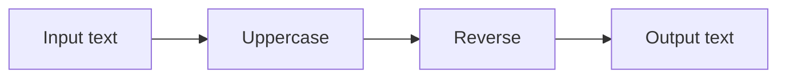
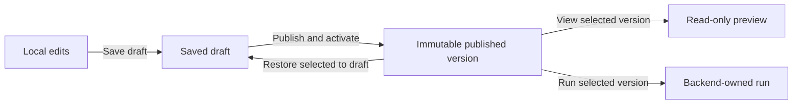

# Studio user guide

The Studio creates and runs linear string-processing workflows. It supports deterministic transforms, host-approved MCP text tools, and a deterministic demonstration agent. Free placement and wire routing organize the graph; they do not add branching or change execution order.

Use disposable text in the local development app. It records inputs, outputs, and comments in local storage without workspace authentication or payload encryption.

## Start the app

From the repository root, with the SDK pinned by `global.json` installed:

```sh
dotnet restore --locked-mode
dotnet build --no-restore --configuration Release
dotnet run --project src/VisualAgentWorkflow.Studio --configuration Release --no-build -- --environment Development
```

Open the loopback address printed by the host, normally port 5099. Keep the backend process running while executing workflows. Closing the browser leaves backend runs running; stopping the backend interrupts unfinished runs.

## Create and edit a workflow

1. Select **New workflow**. The draft begins with input, one transformation, and output.
2. Choose **New node operation**, then use **Add node after** on an existing non-output node. Transformations, available MCP tools, and available agent providers appear here.
3. Change a processing node's operation using its dropdown. Use **Move up**, **Move down**, or **Remove** to change the connected execution sequence. Use **Undo edit** and **Redo edit** to recover local edits.
4. For an agent, configure its instructions and requested tools. The demonstration provider explicitly does not interpret instructions. Selecting a tool does not grant access; the backend checks policy when it runs.
5. Select **Save draft** to persist definition and layout. Unsaved changes block switching workflows and publication until saved or discarded.

The following diagram shows supported execution, not the spatial arrangement of cards. Uppercase and reverse are example deterministic steps.



## Organize the canvas

Drag a node header to place its card. Arrow keys move it by 8 logical units; Shift increases the step to 40. Drag empty background or use scrollbars to pan. Zoom changes the view, not the saved graph coordinates. **Arrange nodes** restores generated positions while retaining annotations and pinned routes.

Open **Labels, comments, sections, and wire routing**. Select **Node to organize** to edit a label, comment, or X/Y coordinates. Labels never replace stable node IDs, and comments are text rather than executable agent instructions.

To create a labeled section, enter **New section label**, check its member nodes, then select **Group selected nodes**. Drag the section header to move all members in one edit. Rename the section or use **Ungroup** in the inspector. Membership is explicit; simply placing a card inside a frame does not join it. A node belongs to one section at a time.

Double-click a wire to add a reroute point, or select a wire in the inspector and use **Add reroute point**. Move points with the mouse, arrow keys, or coordinate fields. **Pinned angle** fixes the tangent; curved wires also accept custom degrees. **Right-angle** style constrains bends to orthogonal segments. **Reset wire route** removes the routing points without deleting the connection. These edits share the same undo/redo history as other draft changes.

## Save, publish, and restore

Saving changes a draft; publishing creates a numbered immutable version and activates it for future active-version runs. Selecting and viewing a version does not replace the current draft. **Restore selected to draft** copies the historical definition and layout into a new draft generation. Publish afterward to create a new version. **Activate selected version** changes the active pointer without rewriting publication history.



Choose a **Published version** and select **View selected version** to inspect its saved positions, comments, sections, and wire routes. **Return to draft** resumes local authoring. If another editor saved first, the conflict message preserves your local work. Review/export it before choosing **Discard local changes and reload**. There is no automatic merge or simultaneous-edit synchronization.

## Run and inspect

For a quick test, choose a pipeline in **Quick template run**, enter **Input**, and select **Start independent run**. For a saved workflow, enter **Published run input** and select **Run selected version**. This uses the selected immutable revision, including when the draft has unsaved edits.

Select a run under **Recorded runs**. Click a node's execution card to inspect its recorded input/output. **Previous event**, **Next event**, the recorded-position slider, and **Follow latest** control playback. Green wires correspond to recorded transfer events; moving cards cannot fabricate execution evidence. Historical viewing makes no live model/tool calls. **Cancel selected run** explicitly requests cancellation; closing the page does not.

## Share and recover local work

**Import / export definition** provides executable JSON and a separate graph-layout sidecar. Export into the editor or use the download links. Import validates the graph, retains the current workflow identity, and remains local until saved. Layout import validates node/connection references against the current definition. Neither import grants tool permissions, installs assemblies, or executes a workflow.

The catalog and run history survive normal host restarts. Unsaved browser edits do not. Interrupted runs are recorded as interrupted rather than automatically retried. A stale tool contract, unavailable provider, denied grant, or oversized input can fail a run; inspect its evidence and correct the draft/configuration rather than assuming it was rolled back or retried.

Branches, arbitrary socket rewiring, nested sections, full reusable prefab assets, collaborative editing, live model configuration, durable approvals/recovery, and production authentication remain future work. Follow [implementation status](implementation.md) for current scope and [graph controls](graph-editor.md) for detailed limits.
