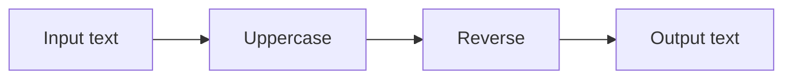
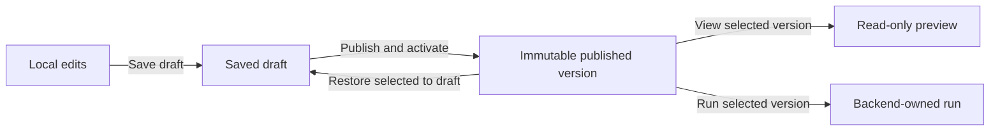

# Studio user guide

The Studio creates and runs linear and conditional workflows, up to four sequential two-branch parallel blocks, one bounded linear-body loop, and bounded Boolean decision graphs, with bounded text and JSON input. It supports deterministic transforms and text templates, workflow-owned typed scalar parameters, host-approved MCP tools with bounded structured JSON inputs, a deterministic demonstration agent, and opt-in host-configured external model providers. Templates combine the incoming string with declared parameters using explicit tokens; they do not provide expression evaluation. JSON input can be reduced to text with a pointer selector or mapped into a bounded JSON object with the **Project JSON fields** node. This is an explicit static projection, not a general-purpose mapping language or dynamic object port system. The typed graph preview grows in opt-in schema steps: schema 1.23 enables separate execution/data pins and pure text values; schema 1.24 adds typed Boolean comparison and branching; schema 1.25 adds Boolean constants and NOT; schema 1.26 supports bounded nested branches, reconvergence, and multiple termination exits; schema 1.27 supports embedded pure graph functions. Studio includes a local Function library and graph editor for immutable function revisions, with exact snapshots embedded in workflow call nodes. Free placement and wire routing organize the graph; only explicit control nodes change execution semantics.

Use the **Theme** selector in the top navigation to switch between **Dark Modern**, **Light Modern**, **VS Code Dark+**, **Solarized Dark**, **Nord**, **Monokai**, **GitHub Dark**, **GitHub Light**, **Dracula**, and **High Contrast**. The Studio remembers the choice in this browser and keeps it when you move between the designer, settings, and observation pages. The graph canvas and nodes use colors coordinated with the selected shell theme. The graph is fitted and centered when the editor attaches; its grid fills the viewport and tracks pan and zoom. Embedded hosts can customize inherited theme tokens independently; see the [editor design system](design-system.md).

All Studio pages share the same full-width navigation, project selector, theme selector, active-page indication, content surface, and responsive spacing. At phone widths the navigation wraps and page content reflows; the graph itself keeps its own scrollable viewport. The same checks run across every Studio route at normal size and at 200% text size.

Use disposable text in the local development app. It records inputs, outputs, and comments in local storage without workspace authentication or payload encryption.

## Organize work with projects

Select **Projects** in the Studio navigation to create and open a local project, archive it, or restore it. The workflow editor, Agent Designer, Skill library, and Function library follow the selected project. The first project is **Default Project**; when an older Studio data directory is opened, the Studio copies its workflow catalog and skill/profile/function files into this project and keeps the original files as a recovery copy.

Projects organize local authoring. Model provider and MCP connection settings remain environment-wide because they contain endpoints, credentials, and host registrations. Choosing a tool in a project does not grant it permission; the current development host still applies its local broker policy. Run history is also host-wide. Archived projects are omitted from the selector, and their data is retained; restore an archived project from **Projects** to open it again.

On **Projects**, choose **Download source snapshot** for a deterministic ZIP containing workflow and asset JSON with a manifest and content hashes. You can **Import as new project** to restore a validated snapshot into a separate catalog-backed Studio project; it does not merge with or replace an existing project. To work directly in Git source, choose **Open folder** in the navigation and enter the absolute path to a validated project folder. The folder is added to the project selector and project list and opens in a project tab. Open up to eight folders together, then switch tabs to move between their independent trees and editor buffers. Tab order and selection persist in Studio-local settings; unsaved buffers stay in the current browser session and are not recovered after refresh or restart. The project explorer groups manifest-indexed files by directory. Select a workflow file to open it in the graph editor, a skill to create a new immutable revision with a typed form, an agent profile to create a new immutable profile revision, or a graph function to edit its typed interface and pure graph. Saving adds a content-addressed source file and updates the project manifest; older versions remain unchanged. Profile requirements for model connections and MCP tools remain logical IDs, not copied credentials or grants. Folder workflows can use project skills, agent profiles, and graph functions alongside the host's configured providers and MCP bindings. Graph-function edits are saved as new immutable project revisions; the selected file and any workflows embedding earlier snapshots remain unchanged. The editor supports deterministic string/Boolean function graphs only. Graph-function source assets preserve canvas node placement, labels/comments, sections, and wire presentation in a versioned Studio authoring envelope; this presentation does not change the function's executable content hash. Legacy graph-function files without the envelope open with an automatically generated layout because their former layout was not stored. Changes to workflow definition and layout remain local to the editor until you choose **Save source file**. Only the active folder tab listens for filesystem notifications and revalidates the full project snapshot every 20 seconds to catch missed events. Inactive folders stop watching and revalidate when you return to their tabs. If it detects a change, a clean editor offers **Reload project files**. With unsaved edits, Studio preserves the editor buffer and offers **Discard local edits and reload folder**; choose it only when you want to abandon those edits. Reload rereads and validates the folder at the time you click. If a Git checkout is temporarily inconsistent, the conflict remains visible until the folder is valid again. Save operations also reject stale content they detect, but this check cannot lock out concurrent external writers. Closing a tab with unsaved edits asks you to keep it open or explicitly discard those edits. Folder editing has no publish or run controls. Its project-specific catalog API routes return HTTP 409 until folder-backed publishing and execution are implemented. The Projects list can download a validated source snapshot directly from the folder. The project folder contains no run history; the Studio host's configured run store remains the audit source. You can now export selected saved workflows as a consumer `.vawpkg`; the release is separate from the editable source snapshot. See [project folders and workspaces](project-workspaces.md) for file format and migration stages.

## Build a consumer release

Open a folder project and save any workflow edits you want to include. In **Build consumer package**, select one or more workflow entry points and choose **Download selected workflows**. Only selected workflows must pass executable validation, so unfinished drafts elsewhere in the project stay out of the release. The archive includes a manifest, validated workflow packages, layouts, embedded snapshots, and their derived host requirements. It does not include project source files that were not selected, Git data, `.vaw/`, MCP endpoints, model credentials, grants, or run history. Review prompts and other user-authored workflow text before sharing.

A consuming service loads the archive with `WorkflowProjectPackageJson.Read` or uses the standalone [WorkflowService sample](../samples/WorkflowService/README.md). The consumer chooses an entry workflow and resolves provider, MCP, and node requirements using services it has registered. The host must still authorize tools; a package requirement never grants access. This format validates integrity but is not signed, does not install assemblies or services, and does not activate a deployment. Folder workflows still cannot be run from inside Studio itself.

To convert a catalog-backed project into a Git folder, first stop Studio, then run `dotnet run --project src/VisualAgentWorkflow.Studio -- --migrate-project-to-folder <project-id> <new-folder>`. Include `--environment Development` when required by your local launch setup, and configure `WorkflowStudio:DataDirectory`/`WorkflowStudio__DataDirectory` the same way as Studio. The destination parent must exist and the destination folder itself must not. The command preserves the project ID and current editable workflow drafts, layouts, skills, profiles, and graph functions. Published/revision/audit history and run data stay in Studio's data directory; credentials and MCP grants are not copied. Studio and the command share an exclusive data-directory lock; the command fails if a Studio process is still using that directory. If Studio stops during migration, its next startup validates the journal and completes a published migration before opening writable project services.

## Restore a project folder snapshot

In an open folder project, use **Create restore point** after saving or discarding editor changes. Studio validates the complete current manifest and its indexed files, then saves a content-addressed copy under `.vaw/snapshots/`. The first restore point adds `/.vaw/` to the project `.gitignore`, preserving existing ignore rules. A project can hold up to 20 restore points and 256 MiB; Studio does not silently remove old points when the limit is reached.

Choose **Preview restore** to compare the captured manifest with the current source. Studio blocks restore while there are unsaved editor changes or an external folder conflict. Confirm **Restore this project snapshot** to switch the manifest to that validated source state. Studio keeps newer immutable files and unindexed files on disk, so inspect the change in Git afterward. A restore point is for source recovery only; folder-backed workflows cannot be run from snapshots yet. You can delete individual restore points from the list or remove `.vaw/` in your file manager; doing so never changes the project manifest or source files. Corrupt or missing sidecar data disables local restores but does not prevent opening or exporting project source.

## Build workflows for your own service

Studio can act as an IDE for workflows that your own application will run. You can also embed the designer in your application or use the engine without a designer. These are independent integration choices.

Today, you can export reviewed workflow definitions/packages and use the lower-level .NET execution libraries from host code. A standalone service/worker sample and shared local-runtime DI registration are implemented; Studio is not required for execution. Stable NuGet distribution and a production hosting SDK remain planned. See [service integration](service-integration.md) for available entry points and host responsibilities. The controls below describe authoring and testing in the development Studio, not deploying an authenticated production service.

## Start the app

From the repository root, with the SDK pinned by `global.json` installed:

```sh
dotnet restore --locked-mode
dotnet build --no-restore --configuration Release
dotnet run --project src/VisualAgentWorkflow.Studio --configuration Release --no-build -- --environment Development
```

Open the loopback address printed by the host, normally port 5099. Keep the backend process running while executing workflows. Closing the browser leaves backend runs running; stopping the backend interrupts unfinished runs.

## Configure model providers

Open **Studio settings → Model connections** and select **Add connection**. Enter a stable connection ID, display name, served model ID, endpoint, and timeout. For LM Studio, use `http://localhost:1234/v1`, enable **Allow unencrypted HTTP for this endpoint**, and leave the API key empty unless authentication is enabled. The same form works with Unsloth and other OpenAI-compatible APIs. Context window and input/output prices are optional observability metadata. Select **Add connection**. The key is protected in local Studio storage and is never returned to the settings page.

To change a connection, select **Edit connection** on its card and save. Keep the ID unchanged: agent nodes and profiles reference that ID, so the edited model, endpoint, default timeout, and metadata apply to future runs using that connection. A configured agent-node timeout takes priority; the connection timeout is used only when the node timeout is blank. Leave the API-key field blank to keep the stored key, or choose **Remove the saved API key** to clear it. Run history records the model descriptor and reported token usage used at the time; playback does not make live calls. The graph viewer displays tokens, context usage when a context window is configured, and estimated cost when both token prices are configured. During an in-flight model request, it labels context usage from the last completed response as stale until new usage arrives. It also shows the number of recorded host compactions; provider-internal compactions are not observable, and the current adapter does not configure a host compaction strategy. The cost is an estimate based on reported usage, not the provider's bill. Delete a connection only when you are ready for references to fail provider preflight until they are updated or the connection is restored. Settings are served by the loopback-only unauthenticated development Studio; do not expose it through a public proxy. See [provider settings and runtime bounds](model-providers.md).

## Create and edit a workflow

1. Select **New workflow**. The draft begins with connected Input and Output nodes. Give it a descriptive **Workflow name**; the generated workflow ID stays stable for references and integrations. Existing workflows without a saved name continue to display their ID until named.
2. Search the **Node library**, then click an action to insert it after the selected node. The insertion hint names the path; select **Insert on output** for a condition's true or false arm. Click insertion opens space downstream. Drag an action onto the canvas to choose its position, or onto a wire to insert on that path.
3. Right-click the canvas, a node, or a wire for **Graph actions**. You can also focus the canvas and press Space or Shift+F10, search for an action, and use arrow keys to navigate. Drag an output socket to a compatible input socket to connect or rewire it; the target pin highlights when it can accept the connection. Reconnecting a pin replaces any wire already attached to that input or output, and the change can be undone. Right-click a wire and choose **Disconnect wire** to remove it. Drag an output socket onto empty canvas to create a step on that exact path. Escape cancels the menu. Select a node to configure it in the properties panel. Change a processing node's operation using its dropdown. Use **Move up**, **Move down**, or **Remove** to change the connected execution sequence. Use **Undo edit** and **Redo edit** to recover local edits.

Drafts may be incomplete while you edit. A visible **Workflow validation issues** panel lists the exact unresolved paths and messages; **Save draft** remains available, while publish and activate controls stay disabled until all issues are fixed. Runtime and published-run APIs validate before execution, so an incomplete draft cannot run. Definition, layout, and package exports are also disabled until the graph validates.
4. For an agent, set **System instructions**, choose a provider, and select its requested tools. Set **Maximum output tokens** from 1 to 16,384 for each response; existing workflows default to 1,024. In schema 1.29 or later, choose **Workflow input** as the source to make this limit configurable at run time; only integer parameters with an in-range default are offered. The run override is checked against the same range before execution starts. Optionally set **Maximum total tokens** from 1 to 100,000 across the agent and its delegated profiles, or bind it to an integer workflow input in schema 1.29+. This requires provider-reported usage; without it the configured budget fails closed. A prompt may itself exceed the limit, and parallel requests already in flight can finish beyond it, so this is not a billing guarantee. Set **Maximum model turns** to a positive integer (default 8), or enter **-1** for unlimited turns; **0** is invalid. The first model response counts as turn one, including tool-call rounds. Timeout and token limits can still bound execution. Optionally set **Agent timeout in seconds** to any positive whole number. This per-node timeout takes priority over the model connection's default timeout; leave it blank to use that connection default. Enable **Require a structured result** to require one `submit_result` call with a success/failure status and JSON object payload. The agent output becomes JSON; connect it to **Select JSON property** at `/status`, then to a Condition to route `success`, `reported_failure`, `turns_exhausted`, `tokens_exhausted`, `token_usage_unavailable`, `timeout`, `invalid_result`, `provider_error`, or `tool_error`. Host cancellation still cancels the run. The endpoint or model may enforce a lower output-token cap. Providers that advertise reasoning controls show **Reasoning effort**. **Off** asks for no reasoning, while **Provider default** leaves the choice to the endpoint; compatible endpoints may ignore either preference. Use **Customize user message** to edit one readable text template. Type `{{` to open matching value suggestions, then use Tab and Enter or click a suggestion. `{{input}}` inserts the incoming graph value; `{{parameter:ID}}` inserts a declared workflow parameter. Write a backslash before `{{` for literal opening braces. The preview uses sample input and parameter defaults; each run renders actual values before the model call. The demonstration provider explicitly does not interpret instructions. External providers send system instructions, the resolved user message, and assigned tool results to the configured endpoint. Selecting a tool does not grant access; the backend checks policy when it runs.
5. To let the agent choose a workflow path, edit **Agent-selected execution routes** in schema 1.30 or later. Enter one route per line as `stable-id | Label | Description`, then wire each labeled execution output pin to its destination. The provider must support function calling. The agent chooses using the internal `select_route` function; its route is followed only after the agent succeeds. A missing or invalid choice fails the agent without activating a path. Removing a route leaves its old connection as a visible validation issue; drafts can be saved, but publishing and running remain blocked until you rewire or remove that connection.
6. Select **Save draft** to persist definition and layout. Unsaved changes block switching workflows and publication until saved or discarded.

### Try the typed graph preview

The preview is an opt-in starting point for a blank draft with only the connected Input and Output nodes. Select **Start typed graph preview** in the node library. It keeps the existing data connection and adds a separate execution activation from Input to Output. The library then offers **String constant** and **Concatenate text**. Add both without relying on automatic wiring, edit the constant value in its properties, then connect Input's string output and the constant to the two concatenation inputs, and connect the concatenation output to Output's data input. Rewire the original Input-to-Output data edge to the concatenation output. The execution wire remains a separate route; it does not carry the string value.

When that explicit data graph is valid, choose **Enable Boolean Branch preview** in the node library. Schema 1.24 exposes **Compare strings**, **Boolean Branch**, and **Terminate workflow**. Connect two string sources into Compare strings, connect its Boolean output to the Branch condition input, and wire Input execution to Branch. Route Branch `true` to Output and `false` to a Terminate node whose outcome is **Failure**. Connect a string data source to Output's data input. The comparison uses ordinal, case-sensitive equality: no whitespace removal, case folding, or text-to-Boolean conversion occurs. Branch starts one route only. Its selected output and the pure values it read are recorded in the run audit, and playback never reevaluates the graph. Schema 1.26 supports bounded nested Branch nodes and reconvergent routes; see the next subsection for its topology and validation rules.

For Boolean logic, first validate the schema 1.24 branch graph, then choose **Enable Boolean primitives**. This upgrades the definition to schema 1.25 without changing existing connections. The **Values** section now offers **Boolean constant** (defaults to `false`, configurable in node properties) and **Boolean NOT**. Add either node unconnected, then wire compatible Boolean data pins yourself. Constants preserve an explicit `true` or `false` value in the workflow definition. NOT inverts its connected Boolean input. Both nodes are pure: they run only when a downstream node requests their value, and their typed results are recorded for playback. There is no implicit conversion from strings.

To build a larger decision graph, validate the schema 1.25 draft, then choose **Enable branch topologies**. This upgrades to schema 1.26 without changing existing edges. You can now add up to eight Boolean Branch nodes and 16 Terminate nodes. Wire each Branch's `true` and `false` execution sockets to another Branch, Output, or Terminate. An Output or Terminate may receive multiple mutually exclusive incoming routes, so branches can converge without a Merge node. Each reached node runs once, regardless of how many alternative routes enter it. The graph must be acyclic and have a structural path to Output; validation cannot determine whether data-dependent predicates will select that path at runtime. Therefore a graph can validate but still terminate on every run for the values it receives. Terminate nodes can independently mark their exit successful or failed. The Studio records the selected arm, activated edge, evaluated Boolean values, and terminal outcome for playback.

For signed integer values, first validate a schema 1.30 agent graph, then choose **Enable integer graph values**. Schema 1.31 adds an **Integer constant**, **Add integers**, **Compare integers**, and a typed **Workflow value**. Integer pins represent signed 64-bit values; add is checked and an overflow fails the run. You can compare the result as a Boolean and wire that into the existing Branch. Select an integer constant to edit its value. A workflow-value pin matches the selected parameter's type; string, Boolean, and integer parameters are supported, while decimal `number` parameters remain unavailable as graph pins. Data wires never activate nodes, and Boolean Branch routes still control execution. The Output node returns integer and Boolean values as invariant text and records the typed value in its audit event. Older workflow schemas keep their original string behavior and are never silently upgraded.

Save the draft as usual. A valid graph can run and publish; disconnected or incorrectly typed pins remain editable but block both. In Run inspector, the recorded cursor highlights each evaluated data wire and the selected pure node shows its recorded value. Playback reads the stored events without recalculating the graph. This is still a deliberately narrow explicit graph subset and does not add Agent or MCP execution steps. See [deterministic visual programming](graph-values.md) for the planned expansion.

### Create and reuse pure graph functions

Open **Function library** from the top navigation. Select **New function** to start with a string input, a fixed `!` suffix, text concatenation, and a string output. The function ID stays stable across revisions; each saved version is immutable. Set its name, description, and folder, then edit the interface by adding, renaming, removing, or changing the type of named input and output pins. Current interface types are `string`, `boolean`, and `integer`.

Use the Function nodes palette to add string constants and operators, Boolean constants and NOT, or integer constants, checked addition, and integer equality. Added nodes are unconnected. Drag compatible data sockets to build a data-only graph. Select a node to edit its constant or remove it. The validation panel explains missing boundaries, incompatible pins, cycles, or other issues; saving is disabled until the function is valid. Function bodies are limited to 64 nodes, 128 connections, 16 inputs and 16 outputs, and 16,384 characters per string. Control flow, MCP calls, agents, external effects, and arbitrary code are not supported in functions.

Choose **Save immutable function version**. To make a change, select **New version from this function** on a saved revision, edit the copy, and save the next version. Folder changes organize the local library without changing the function content hash. Deleting a library entry does not change any workflow that already embeds its snapshot.

To call a function from a workflow, first validate a Boolean-primitive workflow and choose **Enable pure graph functions**. The node library lists saved function revisions. Add the exact revision you need, then connect compatible data pins to its named input/output sockets. The call node contains the immutable definition and hash; no service-side function catalog lookup occurs. Publish and export the workflow normally. The consumer only needs the workflow package and any ordinary provider/MCP registrations used by the rest of that workflow. Function library CRUD is local to this Studio; standalone function-package import/export and draft collaboration are not implemented yet.

### Expose pure graph functions as agent tools

1. Create and validate the pure function you want the agent to use. Give it a clear name and description and define named inputs and outputs; those become the tool contract the model sees.
2. In a valid schema 1.27 workflow, choose **Enable agent function tools**. Select the Agent node and use **Graph function tools** in its properties to assign the exact saved function revision. The agent receives only the selected revisions, up to eight; adding another function revision to the library does not silently expose it.
3. Connect the Agent node's execution pins as usual. The function call result is returned to the model as a JSON object with the declared outputs; the Agent node's data output remains the agent's final response for downstream workflow nodes.

The runtime validates arguments and rejects undeclared inputs. Calls are limited to 16 per agent invocation, 1,024 aggregate evaluated graph nodes, and 65,536 aggregate input and output characters. Audit records capture the exact function hash, inputs, outputs, evaluated values, and failures. Run playback displays these records without calling the model or reevaluating the function. Graph functions are pure: they cannot use the agent's MCP tools or perform external I/O. Use an explicitly assigned MCP tool for external services.

### Define reusable workflow inputs

1. Expand **Workflow parameters** above the graph. Add a parameter with a stable ID, display name, default value, and optional description that explains how to use it. The description appears as help text when editing or running the published workflow. Choose Text, Integer, Number, True/false, or Choice. Choice values are comma-separated and the default must be one of them. IDs accept letters, digits, dashes, and underscores; values are limited to 16,384 characters.
2. Add a **Workflow value** node from the **Inputs** section of the node library. Select which parameter it reads in the node properties. The node replaces its incoming string with that parameter and passes the selected value to the next node, so the data path stays visible in the graph.
3. Save and publish the definition. The parameter schema and defaults travel with the workflow package. When running a published version, edit the displayed parameter values to override defaults for that run. The effective values are captured in the run header and shown in the playback inspector.

Typed parameters remain immutable workflow configuration; they do not create mutable graph variables or expose credentials. A choice parameter with `default,off,low,medium,high` can be assigned to an agent's **Reasoning effort** setting. In schema 1.29+, integer parameters with valid defaults can also configure the agent's **Maximum output tokens** and **Maximum total tokens**. These run-time bindings do not permit changing provider connections, tools, skills, endpoints, credentials, or host grants. Run overrides never alter the published definition, are validated against type, choices, and the bound setting's range before execution, and appear in audit/playback. Because the local run store records inputs and parameter values, do not enter secrets or sensitive information.

### Build text with a template node

Add **Text template** from the node library on the selected path. The node starts by passing through its incoming text. In the properties panel, enter ordinary text and insert `{{input}}` for that incoming value or `{{parameter:ID}}` for a declared workflow parameter. Suggestions appear as you type `{{`; the preview shows sample input and parameter defaults. Write `\{{` for literal opening braces. Save the workflow and run it with an input and optional parameter overrides; the node's rendered output and outgoing transfer are recorded for replay. Templates are structured literal/reference parts, limited to 64 parts and 8,192 characters of stored text; rendering is bounded to 16,384 characters. There is no expression evaluation, model call, or side effect in this node.

### Select and project JSON input

Select the **Input** node and choose **Use JSON input and add a value selector**. The Studio changes that entry input to JSON and inserts a selector before the existing string path. Set the selector's **JSON Pointer** using RFC 6901 syntax, such as `/customer/name` or `/items/0/id`. A selected JSON string becomes plain text; numbers, booleans, null, objects, and arrays become compact JSON text. The selector accepts at most 16 path segments and 1,024 pointer characters; workflow JSON input is bounded to 16,384 characters and a maximum nesting depth of 32. Its string output can feed existing text, agent, tool, and output nodes.

To build a smaller JSON object, first use **Use JSON input and add a value selector** to switch the Input to JSON. Select Input and add **Project JSON fields** from the node library; it is inserted before the initial selector. Select the projection node and add rows in its properties: each row names an output property and gives the JSON Pointer for the source value. For example, map `customerName` to `/customer/name` and `total` to `/orders/0/amount`; the node emits `{"customerName":"Ada","total":42}`. It supports 1–16 uniquely named fields. Choose a value kind for each field. Scalar kinds validate the selected value. Choose **object** to open a property mapper: add output properties, give each a JSON Pointer relative to the selected object, choose its value kind, and mark it optional if missing input should omit it. Choose **array** to define how each item is mapped; its item pointer is relative to that item. Nested contracts can map objects inside arrays and arrays inside objects. Only declared object properties appear in the result. A missing required pointer or mismatched value kind fails at the projection node and records a safe path/type explanation without echoing the selected value. `any` preserves the selected value. Contracts are limited to depth 8, 128 schema nodes, 16 properties at each object, 64 items per array, and 16,384 characters of mapping configuration. Keep the selector after the projection to convert a chosen value to text for an agent or string tool. Remove that selector if the workflow should return the projected JSON object directly. Input and resulting JSON are each bounded to 16,384 characters; JSON nesting is limited to 32. Invalid JSON or a pointer that does not resolve fails the run and is visible in recorded evidence. Removing the original input selector restores text input when the selector is the input's only JSON consumer.

### Configure MCP servers and skills

Select **MCP library** in the top navigation. Choose **Streamable HTTP** for a remote/local HTTP server, or **Local process (stdio)** to have Studio launch a local executable. HTTP requires HTTPS except on loopback; its optional bearer token is stored encrypted. For stdio, enter the executable and its arguments on separate lines, with one argument per line. You can set a working directory and explicit process environment values; values are encrypted in Studio settings. Studio starts the process as the same OS user, without a shell and without inheriting the Studio environment. This is not sandboxed: only configure commands and packages you trust, and do not put secrets in arguments.

For example, Brave Search's current MCP server defaults to stdio. Install Node.js 22 or newer, get a Brave Search API key, then create a stdio connection with executable `npx`, arguments `-y`, `@brave/brave-search-mcp-server`, `--transport`, and `stdio` (one per line), and environment variable `BRAVE_API_KEY` set to your key. Leave working directory blank unless needed. Keep the server process local to the Studio host; VAW starts it when discovering or invoking tools. The API key is for Brave and belongs in the server environment field, not the HTTP bearer-token field. See [Brave's setup documentation](https://github.com/brave/brave-search-mcp-server#configuration).

Enter a stable server ID, display name, and optional folder, then select **Discover tools**. Discovery shows compatible tools and an **Excluded tools and compatibility reasons** list. Review each compatible tool's description, input summary, schema hash, and description hash. Check the tools this Studio may offer, then select **Save server and selected tools**. Return to the designer, select **Refresh MCP tools**, and expand **Tool details** beside a tool on the agent node to review it before assignment. The description is provided to the model and its hash is pinned independently from the input/output schema; older workflow bindings without a description pin remain readable. Tool arguments may use nested bounded objects and arrays of `string`, `integer`, `number`, and `boolean` values. Required/optional properties, scalar enums, string/array length bounds, string patterns, and numeric minimum/maximum values are enforced by the broker. Patterns must use the .NET non-backtracking regex subset, be at most 256 characters, and match within a 50 ms limit. JSON Schema `default` is annotation-only: `default: null` does not make a string or integer argument nullable or optional; requiredness comes from the schema's `required` list. If `additionalProperties` is omitted, Studio treats the object as closed. Arrays without explicit bounds are capped at 64 items. Other limits are 32 declared properties per object, depth 8, 8,192 characters per string, 1,024 values, 65,536 characters per call, and 16,384 characters per schema. Unsupported JSON Schema keywords, unions, references, and non-text results are not supported. For an explicit MCP node, ordinary input text is supplied as the `text` argument; to pass another supported argument shape, provide a JSON object string matching the tool's input summary. A changed pinned schema or pinned description prevents the tool from running; rediscover and review before republishing. Removing a server does not remove workflow requirements. A fresh process is started for stdio discovery and each invocation, with a 30-second operation timeout; `npx` can add startup delay, especially on first use. HTTP connections retain their existing behavior.

Select **Skill library** to create a text-only skill revision. Give it an ID, version, name, folder, and instructions. Save another version to change the instructions; moving folders does not change identity. In the designer, select an agent and check the exact skill revisions under **Skills**. The selected text is embedded in the workflow when it is saved and exported. An imported workflow can be reviewed as a draft without installing a Studio skill library. The runtime appends only that agent's selected skill text to its system instructions; it does not interpret skill text as a permission grant. Deleting a skill from the Studio library does not change published versions.

A consuming service needs its own model-provider and MCP registrations matching the workflow's provider IDs and tool contract hashes, plus its own tool authorization policy. It does not need the Studio's skill library because the assigned text is in the package. Endpoints, bearer tokens, and host grants do not travel with exports. See [agent capability libraries](agent-capability-libraries.md) for the portability model and current limits.

### Design reusable subagents

Open **Agent Designer** in the top navigation. Create a profile with a stable ID and version, instructions, a model connection, and optional reasoning/output-token settings. Select only the MCP tools and skill revisions the specialist needs. To let profiles coordinate when assigned together, add shared **Coordination channels** such as `research` or `review`, one channel ID per line. A profile can join up to eight channels; use lowercase letters, numbers, dots, hyphens, or underscores. Save the profile. To change a saved profile, use **New version** and save the revised settings as a new immutable revision. Folders only organize the local Studio library. The profile keeps the model connection ID, so editing that connection changes the model used by future profile runs without changing the profile version.

Back in a workflow, select a parent agent node and add the desired exact profile versions under **Subagents**. The workflow embeds those profile snapshots and skill text. The parent model can call only the profiles assigned to that node. Each child receives the task as its user message and can use only its own profile tools. MCP calls must also pass the consuming host's grant for the workflow node; package import never grants access.

The current bound allows four assigned profiles and four child executions per parent invocation, with one delegation level and a 16,384-character task. When at least two profiles are assigned, the parent also sees a team tool that sends one shared task to all assigned profiles concurrently and returns named JSON results. Individual calls and team members share the four-execution limit. If any member fails, the team cancels remaining members where possible and returns no partial aggregate; any already completed external action remains completed.

The parent model chooses which assigned delegate to call and when, up to four child executions per parent invocation. Sequential delegate turns share a coordination-channel board for that parent invocation. A profile with channel memberships receives `channel_send` and `channel_read` tools only for those channels. Profiles assigned the same ID can exchange append-only messages between turns. The parallel team tool still runs every assigned profile concurrently, but gets a separate board isolated from sequential turns and other team calls. Each message is limited to 4,000 characters, each channel to 32 messages, and each board to 64. Every send and read is recorded under the child invocation, including the exact messages returned to the agent, so playback can show what it saw without re-running the model. A profile cannot read a channel it did not join. When configured, the parent agent's aggregate token budget is shared with delegated profiles; simultaneous calls already in flight can finish beyond the threshold. Persistent agent memory and aggregate time budgets are not implemented. See [agent profiles and bounded delegation](agent-profiles.md) and [agent results and budgets](agent-results-and-budgets.md).

The following diagram shows supported execution, not the spatial arrangement of cards. Uppercase and reverse are example deterministic steps.



## Organize the canvas

Drag a node header to place its card. Arrow keys move it by 8 logical units; Shift increases the step to 40. Drag a selection rectangle over empty canvas to select several nodes; hold Ctrl/Cmd or Shift while dragging to add nodes to the selection. Ctrl/Cmd-click or Shift-click a node toggles it in the selection. Drag any selected node to move the selected group together. Drag empty background to select; middle-drag to pan across the expanded canvas. **Reset view** returns to the graph origin at 100% zoom, while **Fit graph** fits and centers the nodes. These view controls do not save graph edits. **Arrange nodes** restores generated positions, retains annotations and sections, and clears reroute points so old routes do not cut across the new arrangement. Undo restores the previous positions and routes.

Select a card to inspect its properties; compact cards show summaries instead of editing forms. Use **Label, comment and position** in that panel for annotations. Open **Labels, comments, sections, and wire routing** below the canvas for grouping and wire controls. Select **Node to organize** to edit a label, comment, or X/Y coordinates. Labels never replace stable node IDs, and comments are text rather than executable agent instructions.

To create a labeled section, enter **New section label**, check its member nodes, then select **Group selected nodes**. Drag the section header to move all members in one edit. Rename the section or use **Ungroup** in the inspector. Membership is explicit; simply placing a card inside a frame does not join it. A node belongs to one section at a time.

Double-click a wire to add a reroute point, or select a wire in the inspector and use **Add reroute point**. Move points with the mouse, arrow keys, or coordinate fields. **Pinned angle** fixes the tangent; curved wires also accept custom degrees. **Right-angle** style constrains bends to orthogonal segments. **Reset wire route** removes the routing points without deleting the connection. These edits share the same undo/redo history as other draft changes.

**Fullscreen graph** expands the canvas, library, properties and toolbar using the browser fullscreen API. Escape or **Exit fullscreen graph** returns to the page and restores focus. Fullscreen requires browser/iframe permission; a rejection leaves the inline editor available with an explanation. View switching, selection, fit, and fullscreen do not alter a saved workflow or stop execution. Within the graph, Ctrl/Cmd+S saves; Ctrl/Cmd+Z undoes and Ctrl/Cmd+Y or Ctrl/Cmd+Shift+Z redoes when outside a text field. Delete removes an eligible selected processing node. Required terminals and merges cannot be deleted independently. Delete on a condition opens a confirmation for removing its entire conditional block.

Use **Find workflow** to filter saved IDs; the selected workflow remains available even when it does not match.

## Save, publish, and restore

Saving changes a draft; publishing creates a numbered immutable version and activates it for future active-version runs. Selecting and viewing a version does not replace the current draft. **Restore selected to draft** copies the historical definition and layout into a new draft generation. Publish afterward to create a new version. **Activate selected version** changes the active pointer without rewriting publication history.



Choose a **Published version** and select **View selected version** to inspect its saved positions, comments, sections, and wire routes. **Return to draft** resumes local authoring. If another editor saved first, the conflict message preserves your local work. Review/export it before choosing **Discard local changes and reload**. There is no automatic merge or simultaneous-edit synchronization.

## Run and inspect

Select **Run inspector** for run controls and history; **Designer** returns to the authoring canvas with local edits preserved. Starting a published run opens the inspector automatically. Use **Filter recorded runs** to find a workflow, status, or run identity.

For a quick test, choose a workflow in **Quick template run**, enter **Input**, and select **Start independent run**. For a saved workflow, enter **Published run input** and select **Run selected version**. This uses the selected immutable revision, including when the draft has unsaved edits.

Select a run under **Recorded runs**. Click a node's execution card to inspect its recorded input/output. Active nodes show their latest recorded activity, such as waiting for a model response or calling an MCP tool; playback shows activity only up to the selected event. **Previous event**, **Next event**, the recorded-position slider, and **Follow latest** control playback. Thick dashed teal wires correspond to recorded transfer events; moving cards cannot fabricate execution evidence. Historical viewing makes no live model/tool calls. If a tool succeeds but the model supplies no final text, the agent node uses the successful tool result as its output and records this fallback in the `agent.completed` event. Check that event and the tool result before retrying side-effecting workflows. **Cancel selected run** explicitly requests cancellation; closing the page does not.

## Pause and resume a run

Select a nonterminal run under **Recorded runs**, then choose **Pause selected run**. Wait for `paused`: an in-flight node and its tool/model operations finish first. **Resume selected run** continues the same run; when the status is `pausing`, it withdraws the pending pause. **Cancel selected run** also works while paused.

For fast workflows, check **Start paused** before **Start independent run**, or **Start published run paused** before **Run selected version**. No node executes until resumed. Closing or reloading the page preserves the backend pause state. Other runs can execute while one is paused, within the 32-context admission limit.

Playback shows **State at recorded position** separately from the latest status. Scrubbing over a recorded pause is observation only. Host restart interrupts unfinished runs; it cannot resume their old continuation. See [run-control guarantees and API](run-control.md).

## Reuse a section or published workflow

1. Create a named section containing consecutive processing nodes. Exclude input/output terminals.
2. Open **Reusable workflows**, choose **Section to save**, enter a unique **Reusable workflow ID**, and select **Save section as reusable draft**. This creates a separate draft and leaves the current workflow unchanged.
3. Save any current edits, open that new draft in **Saved workflow**, review it, and publish it. Reusable workflows use the same explicit version lifecycle as other workflows.
4. In a consumer workflow, open **Reusable workflows** and choose **Reusable workflow**, an exact **Reusable version**, and **Insert workflow after**.
5. Review the listed requirements, then select **Insert published workflow**. Use **Undo edit** if needed, then save and publish the consumer explicitly.
6. To keep the source graph reusable as a separate unit, select an exact child version and choose **Call pinned workflow version**. The call embeds that immutable child release. Its input and output pins match the child’s declared `string` or `json` boundaries, so connect matching types. In the call node’s properties, map compatible parameters from the parent workflow into child parameters; unmapped child parameters use the published defaults.
7. To inspect a child while staying in the parent, open **Reusable workflows**, select its call under **Inspect or upgrade a pinned call**, and expand **Inspect pinned child graph**. The view is read-only and shows the embedded definition; Studio uses the saved child layout when available or generates one for inspection. When reviewing an upgrade, expand **Inspect target child graph** to inspect the candidate without replacing the current pin.
7. To change a call to another publication, select its node under **Inspect or upgrade a pinned call**. Review the child definition and dependency changes, then choose **Apply upgrade to draft**. Compatible parameter mappings remain; incompatible mappings are shown and removed so the child uses its new default. The edit is undoable and affects only the parent draft. Save and publish it explicitly to activate the new pin.

Inserted steps have fresh identities and retain their copied annotations, MCP tool contracts, and stable model connection IDs. They show which source/version they came from. Later source publications do not rewrite existing copies, and edits to a copy do not change the source. A pinned call instead keeps the complete child definition in its node and runs it under the parent run’s audit identity. Playback shows child events under that call node without re-executing them. Host authorization still applies to child nodes; a parent does not automatically inherit child tools or vice versa.

## Share and recover local work

Open **Import / export definition**. Use **Copy workflow package into JSON editor** or **Download workflow package** to share the full definition/layout and declared requirements. To import, create or select a draft, paste the package into **Workflow JSON**, and choose **Import package into draft**. Checksum/manifest validation detects mismatched contents; it does not authenticate the sender. Review user-authored text and requirements before sharing or executing.

Package import keeps the current workflow ID, stages one undoable local edit, and requires explicit save/publication. It grants no tools, installs no code, and starts no run. Missing registrations are listed; even a matching registration still needs host policy permission. Existing executable JSON and separate layout sidecar downloads/imports remain available. Layouts validate node/connection references against the current definition.

The catalog and run history survive normal host restarts. Hosts can choose file or SQLite run storage; changing that setting selects a separate history and does not migrate runs. See [storage configuration and upgrade notes](run-storage.md). Unsaved browser edits do not. Interrupted Studio runs are recorded as interrupted rather than automatically retried. A separate [consumer checkpoint API](checkpoint-recovery.md) supports explicit recovery of deterministic saved suspensions; Studio has no checkpoint recovery controls. A stale tool contract, unavailable provider, denied grant, or oversized input can fail a run; inspect its evidence and correct the draft/configuration rather than assuming it was rolled back or retried.

Workflow calls currently allow three nested levels and 1,024 expanded nodes, `string` or `json` input/output boundaries, compatible parent-to-child parameter mappings, explicit revision upgrades with dependency review and undo, and a read-only child graph view. Unmapped child parameters keep their defaults. Child workflows may request approval before an MCP tool; playback shows the parent call, nested path, and executing child revision. Host grants remain independent, and concurrent approval-bearing parallel branches are blocked. Collaborative editing, credentialed live-provider qualification, durable approvals, arbitrary-crash/external-call recovery, and production authentication remain future work. Follow the [nested workflow call contract](nested-workflows.md), [approvals](approvals.md), [roadmap](roadmap.md), and [graph controls](graph-editor.md) for current limits.

## Execute from your own service

Export a reviewed workflow package and deploy it with an operator-owned revision/content pin. The [standalone service sample](../samples/WorkflowService/README.md) shows direct and queued invocation without opening Studio, plus node-scoped host grants and local run evidence. Its commands are documented in the sample; no catalog or browser is required. It remains a single-process development runtime without crash recovery.

Service developers can use `AddLocalWorkflowRuntime` to register the same backend runtime in a .NET Generic Host, then resolve invocation/control services. See the [local hosting API](hosting-sdk.md) for lifecycle, dependency registration and current source-consumption limits. Studio controls are unchanged by this helper.

To provide deterministic custom MCP tools in a consumer service, host them in an operator-reviewed, digest-pinned container and register the tool with `ContainerMcpToolRegistration`. Then add its logical binding to the workflow node and add a matching node-specific host grant. A worker may optionally be configured with a subset of the same node's MCP bindings, allowing it to request those tools through the broker without receiving credentials or network access. The container can also load one approved, versioned extension assembly pinned by SHA-256. The registration does not transfer image identity or permission through workflow packages. This consumer-host configuration is not yet available in Studio's MCP connection form. See [containerized MCP workers](extension-workers.md) and [isolated .NET extensions](extension-assemblies.md) for the code sample, resource limits, isolation proof, and current restrictions.

## Observe a consumer service

When a consumer has enabled its authorized observation endpoint and a Studio operator has configured a named source, choose **Observe a consumer service**, select **Consumer source**, then **Connect to consumer**. Choose a run to inspect live state, node payloads and recorded playback. The connection is read-only; **Disconnect observation** and closing the browser do not change consumer execution. The **Recovery assessment** panel explains unsettled work and checkpoint disposition at the latest evidence cursor, independently of recorded playback. It offers no retry/recovery controls, and eligibility still requires fresh validation by an exclusive host. A connection failure explicitly marks the retained last received evidence and suppresses the old assessment. See [assessment meanings](run-reconciliation.md). See [configuration, embedding and limits](observation.md).

## Add a conditional path

Add a **Condition** from the node library to create a single unconnected branch node. Configure its operator and operand, then connect its input and route the true and false output pins independently. Library additions do not make implicit connections; use **Add node after** or a wire context menu when you explicitly want insertion. Each route can continue to the workflow Output, another condition, or a success/failure **Terminate workflow** node. A merge is needed only when routes should rejoin before shared work. Output accepts multiple alternative routes, and only the selected route executes. Incomplete graphs can be saved as drafts with issues shown; resolve them before publish or run. **Arrange nodes** provides a starting layout, and **Undo edit** reverses edits. The viewer records **Selected output: true/false**, highlights actual transfers, and shows termination or failure; playback makes no calls. To remove a decision block, select a condition and choose **Remove conditional block…** when the selected graph forms a recognized complete block. See [conditions, bounds and current editing limits](conditional-graphs.md) and [workflow termination](workflow-termination.md).
## Add a bounded loop

On a connected string path, select an output and choose **Bounded loop** in the **Flow** section of the node library. The inserted loop has a **Loop body** anchor; select it and add the processing nodes, agent, or MCP tool that should repeat. The final body connection returns to the loop input, while the loop’s **done** pin continues the original path. Select the loop and configure **Continue while**, its match text, and a **Maximum iterations** value from 1 to 16. Predicates use ordinal, case-sensitive text matching.

The initial text reaches the body only when the predicate matches. Each completed body pass returns its result to the loop, where the predicate is tested again. A false predicate or the maximum cap sends the current text through **done** and completes normally. The run journal records each iteration start and completion and whether the predicate or cap stopped the loop. Playback shows the recorded values and does not rerun the body. Pausing takes effect at a node boundary. Tools and agents inside the body may run more than once; external side effects are not rolled back.

Only one loop is supported per workflow in this version, with a single linear body and no other control nodes or JSON paths. To remove it, select the loop and choose **Remove loop and run body once**; its body steps remain on the path exactly once. See [bounded loop semantics and limits](loop-graphs.md).

## Run two paths in parallel

Select a connected string path and choose **Parallel block** from the node library. Studio adds a visible **Parallel fork**, two named **Parallel branch** anchors, and a **Parallel join**. Both branches receive the same string and execute concurrently. Add text transforms, agent nodes, or MCP tools after either branch anchor; keep branch 1 connected to join input `branch_1` and branch 2 to `branch_2`. The join waits for both and emits a JSON object containing both results. Studio inserts a JSON selector to preserve an existing downstream string path, or changes the terminal Output to JSON when the block ends the workflow. Select the whole object with an empty JSON Pointer or choose `/branch_1` or `/branch_2` to continue as text.

A workflow may contain up to four sequential blocks, each with two named branches. To add another one, select a string connection after the preceding block’s JSON selector and insert **Parallel block** again; schema 1.20 records this capability. Branch paths must be simple and complete; they cannot contain another control block, condition, approval, or nested join. The validator rejects parallel blocks placed on independent condition paths. If one branch fails or is cancelled, there is no joined result. A completed side effect in the other branch is not rolled back. Agent and MCP operations on both branches may be active at the same time. Each joined JSON result is capped at 16,384 characters. To remove a block, select any fork, branch, or join inside it and choose **Remove parallel block…**. Review the affected node list before confirming; Studio reconnects the original path, and **Undo edit** restores the block. See [parallel graph behavior and limits](parallel-graphs.md).

## Require review before an MCP call

On an MCP tool card, choose **Require approval before tool**, edit the inserted approval prompt, then save and publish. A selected path reaching it shows `waiting-approval`. Review **Recorded action approval** and **Exact tool input**, then choose **Approve recorded action** or **Reject recorded action**. Reloading the browser preserves the same request. Pausing and approving are separate: approval cannot resume a paused run, and resume cannot approve a call. Remote read-only observation and historical playback show evidence without decision controls. Host restart interrupts the pending continuation. See [exact-action approval semantics](approvals.md).
