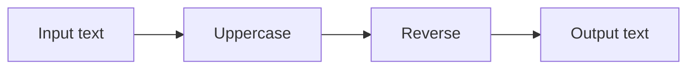
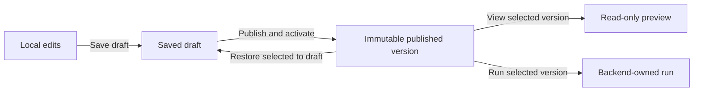

# Studio user guide

The Studio creates and runs linear and conditional workflows, one bounded two-branch parallel block, and one bounded linear-body loop, with bounded text and JSON input. It supports deterministic transforms and text templates, workflow-owned typed scalar parameters, host-approved MCP tools with bounded structured JSON inputs, a deterministic demonstration agent, and opt-in host-configured external model providers. Templates combine the incoming string with declared parameters using explicit tokens; they do not provide expression evaluation. JSON input can be reduced to text with a pointer selector or mapped into a bounded JSON object with the **Project JSON fields** node. This is an explicit static projection, not a general-purpose mapping language or dynamic object port system. Free placement and wire routing organize the graph; only explicit control nodes change execution semantics.

Use the **Theme** selector in the top navigation to switch between **Dark Modern**, **Light Modern**, **VS Code Dark+**, **Solarized Dark**, **Nord**, **Monokai**, and **High Contrast**. The Studio remembers the choice in this browser and keeps it when you move between the designer, settings, and observation pages. The graph canvas and nodes use colors coordinated with the selected shell theme. The graph is fitted and centered when the editor attaches; its grid fills the viewport and tracks pan and zoom. Embedded hosts can customize inherited theme tokens independently; see the [editor design system](design-system.md).

Use disposable text in the local development app. It records inputs, outputs, and comments in local storage without workspace authentication or payload encryption.

## Build workflows for your own service

Studio can act as an IDE for workflows that your own application will run. You can also embed the designer in your application or use the engine without a designer. These are independent integration choices.

Today, you can export reviewed workflow definitions/packages and use the lower-level .NET execution libraries from host code. A standalone service/worker sample and shared local-runtime DI registration are implemented; Studio is not required for execution. Stable NuGet distribution and a production hosting SDK remain planned. See [service integration](service-integration.md) for available entry points and host responsibilities. The controls below describe authoring and testing in the development Studio, not deploying an authenticated production service.

## Start the app

From the repository root, with the SDK pinned by `global.json` installed:

```sh
dotnet restore --locked-mode
dotnet build --no-restore --configuration Release
dotnet run --project src/VisualAgentWorkflow.Studio --configuration Release --no-build -- --environment Development
```

Open the loopback address printed by the host, normally port 5099. Keep the backend process running while executing workflows. Closing the browser leaves backend runs running; stopping the backend interrupts unfinished runs.

## Configure model providers

Open **Settings** in the top navigation. In **Add a provider**, enter a unique provider ID and version, display name, model, endpoint, and timeout. For local LM Studio, use `http://localhost:1234/v1`, check **Allow plain HTTP for this local endpoint**, and leave the API key empty unless you enabled authentication. Copy the model identifier shown by LM Studio into **Model**. Select **Add provider**. The key is protected in local Studio storage and is never returned by the settings page. The new version appears immediately under **Agents** in the node library.

The **Configured providers** list is the settings page's read view. Select **Edit as new version** to prefill a provider and prepare the next numeric version; change the model, endpoint, or key, then select **Save new version**. Leaving the key blank keeps the selected version's credential. Provider versions are immutable: existing published workflows continue using their pinned version, and the new one is available for new or updated drafts. Select **Delete version**, then **Confirm delete** to remove one version and its saved credential. Deleting a version prevents workflows pinned to it from starting new runs; choose **Keep provider** to cancel. Delete only versions that are no longer needed. Settings are served by the loopback-only unauthenticated development Studio; do not expose it through a public proxy. See [provider settings and runtime bounds](model-providers.md).

## Create and edit a workflow

1. Select **New workflow**. The draft begins with connected Input and Output nodes.
2. Search the **Node library**, then click an action to insert it after the selected node. The insertion hint names the path; select **Insert on output** for a condition's true or false arm. Click insertion opens space downstream. Drag an action onto the canvas to choose its position, or onto a wire to insert on that path.
3. Right-click the canvas, a node, or a wire for **Graph actions**. You can also focus the canvas and press Space or Shift+F10, search for an action, and use arrow keys to navigate. Drag an output socket to a compatible input socket to connect or rewire it; the target pin highlights when it can accept the connection. Reconnecting a pin replaces any wire already attached to that input or output, and the change can be undone. Right-click a wire and choose **Disconnect wire** to remove it. Drag an output socket onto empty canvas to create a step on that exact path. Escape cancels the menu. Select a node to configure it in the properties panel. Change a processing node's operation using its dropdown. Use **Move up**, **Move down**, or **Remove** to change the connected execution sequence. Use **Undo edit** and **Redo edit** to recover local edits.

Drafts may be incomplete while you edit. A visible **Workflow validation issues** panel lists the exact unresolved paths and messages; **Save draft** remains available, while publish and activate controls stay disabled until all issues are fixed. Runtime and published-run APIs validate before execution, so an incomplete draft cannot run. Definition, layout, and package exports are also disabled until the graph validates.
4. For an agent, set **System instructions**, choose a provider, and select its requested tools. Set **Maximum output tokens** from 1 to 16,384 for this agent; existing workflows default to 1,024. The endpoint or model may enforce a lower cap. Providers that advertise reasoning controls show **Reasoning effort**. **Off** asks for no reasoning, while **Provider default** leaves the choice to the endpoint; compatible endpoints may ignore either preference. Use **Customize user message** to edit one readable text template. Type `{{` to open matching value suggestions, then use Tab and Enter or click a suggestion. `{{input}}` inserts the incoming graph value; `{{parameter:ID}}` inserts a declared workflow parameter. Write a backslash before `{{` for literal opening braces. The preview uses sample input and parameter defaults; each run renders actual values before the model call. The demonstration provider explicitly does not interpret instructions. External providers send system instructions, the resolved user message, and assigned tool results to the configured endpoint. Selecting a tool does not grant access; the backend checks policy when it runs.
5. Select **Save draft** to persist definition and layout. Unsaved changes block switching workflows and publication until saved or discarded.

### Define reusable workflow inputs

1. Expand **Workflow parameters** above the graph. Add a parameter with a stable ID, display name, default value, and optional description that explains how to use it. The description appears as help text when editing or running the published workflow. Choose Text, Integer, Number, True/false, or Choice. Choice values are comma-separated and the default must be one of them. IDs accept letters, digits, dashes, and underscores; values are limited to 16,384 characters.
2. Add a **Workflow value** node from the **Inputs** section of the node library. Select which parameter it reads in the node properties. The node replaces its incoming string with that parameter and passes the selected value to the next node, so the data path stays visible in the graph.
3. Save and publish the definition. The parameter schema and defaults travel with the workflow package. When running a published version, edit the displayed parameter values to override defaults for that run. The effective values are captured in the run header and shown in the playback inspector.

Typed parameters remain immutable workflow configuration; they do not create mutable graph variables or expose credentials. A choice parameter with `default,off,low,medium,high` can be assigned to an agent's **Reasoning effort** setting, exposing it as a workflow run input. Run overrides never alter the published definition, are validated against type and choices, and appear in audit/playback. Because the local run store records inputs and parameter values, do not enter secrets or sensitive information.

### Build text with a template node

Add **Text template** from the node library on the selected path. The node starts by passing through its incoming text. In the properties panel, enter ordinary text and insert `{{input}}` for that incoming value or `{{parameter:ID}}` for a declared workflow parameter. Suggestions appear as you type `{{`; the preview shows sample input and parameter defaults. Write `\{{` for literal opening braces. Save the workflow and run it with an input and optional parameter overrides; the node's rendered output and outgoing transfer are recorded for replay. Templates are structured literal/reference parts, limited to 64 parts and 8,192 characters of stored text; rendering is bounded to 16,384 characters. There is no expression evaluation, model call, or side effect in this node.

### Select and project JSON input

Select the **Input** node and choose **Use JSON input and add a value selector**. The Studio changes that entry input to JSON and inserts a selector before the existing string path. Set the selector's **JSON Pointer** using RFC 6901 syntax, such as `/customer/name` or `/items/0/id`. A selected JSON string becomes plain text; numbers, booleans, null, objects, and arrays become compact JSON text. The selector accepts at most 16 path segments and 1,024 pointer characters; workflow JSON input is bounded to 16,384 characters and a maximum nesting depth of 32. Its string output can feed existing text, agent, tool, and output nodes.

To build a smaller JSON object, first use **Use JSON input and add a value selector** to switch the Input to JSON. Select Input and add **Project JSON fields** from the node library; it is inserted before the initial selector. Select the projection node and add rows in its properties: each row names an output property and gives the JSON Pointer for the source value. For example, map `customerName` to `/customer/name` and `total` to `/orders/0/amount`; the node emits `{"customerName":"Ada","total":42}`. It supports 1–16 uniquely named fields. Choose a value kind for each field. Scalar kinds validate the selected value. Choose **object** to open a property mapper: add output properties, give each a JSON Pointer relative to the selected object, choose its value kind, and mark it optional if missing input should omit it. Choose **array** to define how each item is mapped; its item pointer is relative to that item. Nested contracts can map objects inside arrays and arrays inside objects. Only declared object properties appear in the result. A missing required pointer or mismatched value kind fails at the projection node and records a safe path/type explanation without echoing the selected value. `any` preserves the selected value. Contracts are limited to depth 8, 128 schema nodes, 16 properties at each object, 64 items per array, and 16,384 characters of mapping configuration. Keep the selector after the projection to convert a chosen value to text for an agent or string tool. Remove that selector if the workflow should return the projected JSON object directly. Input and resulting JSON are each bounded to 16,384 characters; JSON nesting is limited to 32. Invalid JSON or a pointer that does not resolve fails the run and is visible in recorded evidence. Removing the original input selector restores text input when the selector is the input's only JSON consumer.

### Configure MCP servers and skills

Select **MCP library** in the top navigation. Enter a stable server ID, name, optional folder, and Streamable HTTP endpoint. HTTPS is required outside localhost. Add a bearer token if needed, then select **Discover tools**. Discovery shows compatible tools for selection and an **Excluded tools and compatibility reasons** list for tools the server returned but Studio cannot safely offer. The list names schema keywords it cannot handle and reports descriptions over the 2,048-character limit. Review each compatible tool's description, input summary, schema hash, and description hash. Check the tools this Studio may offer, then select **Save server and selected tools**. Return to the designer, select **Refresh MCP tools**, and expand **Tool details** beside a tool on the agent node to review it before assignment. The description is provided to the model and its hash is pinned independently from the input/output schema; older workflow bindings without a description pin remain readable. Tool arguments may use nested bounded objects and arrays of `string`, `integer`, `number`, and `boolean` values. Required/optional properties, scalar enums, string/array length bounds, string patterns, and numeric minimum/maximum values are enforced by the broker. Patterns must use the .NET non-backtracking regex subset, be at most 256 characters, and match within a 50 ms limit. JSON Schema `default` is annotation-only: `default: null` does not make a string or integer argument nullable or optional; requiredness comes from the schema's `required` list. If `additionalProperties` is omitted, Studio treats the object as closed. Arrays without explicit bounds are capped at 64 items. Other limits are 32 declared properties per object, depth 8, 8,192 characters per string, 1,024 values, 65,536 characters per call, and 16,384 characters per schema. Unsupported JSON Schema keywords, open/dynamic objects except the bounded explicit arbitrary-JSON map form, unions, references, and non-text results are not supported. For an explicit MCP node, ordinary input text is supplied as the `text` argument; to pass another supported argument shape, provide a JSON object string matching the tool's input summary. A changed pinned schema or pinned description prevents the tool from running; rediscover and review before republishing. Removing a server does not remove workflow requirements.

Select **Skill library** to create a text-only skill revision. Give it an ID, version, name, folder, and instructions. Save another version to change the instructions; moving folders does not change identity. In the designer, select an agent and check the exact skill revisions under **Skills**. The selected text is embedded in the workflow when it is saved and exported. An imported workflow can be reviewed as a draft without installing a Studio skill library. The runtime appends only that agent's selected skill text to its system instructions; it does not interpret skill text as a permission grant. Deleting a skill from the Studio library does not change published versions.

A consuming service needs its own model-provider and MCP registrations matching the workflow's provider IDs and tool contract hashes, plus its own tool authorization policy. It does not need the Studio's skill library because the assigned text is in the package. Endpoints, bearer tokens, and host grants do not travel with exports. See [agent capability libraries](agent-capability-libraries.md) for the portability model and current limits.

### Design reusable subagents

Open **Agent Designer** in the top navigation. Create a profile with a stable ID and version, instructions, provider, and optional reasoning/output-token settings. Select only the MCP tools and skill revisions the specialist needs. To let profiles coordinate when assigned together, add shared **Coordination channels** such as `research` or `review`, one channel ID per line. A profile can join up to eight channels; use lowercase letters, numbers, dots, hyphens, or underscores. Save the profile. To change a saved profile, use **New version** and save the revised settings as a new immutable revision. Folders only organize the local Studio library.

Back in a workflow, select a parent agent node and add the desired exact profile versions under **Subagents**. The workflow embeds those profile snapshots and skill text. The parent model can call only the profiles assigned to that node. Each child receives the task as its user message and can use only its own profile tools. MCP calls must also pass the consuming host's grant for the workflow node; package import never grants access.

The current bound allows four assigned profiles and four child executions per parent invocation, with one delegation level and a 16,384-character task. When at least two profiles are assigned, the parent also sees a team tool that sends one shared task to all assigned profiles concurrently and returns named JSON results. Individual calls and team members share the four-execution limit. If any member fails, the team cancels remaining members where possible and returns no partial aggregate; any already completed external action remains completed.

The parent model chooses which assigned delegate to call and when, up to four child executions per parent invocation. Sequential delegate turns share a coordination-channel board for that parent invocation. A profile with channel memberships receives `channel_send` and `channel_read` tools only for those channels. Profiles assigned the same ID can exchange append-only messages between turns. The parallel team tool still runs every assigned profile concurrently, but gets a separate board isolated from sequential turns and other team calls. Each message is limited to 4,000 characters, each channel to 32 messages, and each board to 64. Every send and read is recorded under the child invocation, including the exact messages returned to the agent, so playback can show what it saw without re-running the model. A profile cannot read a channel it did not join. Persistent agent memory and aggregate token/time budgets are not implemented. See [agent profiles and bounded delegation](agent-profiles.md).

The following diagram shows supported execution, not the spatial arrangement of cards. Uppercase and reverse are example deterministic steps.



## Organize the canvas

Drag a node header to place its card. Arrow keys move it by 8 logical units; Shift increases the step to 40. Drag a selection rectangle over empty canvas to select several nodes; hold Ctrl/Cmd or Shift while dragging to add nodes to the selection. Ctrl/Cmd-click or Shift-click a node toggles it in the selection. Drag any selected node to move the selected group together. Drag empty background to select; middle-drag to pan across the expanded canvas. **Reset view** returns to the graph origin at 100% zoom, while **Fit graph** fits and centers the nodes. These view controls do not save graph edits. **Arrange nodes** restores generated positions, retains annotations and sections, and clears reroute points so old routes do not cut across the new arrangement. Undo restores the previous positions and routes.

Select a card to inspect its properties; compact cards show summaries instead of editing forms. Use **Label, comment and position** in that panel for annotations. Open **Labels, comments, sections, and wire routing** below the canvas for grouping and wire controls. Select **Node to organize** to edit a label, comment, or X/Y coordinates. Labels never replace stable node IDs, and comments are text rather than executable agent instructions.

To create a labeled section, enter **New section label**, check its member nodes, then select **Group selected nodes**. Drag the section header to move all members in one edit. Rename the section or use **Ungroup** in the inspector. Membership is explicit; simply placing a card inside a frame does not join it. A node belongs to one section at a time.

Double-click a wire to add a reroute point, or select a wire in the inspector and use **Add reroute point**. Move points with the mouse, arrow keys, or coordinate fields. **Pinned angle** fixes the tangent; curved wires also accept custom degrees. **Right-angle** style constrains bends to orthogonal segments. **Reset wire route** removes the routing points without deleting the connection. These edits share the same undo/redo history as other draft changes.

**Fullscreen graph** expands the canvas, library, properties and toolbar using the browser fullscreen API. Escape or **Exit fullscreen graph** returns to the page and restores focus. Fullscreen requires browser/iframe permission; a rejection leaves the inline editor available with an explanation. View switching, selection, fit, and fullscreen do not alter a saved workflow or stop execution. Within the graph, Ctrl/Cmd+S saves; Ctrl/Cmd+Z undoes and Ctrl/Cmd+Y or Ctrl/Cmd+Shift+Z redoes when outside a text field. Delete removes an eligible selected processing node. Required terminals and merges cannot be deleted independently. Delete on a condition opens a confirmation for removing its entire conditional block.

Use **Find workflow** to filter saved IDs; the selected workflow remains available even when it does not match.

## Save, publish, and restore

Saving changes a draft; publishing creates a numbered immutable version and activates it for future active-version runs. Selecting and viewing a version does not replace the current draft. **Restore selected to draft** copies the historical definition and layout into a new draft generation. Publish afterward to create a new version. **Activate selected version** changes the active pointer without rewriting publication history.



Choose a **Published version** and select **View selected version** to inspect its saved positions, comments, sections, and wire routes. **Return to draft** resumes local authoring. If another editor saved first, the conflict message preserves your local work. Review/export it before choosing **Discard local changes and reload**. There is no automatic merge or simultaneous-edit synchronization.

## Run and inspect

Select **Run inspector** for run controls and history; **Designer** returns to the authoring canvas with local edits preserved. Starting a published run opens the inspector automatically. Use **Filter recorded runs** to find a workflow, status, or run identity.

For a quick test, choose a pipeline in **Quick template run**, enter **Input**, and select **Start independent run**. For a saved workflow, enter **Published run input** and select **Run selected version**. This uses the selected immutable revision, including when the draft has unsaved edits.

Select a run under **Recorded runs**. Click a node's execution card to inspect its recorded input/output. Active nodes show their latest recorded activity, such as waiting for a model response or calling an MCP tool; playback shows activity only up to the selected event. **Previous event**, **Next event**, the recorded-position slider, and **Follow latest** control playback. Thick dashed teal wires correspond to recorded transfer events; moving cards cannot fabricate execution evidence. Historical viewing makes no live model/tool calls. If a tool succeeds but the model supplies no final text, the agent node uses the successful tool result as its output and records this fallback in the `agent.completed` event. Check that event and the tool result before retrying side-effecting workflows. **Cancel selected run** explicitly requests cancellation; closing the page does not.

## Pause and resume a run

Select a nonterminal run under **Recorded runs**, then choose **Pause selected run**. Wait for `paused`: an in-flight node and its tool/model operations finish first. **Resume selected run** continues the same run; when the status is `pausing`, it withdraws the pending pause. **Cancel selected run** also works while paused.

For fast pipelines, check **Start paused** before **Start independent run**, or **Start published run paused** before **Run selected version**. No node executes until resumed. Closing or reloading the page preserves the backend pause state. Other runs can execute while one is paused, within the 32-context admission limit.

Playback shows **State at recorded position** separately from the latest status. Scrubbing over a recorded pause is observation only. Host restart interrupts unfinished runs; it cannot resume their old continuation. See [run-control guarantees and API](run-control.md).

## Reuse a section or published workflow

1. Create a named section containing consecutive processing nodes. Exclude input/output terminals.
2. Open **Reusable pipelines**, choose **Section to save**, enter a unique **Reusable pipeline ID**, and select **Save section as reusable draft**. This creates a separate draft and leaves the current workflow unchanged.
3. Save any current edits, open that new draft in **Saved workflow**, review it, and publish it. Reusable pipelines use the same explicit version lifecycle as other workflows.
4. In a consumer workflow, open **Reusable pipelines** and choose **Reusable workflow**, an exact **Reusable version**, and **Insert pipeline after**.
5. Review the listed requirements, then select **Insert published pipeline**. Use **Undo edit** if needed, then save and publish the consumer explicitly.

Inserted steps have fresh identities and retain their copied annotations and exact tool/provider requirements. They show which source/version they came from. Later source publications do not rewrite existing copies, and edits to a copy do not change the source. This is template expansion, not a nested runtime call or automatic upgrade. Host authorization still applies to each new node.

## Share and recover local work

Open **Import / export definition**. Use **Copy workflow package into JSON editor** or **Download workflow package** to share the full definition/layout and declared requirements. To import, create or select a draft, paste the package into **Workflow JSON**, and choose **Import package into draft**. Checksum/manifest validation detects mismatched contents; it does not authenticate the sender. Review user-authored text and requirements before sharing or executing.

Package import keeps the current workflow ID, stages one undoable local edit, and requires explicit save/publication. It grants no tools, installs no code, and starts no run. Missing registrations are listed; even a matching registration still needs host policy permission. Existing executable JSON and separate layout sidecar downloads/imports remain available. Layouts validate node/connection references against the current definition.

The catalog and run history survive normal host restarts. Hosts can choose file or SQLite run storage; changing that setting selects a separate history and does not migrate runs. See [storage configuration and upgrade notes](run-storage.md). Unsaved browser edits do not. Interrupted Studio runs are recorded as interrupted rather than automatically retried. A separate [consumer checkpoint API](checkpoint-recovery.md) supports explicit recovery of deterministic saved suspensions; Studio has no checkpoint recovery controls. A stale tool contract, unavailable provider, denied grant, or oversized input can fail a run; inspect its evidence and correct the draft/configuration rather than assuming it was rolled back or retried.

Nested prefab instances, collaborative editing, credentialed live-provider qualification, durable approvals, arbitrary-crash/external-call recovery, and production authentication remain future work. Follow the [roadmap](roadmap.md) for current scope and [graph controls](graph-editor.md) for detailed limits.

## Execute from your own service

Export a reviewed workflow package and deploy it with an operator-owned revision/content pin. The [standalone service sample](../samples/WorkflowService/README.md) shows direct and queued invocation without opening Studio, plus node-scoped host grants and local run evidence. Its commands are documented in the sample; no catalog or browser is required. It remains a single-process development runtime without crash recovery.

Service developers can use `AddLocalWorkflowRuntime` to register the same backend runtime in a .NET Generic Host, then resolve invocation/control services. See the [local hosting API](hosting-sdk.md) for lifecycle, dependency registration and current source-consumption limits. Studio controls are unchanged by this helper.

## Observe a consumer service

When a consumer has enabled its authorized observation endpoint and a Studio operator has configured a named source, choose **Observe a consumer service**, select **Consumer source**, then **Connect to consumer**. Choose a run to inspect live state, node payloads and recorded playback. The connection is read-only; **Disconnect observation** and closing the browser do not change consumer execution. The **Recovery assessment** panel explains unsettled work and checkpoint disposition at the latest evidence cursor, independently of recorded playback. It offers no retry/recovery controls, and eligibility still requires fresh validation by an exclusive host. A connection failure explicitly marks the retained last received evidence and suppresses the old assessment. See [assessment meanings](run-reconciliation.md). See [configuration, embedding and limits](observation.md).

## Add a conditional path

On a node's connected output, choose **+ Condition after out** (or true/false). This adds a condition and merge; the two branches pass through unchanged until you add nodes to either branch. Set the condition's operator and operand, then add the processing steps for each arm. By default, the merge passes the selected arm's value into existing downstream work. To send the arms along different routes, select the merge and choose **Remove merge and split paths**; reconnect each arm through its own nodes and end each route at the workflow Output, a **Terminate workflow** node, or another branch. Output accepts multiple alternative routes, and only the selected route executes. Keep a merge when routes should rejoin for shared work. To end one route successfully without a result, select its outgoing connection and insert **Terminate workflow** from the node library; the former destination is disconnected, so remove or reconnect any nodes that become unreachable. Termination does not undo prior external effects. **Arrange nodes** provides a starting layout, and **Undo edit** reverses edits. Save and publish before running both matching and nonmatching inputs. The viewer records **Selected output: true/false**, highlights actual transfers, and labels a no-result exit **terminated**; playback makes no calls. To remove a decision, select the condition and choose **Remove conditional block…**. Review the list: confirmation deletes both branches, nested decisions and their matching merge, then reconnects the preceding node to the following node. Choose **Cancel block removal** to keep the graph, or **Undo edit** after removal to restore the nodes and layout. Shared branch boundaries are rejected rather than deleting another path. Published versions and past runs stay unchanged. See [conditions, bounds and current editing limits](conditional-graphs.md) and [workflow termination](workflow-termination.md).

## Add a bounded loop

On a connected string path, select an output and choose **Bounded loop** in the **Flow** section of the node library. The inserted loop has a **Loop body** anchor; select it and add the processing nodes, agent, or MCP tool that should repeat. The final body connection returns to the loop input, while the loop’s **done** pin continues the original path. Select the loop and configure **Continue while**, its match text, and a **Maximum iterations** value from 1 to 16. Predicates use ordinal, case-sensitive text matching.

The initial text reaches the body only when the predicate matches. Each completed body pass returns its result to the loop, where the predicate is tested again. A false predicate or the maximum cap sends the current text through **done** and completes normally. The run journal records each iteration start and completion and whether the predicate or cap stopped the loop. Playback shows the recorded values and does not rerun the body. Pausing takes effect at a node boundary. Tools and agents inside the body may run more than once; external side effects are not rolled back.

Only one loop is supported per workflow in this version, with a single linear body and no other control nodes or JSON paths. To remove it, select the loop and choose **Remove loop and run body once**; its body steps remain on the path exactly once. See [bounded loop semantics and limits](loop-graphs.md).

## Run two paths in parallel

Select a connected string path and choose **Parallel block** from the node library. Studio adds a visible **Parallel fork**, two named **Parallel branch** anchors, and a **Parallel join**. Both branches receive the same string and execute concurrently. Add text transforms, agent nodes, or MCP tools after either branch anchor; keep branch 1 connected to join input `branch_1` and branch 2 to `branch_2`. The join waits for both and emits a JSON object containing both results. Studio inserts a JSON selector to preserve an existing downstream string path, or changes the terminal Output to JSON when the block ends the workflow. Select the whole object with an empty JSON Pointer or choose `/branch_1` or `/branch_2` to continue as text.

One two-branch block is supported per workflow. Branch paths must be simple and complete; they cannot contain another control block, condition, approval, or nested join. If one branch fails or is cancelled, there is no joined result. A completed side effect in the other branch is not rolled back. Agent and MCP operations on both branches may be active at the same time. The joined JSON is capped at 16,384 characters. To remove the block, select any fork, branch, or join and choose **Remove parallel block…**. Review the affected node list before confirming; Studio reconnects the original path, and **Undo edit** restores the block. See [parallel graph behavior and limits](parallel-graphs.md).

## Require review before an MCP call

On an MCP tool card, choose **Require approval before tool**, edit the inserted approval prompt, then save and publish. A selected path reaching it shows `waiting-approval`. Review **Recorded action approval** and **Exact tool input**, then choose **Approve recorded action** or **Reject recorded action**. Reloading the browser preserves the same request. Pausing and approving are separate: approval cannot resume a paused run, and resume cannot approve a call. Remote read-only observation and historical playback show evidence without decision controls. Host restart interrupts the pending continuation. See [exact-action approval semantics](approvals.md).
