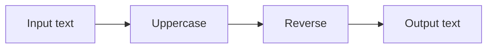
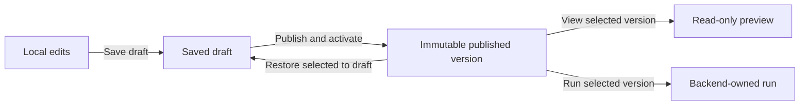

# Studio user guide

The Studio creates and runs linear and conditional string-processing workflows. It supports deterministic transforms, host-approved MCP text tools, a deterministic demonstration agent, and opt-in host-configured external model providers. Free placement and wire routing organize the graph; they do not change execution semantics. Branches are authored through explicit conditional nodes.

Use disposable text in the local development app. It records inputs, outputs, and comments in local storage without workspace authentication or payload encryption.

## Build workflows for your own service

Studio can act as an IDE for workflows that your own application will run. You can also embed the designer in your application or use the engine without a designer. These are independent integration choices.

Today, you can export reviewed workflow definitions/packages and use the lower-level .NET execution libraries from host code. A standalone service/worker sample and shared local-runtime DI registration are implemented; Studio is not required for execution. Stable NuGet distribution and a production hosting SDK remain planned. See [service integration](service-integration.md) for available entry points and host responsibilities. The controls below describe authoring and testing in the development Studio, not deploying an authenticated production service.

## Start the app

From the repository root, with the SDK pinned by `global.json` installed:

```sh
dotnet restore --locked-mode
dotnet build --no-restore --configuration Release
dotnet run --project src/VisualAgentWorkflow.Studio --configuration Release --no-build -- --environment Development
```

Open the loopback address printed by the host, normally port 5099. Keep the backend process running while executing workflows. Closing the browser leaves backend runs running; stopping the backend interrupts unfinished runs.

## Create and edit a workflow

1. Select **New workflow**. The draft begins with input, one transformation, and output.
2. Choose **New node operation**, then use **Add node after** on an existing non-output node. Transformations, available MCP tools, and available agent providers appear here.
3. Change a processing node's operation using its dropdown. Use **Move up**, **Move down**, or **Remove** to change the connected execution sequence. Use **Undo edit** and **Redo edit** to recover local edits.
4. For an agent, configure its instructions and requested tools. The demonstration provider explicitly does not interpret instructions. External providers appear only when enabled by the host. Their instructions, input and assigned tool results are sent to the configured model endpoint; credentials are never entered in the designer. See [model provider configuration](model-providers.md). Selecting a tool does not grant access; the backend checks policy when it runs.
5. Select **Save draft** to persist definition and layout. Unsaved changes block switching workflows and publication until saved or discarded.

The following diagram shows supported execution, not the spatial arrangement of cards. Uppercase and reverse are example deterministic steps.



## Organize the canvas

Drag a node header to place its card. Arrow keys move it by 8 logical units; Shift increases the step to 40. Drag empty background or use scrollbars to pan. Zoom changes the view, not the saved graph coordinates. **Arrange nodes** restores generated positions while retaining annotations and pinned routes.

Open **Labels, comments, sections, and wire routing**. Select **Node to organize** to edit a label, comment, or X/Y coordinates. Labels never replace stable node IDs, and comments are text rather than executable agent instructions.

To create a labeled section, enter **New section label**, check its member nodes, then select **Group selected nodes**. Drag the section header to move all members in one edit. Rename the section or use **Ungroup** in the inspector. Membership is explicit; simply placing a card inside a frame does not join it. A node belongs to one section at a time.

Double-click a wire to add a reroute point, or select a wire in the inspector and use **Add reroute point**. Move points with the mouse, arrow keys, or coordinate fields. **Pinned angle** fixes the tangent; curved wires also accept custom degrees. **Right-angle** style constrains bends to orthogonal segments. **Reset wire route** removes the routing points without deleting the connection. These edits share the same undo/redo history as other draft changes.

## Save, publish, and restore

Saving changes a draft; publishing creates a numbered immutable version and activates it for future active-version runs. Selecting and viewing a version does not replace the current draft. **Restore selected to draft** copies the historical definition and layout into a new draft generation. Publish afterward to create a new version. **Activate selected version** changes the active pointer without rewriting publication history.



Choose a **Published version** and select **View selected version** to inspect its saved positions, comments, sections, and wire routes. **Return to draft** resumes local authoring. If another editor saved first, the conflict message preserves your local work. Review/export it before choosing **Discard local changes and reload**. There is no automatic merge or simultaneous-edit synchronization.

## Run and inspect

For a quick test, choose a pipeline in **Quick template run**, enter **Input**, and select **Start independent run**. For a saved workflow, enter **Published run input** and select **Run selected version**. This uses the selected immutable revision, including when the draft has unsaved edits.

Select a run under **Recorded runs**. Click a node's execution card to inspect its recorded input/output. **Previous event**, **Next event**, the recorded-position slider, and **Follow latest** control playback. Green wires correspond to recorded transfer events; moving cards cannot fabricate execution evidence. Historical viewing makes no live model/tool calls. **Cancel selected run** explicitly requests cancellation; closing the page does not.

## Pause and resume a run

Select a nonterminal run under **Recorded runs**, then choose **Pause selected run**. Wait for `paused`: an in-flight node and its tool/model operations finish first. **Resume selected run** continues the same run; when the status is `pausing`, it withdraws the pending pause. **Cancel selected run** also works while paused.

For fast pipelines, check **Start paused** before **Start independent run**, or **Start published run paused** before **Run selected version**. No node executes until resumed. Closing or reloading the page preserves the backend pause state. Other runs can execute while one is paused, within the 32-context admission limit.

Playback shows **State at recorded position** separately from the latest status. Scrubbing over a recorded pause is observation only. Host restart interrupts unfinished runs; it cannot resume their old continuation. See [run-control guarantees and API](run-control.md).

## Reuse a section or published workflow

1. Create a named section containing consecutive processing nodes. Exclude input/output terminals.
2. Open **Reusable pipelines**, choose **Section to save**, enter a unique **Reusable pipeline ID**, and select **Save section as reusable draft**. This creates a separate draft and leaves the current workflow unchanged.
3. Save any current edits, open that new draft in **Saved workflow**, review it, and publish it. Reusable pipelines use the same explicit version lifecycle as other workflows.
4. In a consumer workflow, open **Reusable pipelines** and choose **Reusable workflow**, an exact **Reusable version**, and **Insert pipeline after**.
5. Review the listed requirements, then select **Insert published pipeline**. Use **Undo edit** if needed, then save and publish the consumer explicitly.

Inserted steps have fresh identities and retain their copied annotations and exact tool/provider requirements. They show which source/version they came from. Later source publications do not rewrite existing copies, and edits to a copy do not change the source. This is template expansion, not a nested runtime call or automatic upgrade. Host authorization still applies to each new node.

## Share and recover local work

Open **Import / export definition**. Use **Copy workflow package into JSON editor** or **Download workflow package** to share the full definition/layout and declared requirements. To import, create or select a draft, paste the package into **Workflow JSON**, and choose **Import package into draft**. Checksum/manifest validation detects mismatched contents; it does not authenticate the sender. Review user-authored text and requirements before sharing or executing.

Package import keeps the current workflow ID, stages one undoable local edit, and requires explicit save/publication. It grants no tools, installs no code, and starts no run. Missing registrations are listed; even a matching registration still needs host policy permission. Existing executable JSON and separate layout sidecar downloads/imports remain available. Layouts validate node/connection references against the current definition.

The catalog and run history survive normal host restarts. Hosts can choose file or SQLite run storage; changing that setting selects a separate history and does not migrate runs. See [storage configuration and upgrade notes](run-storage.md). Unsaved browser edits do not. Interrupted runs are recorded as interrupted rather than automatically retried. A stale tool contract, unavailable provider, denied grant, or oversized input can fail a run; inspect its evidence and correct the draft/configuration rather than assuming it was rolled back or retried.

Arbitrary socket rewiring, nested prefab instances, collaborative editing, credentialed live-provider qualification, durable approvals/recovery, and production authentication remain future work. Follow the [roadmap](roadmap.md) for current scope and [graph controls](graph-editor.md) for detailed limits.

## Execute from your own service

Export a reviewed workflow package and deploy it with an operator-owned revision/content pin. The [standalone service sample](../samples/WorkflowService/README.md) shows direct and queued invocation without opening Studio, plus node-scoped host grants and local run evidence. Its commands are documented in the sample; no catalog or browser is required. It remains a single-process development runtime without crash recovery.

Service developers can use `AddLocalWorkflowRuntime` to register the same backend runtime in a .NET Generic Host, then resolve invocation/control services. See the [local hosting API](hosting-sdk.md) for lifecycle, dependency registration and current source-consumption limits. Studio controls are unchanged by this helper.

## Observe a consumer service

When a consumer has enabled its authorized observation endpoint and a Studio operator has configured a named source, choose **Observe a consumer service**, select **Consumer source**, then **Connect to consumer**. Choose a run to inspect live state, node payloads and recorded playback. The connection is read-only; **Disconnect observation** and closing the browser do not change consumer execution. A connection failure explicitly marks the retained last received evidence. See [configuration, embedding and limits](observation.md).

## Add a conditional path

On a node's connected output, choose **+ Conditional after out** (or true/false). Set the inserted condition's operator and operand, then configure the two processing arms. Only one arm runs; the exclusive merge passes its value forward. **Arrange nodes** provides a starting layout, and **Undo edit** reverses the insertion as one edit. Save and publish before running both matching and nonmatching inputs. The viewer records **Selected output: true/false** and highlights actual transfers; playback makes no calls. See [conditions, bounds and current editing limits](conditional-graphs.md).

## Require review before an MCP call

On an MCP tool card, choose **Require approval before tool**, edit the inserted approval prompt, then save and publish. A selected path reaching it shows `waiting-approval`. Review **Recorded action approval** and **Exact tool input**, then choose **Approve recorded action** or **Reject recorded action**. Reloading the browser preserves the same request. Pausing and approving are separate: approval cannot resume a paused run, and resume cannot approve a call. Remote read-only observation and historical playback show evidence without decision controls. Host restart interrupts the pending continuation. See [exact-action approval semantics](approvals.md).
