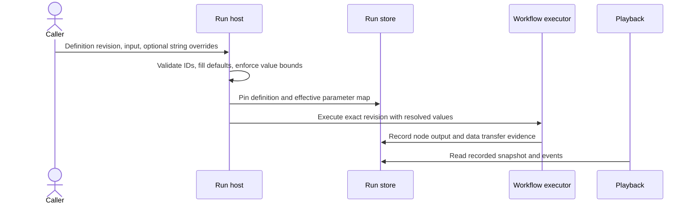

# Workflow parameters

Schema 1.6 adds portable string parameters for workflow-specific configuration. Parameters are immutable definition data with stable IDs, display names, and default values. A `core.workflow-value` node reads one resolved parameter and replaces the incoming string with it, making the data path explicit in the graph.

This is the first parameter slice. It does not provide typed values, required/choice validation, mutable variables, prompt interpolation, special model-profile resolution, or parameter pins on agent configuration. All values are ordinary strings and must be treated as non-secret because local run histories record them in plaintext.

## Definition contract

The optional `parameters` property is an object keyed by parameter ID. IDs contain 1–64 ASCII letters, digits, dashes, or underscores. A definition may contain at most 64 parameters; display names are 1–128 characters, defaults are bounded at 16,384 characters, and combined IDs/names/defaults are bounded at 128,000 characters to remain inside the workflow JSON size limit.

```json
{
  "schemaVersion": "1.6",
  "workflowId": "greeting-flow",
  "entryNodeId": "input",
  "nodes": {
    "input": { "type": "core.input", "typeVersion": "1.0.0" },
    "greeting": {
      "type": "core.workflow-value",
      "typeVersion": "1.0.0",
      "parameterId": "greeting-text"
    },
    "output": { "type": "core.output", "typeVersion": "1.0.0" }
  },
  "connections": {
    "input-to-greeting": {
      "source": { "nodeId": "input", "portId": "out" },
      "target": { "nodeId": "greeting", "portId": "in" },
      "kind": "data"
    },
    "greeting-to-output": {
      "source": { "nodeId": "greeting", "portId": "out" },
      "target": { "nodeId": "output", "portId": "in" },
      "kind": "data"
    }
  },
  "parameters": {
    "greeting-text": {
      "displayName": "Greeting text",
      "defaultValue": "Hello"
    }
  }
}
```

Legacy workflow schemas continue to omit `parameters` and `parameterId` when unused; their canonical JSON and content hashes are unchanged. Editing helpers preserve schema 1.6 through graph edits. Reusable workflow insertion copies parameters used by inserted value nodes and remaps conflicting IDs.

## Resolve, execute, and replay

At run admission, the host validates caller-supplied override IDs against the pinned definition, fills every missing value from its default, and bounds each string. Unknown IDs are rejected. The fully resolved map is separate from the workflow definition and is written into `RunHeader.Parameters` before execution. The worker passes that same map to the Agent Framework adapter. Each value node records its actual output and downstream transfer like any other node. Playback reads stored evidence only; it does not resolve current defaults or make live calls.



`LocalWorkflowRuntime` implements the additive `IParameterizedWorkflowClient` capability. Existing `IWorkflowClient` method signatures remain unchanged and still resolve definition defaults. Parameter-bearing runs require an `IParameterizedWorkflowRunStore`; built-in file and SQLite stores implement it. Older/custom run stores that do not implement the optional capability reject parameterized definitions rather than dropping audit values.

The Studio accepts overrides for selected published revisions and displays the effective values in the run inspector. The development HTTP endpoint accepts a `parameters` string map alongside `input`; consumer hosts should call the parameterized client directly or implement equivalent authenticated invocation policy. Do not treat the unauthenticated local Studio endpoint as a production service boundary.

## Security and limits

Parameters cannot select an endpoint, create tools, or grant host capabilities. Workflow packages include parameter defaults and schemas but no run overrides or credentials. Current values are recorded verbatim in run headers and node/transfer events; there is no secret classification or redaction. Consumers must keep secrets in host-owned secret storage and should not pass them as workflow parameters. Graphs containing workflow-value nodes are not eligible for the deterministic checkpoint host unless parameter state is added to that recovery contract.
